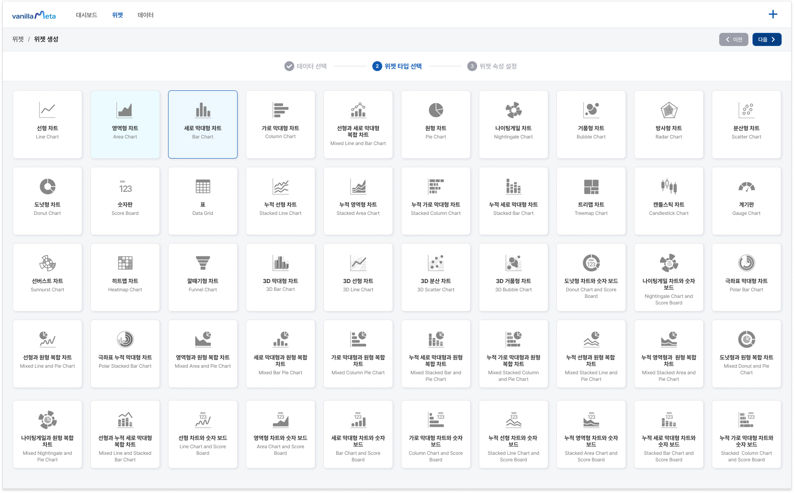
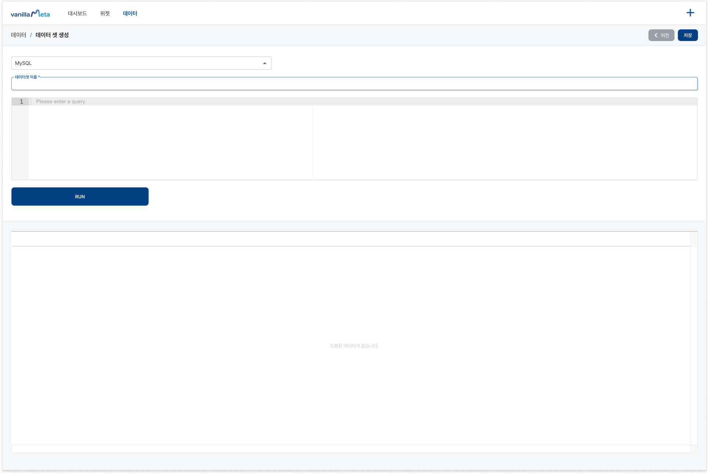
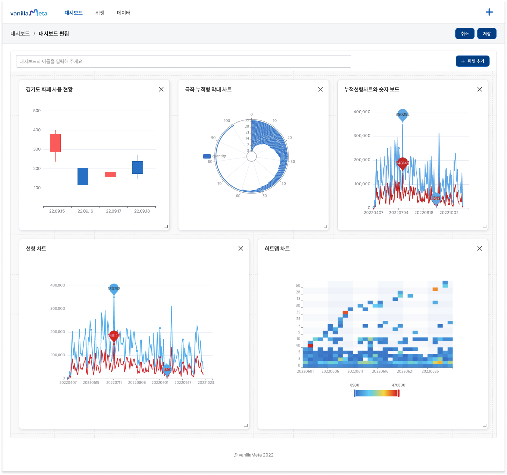
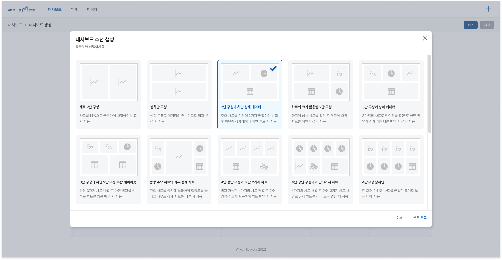

# VanillaMeta


**Lightweight, embeddable open-source dashboards — Apache-2.0, no "Powered by" badge required.**

VanillaMeta is an open-source business intelligence web application for building chart widgets and dashboards on top of your databases and files — without the heavyweight footprint of traditional BI platforms.

## Why VanillaMeta?

|                | VanillaMeta                                               | Metabase                        | Superset                        |
| -------------- | --------------------------------------------------------- | ------------------------------- | ------------------------------- |
| License        | **Apache-2.0**                                            | AGPL (OSS) / Commercial         | Apache-2.0                      |
| Embedding      | Free, **no logo required**                                | Logo required (or paid license) | Complex guest tokens            |
| Metadata store | **PostgreSQL 17** in Docker; SQLite only for local tests  | Requires Postgres/MySQL         | Requires Postgres/MySQL + Redis |
| File analysis  | **CSV / JSON / Parquet** upload + in-browser DuckDB       | CSV only, needs storage backend | CSV upload into DB              |
| Stack          | Node.js — light                                           | JVM — heavy                     | Python — heavy                  |
| AI assistant   | Text-to-SQL, chart recommendation (OpenAI-compatible API) | Paid tiers / Metabot            | Limited                         |

If you need a dashboard engine you can drop into your own product or internal tools without license friction, VanillaMeta is built for that job.

## User guide

데이터 연결부터 AI 분석 생성·수정·저장·게시·공유까지는 [온라인 사용자 가이드](https://docs.vanillameta.net/) 또는 [저장소 가이드](docs/user-manual/README.md)를 참고하세요. 처음이라면 [샘플로 시작하기](docs/user-manual/빠른_시작_가이드.md)를 따라 할 수 있습니다.

검색·기능별 상세 목차를 갖춘 VitePress 문서는 `npm --prefix docs/user-manual ci` 후 `npm run docs:dev`로 실행합니다. [전체 목차](docs/user-manual/site/contents.md)와 [실행 방법](docs/user-manual/README.md#상세-문서-사이트)을 참고하세요.

## Quickstart

You need Docker with Compose v2 (Docker Desktop, OrbStack, or Colima + Compose). Give Docker 4 GB or more of memory: the backend compile uses a 3 GB heap (not measured end to end). If `docker compose` is an unknown command (for example Colima with a Homebrew `docker-compose`, which is a standalone binary), run `docker-compose up --build` instead. It is the same engine.

```bash
git clone https://github.com/vanillabrain/vanillameta.git
cd vanillameta
docker compose up --build
```

The first run builds two images and can take over 10 minutes (9 to 13 minutes measured on 4 CPUs with no cache), so give it time. Then open **http://localhost:3000** and sign in:

```
ID: guest
PW: Admin!@12
```

Compose starts PostgreSQL 17, the backend (which creates the metadata schema and seeds the demo account and chart components), and a web container that serves the app and proxies `/v1` to the backend, so the browser only talks to port 3000. The seeded `guest` account starts with an empty home. Press **샘플 대시보드 보기** (view sample dashboard) in the getting-started card to open the sales and refunds sample. Signup also creates a separate starter sample dashboard in the background, which has not been verified on this stack.

- Run in the background: `docker compose up --build -d`, stop with `docker compose down`.
- Start over with an empty database: `docker compose down -v`.
- Different web port: `VM_WEB_PORT=8080 CORS_ORIGIN=http://localhost:8080 docker compose up --build`.
- The web port is bound to `127.0.0.1` only. This stack is not for the internet: in dev mode `GET /v1/` reveals the demo account and signup is open. Use `VM_BIND=0.0.0.0` only on a trusted LAN, and change the five `dev-only-*` secrets (see `.env.example`) before the first start: `CONFIG_SECRET_KEY` encrypts saved connections, so changing it later needs `docker compose down -v`. For a public deployment use [`deploy/`](deploy/README.md).
- Check the whole path (build, start, proxy, sign-in) with one command: `scripts/docker-smoke.sh`.
- AI assistant (optional): set `AI_PROVIDER`, `AI_API_KEY`, `AI_MODEL` (and `AI_API_BASE_URL` for compatible endpoints) before `docker compose up`. Without a key only the AI features are off. There is no in-app screen for the key; it is read from the environment only.
- MCP: with no server AI configured, verified on this stack: the local stdio server connects through the web proxy (`VM_API_URL=http://127.0.0.1:3000/v1`, not port 4000), lists and describes sources, and sees an uploaded CSV. That is all it does without a server AI. `vm_propose_analysis` returns 503, and saving needs a server-made proposal, so an external AI cannot save an analysis it wrote itself. External databases are listed but are not MCP analysis targets, and their connection test currently fails (known defect, `Tarn: invalid opt.idleTimeoutMillis 0`, unfixed). Remote MCP was not tested. Details: [README_DOCKER.md](README_DOCKER.md#mcp와-ai-키).

> This stack is for trying VanillaMeta out. It runs with `NODE_ENV=dev`, so the database is created by schema sync and cannot be promoted to production with `migrate-prod`. For a real deployment use [`deploy/`](deploy/README.md). There is no `npx` one-liner: the app needs a server and PostgreSQL, so Docker Compose is the supported one-command path. The [MCP server](mcp-server/README.md) is a separate local process, not published to npm yet.

### Local development

```bash
# Needs Node.js 24 LTS (`nvm use`, or 24.11+). The dashboard Assistant uses AI SDK 7 and the Codex CLI connection to `gpt-6-luna`; see docs/testing/dashboard-assistant.md.
# Backend — http://localhost:4000 (NODE_ENV=local uses SQLite for fast local work, API prefix /v1)
# Local sign-in: ID admin / PW admin123 (created on first start; login looks up the ID, not the email); `npm run seed` also adds guest / Admin!@12
cd backend-api && npm run start:local

# Frontend — http://localhost:3000
cd frontend-web && npm start

# Seed (idempotent — safe to re-run)
cd backend-api && npm run seed
```

See [AGENTS.md](AGENTS.md) for the full dev guide including tests and E2E.

## Features

- **No-code chart widgets** — 50+ chart types (bar, line, pie, radar, treemap, numeric boards…)
- **Dashboards** — drag-and-drop layout, template recommendations, sharing & public embed (`/share/:uuid`, `/embed/:uuid`)
- **SQL editor** — query builder with live preview and read-only guardrails
- **File analysis** — upload CSV/JSON/Parquet, analyze in-browser via DuckDB-WASM or save as a server-side dataset
- **AI assistant** — natural-language → SQL and chart recommendation (bring your own OpenAI-compatible API key)
- **Metrics** — reusable semantic metrics (SUM/COUNT/AVG) with evaluation
- **Operational touches** — query progress over WebSocket, optional Redis result cache, rate limiting, Sentry hooks
- **i18n** — Korean & English

## Data sources

| Status                                                                        | Connectors                                                                                                                     |
| ----------------------------------------------------------------------------- | ------------------------------------------------------------------------------------------------------------------------------ |
| ✅ **Verified** (automated E2E)                                               | SQLite, file upload (CSV/JSON/Parquet)                                                                                         |
| 🔷 **Supported** (driver bundled, standard path)                              | PostgreSQL, MySQL, MariaDB, Amazon Aurora, CockroachDB, PostGIS, Amazon Redshift, SQL Server, Oracle, DB2, BigQuery, Snowflake |
| 🔶 **Community** (HTTP executors implemented, needs real-server verification) | ClickHouse, Trino, Databricks                                                                                                  |

Honest support matrix — 🔷 connectors share the standard knex/driver path but haven't all been exercised end-to-end. PRs for connector verification and fixes are very welcome.

## Screenshots

|                                                |                                                |
| ---------------------------------------------- | ---------------------------------------------- |
|  |  |
| **Diverse chart types**                        | **SQL editor**                                 |
|  |  |
| **No-code widget builder**                     | **Template recommendations**                   |

## MCP for coding agents

The local stdio [MCP server](mcp-server/README.md) connects authenticated coding agents to source/metric discovery, structured AI previews and explicitly approved private artifact saves. Returns Studio links; no arbitrary SQL or automatic publishing. [Setup and prompt walkthrough](https://docs.vanillameta.net/mcp). Codex and Claude Code hosts verified with synthetic local data, separate preview/save approval and Studio reload.

## Roadmap

- Dashboard templates & scheduled reports
- Excel / Google Sheets connectors
- Scoped embed tokens & tenant-aware workspaces

## License

Apache-2.0 — embed it, brand it, ship it in your product. See [LICENSE](LICENSE).

---

<details>
<summary>한국어</summary>

## 바닐라메타

Apache-2.0 라이선스의 경량 임베디드 대시보드 — "Powered by" 로고 없이 자유롭게 제품에 심을 수 있는 오픈소스 BI입니다.

### 빠른 시작

Docker(Compose v2)가 필요합니다. 백엔드 컴파일이 3GB 힙을 쓰므로 Docker 메모리를 4GB 이상으로 권합니다(실측하지 않았습니다).

```bash
git clone https://github.com/vanillabrain/vanillameta.git
cd vanillameta
docker compose up --build
```

첫 실행은 이미지 두 개를 빌드하느라 10분 넘게 걸릴 수 있습니다(4 CPU, 캐시 없음에서 9~13분 실측). 이후 **http://localhost:3000** 접속 → `guest` / `Admin!@12` 로그인. PostgreSQL 17, 백엔드(스키마·데모 계정 시드), 웹(`/v1` 프록시) 컨테이너가 함께 뜹니다. 시드 계정 `guest`의 홈은 비어 있습니다. 시작 카드의 **샘플 대시보드 보기** 버튼으로 매출·환불 샘플을 열 수 있고, 가입할 때 백그라운드로 만들어지는 별도의 시작용 샘플 대시보드는 이 스택에서 확인하지 않았습니다. `docker compose`가 없다는 오류(예: Colima에 brew로 설치한 독립 실행형 `docker-compose`)가 나면 `docker-compose up --build`를 쓰세요. 같은 엔진입니다.

- 백그라운드 실행 `docker compose up --build -d`, 종료 `docker compose down`, DB까지 초기화 `docker compose down -v`
- 웹 포트는 기본적으로 `127.0.0.1`에만 열립니다. 인터넷 공개용이 아닙니다(dev 모드는 `GET /v1/`이 데모 계정을 알려 주고 회원가입도 열려 있습니다). 신뢰하는 LAN에서만 `VM_BIND=0.0.0.0`을 쓰고 `dev-only-*` 비밀값 5개를 처음 띄우기 전에 바꾸세요(`CONFIG_SECRET_KEY`는 저장된 연결을 암호화하므로 나중에 바꾸면 `docker compose down -v`가 필요합니다). 공개 배포는 [`deploy/`](deploy/README.md)를 쓰세요.
- 빌드·기동·프록시·로그인까지 한 번에 확인: `scripts/docker-smoke.sh`
- MCP: 서버 AI를 설정하지 않은 스택에서 확인한 것은 소스 목록·스키마 조회와 CSV 업로드 노출까지입니다. 분석안 생성은 서버 AI가 필요해 설정이 없으면 503이고, 저장도 서버가 만든 제안만 받으므로 외부 AI가 직접 만든 분석은 저장할 수 없습니다. 로컬 MCP 서버는 4000이 아니라 웹 프록시(`VM_API_URL=http://127.0.0.1:3000/v1`)로 붙입니다. 외부 DB는 목록에는 나오지만 MCP 분석 대상이 아니고 연결 테스트가 알려진 결함(`Tarn: invalid opt.idleTimeoutMillis 0`, 미수정)으로 실패합니다. 원격 MCP는 시험하지 않았습니다. 자세한 내용은 [README_DOCKER.md](README_DOCKER.md#mcp와-ai-키)를 보세요.
- 이 구성은 체험용입니다(`NODE_ENV=dev`). 운영 승격은 되지 않으며 운영 배포는 [`deploy/`](deploy/README.md)를 따르세요. 앱 전체를 `npx`로 띄우는 방법은 없습니다(서버와 PostgreSQL이 필요).

### 주요 기능

- 코딩 없이 만드는 50+ 차트 위젯
- 드래그앤드롭 대시보드, 템플릿 추천, 공유/임베드
- CSV/JSON/Parquet 파일 업로드 + 브라우저 내 DuckDB 분석
- AI 어시스턴트 (자연어 → SQL, 차트 추천)
- 시맨틱 메트릭, WebSocket 쿼리 진행, Redis 캐시(선택)

자세한 개발 가이드는 [AGENTS.md](AGENTS.md)를 참고하세요.

</details>
