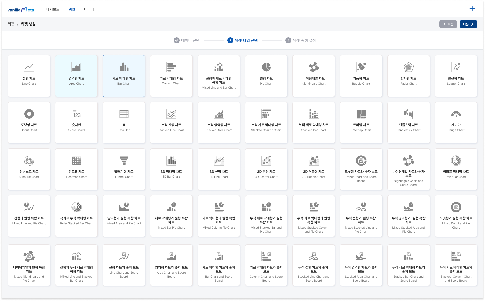
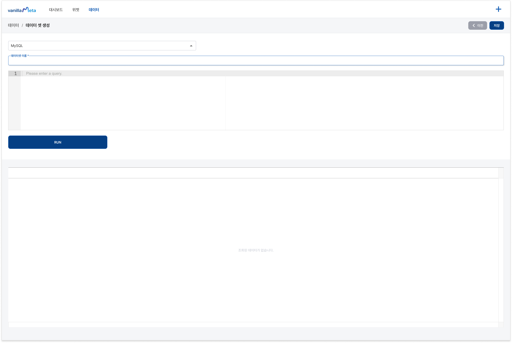
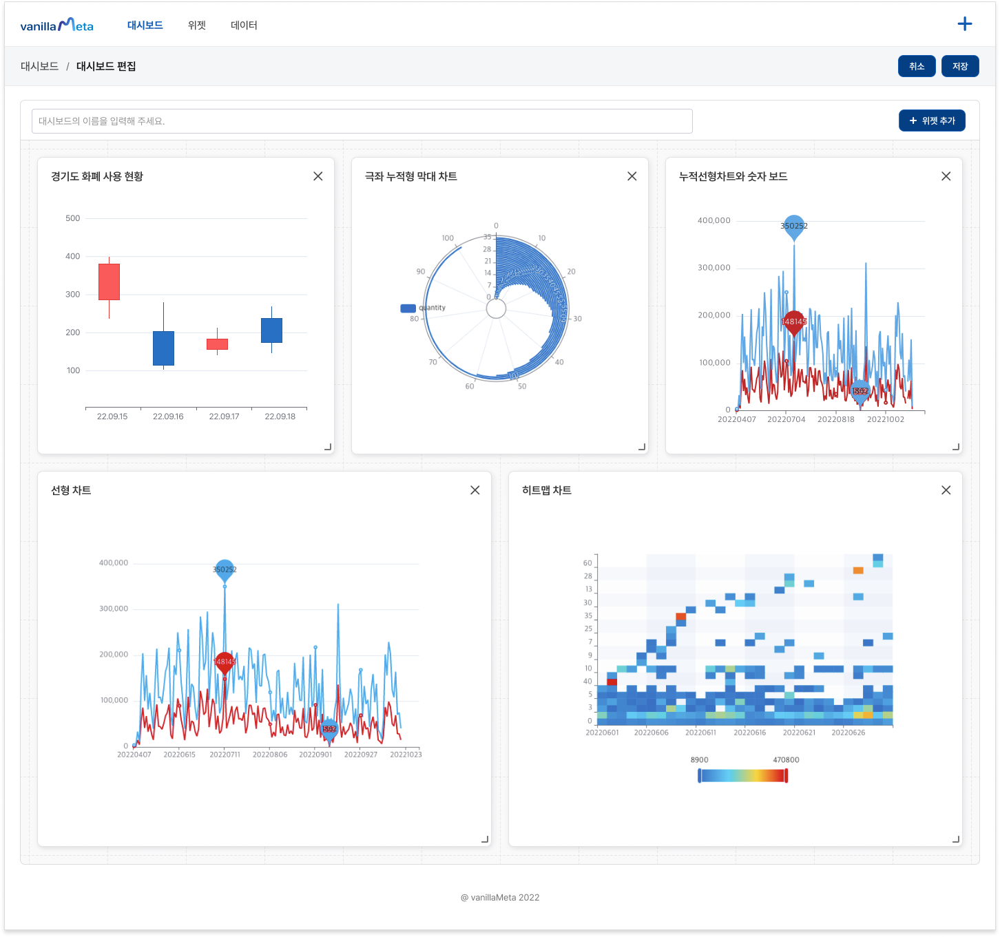
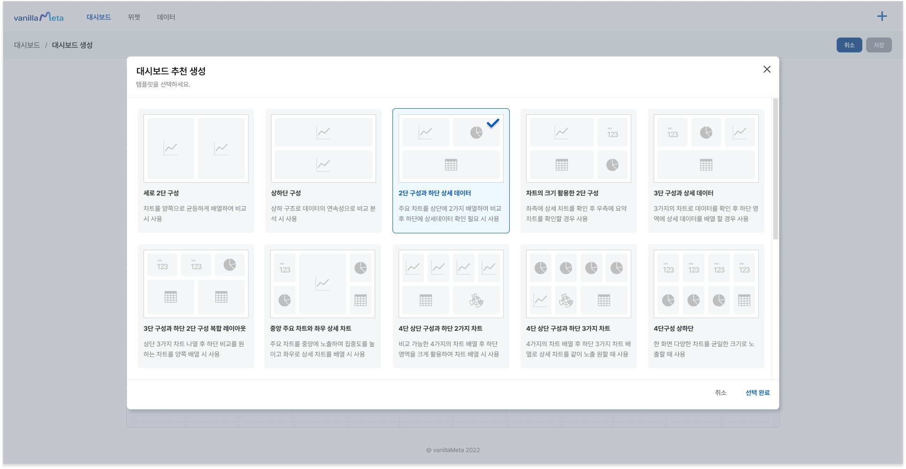

# VanillaMeta


**Lightweight, embeddable open-source dashboards — Apache-2.0, no "Powered by" badge required.**

VanillaMeta is an open-source business intelligence web application for building chart widgets and dashboards on top of your databases and files — without the heavyweight footprint of traditional BI platforms.

## Why VanillaMeta?

|                | VanillaMeta                                               | Metabase                        | Superset                        |
| -------------- | --------------------------------------------------------- | ------------------------------- | ------------------------------- |
| License        | **Apache-2.0**                                            | AGPL (OSS) / Commercial         | Apache-2.0                      |
| Embedding      | Free, **no logo required**                                | Logo required (or paid license) | Complex guest tokens            |
| Metadata store | **Built-in SQLite** — zero external deps                  | Requires Postgres/MySQL         | Requires Postgres/MySQL + Redis |
| File analysis  | **CSV / JSON / Parquet** upload + in-browser DuckDB       | CSV only, needs storage backend | CSV upload into DB              |
| Stack          | Node.js — light                                           | JVM — heavy                     | Python — heavy                  |
| AI assistant   | Text-to-SQL, chart recommendation (OpenAI-compatible API) | Paid tiers / Metabot            | Limited                         |

If you need a dashboard engine you can drop into your own product or internal tools without license friction, VanillaMeta is built for that job.

## User guide

데이터 연결부터 AI 분석 생성·수정·저장·게시·공유까지는 [온라인 사용자 가이드](https://docs.vanillameta.net/) 또는 [저장소 가이드](docs/user-manual/README.md)를 참고하세요. 처음이라면 [샘플로 시작하기](docs/user-manual/빠른_시작_가이드.md)를 따라 할 수 있습니다.

검색·기능별 상세 목차를 갖춘 VitePress 문서는 `npm --prefix docs/user-manual ci` 후 `npm run docs:dev`로 실행합니다. [전체 목차](docs/user-manual/site/contents.md)와 [실행 방법](docs/user-manual/README.md#상세-문서-사이트)을 참고하세요.

## Quickstart

Local development and CI use **Node.js 24 LTS** (`nvm use`, or install Node 24.11+). The dashboard Assistant uses AI SDK 7 (`@ai-sdk/react` 4) and the existing Codex CLI connection to `gpt-6-luna`. Configuration and supported runtime limits are in [the Assistant verification guide](docs/testing/dashboard-assistant.md). Legacy Lambda deployment files are outside the persistent DuckDB worker deployment path.

```bash
docker compose up
```

Then open **http://localhost:3000** and sign in:

```
ID: guest
PW: Admin!@12
```

That's it — no external database, no env files. The backend runs on embedded SQLite, auto-seeds chart components, and creates a sample dashboard on first signup.

> Set your own secrets before exposing it beyond localhost: `ACCESS_SECRET`, `REFRESH_SECRET`, `JWT_ACCESS_SECRET`, `URL_ACCESS_SECRET`, `CONFIG_SECRET_KEY` (see `backend-api/.env.example`).

### Local development

```bash
# Backend — http://localhost:4000 (SQLite, API prefix /v1)
cd backend-api && npm run start:local

# Frontend — http://localhost:3000
cd frontend-web && npm start

# Seed (idempotent — safe to re-run)
cd backend-api && npm run seed
```

See [AGENTS.md](AGENTS.md) for the full dev guide including tests and E2E.

## Features

- **No-code chart widgets** — 50+ chart types (bar, line, pie, radar, treemap, numeric boards…)
- **Dashboards** — drag-and-drop layout, template recommendations, sharing & public embed (`/share/:uuid`, `/embed/:uuid`)
- **SQL editor** — query builder with live preview and read-only guardrails
- **File analysis** — upload CSV/JSON/Parquet, analyze in-browser via DuckDB-WASM or save as a server-side dataset
- **AI assistant** — natural-language → SQL and chart recommendation (bring your own OpenAI-compatible API key)
- **Metrics** — reusable semantic metrics (SUM/COUNT/AVG) with evaluation
- **Operational touches** — query progress over WebSocket, optional Redis result cache, rate limiting, Sentry hooks
- **i18n** — Korean & English

## Data sources

| Status                                                                        | Connectors                                                                                                                     |
| ----------------------------------------------------------------------------- | ------------------------------------------------------------------------------------------------------------------------------ |
| ✅ **Verified** (automated E2E)                                               | SQLite, file upload (CSV/JSON/Parquet)                                                                                         |
| 🔷 **Supported** (driver bundled, standard path)                              | PostgreSQL, MySQL, MariaDB, Amazon Aurora, CockroachDB, PostGIS, Amazon Redshift, SQL Server, Oracle, DB2, BigQuery, Snowflake |
| 🔶 **Community** (HTTP executors implemented, needs real-server verification) | ClickHouse, Trino, Databricks                                                                                                  |

Honest support matrix — 🔷 connectors share the standard knex/driver path but haven't all been exercised end-to-end. PRs for connector verification and fixes are very welcome.

## Screenshots

|                                                |                                                |
| ---------------------------------------------- | ---------------------------------------------- |
|  |  |
| **Diverse chart types**                        | **SQL editor**                                 |
|  |  |
| **No-code widget builder**                     | **Template recommendations**                   |

## MCP for coding agents

The local stdio [MCP server](mcp-server/README.md) connects authenticated coding agents to source/metric discovery, structured AI previews and explicitly approved private artifact saves. Returns Studio links; no arbitrary SQL or automatic publishing. [Setup and prompt walkthrough](https://docs.vanillameta.net/mcp). Codex host verified; Claude Code configuration is documented separately from runtime verification.

## Roadmap

- Dashboard templates & scheduled reports
- Excel / Google Sheets connectors
- Scoped embed tokens & tenant-aware workspaces

## License

Apache-2.0 — embed it, brand it, ship it in your product. See [LICENSE](LICENSE).

---

<details>
<summary>한국어</summary>

## 바닐라메타

Apache-2.0 라이선스의 경량 임베디드 대시보드 — "Powered by" 로고 없이 자유롭게 제품에 심을 수 있는 오픈소스 BI입니다.

### 빠른 시작

```bash
docker compose up
```

**http://localhost:3000** 접속 → `guest` / `Admin!@12` 로그인. 외부 DB 없이 SQLite로 동작하며, 첫 가입 시 샘플 대시보드가 자동 생성됩니다.

### 주요 기능

- 코딩 없이 만드는 50+ 차트 위젯
- 드래그앤드롭 대시보드, 템플릿 추천, 공유/임베드
- CSV/JSON/Parquet 파일 업로드 + 브라우저 내 DuckDB 분석
- AI 어시스턴트 (자연어 → SQL, 차트 추천)
- 시맨틱 메트릭, WebSocket 쿼리 진행, Redis 캐시(선택)

자세한 개발 가이드는 [AGENTS.md](AGENTS.md)를 참고하세요.

</details>
