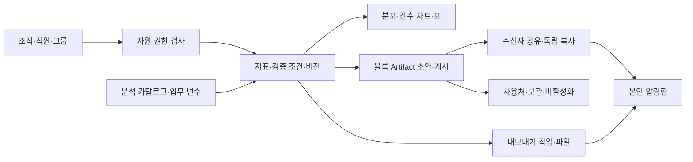

# 기업용 사내 분석·Artifact 요건 설계

2026-10-18 · Draft · 설계/요건 추가만 수행. 사내 분석과 공유에 필요한 FR014~025/NFR005~008의 목표 계약을 정의한다. MK AI 연동 계약/구현은 보류한다. 기존 Rill 의미 계층·Claude식 결과 편집 원칙과 현재 Studio를 재사용한다.

## 사용자와 책임

- 조직 관리자: 직원·그룹·자원별 권한을 관리한다. 데이터 관리자 권한과 구분 가능하게 설계한다.
- 데이터 관리자: 원천 카탈로그·열의 업무 의미·공식 지표 연결·활성 상태와 변경 영향을 관리한다.
- 분석 담당자: 허용 데이터·조건으로 탐색하고 Artifact 초안/게시/보고서를 만든다.
- 수신자: 허용 결과를 조회하거나 명시 허용된 독립 사본을 본인 소스로 재사용한다. 공유 접근과 원본 데이터 권한은 별도다.

## 계층과 경계

권한은 작업 생성과 데이터 조회 전에 서버가 확인한다. 동일 검증 정의를 미리보기/규모 집계/비교 리포트/export가 사용한다. AI는 설명·조회·변경 제안을 만들며 데이터 권한·정의 유효성을 승인하는 주체가 아니다. 기존 화면에 관리자 메뉴를 추가하는 것만으로 기업 권한을 구현했다고 간주하지 않는다.

## 현재 기반과 새 부족점

| 영역        | 재사용할 기반                        | 새 목표/아직 검증하지 않은 부분                                             |
| ----------- | ------------------------------------ | --------------------------------------------------------------------------- |
| 목록        | UC049 제목/유형/정렬                 | 개인 즐겨찾기/보관·조직/수신자 탐색은 후속                                  |
| 데이터·지표 | Source profile·Metric 정의·의미 제안 | 업무 변수 사전·카탈로그 관리·공식성/변경 영향·날짜/단위 의미                |
| 권한        | 기존 소유자·공유 링크·복제 검증      | 조직/그룹·데이터와 산출물 권한 분리·모든 서버 경로 회수 반영                |
| 조건·AI     | 기존 필터·지표/블록 AI·초안 검증     | 중첩AND/OR 편집·유형별 연산자·AI 조건 차이와 동일 정의의 분포/규모 탐색     |
| 공유        | 게시 snapshot·명시 허용 복제         | 수신자 지정/그룹 관계·알림·권한 회수·중복/재공유·개인 보관과 공유 중지 분리 |
| 출력·운영   | 집계/게시 결과·저장 영수증           | 버전에 고정한 비동기export·전달 권한·만료/중단 상태·감사 이력               |

위 표는 새 설계와 기존 증빙의 범위를 구분한 것이다. 이번 작업에서 제품 코드를 재실행하거나 운영 연결을 검증하지 않았다. 기존 동일 목표는 별도 기능으로 중복 구현하지 않는다.

## 상태·실패 계약

- 카탈로그 등록/정의 변경: 관리자·스키마 검사 후 명시 저장. 비활성화는 원본 물리 삭제가 아니다. 연결된 분석/게시의 영향은 따로 확인한다.
- 분석 조건: AI/직접 편집 공통 구조와 타입 검증. 일부 미지원 조건이 포함된 묶음은 기존 초안을 보존하며 전체 거절한다. 사용자가 범위를 줄여 재제안하면 새 묶음으로 검증한다.
- 실행 문맥: sourceRevision·metricVersion·검증 조건·기준/비교 기간·시간대·제외 기준·결과 범위를 연결한다. 샘플 분포를 전체 집계로 표시하지 않는다. 저장과 단순 탐색은 구분한다.
- 공유: 조회 권한 부여와 독립 사본 전달을 선택 단계에서 구분한다. 복사 시 새ID·소유자·소스 권한을 검증한다. 전달 저장과 알림은 별도 결과다. 알림 실패만으로 전달을 되돌리지 않는다.
- 공유 중지: 현재 접근 관계와 향후 받기를 중지한다. 이미 정당하게 만든 수신자 소유 사본/다운로드 파일을 원격 삭제한다고 안내하지 않는다. 재공유는 새 권한·현재 상태로 검사하고 중복 관계를 만들지 않는다.
- export: 접수→실행→완료/실패/취소, 재시작 미확정은 중단/결과확인. 완료는 검증된 파일 메타데이터가 있을 때만 표시한다. 상태 재조회는 새 작업을 만들지 않는다. 오래된 파일·회수된 권한은 전달을 거절한다.
- 보관: 개인 목록 숨김/복원, 조직 자산 비활성화, 영구 삭제는 별도 작업이다. 공유/지표/게시 참조가 있으면 영향 없이 자동 연쇄 삭제하지 않는다.

## 목표 논리 객체 — DB 변경 아님

| 객체                                   | 책임·관계                                                                            |
| -------------------------------------- | ------------------------------------------------------------------------------------ |
| Organization / Membership / Group      | 사용자 소속·활성 상태·조직 범위. 기존 로그인 ID와 연결하며 인증 대체를 강제하지 않음 |
| ResourceGrant                          | 주체·조직·자원·허용 동작. 데이터와 Artifact 권한을 따로 표현                         |
| AnalysisCatalog / BusinessVariable     | 허용 원천·업무 표시명·유형/날짜/단위·정의 버전                                       |
| ConditionDefinition / ExecutionContext | 공통 검증 조건과 원천/지표/기간/제외/결과 범위 고정                                  |
| ArtifactDelivery / Notification        | 접근 관계 또는 독립 복사 이력과 별도 수신자 이벤트                                   |
| ExportJob / ResultFile                 | 요청자/동일 요청ID·정의 문맥·상태·결과 범위/만료·접근 경로                           |
| PersonalLibraryState / UsageReference  | 본인 보관/즐겨찾기와 공유 자산의 참조 영향                                           |
| BusinessAuditEvent                     | 행위자·자원ID·버전·시각·결과. 민감한 원본 행/인증 비밀은 비보관                      |

물리 스키마·고유키·데이터 마이그레이션·재시작 처리/저장 방식은 각 구현 단위에서 별도 검증한다. 목표 객체를 기존 테이블/FK처럼 표기하지 않는다.

## 우선순위와 종료 조건

1. UC049 목록 기반/사용자별 보관을 이어가되, 조직·데이터 카탈로그·서버 권한(UC050/051)을 기업 도입의 선행 단위로 설계한다.
2. 공식 지표·변수 의미와 조건/분포/규모 탐색(UC052)을 기존 편집·미리보기에 연결한다.
3. 수신자 전달·알림(UC053), 기간 비교/비동기export(UC054), 보관/사용처 보호(UC055)를 구현 단위로 나눈다.
4. 확정형 게시와 갱신형 게시·템플릿/EIS 조합은 기존 사내 로드맵과 함께 후속 구현한다. 외부 엔진·MK AI 연동을 선행하지 않는다.

형식/추적 종료는 requirements↔UC050~055↔TC050 연결과 출처 대조다. 제품 종료는 [TC050](../test_cases/TC-050-enterprise-analysis.md)의 실제 역할별/동일 정답/화면 검증과 기존 TC005 무회귀다. 성능·가용성·동시 이용자·감사 보존 수치는 실제 데이터/조직 규모를 정한 후 측정·합의한다. 측정 전 성능 수치를 제품의 보장으로 제시하지 않는다.

## 첫 구현 단위: 업무 메타데이터

[UC050 계획](../plans/UC-050.md)은 기존 소유 DuckDB 소스의 실제 열 프로파일과 추가 전용 업무 설명 이력을 연결한다. 원본 열 타입을 변경하지 않고 표시명·설명·단위만 편집한다. 기존 분석·AI 문맥에 자동 적용하지 않으며 별도 공식 승인/관리자 역할을 구현한 것으로 보지 않는다. 조직·분류·활성/영향 검토는 목표로 남긴다. [검증 상태](../testing/source-catalog.md)에서 자동 검사와 실제 화면 미실행을 구분한다.
