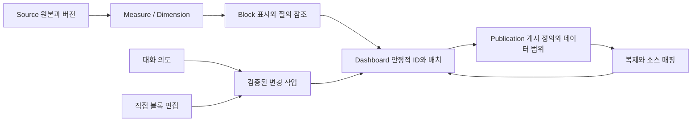

# Prompt To Dashboard 통합 설계

목표 설계이며 현재 구현 완료나 DB migration을 뜻하지 않는다. 제품 계약은 [최상위 목표](../strategy/prompt-to-dashboard.md), 요구사항은 FR-007~012, 수용 흐름은 UC-005/TC-005를 따른다. 기존 Nest/React/MUI/ECharts, DuckDB worker, 메타데이터 DB 및 API를 재사용한다.

## 책임과 정의

| 정의         | 저장할 의미                                                                                    | 분리할 것                                                     |
| ------------ | ---------------------------------------------------------------------------------------------- | ------------------------------------------------------------- |
| Source       | 소유자, schema/dataVersion, 열 타입/원본 연결/갱신 정보                                        | 인증 비밀과 업로드 파일 경로는 외부 결과에 포함하지 않음      |
| Measure      | 안정적 ID, sourceId, 계산식/집계/단위/정밀도/definitionVersion                                 | 표시 축약과 계산 스케일 구별, 원본 SQL은 서버 컴파일 경계     |
| Dimension    | 안정적 ID, sourceId, column/타입/표시명; 시간열의 timezone/grain 의미                          | 원본 열 분류부터 시작, 파생 분류는 필요 시 별도 검증          |
| Block        | 안정적 blockId, kind, measure/dimension 참조·버전, 표시 옵션                                   | 배열 index/새로 생성된 DB Widget ID를 논리 ID로 사용하지 않음 |
| Dashboard    | schemaVersion/revision, blocks, 조회 조건 기본값, breakpoint별 layout                          | 일회 조회 결과·대화·서버 인증 정보와 분리                     |
| Publication  | publicationId/version, dashboardRevision, 공개 정의, 데이터 모드/시점, visibility, revoke 상태 | 편집 초안과 게시 버전 분리                                    |
| Conversation | 대화 ID, 연결 dashboardId, 요청/작업 결과·revision                                             | 대화 문장만을 분석 저장 정의로 사용하지 않음                  |

기존 분석 JSON·Metric.definition·structuredDefinition·layout을 보존하면서 버전이 있는 정의를 추가한다. 기존 API용 adapter에서 Widget/Dataset를 연결한다. 안정적 ID 도입 시 기존 데이터를 지우거나 조회만으로 조용히 재저장하지 않는다. 레거시 변환은 명시 저장 작업에서 적용하고 계약/회귀 테스트를 선행한다. 목표 엔티티를 곧바로 테이블로 나누는 작업은 하지 않는다.

## 동일한 변경 경로

AI와 캔버스는 add/remove/duplicate/update/move/resize 등의 제한된 작업과 expectedRevision을 제출한다. 서버가 대상 blockId, 소유권, source/metric/dimension, SQL, 배치 bounds, 지원 유형을 검증하고 적용된 새 정의를 반환한다. LLM의 원시 코드/SQL은 실행 권한이 아니다. 기존 preview/save/compiler를 재사용하며 임의 JS 실행 엔진은 만들지 않는다.

- 직접 이동 후 AI 내용 수정은 그 블록의 위치/크기를 유지한다. 이동 요청은 대상 배치만 변경한다. 전체 재배치를 명시한 경우에만 여러 블록 배치를 바꾼다.
- 블록 추가/복제 시 새 ID를 발급하고 기존 ID는 유지한다. 삭제할 때 저장된 다른 블록 참조가 깨지지 않는지 확인한다.
- undo/redo는 대시보드 정의 변경에 적용하고 이미 게시된 버전을 암묵적으로 바꾸지 않는다. 요청 진행 중 수정은 revision 경합으로 처리한다.
- 텍스트·표·필터는 목표 블록 종류다. 첫 구현에서 기존 숫자/차트 블록부터 연결하고 지원하지 않는 유형은 부분 완료 사유를 보여준다.
- 숫자+추세는 기존 파생 MetricTrend를 유지할 수 있다. Block이 있다고 추세를 별도 중복 데이터 정의로 저장할 필요는 없다.

## 대화 실행과 오류 복구

단일 입력에서 의도/대상/조회 조건을 분리해 실행 계획을 만들고 검증한다. 생성·설명·블록 변경·저장·게시·복제를 기존 서비스 호출로 연결한다. 대화 생성기, 읽기 전용 설명기, 실제 저장 권한을 구분하되 사용자가 모드 선택을 할 필요는 없다.

요청 ID와 실행 단계 결과를 기록해 재시도에서 저장·게시·복제가 중복 생성되지 않게 한다. schemaVersion/expectedRevision/definitionVersion으로 충돌을 잡는다. 새 정의 생성과 대시보드 저장은 함께 성공하거나 rollback한다. 게시가 나중에 실패해도 이미 저장한 초안은 보존하고 “저장 완료 / 게시 실패”로 표시하며 게시 단계만 재시도한다. 전체 요청이 하나의 DB transaction인 것처럼 보고하지 않는다.

소스/열이 명확하면 자동 매핑한다. 동일한 후보가 여러 개거나 업무 계산식의 분모가 불명확할 때만 한 번에 필요한 질문을 묻는다. 중단/제한시간/미지원 모델은 현재 정의를 보존하고 재시도를 안내한다. 요청하지 않은 공유 범위를 생성하지 않는다.

## 반응형 배치

12열 기반 desktop 편집을 재사용하고 breakpoint별 layout을 정의한다.390px은 읽기 순서에 따른 단일열,768px은 충돌 없는 중간 배치,1440px은 사용자 배치다. 모바일에서는 버튼 이동/순서 조절·resize를 제공해 데스크톱 drag만으로 기능을 제한하지 않는다. grid snap 범위 안에서 위치/크기를 조절하며 절대 pixel 캔버스가 완료 조건은 아니다. view와 editor가 같은 배치 계산기를 사용한다.

화면 폭 전환에서 선택 블록·대화·미저장 내용·undo 상태를 보존한다. 사용자가 별도 편집한 breakpoint 배치는 다른 폭 편집으로 덮어쓰지 않는다. 긴 제목·빈 결과·로딩·오류를 포함해 UI Kit 크기/정렬/높이/폰트/간격과 주변 회귀를 확인한다.

## 게시와 재사용

첫 게시 기본안은 검증된 정의 및 집계 결과 snapshot을 저장하는 링크다. 다른 데이터 모드가 구현되기 전에는 live 갱신을 약속하지 않는다. snapshot의 조회 기간/필터/소스버전/시점/제한을 표시하며 원본 파일·인증 비밀·원본 상세 접근을 함께 공개하지 않는다. 명시 요청한 데이터 범위만 게시한다. 기존 공유 경로를 adapter로 사용하되 현행 live 대시보드 조회를 게시 snapshot 완료로 간주하지 않는다.

이후 live 모드는 서버 소스 접근과 최신 조회 시점을 표시하는 별도 계약으로 검증한다. definition snapshot과 data snapshot은 별개다. 첫 단계에서 계정 내부/링크 공유, 공유 중지, 명시 재게시를 지원하고 새 게시 버전으로 업데이트한다. URL 안정성·이전 버전 접근 정책은 P4 상세 UC에서 고정한다.

재사용은 정의와 layout을 복제해 새 owner/dashboard/block ID를 발급한다. 원본 지표·소스의 접근 권한을 자동 복사하지 않는다. 같은 소스는 허용된 지표를 재사용하고 다른 소스는 열 타입/Measure/Dimension을 매핑한 새 정의로 저장한다. 매핑되지 않은 블록은 사유를 표시하고 해당 결과의 저장/게시를 막는다. 원본 게시물을 조회할 수 있다는 사실만으로 원본 데이터 접근권을 부여하지 않는다.

## 현재 구현과 목표의 차이

검토 기준6edcb4b0,2026-10-14. 코드 확인이며 전체 runtime 재검증은 아니다.

| 기반                      | 코드 근거                                                       | 남은 목표                                                                |
| ------------------------- | --------------------------------------------------------------- | ------------------------------------------------------------------------ |
| AI 초안/수정·preview/save | ai.controller.ts, ai-dashboard.service.ts, AiDashboardPanel.tsx | 한 입력 의도 실행, 지표/차원 동시 생성, 대화 지속                        |
| 현재 설명 Assistant       | ai-dashboard.service.ts assistant                               | 읽기 전용 답변; 저장·게시 수행 금지. 통합 작업기는 별도 실행 책임 필요   |
| 소스·저장 지표·제작       | bi.controller.ts, bi.service.ts                                 | Dimension 명시 정의 및 공동 저장, AI 생성의 모든 참조 보존               |
| 자유 그리드 편집          | DashboardModify/index.tsx                                       | 1390px 고정 폭, lg layout. AI와 안정적 block ID 통합/모바일 편집 보완    |
| 반응형 읽기               | readLayouts.ts, DashboardView/index.tsx                         | 자동 도출 배치; breakpoint별 편집 저장 미완성                            |
| AI 분석 정의              | dashboard-draft.ts                                              | 현재1~6차트/제한된 유형·layoutSizes. 목표 블록 작업/position 계약과 다름 |
| 공유/템플릿               | share-url, template, ShareButton                                | 게시 버전·데이터snapshot·AI 공유·소스 재매핑의 통합 검증 미실행          |
| 지표 변경·일괄 반영       | UC-003/004 및 실행 증빙                                         | 해당 완료는 전체 생성·편집·게시·재사용 완료가 아님                       |

## 확인할 설계 선택

snapshot 기본 게시와 모바일 이동 버튼은 이 문서의 구현 제안이다. 사용자 지정 방식이 있으면 그 지시를 따른다. URL 버전 정책, 텍스트/필터 블록의 구체 형식, 결과 snapshot 용량/만료는 해당 P 단계의 좁은 설계에서 정한다. 미결정을 핑계로 P1을 중단하거나 임의 동작을 완료로 처리하지 않는다.
