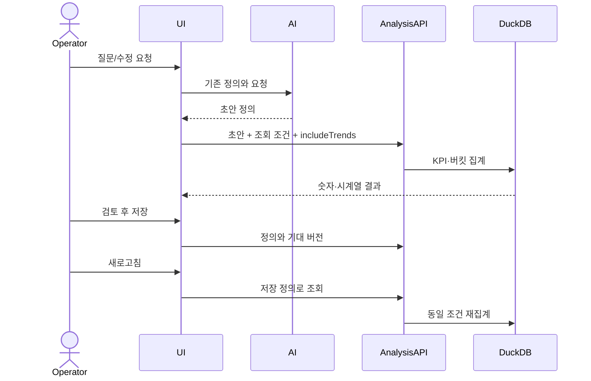

# Structured Analysis With Simple UI

## 상위 목표와 범위

[통합 제품 설계](prompt-to-dashboard.md)가 새 생성·블록 편집·게시·재사용 범위의 상위 계약이다. 이 문서의 숫자+추세 및 단순 설정 계약은 하위 분석 UX에 유지하며 전체 제품 목표를 제한하지 않는다.

## Decision

2026-10-14 사용자 합의: 내부는 Rill처럼 책임을 구조화하고 화면은 대화와 결과 중심으로 단순하게 제공한다. 데이터 소스 → 변환 모델(필요할 때) → 지표 정의 → 분석 화면이라는 경계를 유지한다. 미래 알림/API/커넥터의 확장을 위해 현재 엔진을 전면 교체하지 않는다.

## Current implementation

소스와 버전은 기존 DuckDB 메타데이터, 계산·표시는 analysisDefinition.widgets, 조회 조건은 별도 state다. 기존 구조화 저장 지표의 AI 재사용은 [UC-002 설계](saved-metric-ai.md) 후속으로 연결한다. live reference와 자동 이름 매칭의 완전 보장은 아직 후속 범위다. 이 문서는 목표 경계를 정하지만 현재 구현을 독립 metrics layer로 과장하지 않는다.

## UI design

- 기본: 기간·필터·집계 단위·비교·Assistant, 숫자+시계열, 분류별 차트.
- 접기: 업무 시간대는 ‘기간·필터 설정’, 계산 안내는 ‘집계·기간 비교 안내’, 큰 저장 보기 패널은 ‘개인 저장 보기’에 둔다. 숫자 표시는 도구 모음에서 바로 선택한다. 원본 행은 상세 영역에서 필요할 때 연다.
- 미리보기: 기존 MetricTrend를 재사용하고 생성 패널도 includeTrends를 요청한다. 결과가 없으면 기존 unavailable 사유를 보여준다. 변경 확정 전 미리보기는 탐색·원본 행 요청을 실행하지 않는다.
- UI Kit: AnalysisUiProvider를 국소 적용한다. 부모 선택자로 버튼 높이를 강제하는 기존 Assistant 예외는 제거한다. 여러 줄·긴 라벨의 필요한 높이는 유지한다.

## Sequence

## Rill reference

[Rill Explore](https://docs.rilldata.com/guide/dashboards/explore)의 숫자+추세, 지표/분류 선택과 개발자 정의 편집의 분리를 따른다. 같은 원본을 사용하되 Rill 데모의 시간 이동 표시와 원본 UTC 날짜를 같은 날짜라고 주장하지 않는다. 평균 Bid Floor는 SUM(bid_floor)/SUM(has_bid_floor_cnt)로 비교하고 반올림·통화 표시 차이는 기록한다.
