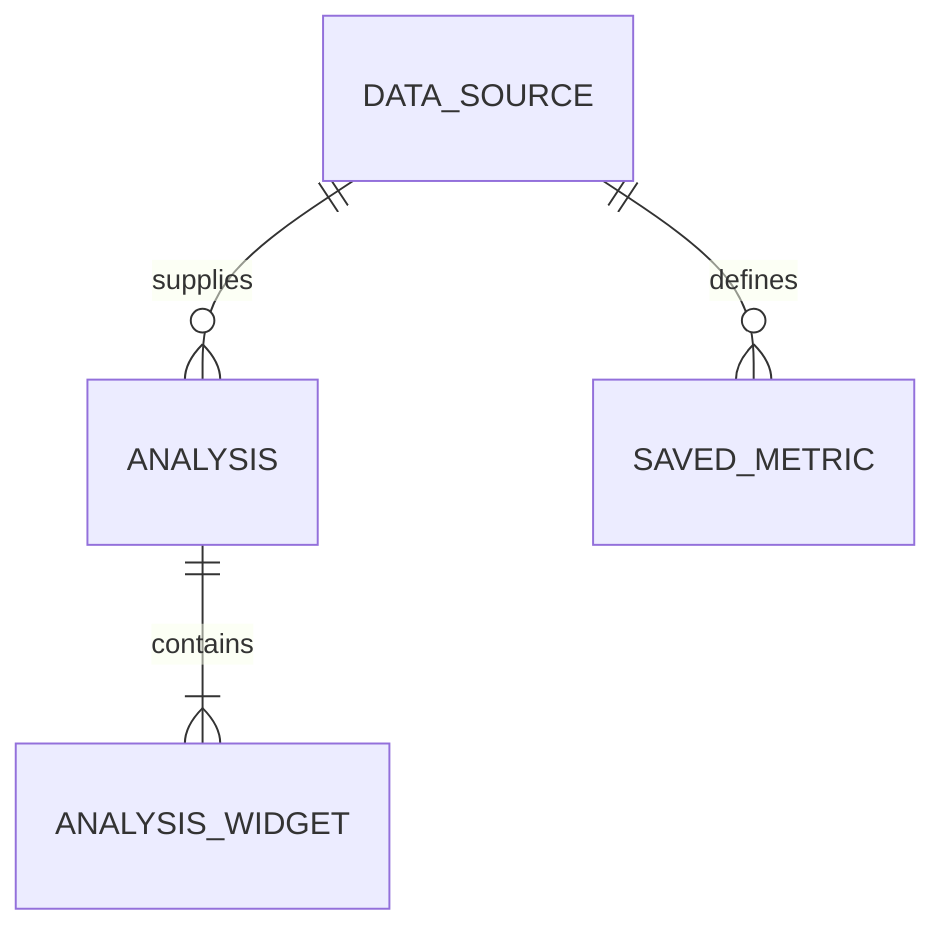
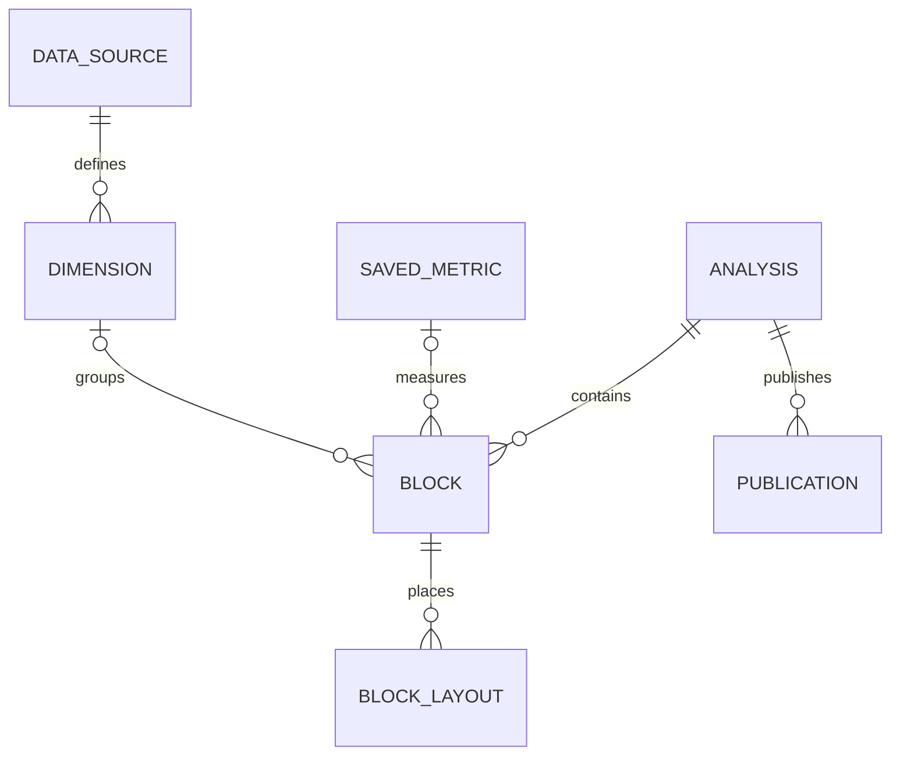

# Entity Model

UC-001~004의 현재 논리 모델과 UC-005의 목표 논리 모델을 구분하며 신규 DB 테이블 생성 명령이 아니다. 기존 JSON 위젯 정의에 포함된 지표 정의를 독립 지표 엔티티로 이미 구현했다고 주장하지 않는다.

## Entity Relationship Diagram

### DATA_SOURCE

분석 원본과 버전의 기준이다.

| Attribute | Description    | Data Type | Length/Precision | Validation Rules      |
| --------- | -------------- | --------- | ---------------- | --------------------- |
| id        | 원본 식별자    | Long      | 19               | Primary Key, Sequence |
| revision  | 게시 원본 버전 | String    | 128              | Not Null              |

### ANALYSIS

저장된 분석 정의다.

| Attribute  | Description           | Data Type | Length/Precision | Validation Rules                       |
| ---------- | --------------------- | --------- | ---------------- | -------------------------------------- |
| id         | 분석 식별자           | Long      | 19               | Primary Key, Sequence                  |
| databaseId | 데이터 소스           | Long      | 19               | Not Null, Foreign Key (DATA_SOURCE.id) |
| title      | 제목                  | String    | 300              | Not Null                               |
| revision   | 저장 충돌 검사용 버전 | String    | 128              | Optional                               |

### ANALYSIS_WIDGET

지표 계산과 차트 표시를 담은 기존 정의다.

| Attribute     | Description    | Data Type | Length/Precision | Validation Rules                    |
| ------------- | -------------- | --------- | ---------------- | ----------------------------------- |
| id            | 논리 식별자    | Long      | 19               | Primary Key                         |
| analysisId    | 분석 참조      | Long      | 19               | Not Null, Foreign Key (ANALYSIS.id) |
| type          | 표시 유형      | String    | 50               | Not Null                            |
| expression    | 지표 계산 정의 | String    | 500              | Not Null                            |
| decimalPlaces | 표시 정밀도    | Integer   | 10               | Optional                            |

**Constraints:** 실제 위젯은 analysisDefinition.widgets의 배열 항목이다. 시계열은 저장 정의의 별도 위젯이 아닌 현재 조회 조건으로 계산한 파생 결과다. 미리보기의 조회 결과를 저장 정의에 복사하지 않는다.

### SAVED_METRIC

기존 Metric.definition에 저장된 버전이 있는 구조화 계산 정의다. UC-002 생성 시 선택 참조되고 분석에는 SQL snapshot이 저장된다. live FK가 새로 생성되는 것은 아니다.

| Attribute  | Description                                         | Data Type | Length/Precision | Validation Rules                       |
| ---------- | --------------------------------------------------- | --------- | ---------------- | -------------------------------------- |
| id         | 지표 ID                                             | Long      | 19               | Primary Key, Sequence                  |
| databaseId | 원본 참조                                           | Long      | 19               | Not Null, Foreign Key (DATA_SOURCE.id) |
| definition | schemaVersion·label·aggregation·column 등 기존 정의 | String    | 10000            | Not Null                               |
| useYn      | 활성 여부                                           | String    | 1                | Not Null, Values: Y, N                 |

UC-003은 기존 Metric.definition의 definitionVersion(양의 정수)을 증가시키며 선택 분석 SQL snapshot과 atomic 저장한다. live FK/전체 자동 전파는 추가하지 않는다.

UC-004은 기존 structuredDefinition의 sourceId/metricId와 widget index 연결을 사용한다. 미연결 raw AI는 명시 선택 저장부터 metric-linked-analysis JSON snapshot을 기록한다. 같은 지표의 선택 분석들을 하나의 transaction에서 갱신한다.

## UC-005 Target Model

아래는 목표 모델이며 미구현이다. ANALYSIS는 제품의 Dashboard에 해당한다. 기존 ANALYSIS_WIDGET/Metric/JSON/layout에서 버전 있는 adapter로 전환하고 데이터 삭제·테이블 일괄 신설은 하지 않는다. 자세한 계약은 [통합 설계](architecture/prompt-to-dashboard.md)이다.

### DIMENSION

소스 열을 재사용 가능한 분류 기준으로 정의한다.

| Attribute  | Description                   | Data Type | Length/Precision | Validation Rules                       |
| ---------- | ----------------------------- | --------- | ---------------- | -------------------------------------- |
| id         | 논리 ID                       | String    | 128              | Primary Key                            |
| sourceId   | 원본 참조                     | Long      | 19               | Not Null, Foreign Key (DATA_SOURCE.id) |
| definition | 열/타입/표시/시간 의미와 버전 | String    | 10000            | Not Null                               |

### BLOCK

대시보드 내용과 표시를 안정적 ID로 식별한다.

| Attribute  | Description                 | Data Type | Length/Precision | Validation Rules                    |
| ---------- | --------------------------- | --------- | ---------------- | ----------------------------------- |
| id         | 안정적 ID                   | String    | 128              | Primary Key                         |
| analysisId | 소유 대시보드               | Long      | 19               | Not Null, Foreign Key (ANALYSIS.id) |
| kind       | 숫자/차트/표/설명/필터      | String    | 50               | Not Null                            |
| definition | 지표·차원 참조/버전 및 표시 | String    | 10000            | Not Null                            |

**Constraints:** 여러 지표/차원 참조는 definition의 목록으로 검증한다. ER의 optional 연결은 한 개 필수 참조를 강제하지 않는다. SQL snapshot은 기존 실행 호환용이며 논리 ID는 DB widget 재생성으로 바뀌지 않는다.

### BLOCK_LAYOUT

breakpoint마다 블록의 grid 위치와 크기를 저장한다.

| Attribute  | Description              | Data Type | Length/Precision | Validation Rules                 |
| ---------- | ------------------------ | --------- | ---------------- | -------------------------------- |
| id         | block/breakpoint 논리 키 | String    | 256              | Primary Key                      |
| blockId    | 대상 블록                | String    | 128              | Not Null, Foreign Key (BLOCK.id) |
| breakpoint | 표시 폭 구간             | String    | 50               | Not Null                         |
| geometry   | x/y/w/h 및 제약          | String    | 1000             | Not Null                         |

### PUBLICATION

초안과 분리된 게시 정의 및 데이터 범위를 관리한다.

| Attribute  | Description                       | Data Type | Length/Precision | Validation Rules                    |
| ---------- | --------------------------------- | --------- | ---------------- | ----------------------------------- |
| id         | 게시 ID                           | String    | 128              | Primary Key                         |
| analysisId | 원본 분석                         | Long      | 19               | Not Null, Foreign Key (ANALYSIS.id) |
| version    | 게시 버전                         | Integer   | 10               | Not Null, Min: 1, Max: 2147483647   |
| definition | 검증된 정의 snapshot              | String    | 100000           | Not Null                            |
| dataPolicy | snapshot/live 및 데이터 시점/조건 | String    | 10000            | Not Null                            |
| visibility | 계정 내부/링크                    | String    | 50               | Not Null                            |
| revoked    | 조회 중지                         | Boolean   | 1                | Not Null                            |

**Constraints:** 게시 데이터는 별도 결과 저장소 참조로 보존할 수 있다. 용량/만료/URL 버전 정책은 P4 상세 설계에서 정한다. 대화/작업 이력은 dashboardId/revision/requestId에 연결하는 서비스 책임이며 지금 새 DB 엔티티로 확정하지 않는다.

UC-006 현재 구현: analysisDefinition.widgets.blockId는 안정적 String 식별자이며 기존 layout/mapping은 DB widget 위치를 유지한다. blockLayouts는 서버가 읽어 반환하는 파생 표시 정보이며 클라이언트 쓰기 권한이 아니다. Block/Layout 전체 목표와 breakpoint별 편집은 미완료다.

## UC-012 creation receipt

다음은 P2 저장 단계 B에 추가한 `analysis_creation_receipt` 모델이다. 로컬 SQLite의 migration·unique·transaction을 검증했고 운영 MySQL은 미검증이다. 지표·분석 저장 재시도에 필요한 영수증만 추가하며 Source/Measure/Dimension/Block 전체를 새 테이블로 나누지 않는다. [UC-012 설계](architecture/semantic-creation.md)를 따른다.

### ANALYSIS_CREATION_RECEIPT

| Attribute     | Description             | Data Type | Length/Precision | Validation Rules                                                                |
| ------------- | ----------------------- | --------- | ---------------- | ------------------------------------------------------------------------------- |
| id            | 내부 식별자             | Long      | 19               | Primary Key                                                                     |
| actorId       | 요청 소유 사용자        | Long      | 19               | Not Null; 기존 인증 actor                                                       |
| requestId     | 저장 재시도 논리 키     | String    | 36               | Not Null; UUID; Unique(actorId, requestId)                                      |
| payloadDigest | 저장 의미의 정규 digest | String    | 64               | Not Null; SHA256; 같은 key/다른 digest409                                       |
| dashboardId   | 성공 결과               | Long      | 19               | transaction 안의 key 확보 단계에서만 null 허용, commit 결과는 유효 Dashboard.id |
| createdAt     | 생성 시점               | DateTime  | -                | Not Null                                                                        |

영수증·지표·분석은 같은 metadata transaction에 기록한다. 실패는 영수증도 rollback하며 중간 running 행을 commit하지 않는다. 영수증을 조회만으로 생성하지 않는다. 분석 삭제 때 영수증을 cascade 삭제하여 같은 requestId가 분석을 재생성하게 하지 않는다. 이미 삭제된 결과는 unavailable을 반환한다.

Dimension은 첫 범위에서 source+원본 column 기반 안정적 논리 ID·정의 snapshot이다. 기존 structured-bi-dashboard.items의 dimensionDefinition으로 기록하며 독립 차원 카탈로그 테이블이 이미 생긴 것으로 간주하지 않는다. 확장된 snapshot의 UC003/004 지표 영향 연결·직접 수정/복제 보존을 TC-012-09의 API/SQLite 범위로 확인했다. 전체 내용/배치 AI·실제 UI 연속 검증은 남았다.

## UC-018 concrete publication

위 PUBLICATION 목표의 첫 DB 구현은 `dashboard_publication`이다. 목표전체가아닌고정집계링크범위이며기존 DashboardShare와별개다.

| Field                     | Type                  | Constraint                                                |
| ------------------------- | --------------------- | --------------------------------------------------------- |
| dashboardId               | integer               | PK, Dashboard.id, dashboard당최신1행                      |
| uuid                      | varchar36             | Unique, 활성재게시유지·중지/만료후교체                    |
| version                   | integer               | 양수, CAS                                                 |
| dashboardRevision         | varchar64             | 저장정의SHA256                                            |
| snapshot                  | text                  | whitelist집계JSONSQLite최대1MiB/MySQL60KiB,SQL/원본행없음 |
| publishedAt / expiresAt   | varchar24             | ISO UTC,최대30일                                          |
| active                    | boolean               | 중지시false                                               |
| requestId / payloadDigest | varchar36 / varchar64 | 마지막성공재시도동일성                                    |

소유권은원본 Dashboard/UserMapping/Source, 삭제는Dashboard.delYn으로검사한다. 가시성link·dataMode snapshot만지원한다. 개념모델의여러visibility·live·이력저장전체완료는아니다.

## UC-020 reuse receipt

대시보드 복제는 기존 `analysis_creation_receipt`의 actor/requestId unique 제약과 같은 transaction 저장을 재사용한다. digest에 `dashboard-reuse` namespace와 원본 ID·ticket을 포함해 UC012 생성 요청과 구분한다. 성공 재시도는 기존 dashboardId만 반환한다. 새 영구 블록 ID/모든 폭 배치·비공개 공유를 기록하며 지표 링크/게시본은 복사하지 않는다. 스키마 변경은 없다. [설계](architecture/dashboard-reuse.md)·[검증](testing/dashboard-reuse.md).

## UC-021 shared/publication reuse

`dashboard_share.allowReuse` boolean default false, `reuseVersion` integer default0을 추가한다. 소유자 허용 및 공유 on/off마다 버전을 증가시켜 ABA를 막는다. `dashboard_publication.reuseDefinition` nullable text는 게시 ticket에서 캡처한 private 계산/배치/필요 열 타입을 저장한다(최대60KiB). 익명 응답은 정의를 반환하지 않는다. [migration/설계](architecture/shared-dashboard-reuse.md)·[검증](testing/shared-dashboard-reuse.md).

## UC025 브라우저 보관 초안

서버 엔티티/DB 변경은 없다. [설계](architecture/browser-draft-recovery.md)의 버전1 envelope는 sessionStorage에 기준 revision·기준 정의·미저장 정의/질문·복구 상태만 보관한다. 행 데이터/미리보기·인증 토큰·게시 실행 영수증은 보관하지 않는다. 기존 ANALYSIS/블록·Publication 책임과 Source/Measure/Dimension 모델은 유지한다.

## UC028 브라우저 로그인 세대

서버 엔티티/DB는 그대로다. [설계](architecture/cross-tab-token-draft.md)의 기능 전용 localStorage 메타데이터는 로그인 세대(epoch)·현재 tokenHash·초안 scope만 보관한다. 본문은 UC025 sessionStorage에 유지한다. 정상 refresh는 scope를 승계하고 새 로그인/로그아웃은 세대를 교체한다. 토큰 원문/SQL/질문/행/preview는 이 공유 메타데이터에 포함하지 않는다. 다른 탭 보관 본문은 직접 지우지 않고 다른 로그인 세대로 연결하지 않는다.

## 기업 사내 분석 목표 객체 — UC050~055

[기업용 설계](architecture/enterprise-analysis.md)의 Organization/Membership/Group·ResourceGrant·AnalysisCatalog/BusinessVariable·ConditionDefinition/ExecutionContext·ArtifactDelivery/Notification·ExportJob/ResultFile·PersonalLibraryState/UsageReference·BusinessAuditEvent는 목표 책임이다. 현재 DB 테이블·FK·마이그레이션 완료가 아니다. 조직/원천/산출물/전달 권한과 독립 사본·파일 결과를 분리하며 물리 모델은 구현 단위에서 검증한다. 기존 엔티티의 구현 상태는 그대로 유지한다.

## UC050 첫 물리 모델

`source_catalog_entry`는 `(sourceId, version)` 복합 기본키의 추가 전용 이력이다. `actorId`, `sourceRevision`(varchar128), `schemaRevision`(varchar64), `metadata`(text, UTF-8 60,000 bytes 이하), `createdAt`을 기록한다. 메타데이터는 소스 표시명(100자)/설명(1000자)·실제 열별 표시명(100자)/설명(1000자)/단위(24자)만 담고 원본 행·연결정보·SQL은 담지 않는다. 새 저장은 기존 최대 버전+1의 고유키로 경쟁을 거절한다. 조직 승인 카탈로그·공통 분류와는 별도 첫 단계이며 기존 Source/Measure/Dimension 정의를 자동 변경하지 않는다. [계획](plans/UC-050.md)·[검증](testing/source-catalog.md).

## UC051 조직·직원 물리 모델

새 SQLite/MySQL 추가 마이그레이션의 모델이며 기존 소스/분석 소유권을 자동 이전하지 않는다.

| Entity                  | Key / fields                                                                     | Constraints                             |
| ----------------------- | -------------------------------------------------------------------------------- | --------------------------------------- |
| enterprise_organization | id PK·name varchar100·version integer                                            | 직원 변경의 version CAS                 |
| enterprise_membership   | userId integer PK·organizationId integer index·role varchar16·team varchar100    | 한 계정 한 조직·admin/member            |
| enterprise_enrollment   | userId integer PK·organizationId integer·codeHash varchar64·expiresAt datetime   | 본인 발급 SHA256·15분·등록 시 원자 소비 |
| enterprise_audit_event  | id PK·organizationId index·actorId·action varchar40·resourceId·version·createdAt | 성공한 변경만·원문/비밀 값 없음         |
| User 추가 컬럼          | active boolean defaulttrue·authVersion integer default0                          | 비활성/재활성 때 epoch 증가·jwtId 제거  |

관계는 서비스에서 확인하는 논리ID이며 이 단위에 물리 FK/자동 삭제를 추가하지 않는다. 기존 로그인/토큰은 epoch0으로 호환하고 마이그레이션의 파괴적 down은 거절한다. 그룹/자원 권한·조직 이동/탈퇴는 이 스키마만으로 구현됐다고 보지 않는다.

## UC051 자원별 권한 물리 모델

`enterprise_resource_grant`의 복합PK는 resourceKind(varchar16 source/dashboard)·resourceId(integer)·recipientId(integer)다. organizationId·ownerId가 부여 권한 주체를 고정하고 version(integer)과 read/edit/publish/export(boolean defaultfalse)가 현재 정책을 나타낸다. 수신자/조직 조회 index를 둔다. 전체 false 회수 행도 보존한다. 기존 `enterprise_audit_event.subjectId` nullable integer는 권한 변경 대상 직원ID이며 actorId와 구분한다. 신규 추가 마이그레이션은 기존 이력을 변경하지 않고 파괴적 down을 거절한다. 그룹/파일 작업 모델이 구현됐다는 의미는 아니다.

기존 dashboard_publication에도 nullable publisherId/sourceId를 추가해 실제 게시자와 원래 소스의 현재 권한을 익명 읽기/재사용에서 확인한다. 기존 null 값만 단일 원래 소유자 기준으로 호환하며 이 두 값은 공개 snapshot/메타데이터에 출력하지 않는다.

## UC050 업무 변수 의미 확장

기존 `source_catalog_entry.metadata.columns` JSON에 optional businessType(auto/number/category/date), dateFormat(빈 값/native/YYYY-MM-DD/YYYY/MM/DD/YYYYMMDD), classification(정규화한80자 문자열)을 추가한다. 별도 테이블/마이그레이션은 없다. 이전 이력의 생략은 auto/빈 값이며 기존 클라이언트 쓰기에서 생략한 필드는 해당 열의 현재 선언을 보존한다. 원본 열 type은 읽기 전용으로 별도 유지한다. 변경은 동일 append-only sourceId/version·actorId와 schemaRevision/sourceRevision을 사용한다. 조직 공통 분류 식별자/사전이나 쿼리 계산식 변경을 구현한 것으로 보지 않는다.

## UC050 소스 활성 상태

기존 `database.catalogActive` boolean(defaulttrue)와 `catalogVersion` integer(default0)는 소스 사용 상태와 CAS 버전이다. 여기의 catalogVersion은 /bi/sources가 반환하는 동명 업무 설명 버전과 구분하며 상태 API에서는 version으로만 반환한다. 신규179242 마이그레이션은 기존 소유권/연결정보/행을 보존한다. 상태 관리에는 현재 활성 소유 admin만 접근하고 일반 read/edit와 분리한다. 권한·원본/분석/게시 행은 비활성화 시 삭제하지 않는다. 상태 변경은 enterprise_audit_event의 실제 actorId/resourceId/version과 source.activate/source.deactivate로 기록한다. source.updatedAt도 갱신되므로 오래된 데이터 버전 요청은 다시 확인해야 한다.
