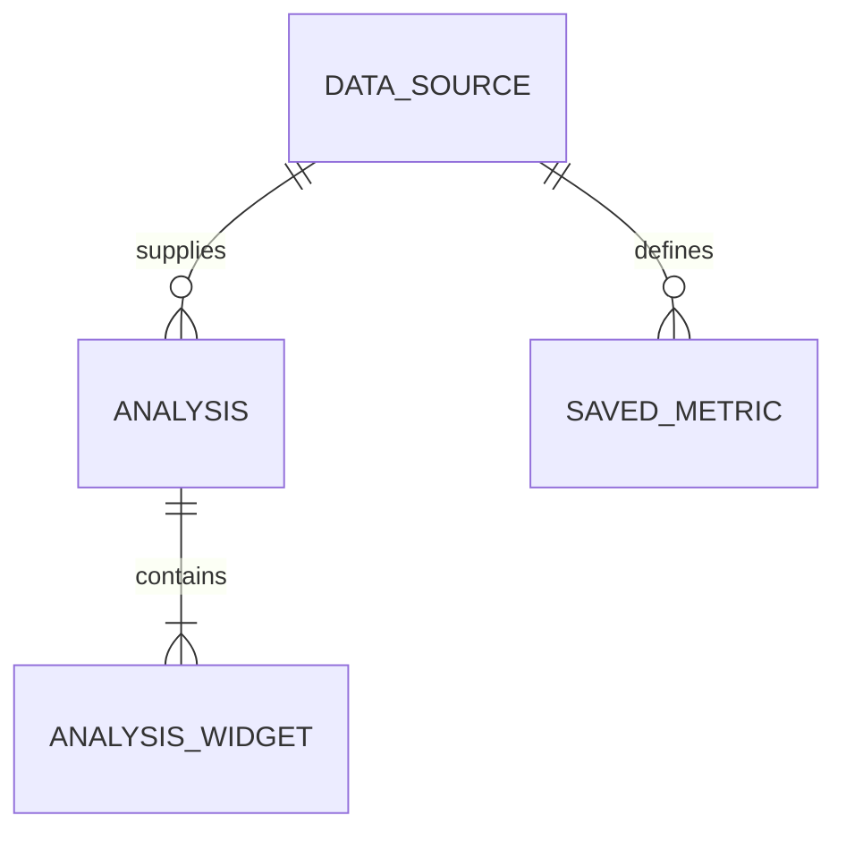
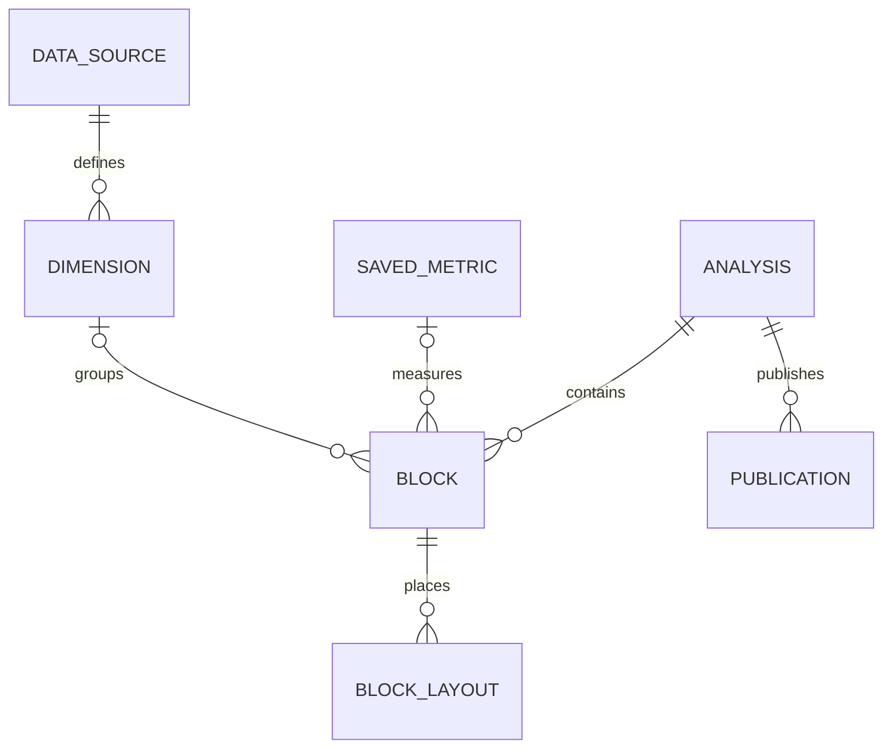

# Entity Model

UC-001~004의 현재 논리 모델과 UC-005의 목표 논리 모델을 구분하며 신규 DB 테이블 생성 명령이 아니다. 기존 JSON 위젯 정의에 포함된 지표 정의를 독립 지표 엔티티로 이미 구현했다고 주장하지 않는다.

## Entity Relationship Diagram

### DATA_SOURCE

분석 원본과 버전의 기준이다.

| Attribute | Description    | Data Type | Length/Precision | Validation Rules      |
| --------- | -------------- | --------- | ---------------- | --------------------- |
| id        | 원본 식별자    | Long      | 19               | Primary Key, Sequence |
| revision  | 게시 원본 버전 | String    | 128              | Not Null              |

### ANALYSIS

저장된 분석 정의다.

| Attribute  | Description           | Data Type | Length/Precision | Validation Rules                       |
| ---------- | --------------------- | --------- | ---------------- | -------------------------------------- |
| id         | 분석 식별자           | Long      | 19               | Primary Key, Sequence                  |
| databaseId | 데이터 소스           | Long      | 19               | Not Null, Foreign Key (DATA_SOURCE.id) |
| title      | 제목                  | String    | 300              | Not Null                               |
| revision   | 저장 충돌 검사용 버전 | String    | 128              | Optional                               |

### ANALYSIS_WIDGET

지표 계산과 차트 표시를 담은 기존 정의다.

| Attribute     | Description    | Data Type | Length/Precision | Validation Rules                    |
| ------------- | -------------- | --------- | ---------------- | ----------------------------------- |
| id            | 논리 식별자    | Long      | 19               | Primary Key                         |
| analysisId    | 분석 참조      | Long      | 19               | Not Null, Foreign Key (ANALYSIS.id) |
| type          | 표시 유형      | String    | 50               | Not Null                            |
| expression    | 지표 계산 정의 | String    | 500              | Not Null                            |
| decimalPlaces | 표시 정밀도    | Integer   | 10               | Optional                            |

**Constraints:** 실제 위젯은 analysisDefinition.widgets의 배열 항목이다. 시계열은 저장 정의의 별도 위젯이 아닌 현재 조회 조건으로 계산한 파생 결과다. 미리보기의 조회 결과를 저장 정의에 복사하지 않는다.

### SAVED_METRIC

기존 Metric.definition에 저장된 버전이 있는 구조화 계산 정의다. UC-002 생성 시 선택 참조되고 분석에는 SQL snapshot이 저장된다. live FK가 새로 생성되는 것은 아니다.

| Attribute  | Description                                         | Data Type | Length/Precision | Validation Rules                       |
| ---------- | --------------------------------------------------- | --------- | ---------------- | -------------------------------------- |
| id         | 지표 ID                                             | Long      | 19               | Primary Key, Sequence                  |
| databaseId | 원본 참조                                           | Long      | 19               | Not Null, Foreign Key (DATA_SOURCE.id) |
| definition | schemaVersion·label·aggregation·column 등 기존 정의 | String    | 10000            | Not Null                               |
| useYn      | 활성 여부                                           | String    | 1                | Not Null, Values: Y, N                 |

UC-003은 기존 Metric.definition의 definitionVersion(양의 정수)을 증가시키며 선택 분석 SQL snapshot과 atomic 저장한다. live FK/전체 자동 전파는 추가하지 않는다.

UC-004은 기존 structuredDefinition의 sourceId/metricId와 widget index 연결을 사용한다. 미연결 raw AI는 명시 선택 저장부터 metric-linked-analysis JSON snapshot을 기록한다. 같은 지표의 선택 분석들을 하나의 transaction에서 갱신한다.

## UC-005 Target Model

아래는 목표 모델이며 미구현이다. ANALYSIS는 제품의 Dashboard에 해당한다. 기존 ANALYSIS_WIDGET/Metric/JSON/layout에서 버전 있는 adapter로 전환하고 데이터 삭제·테이블 일괄 신설은 하지 않는다. 자세한 계약은 [통합 설계](architecture/prompt-to-dashboard.md)이다.

### DIMENSION

소스 열을 재사용 가능한 분류 기준으로 정의한다.

| Attribute  | Description                   | Data Type | Length/Precision | Validation Rules                       |
| ---------- | ----------------------------- | --------- | ---------------- | -------------------------------------- |
| id         | 논리 ID                       | String    | 128              | Primary Key                            |
| sourceId   | 원본 참조                     | Long      | 19               | Not Null, Foreign Key (DATA_SOURCE.id) |
| definition | 열/타입/표시/시간 의미와 버전 | String    | 10000            | Not Null                               |

### BLOCK

대시보드 내용과 표시를 안정적 ID로 식별한다.

| Attribute  | Description                 | Data Type | Length/Precision | Validation Rules                    |
| ---------- | --------------------------- | --------- | ---------------- | ----------------------------------- |
| id         | 안정적 ID                   | String    | 128              | Primary Key                         |
| analysisId | 소유 대시보드               | Long      | 19               | Not Null, Foreign Key (ANALYSIS.id) |
| kind       | 숫자/차트/표/설명/필터      | String    | 50               | Not Null                            |
| definition | 지표·차원 참조/버전 및 표시 | String    | 10000            | Not Null                            |

**Constraints:** 여러 지표/차원 참조는 definition의 목록으로 검증한다. ER의 optional 연결은 한 개 필수 참조를 강제하지 않는다. SQL snapshot은 기존 실행 호환용이며 논리 ID는 DB widget 재생성으로 바뀌지 않는다.

### BLOCK_LAYOUT

breakpoint마다 블록의 grid 위치와 크기를 저장한다.

| Attribute  | Description              | Data Type | Length/Precision | Validation Rules                 |
| ---------- | ------------------------ | --------- | ---------------- | -------------------------------- |
| id         | block/breakpoint 논리 키 | String    | 256              | Primary Key                      |
| blockId    | 대상 블록                | String    | 128              | Not Null, Foreign Key (BLOCK.id) |
| breakpoint | 표시 폭 구간             | String    | 50               | Not Null                         |
| geometry   | x/y/w/h 및 제약          | String    | 1000             | Not Null                         |

### PUBLICATION

초안과 분리된 게시 정의 및 데이터 범위를 관리한다.

| Attribute  | Description                       | Data Type | Length/Precision | Validation Rules                    |
| ---------- | --------------------------------- | --------- | ---------------- | ----------------------------------- |
| id         | 게시 ID                           | String    | 128              | Primary Key                         |
| analysisId | 원본 분석                         | Long      | 19               | Not Null, Foreign Key (ANALYSIS.id) |
| version    | 게시 버전                         | Integer   | 10               | Not Null, Min: 1, Max: 2147483647   |
| definition | 검증된 정의 snapshot              | String    | 100000           | Not Null                            |
| dataPolicy | snapshot/live 및 데이터 시점/조건 | String    | 10000            | Not Null                            |
| visibility | 계정 내부/링크                    | String    | 50               | Not Null                            |
| revoked    | 조회 중지                         | Boolean   | 1                | Not Null                            |

**Constraints:** 게시 데이터는 별도 결과 저장소 참조로 보존할 수 있다. 용량/만료/URL 버전 정책은 P4 상세 설계에서 정한다. 대화/작업 이력은 dashboardId/revision/requestId에 연결하는 서비스 책임이며 지금 새 DB 엔티티로 확정하지 않는다.

UC-006 현재 구현: analysisDefinition.widgets.blockId는 안정적 String 식별자이며 기존 layout/mapping은 DB widget 위치를 유지한다. blockLayouts는 서버가 읽어 반환하는 파생 표시 정보이며 클라이언트 쓰기 권한이 아니다. Block/Layout 전체 목표와 breakpoint별 편집은 미완료다.

## UC-012 creation receipt

다음은 P2 저장 단계 B에 추가한 `analysis_creation_receipt` 모델이다. 로컬 SQLite의 migration·unique·transaction을 검증했고 운영 MySQL은 미검증이다. 지표·분석 저장 재시도에 필요한 영수증만 추가하며 Source/Measure/Dimension/Block 전체를 새 테이블로 나누지 않는다. [UC-012 설계](architecture/semantic-creation.md)를 따른다.

### ANALYSIS_CREATION_RECEIPT

| Attribute     | Description             | Data Type | Length/Precision | Validation Rules                                                                |
| ------------- | ----------------------- | --------- | ---------------- | ------------------------------------------------------------------------------- |
| id            | 내부 식별자             | Long      | 19               | Primary Key                                                                     |
| actorId       | 요청 소유 사용자        | Long      | 19               | Not Null; 기존 인증 actor                                                       |
| requestId     | 저장 재시도 논리 키     | String    | 36               | Not Null; UUID; Unique(actorId, requestId)                                      |
| payloadDigest | 저장 의미의 정규 digest | String    | 64               | Not Null; SHA256; 같은 key/다른 digest409                                       |
| dashboardId   | 성공 결과               | Long      | 19               | transaction 안의 key 확보 단계에서만 null 허용, commit 결과는 유효 Dashboard.id |
| createdAt     | 생성 시점               | DateTime  | -                | Not Null                                                                        |

영수증·지표·분석은 같은 metadata transaction에 기록한다. 실패는 영수증도 rollback하며 중간 running 행을 commit하지 않는다. 영수증을 조회만으로 생성하지 않는다. 분석 삭제 때 영수증을 cascade 삭제하여 같은 requestId가 분석을 재생성하게 하지 않는다. 이미 삭제된 결과는 unavailable을 반환한다.

Dimension은 첫 범위에서 source+원본 column 기반 안정적 논리 ID·정의 snapshot이다. 기존 structured-bi-dashboard.items의 dimensionDefinition으로 기록하며 독립 차원 카탈로그 테이블이 이미 생긴 것으로 간주하지 않는다. 확장된 snapshot의 UC003/004 지표 영향 연결·직접 수정/복제 보존을 TC-012-09의 API/SQLite 범위로 확인했다. 전체 내용/배치 AI·실제 UI 연속 검증은 남았다.

## UC-018 concrete publication

위 PUBLICATION 목표의 첫 DB 구현은 `dashboard_publication`이다. 목표전체가아닌고정집계링크범위이며기존 DashboardShare와별개다.

| Field                     | Type                  | Constraint                                                |
| ------------------------- | --------------------- | --------------------------------------------------------- |
| dashboardId               | integer               | PK, Dashboard.id, dashboard당최신1행                      |
| uuid                      | varchar36             | Unique, 활성재게시유지·중지/만료후교체                    |
| version                   | integer               | 양수, CAS                                                 |
| dashboardRevision         | varchar64             | 저장정의SHA256                                            |
| snapshot                  | text                  | whitelist집계JSONSQLite최대1MiB/MySQL60KiB,SQL/원본행없음 |
| publishedAt / expiresAt   | varchar24             | ISO UTC,최대30일                                          |
| active                    | boolean               | 중지시false                                               |
| requestId / payloadDigest | varchar36 / varchar64 | 마지막성공재시도동일성                                    |

소유권은원본 Dashboard/UserMapping/Source, 삭제는Dashboard.delYn으로검사한다. 가시성link·dataMode snapshot만지원한다. 개념모델의여러visibility·live·이력저장전체완료는아니다.

## UC-020 reuse receipt

대시보드 복제는 기존 `analysis_creation_receipt`의 actor/requestId unique 제약과 같은 transaction 저장을 재사용한다. digest에 `dashboard-reuse` namespace와 원본 ID·ticket을 포함해 UC012 생성 요청과 구분한다. 성공 재시도는 기존 dashboardId만 반환한다. 새 영구 블록 ID/모든 폭 배치·비공개 공유를 기록하며 지표 링크/게시본은 복사하지 않는다. 스키마 변경은 없다. [설계](architecture/dashboard-reuse.md)·[검증](testing/dashboard-reuse.md).

## UC-021 shared/publication reuse

`dashboard_share.allowReuse` boolean default false, `reuseVersion` integer default0을 추가한다. 소유자 허용 및 공유 on/off마다 버전을 증가시켜 ABA를 막는다. `dashboard_publication.reuseDefinition` nullable text는 게시 ticket에서 캡처한 private 계산/배치/필요 열 타입을 저장한다(최대60KiB). 익명 응답은 정의를 반환하지 않는다. [migration/설계](architecture/shared-dashboard-reuse.md)·[검증](testing/shared-dashboard-reuse.md).

## UC025 브라우저 보관 초안

서버 엔티티/DB 변경은 없다. [설계](architecture/browser-draft-recovery.md)의 버전1 envelope는 sessionStorage에 기준 revision·기준 정의·미저장 정의/질문·복구 상태만 보관한다. 행 데이터/미리보기·인증 토큰·게시 실행 영수증은 보관하지 않는다. 기존 ANALYSIS/블록·Publication 책임과 Source/Measure/Dimension 모델은 유지한다.

## UC028 브라우저 로그인 세대

서버 엔티티/DB는 그대로다. [설계](architecture/cross-tab-token-draft.md)의 기능 전용 localStorage 메타데이터는 로그인 세대(epoch)·현재 tokenHash·초안 scope만 보관한다. 본문은 UC025 sessionStorage에 유지한다. 정상 refresh는 scope를 승계하고 새 로그인/로그아웃은 세대를 교체한다. 토큰 원문/SQL/질문/행/preview는 이 공유 메타데이터에 포함하지 않는다. 다른 탭 보관 본문은 직접 지우지 않고 다른 로그인 세대로 연결하지 않는다.

## 기업 사내 분석 목표 객체 — UC050~055

[기업용 설계](architecture/enterprise-analysis.md)의 Organization/Membership/Group·ResourceGrant·AnalysisCatalog/BusinessVariable·ConditionDefinition/ExecutionContext·ArtifactDelivery/Notification·ExportJob/ResultFile·PersonalLibraryState/UsageReference·BusinessAuditEvent는 목표 책임이다. 현재 DB 테이블·FK·마이그레이션 완료가 아니다. 조직/원천/산출물/전달 권한과 독립 사본·파일 결과를 분리하며 물리 모델은 구현 단위에서 검증한다. 기존 엔티티의 구현 상태는 그대로 유지한다.

## UC050 첫 물리 모델

`source_catalog_entry`는 `(sourceId, version)` 복합 기본키의 추가 전용 이력이다. `actorId`, `sourceRevision`(varchar128), `schemaRevision`(varchar64), `metadata`(text, UTF-8 60,000 bytes 이하), `createdAt`을 기록한다. 메타데이터는 소스 표시명(100자)/설명(1000자)·실제 열별 표시명(100자)/설명(1000자)/단위(24자)만 담고 원본 행·연결정보·SQL은 담지 않는다. 새 저장은 기존 최대 버전+1의 고유키로 경쟁을 거절한다. 조직 승인 카탈로그·공통 분류와는 별도 첫 단계이며 기존 Source/Measure/Dimension 정의를 자동 변경하지 않는다. [계획](plans/UC-050.md)·[검증](testing/source-catalog.md).

## UC051 조직·직원 물리 모델

새 SQLite/MySQL 추가 마이그레이션의 모델이며 기존 소스/분석 소유권을 자동 이전하지 않는다.

| Entity                  | Key / fields                                                                     | Constraints                             |
| ----------------------- | -------------------------------------------------------------------------------- | --------------------------------------- |
| enterprise_organization | id PK·name varchar100·version integer                                            | 직원 변경의 version CAS                 |
| enterprise_membership   | userId integer PK·organizationId integer index·role varchar16·team varchar100    | 한 계정 한 조직·admin/member            |
| enterprise_enrollment   | userId integer PK·organizationId integer·codeHash varchar64·expiresAt datetime   | 본인 발급 SHA256·15분·등록 시 원자 소비 |
| enterprise_audit_event  | id PK·organizationId index·actorId·action varchar40·resourceId·version·createdAt | 성공한 변경만·원문/비밀 값 없음         |
| User 추가 컬럼          | active boolean defaulttrue·authVersion integer default0                          | 비활성/재활성 때 epoch 증가·jwtId 제거  |

관계는 서비스에서 확인하는 논리ID이며 자동 삭제·연쇄 전파는 추가하지 않는다. 계정 유일성과 소속 무결성의 물리 제약은 아래 계정 유일성·소속 무결성 물리 모델을 따른다. 기존 로그인/토큰은 epoch0으로 호환하고 마이그레이션의 파괴적 down은 거절한다. 그룹/자원 권한·조직 이동/탈퇴는 이 스키마만으로 구현됐다고 보지 않는다.

## UC051 계정 유일성·소속 무결성 물리 모델

FR016/FR017의 첫 DB 제약이다. `user.userId`와 `user.email`에 명명된 unique index `UQ_user_userId`·`UQ_user_email`를 두고, `enterprise_membership.userId`→`user.id`에 `FK_enterprise_membership_user` RESTRICT 외래 키를 둔다. 관계는 자동 조회하지 않으며 API 응답 필드를 추가하지 않는다. `enterprise_membership.userId`는 계속 기본 키이고 관계는 같은 컬럼을 참조한다.

추가 전용 `1792430000000-add-account-integrity` 마이그레이션은 모든 DDL 전에 중복 userId/email·NULL·소속 고아·참조 컬럼 타입/unsigned·user.id PK 여부·membership.userId PK 여부·membership.userId 컬럼 존재·같은 이름 인덱스/FK 정의·비 InnoDB 엔진을 검사한다. 비정상 데이터나 정의 불일치가 있으면 식별값 없이 종류/개수만 알리고 중단하며 사용자·소속·기존 인덱스·FK를 자동 삭제·병합·복구하지 않는다. user 테이블이 없는 신규 DB는 sync baseline에 맡기고, 컬럼이 불완전한 기존 user 테이블과 userId 없는 membership 테이블은 fail-closed한다. up은 반복 실행해도 안전하고 down은 검토된 백업 없이 거절한다. MySQL DDL은 비원자적이므로 운영에서는 writer 중지·백업·InnoDB 확인 후 적용하며 이번 검증에서는 운영 DB에 실행하지 않았다. 실제 SQLite 제약/마이그레이션과 MySQL 동시성 검증은 `.aiwf/evidence/UC051-identity-integrity`와 `docs/plans/UC-051-identity-integrity.md`를 따른다.

## UC051 자원별 권한 물리 모델

`enterprise_resource_grant`의 복합PK는 resourceKind(varchar16 source/dashboard)·resourceId(integer)·recipientId(integer)다. organizationId·ownerId가 부여 권한 주체를 고정하고 version(integer)과 read/edit/publish/export(boolean defaultfalse)가 현재 정책을 나타낸다. 수신자/조직 조회 index를 둔다. 전체 false 회수 행도 보존한다. 기존 `enterprise_audit_event.subjectId` nullable integer는 권한 변경 대상 직원ID이며 actorId와 구분한다. 신규 추가 마이그레이션은 기존 이력을 변경하지 않고 파괴적 down을 거절한다. 그룹/파일 작업 모델이 구현됐다는 의미는 아니다.

기존 dashboard_publication에도 nullable publisherId/sourceId를 추가해 실제 게시자와 원래 소스의 현재 권한을 익명 읽기/재사용에서 확인한다. 기존 null 값만 단일 원래 소유자 기준으로 호환하며 이 두 값은 공개 snapshot/메타데이터에 출력하지 않는다.

## UC054 영속 집계 export 작업

현재 물리 모델은 추가 마이그레이션 `1792510000000-add-export-jobs`의 `export_job`과 `export_part`다. 목표 객체 목록의 ExportJob/ResultFile을 실제 저장 책임으로 구체화하며, 결과 파일은 filesystem 경로가 아닌 DB TEXT 조각으로 저장한다.

| Entity        | Key / fields                                                                                                                                                                                                               | Constraints                                                                                       |
| ------------- | -------------------------------------------------------------------------------------------------------------------------------------------------------------------------------------------------------------------------- | ------------------------------------------------------------------------------------------------- |
| `export_job`  | id PK; ownerId, organizationId, sourceId, sourceOwnerId; requestId, digest, requestJson, basisJson; status, version, attemptToken, leaseUntil; createdAt, expiresAt; filename, hash, errorCode, rowCount, bytes, partCount | `(ownerId, requestId)` unique; actor/org/id 목록 index; owner당 미만료 100개; 24h 만료; 5m lease  |
| `export_part` | `(jobId, part)` composite PK; `data` TEXT                                                                                                                                                                                  | CSV 조각 순서 보존; 조각당 UTF-8 36 KiB 이하, 최대 200조각; job FK/cascade는 모델에 선언하지 않음 |

요청은 집계 조건과 소스 revision 및 선택 지표의 version/digest를 고정한다. 작업 생성은 aggregate SQL을 실행하지 않는다. 명시 실행은 status/version/attempt token CAS를 통과해야 하며 SQL은 metadata transaction/SQLite queue 밖에서 수행한다. 완료 metadata와 조각은 원자 저장한다. 실패 정리는 소유 attempt의 CAS 성공 후에만 파일 조각을 삭제한다. 파일 조회 때 현재 actor/조직/소유권/export 권한/auth epoch, 만료와 checksum을 확인한다. 상태 응답에는 attempt token, checksum, 부분 내용이 포함되지 않는다. 전체 저장 모델과 미확정 수용 범위는 [UC-054 계획](plans/UC-054-export-jobs.md)·[검증 증빙](testing/export-jobs.md)을 따른다.

## UC050 업무 변수 의미 확장

기존 `source_catalog_entry.metadata.columns` JSON에 optional businessType(auto/number/category/date), dateFormat(빈 값/native/YYYY-MM-DD/YYYY/MM/DD/YYYYMMDD), classification(정규화한80자 문자열)을 추가한다. 별도 테이블/마이그레이션은 없다. 이전 이력의 생략은 auto/빈 값이며 기존 클라이언트 쓰기에서 생략한 필드는 해당 열의 현재 선언을 보존한다. 원본 열 type은 읽기 전용으로 별도 유지한다. 변경은 동일 append-only sourceId/version·actorId와 schemaRevision/sourceRevision을 사용한다. 조직 공통 분류 식별자/사전이나 쿼리 계산식 변경을 구현한 것으로 보지 않는다.

### UC050 신규 생성 고정 업무 기준 — 구현 진행 중

신규 지표/차원과 제안 문맥은 별도 테이블 없이 선택적 `businessBasis` JSON snapshot으로 업무 기준을 고정한다. snapshot은 schemaVersion, source catalog version(또는 명시 native null), schema revision, 열의 물리명/native type 및 업무 label/설명/unit/businessType/dateFormat/classification/ref를 담는다. 서버는 정확한 catalog history와 실제 schema를 대조하며 SQL/표현식은 저장 기준으로 받지 않는다. 제안 문맥은 전체 기준을 보존하고 계산 정의는 사용 열의 기준만 보존한다. Metric의 실제 definition version, 파일 revision, source condition version과 catalogVersion은 서로 대체하지 않는다. 기존 기준 없는 정의는 native로 남는다. 공개 응답에 전체 기준을 투영하지 않는다. [계획](plans/UC-050-semantic-business-basis.md)·[진행 중 증빙](testing/semantic-business-basis.md)을 따른다. 해당 단위의 실제 Codex/headless 화면·SQLite/DuckDB 선택 증거는 위 증빙을 따른다. 이번 MySQL/Ego/실기기/운영·업무 수용은 미확인이다.

## UC050 소스 활성 상태

기존 `database.catalogActive` boolean(defaulttrue)와 `catalogVersion` integer(default0)는 소스 사용 상태와 CAS 버전이다. 여기의 catalogVersion은 /bi/sources가 반환하는 동명 업무 설명 버전과 구분하며 상태 API에서는 version으로만 반환한다. 신규179242 마이그레이션은 기존 소유권/연결정보/행을 보존한다. 상태 관리에는 현재 활성 소유 admin만 접근하고 일반 read/edit와 분리한다. 권한·원본/분석/게시 행은 비활성화 시 삭제하지 않는다. 상태 변경은 enterprise_audit_event의 실제 actorId/resourceId/version과 source.activate/source.deactivate로 기록한다. source.updatedAt도 갱신되므로 오래된 데이터 버전 요청은 다시 확인해야 한다.

## UC052 소스 조건 버전

`source_condition_entry`는 sourceId/version 복합 PK로 포함/제외 조건 정의를 append하고 actorId/sourceRevision/createdAt을 보존한다. 값이 포함된 정의는 현재 소스 read/edit 정책으로 보호하며 원본 행/SQL/연결 정보를 저장하지 않는다. 기존 파일·분석·게시를 자동 변경하지 않는다. 선택적 semanticsJSON(text nullable)은 마이그레이션1792570000000으로 추가한다. SQL NULL은 legacy native이고 JSON은 schemaVersion1/catalogVersion/전체 non-auto 선언의 고정 snapshot이다. 정확한 SourceCatalogEntry 이력/native schema를 대조하고 기존 행·시각·NULL을 보존한다. sourceRevision은 조건 편집 metadata 기준으로 분석 wrapper의 불변 파일 기준과 다르다. [조건 의미 증빙](testing/business-condition-semantics.md)은 Source/Studio·보기/출력/재사용 연결의 선택 실행을 기록하며 전체 이력 UI/FR015 수용을 뜻하지 않는다.

## UC053 Personal Notification State

기존 `EnterpriseAuditEvent`의 수신자/조직·권한 action을 알림 원장으로 사용한다. 별도 개인 표시 상태 `enterprise_notification_state`는 recipientId+eventId 복합 PK와 read/removed boolean(default false)이다. 논리적으로 User/AuditEvent와 연결하지만 물리 FK/cascade는 추가하지 않는다. 상태 변경 API는 본인 active 계정/현재 소속/원장 이벤트를 재검증한다. 상태 제거는 감사/권한/자원 삭제가 아니며 false→true 단방향 멱등 갱신이다. 감사 원장의 subjectId/organizationId/id 복합 인덱스로 본인 최신순 조회를 지원한다. 직원/그룹 전달 관계·export job은 이 테이블에 혼합하지 않으며 별도 후속 모델이다.

## UC053 Dashboard Delivery and Receipt

`enterprise_dashboard_delivery`는 ownerId+organizationId+dashboardId+recipientId 복합 PK와 active/version을 보관한다. 현재 소유권·양쪽 계정 활성/조직 binding을 확인할 때 read만 합성한다. 별도 직접 grant의 edit/publish/export를 공유 관계로 옮기지 않는다. 원본/사본의 소유권·정의도 변경하지 않는다. 수신자/조직/active 인덱스로 목록 허용 ID를 찾는다.

`enterprise_delivery_receipt`는 ownerId+UUID requestId PK, organizationId·SHA256 digest·고정 응답 text다. 현재 소유 admin/조직을 재검증한 replay만 허용하고 다른 요청 내용/조직은409다. 그룹 공유도 이 영수증을 재사용하지만 digest의 `group-delivery` domain으로 개인 공유 요청과 분리한다. 영수증은 과거 저장 확인이며 현재 공유 상태가 아니다. 관계 변경·감사·영수증은 한 transaction이다.

UC053 받은 자료는 새 영속 엔티티가 아닌 현재 유효한 delivery의 읽기 투영이다. 모든 연결 소스의 read 후 dashboardId/title/version만 반환한다. cursor는 마지막 검사 후보이며 마지막 표시 행과 다를 수 있다. 알림 표시 상태·원본·공유 관계·영수증을 변경하지 않는다.

UC053 direct delivery의 `allowCopy` boolean은 기본 false인 별도 독립 복제 동의다. 공유 API에서 생략하면 보존하고 회수 시 false로 정리한다. active/allowCopy 변화 모두 관계 version·감사/영수증 transaction에 묶인다. 받은 자료에는 boolean만 추가하며 private 복제 reference는 조직/소유자/분석/관계 version·현재 Studio 문서/schema/파일 revision/template fingerprint로 구성한다. reference 자체는 접근권이 아니고 필수 JWT/current read/허용을 요구한다. 사본의 새 소유/블록/지표 ID와 모든 폭 배치는 기존 StudioRemixRequest 원자 저장을 재사용한다.

그룹 전달 `enterprise_group_delivery`는 `(ownerId, organizationId, dashboardId, groupId)` 복합 PK와 `version`, `active`, `allowCopy`를 보관한다. 조직/활성 소유자·현재 활성 그룹/구성원·유일 소유권을 매 요청 확인하며 소스 read는 별도다. 그룹 전달도 위 ownerId+requestId 영수증을 재사용하되 digest domain으로 direct 전달과 구분한다. 감사 action은 `dashboard.group-shared`/`dashboard.group-unshared`, `subjectId`는 직원이 아닌 groupId이며 개인 알림 대상으로 해석하지 않는다. 그룹 private reference는 `g-` 형식으로 조직·소유자·대시보드·관계 version·groupId·group version·template fingerprint를 묶고 reference/preview/save에서 현재 권한을 다시 확인한다. [그룹 전달 계획](plans/UC-053-group-deliveries.md)·[범위 증빙](testing/group-deliveries.md)을 따른다.

그룹 알림은 `enterprise_notification_audience`의 `(eventId, recipientId)` 복합 PK로 사건 당시 수신자를 고정하며 현재 grant를 복제하지 않는다. 그룹 공유/회수 action의 `subjectId`는 계속 groupId다. `dashboard.group-shared`/`group-unshared`와 명시적 구성원 추가·제외 또는 그룹 활성 복원·비활성의 `dashboard.group-joined`/`group-left`만 대상으로 하며, 이름 변경이나 조직/계정 활성 변경은 사건을 만들지 않는다. 기존 그룹 감사에는 수신자 snapshot을 소급 생성하지 않는다. [계획](plans/UC-053-group-notifications.md)·[증빙](testing/group-notifications.md)을 따른다.

## UC051 Dynamic Groups

`enterprise_group`은 id PK·organizationId/nameKey unique·name/active/version이다. nameKey는 trim/NFKC/소문자로 정규화한다. `enterprise_group_member`는 groupId/userId PK·userId/groupId index다. `enterprise_group_grant`는 resourceKind/resourceId/groupId PK와 organizationId/ownerId/version·read/edit/publish/export(defaultfalse)를 보관한다. 현재 조직/활성/소유자/그룹/구성원 연결을 매 요청 확인하고 직접 권한과 합산한다. 팀 문자열 이관이나 물리 cascade/User FK는 추가하지 않는다.

`enterprise_group_request`는 actorId/requestId UUID PK·organizationId/payloadHash/groupId다. 생성과 감사에 원자적으로 저장하며 동일 요청 replay는 현재 원래 그룹을 반환한다. 그룹은 삭제 대신 비활성화하고 구성원/정책/감사를 보존한다. 그룹 정책 감사의 subjectId는 그룹ID이며 개인 알림 대상 직원ID로 해석하지 않는다. [설계](plans/UC-051-groups.md)·[검증](testing/dynamic-groups.md)을 따른다.

## UC055 개인 산출물 상태

추가 마이그레이션 `1792520000000-add-personal-library-state`의 `personal_library_state`는 `(userId, organizationId, dashboardId)` 복합 기본키와 archived(boolean), version(integer), updatedAt(datetime)을 저장한다. 원본 Dashboard나 공유/게시 행과 별개인 본인 목록 선호다. 상태 없음은 false/version0이며 실제 조직의 현재 read 권한을 재검사해야 조회·변경할 수 있다. 조직 없는 계정은 상태를 만들지 않고 기존 허용 목록만 탐색한다. 현재 조직과 요청에서 확인한 조직이 다르면 새 상태를 쓰지 않는다. FK/cascade·자산 삭제 정책으로 확대하지 않으며 [계획](plans/UC-055-library-archive.md)과 [증빙](testing/personal-library-archive.md)을 따른다.

## UC055 대시보드 삭제 영수증

추가 마이그레이션 `1792530000000-add-dashboard-delete-receipts`의 `dashboard_delete_receipt`는 generated id, actorId/requestId unique, nullable organizationId, dashboardId index, expectedRevision/digest, createdAt을 보관한다. 원본 삭제·소유 연결 정리와 한 transaction으로 저장하는 과거 확인 기록이다. FK/cascade로 독립 사본/게시/개인 상태를 삭제하지 않는다. 조직 감사 `dashboard-deletion.completed`의 resourceId는 이 영수증 id이며 version1의 완료 사건이다. 영수증의 dashboardId/expectedRevision이 삭제 대상·기준을 잇고 조직 없는 과거 기록도 actor/기준/시각을 보존한다. [계획](plans/UC-055-dashboard-delete.md)·[증빙](testing/dashboard-deletion.md)을 따르며 운영 보관 정책은 별도다.

### MetricDeleteReceipt (UC055)

지표의 명시 논리 삭제에 대한 과거 확정 영수증이다. `actorId+requestId` unique, nullable organizationId, metricId, expectedRevision, digest, createdAt을 보존한다. Metric/다른 자원의 소유권/현재 상태를 대신하지 않으며 재확인은 useYn을 다시 변경하지 않는다. 조직 감사 `metric-deletion.completed`의 resourceId는 영수증ID/version=1이다.

### SourceDeleteReceipt (UC055)

마이그레이션 `1792550000000-add-source-delete-receipts`의 `source_delete_receipt`는 generated id, actorId/requestId unique, nullable organizationId, sourceId index, expectedRevision/digest, createdAt을 저장한다. 삭제 원자 transaction의 과거 확정 기록이며 Source 재생성/복원 권한이 아니다. 암호화 filePlan에는 서버 관리 파일의 경계·신원 proof와 파일별 진행 상태를 보관한다. managedFiles·cleanupStatus(pending/complete/retry_required)·cleanupVersion·cleanupAttempt·cleanupLeaseUntil로 별도 파일 정리의 CAS/lease를 관리한다. FK/cascade 없이 기존 자원·과거 이력을 보존한다. 조직 감사 source-deletion.completed 및 source-cleanup.completed/retry-required의 resourceId는 이 영수증ID다. 현재 actor/org/epoch를 확인한 안전한 상태만 응답하며 파일 계획/경로/연결 설정은 공개하지 않는다. [계획](plans/UC-055-source-delete.md)·[증빙](testing/source-deletion.md)을 따른다.

### Dashboard lifecycle (UC055)

Dashboard.assetActive(boolean defaulttrue), assetVersion(integer default0)는 조직 자산의 일반 이용 상태다. delYn/개인 보관 상태/소스 catalogActive/게시 version과 별도다. `dashboard_lifecycle_receipt`는 generated id, actorId/requestId unique, organizationId/dashboardId/payloadDigest/active/version/createdAt을 저장한다. 요청 재확인이 현재 상태를 덮지 않으며 FK/cascade로 기존 자원을 삭제하지 않는다. 상태 CAS·영수증·조직 감사 dashboard.activate/deactivate는 한 transaction이다. 감사 resourceId는 실제 dashboardId, version은 상태 버전이다. [계획](plans/UC-055-dashboard-lifecycle.md)·[실행 범위](testing/dashboard-asset-lifecycle.md)를 따른다.

### Applied Explore condition and measure basis (UC052/054)

[설계](plans/UC-052-explore-basis.md)의 적용 조건은 기존 PersonalView/ExploreView state JSON에 선택적으로 보관하는 StudioConditions(sourceRevision, definition, optional semantics)다. semantics가 없으면 legacy native이며 최신 catalog를 자동 상속하지 않는다. 별도 테이블·조건 metadata 저장/동기화는 없다. 기존 version1~5 보기와 조건 없는 상태를 유지하고 복구 시 현재 파일/schema를 검증한다. 조회의 measureVersions는 실제 사용한 지표 정의 version 집합이며 출력의 expectedMeasureVersions와 대조한다. sourceRevision과 지표 버전·source 조건 metadata version은 서로 대체하지 않는다.

## UC050 조직 공통 분류 물리 모델

추가 migration `1792580000000-add-enterprise-classifications`는 `enterprise_classification`과 `enterprise_classification_request`를 만든다. [계획](plans/UC-050-classifications.md)·[선택 증빙](testing/organization-classifications.md)을 따른다.

| Entity                            | Key / fields                                                                                         | Constraints                                                         |
| --------------------------------- | ---------------------------------------------------------------------------------------------------- | ------------------------------------------------------------------- |
| enterprise_classification         | id integer PK·organizationId integer·name varchar80·nameKey varchar64·active boolean·version integer | 조직/nameKey unique·양의32비트 CAS·비활성 이름 예약·물리 삭제 없음  |
| enterprise_classification_request | actorId/requestId 복합 PK·organizationId integer·payloadHash varchar64·result text                   | UUID/canonical 본문/조직에 묶인 최초 생성 snapshot·감사와 원자 저장 |

name은 NFKC/trim 후 UTF-16 길이1~80이며 nameKey는 lowercase UTF8 SHA256 hex64다. 생성 영수증 result는 actorId/organizationId/entry의 허용 shape만 저장·검증하고 최초 active=true/version=1을 반환한다. 이후 이름/활성이 바뀌어도 과거 결과이며 현재 상태·접근/새 연결 허용의 증거가 아니다. `enterprise_audit_event`에는 classification.created/changed의 actor/자원/version을 남긴다. source 권한이나 역방향 source 잠금은 추가하지 않는다.

`source_catalog_entry.metadata.columns`의 선택적 `classificationRef`는 `{organizationId,id,version} | null`이다. null은 명시 해제이며 저장/preview draft/조회/이력에서 키를 없애지 않는다. ref는 역사적 이름과 함께 append-only JSON에 남고 사전 rename/비활성/소속 이동으로 자동 갱신하지 않는다. 현재 bound ref 생략은 연결/이름 보존, ref 없는 legacy/해제된 열의 생략은 제공한 자유 문자열 편집 허용이다. 명시 해제는 기존 이름을 유지하며 후속 별도 편집에서 이름을 바꾼다. 신규/변경/최신 채택만 현재 조직·활성·정확 버전과 source edit를 검증한다. ConditionSemantics에는 이 ref를 넣지 않는다.

분류 생성의 reload 복구는 DB entity가 아닌 탭 `classificationCreate` 최소 요청이다. 현재 로그인 세대/actor/조직 scope·24시간/8KiB이며 자동 POST 없이 현재 목록/권한 확인 후 명시 재확인한다. 기본 생성 유실/reload/동일 요청은 ui-second1 PASS로 확인했다. FE helper read/delete 실패 처리는 수정 후 FE8 suites/102 PASS·types/lint/build를 확인했다. core-final15 PASS/51.0초 뒤 FE receipt/pagination을 보강해 영향13 PASS·types/lint/build와 수정 후 ui-stable2 PASS/13.4초·Jason 최종 APPROVE0를 확인했다. 이전102와13은 중복 합산하지 않는다. 이후 Main의 최종6개 화면 열람에서768/1440 입력 상단 약7px 정렬 차이가 발견되어 UI Kit을 유지한 TextField select 수정과 행 top 차이≤1px 검증/UI2 재실행은 대기다. 과거 영수증은 페이지 밖 entry를 현재 목록에 삽입하지 않으며 현재 이름/활성은 명시 load-more 조회로 확인한다. Ego96 제어권 인수·물리 휴대폰·운영·사람 수용은 미실행이다.

## UC051 직원 이동 동의

`enterprise_staff_transfer`는 userId PK, sourceOrganizationId/targetOrganizationId/authVersion integer, codeHash varchar64 unique, expiresAt datetime, nullable acceptedBy/acceptedEpoch/targetVersion integer, team varchar100 default empty, completed boolean defaultfalse다. code 원문은 최초 발급 응답에만 반환한다. 코드 hash·당사자·계정 epoch·수락자/epoch/팀·대상 조직 version의 고정 digest reviewBasis는 조회에서 계산하며 최종 요청과 대조한다. 새 동의 발급은 이전 코드를 대체하고 완료 행은 현재 소속의 증거가 아닌 본인 확인 기록이다. 다음 동의로 대체되어도 target admin의 `member.transfer.accepted`와 양쪽 조직의 `member.transferred` 감사는 남는다.

migration `1792590000000-add-staff-transfer`는 새 테이블만 추가한다. 기존 테이블은 필수 type/length/null/default·PK/unique를 검사해 불일치 시 자동 재작성 없이 중단한다. FK/cascade·소유권/자료 재배치는 추가하지 않는다. [설계](plans/UC-051-staff-transfer.md)·[선택 검증](testing/staff-transfer.md)을 따른다.

## UC051 업무 자료 인계 의향

새 `enterprise_handover_proposal`은 실제 소유권 이전과 분리된 요청/의향 기록이다. [설계](plans/UC-051-handover-proposal.md)에 따라 UUID requestId PK, organizationId/ownerId/recipientId·발급 양쪽 epoch·조직 버전·CAS version, status·24h expiresAt·acceptedAt, 고정 manifestJson·내부 payloadHash·무작위 reviewBasis·생성/수락/철회의 정확한 감사 ID 연결을 저장한다. 같은 당사자/버전의 여러 UUID도 감사 사건이 구분된다. manifest는 선택 kind/id/title와 내부 metadata hash만 보관하며 연결 설정·SQL·질문·파일 경로는 저장/응답하지 않는다. 응답에는 내부 fingerprint/payloadHash를 포함하지 않는다.

ownerId는 제안 소유자이고 기존 Database.ownerId/UserMapping의 소유권을 변경하는 열이 아니다. recipientId는 검토 수신자이며 자원 grant가 아니다. 수락/철회 감사와 의향 행만 원자 저장하며 자산·독립 사본·과거 게시/출력·영수증의 actor를 소급 변경하지 않는다. additive migration은 기존 행을 삭제/병합하지 않으며 운영 적용과 전체 인계/탈퇴 수용은 별도다.

[인계 전 연결·보관 조건 검토](plans/UC-051-handover-review.md)는 기존 의향/자산/연결 행에서 계산하는 비영속 읽기 투영이다. schema·migration·감사·원본 파일은 추가/변경하지 않는다. checkedAt은 조회 snapshot의 시각이며 실행 기준이나 새 수락 기록이 아니다. 소유자에게 선택 자료의 명시 연결 건수/보관 검토 필요만 제공하고 미선택 소스의 신원·내용을 응답하지 않는다.

[파일 보관 검토](plans/UC-051-handover-custody.md)는 기존 Source 설정/관리 파일 신원·Database/CommerceSource 소비자·FileRefresh의 비영속 읽기 투영이다. 새 소유권/파일 보관 책임 열·영수증·migration을 만들지 않는다. 신원/소비자/lease는 관측이며 파일 bytes 검증이나 실행 ticket이 아니고 내부 proof·경로·미선택 자료 신원은 응답하지 않는다.

## UC051 비공개 대시보드 최종 인계

[최종 이전 설계](plans/UC-051-handover-transfer.md)의 `enterprise_handover_transfer`는 제목 공개 의향과 별개인 최종 동의/실행 영수증이다. proposalId UUID PK·requestId UUID unique, 현재 조직/양쪽 actor·발급 epoch/조직 버전·CAS version, prepared/accepted/completed/cancelled 상태, 의향 만료 또는 준비15분 중 이른 expiresAt, acceptedAt/completedAt nullable, 고정 dashboard manifestJson·내부 basisHash/payloadHash·불투명 reviewBasis와 단계별 정확한 감사 ID를 저장한다. 최종 요청은 의향 하나당 하나이며 취소/만료 뒤 자동 재활성화하지 않는다. 내부 hash/미선택 자료/SQL·파일 경로는 응답하지 않는다.

최종 실행은 같은 transaction에서 기존 `user_mapping.userInfoId`만 수신자로 변경하고 `dashboard.assetVersion`을 증가시킨다. `studio_state.legacyRevision`은 새 dashboardRevision에 묶되 document bytes는 보존한다. 새 대시보드·블록·파일 사본을 만들거나 과거 actor/관계/게시/독립 사본을 재작성하지 않는다. 완료 영수증은 현재 소유권/접근권 증명이 아니며 현재 활성 당사자/조직으로만 읽는다. additive migration의 기존 schema 검사·운영 적용 및 source/파일 인계·전체 수용은 별도다.

## UC051 관리 파일 소스 최종 인계

[설계](plans/UC-051-source-handover.md)의 `enterprise_source_handover`는 기존 제목 의향/대시보드 이전과 별도인 source 최종 수락·실행 영수증이다. proposalId UUID PK·requestId UUID unique, organizationId/양쪽 actor·발급 epoch/조직 버전·CAS version, prepared/accepted/completed/cancelled, expiresAt/acceptedAt/completedAt, 고정 manifestJson(source ID/title·파일/지표 건수)·내부 basisHash/payloadHash/custodyHash·random reviewBasis·단계별 감사 ID를 보존한다. 내부 proof/경로/내용은 응답하지 않는다. additive migration은 기존 schema 불일치 때 중단하며 기록을 자동 삭제하지 않는다.

실제 이전은 `Database.ownerId`·`catalogVersion+1`과 최종 영수증/감사를 원자 저장한다. source ID·connectionConfig·Metric ID/정의·카탈로그/조건 이력·파일/manifest bytes·과거 actor는 재작성하지 않는다. 서버 파일의 OS 소유자/위치는 그대로이며 새 사용자의 앱 관리권만 변경한다. 완료 기록은 현재 접근권의 증명이 아니고 계정/조직 현재 경계를 따른다. 외부 연결/혼합 대시보드/직원 퇴사·전체 수용은 별도다.

## UC051 소스·대시보드 묶음 최종 인계

[설계](plans/UC-051-bundle-handover.md)의 enterprise_bundle_handover는 원 의향 UUID에 묶인 별도 준비/양쪽 최종 동의·원자 실행 영수증이다. proposalId PK/requestId unique·양쪽 actor/epoch·조직/version·CAS version/status·expiresAt/acceptedAt/completedAt·내부 basis/payload/custody hash·random reviewBasis·단계별 감사 ID와 고정 sources/dashboards manifestJson을 저장한다. 내부 proof/파일 경로/정의는 공개하지 않는다. 기존 단독 영수증은 재해석하지 않으며 additive migration으로 관리한다.

실행 시 Database owner/catalogVersion과 기존 UserMapping 소유 actor·Dashboard assetVersion·Studio legacyRevision만 한 transaction으로 갱신한다. 자산/블록/mapping ID·원본/문서 bytes/모든 폭 배치·Metric/카탈로그/조건 이력·독립 사본/과거 actor는 그대로다. 물리 파일 이전이나 퇴사/탈퇴 확정과 구별한다.
