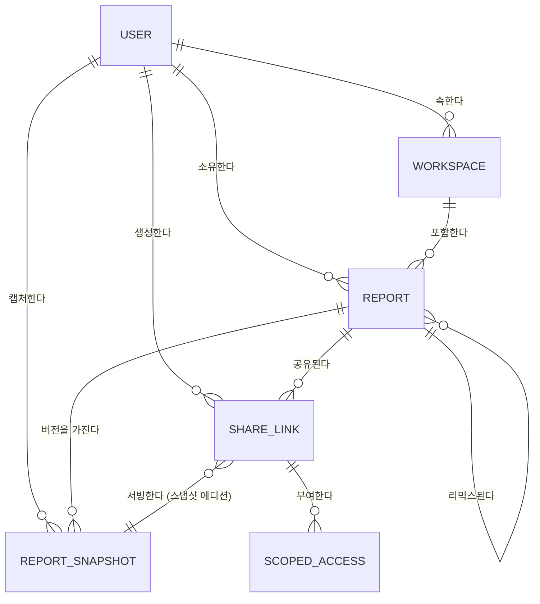

# 엔티티 모델

공유 가능한 리포트 아티팩트를 위한 엔티티: 에디션/역할 권한을 담은 공유
링크, 불변 리포트 스냅샷, 스코프 에이전트 접근, 리믹스 계보.

기존 플랫폼 엔티티(`USER`, `DASHBOARD` — 리포트, `WIDGET`, `DATASET`,
`DATABASE` — 데이터 소스)는 관계 앵커로만 포함하며, 전체 정의는 코드베이스에
있다.

## ER 다이어그램

### USER

리포트를 작성하고, 공유 링크를 만들고, 작업공간을 소유하는 로그인 계정. 기존 엔티티 — 관계 앵커로 표기.

| 속성 | 설명 | 데이터 타입 | 길이/정밀도 | 검증 규칙 |
|------|------|-------------|-------------|-----------|
| id | 고유 식별자 | Long | 19 | Primary Key, Sequence |
| userId | 로그인 식별자 | String | 50 | Not Null, Unique |

### WORKSPACE

리포트의 소유 경계이자 모든 리믹스의 목적지.

| 속성 | 설명 | 데이터 타입 | 길이/정밀도 | 검증 규칙 |
|------|------|-------------|-------------|-----------|
| id | 고유 식별자 | Long | 19 | Primary Key, Sequence |
| name | 작업공간 표시명 | String | 100 | Not Null |
| ownerId | 소유 사용자 | Long | 19 | Not Null, Foreign Key (USER.id) |

### REPORT

데이터셋에 바인딩된 위젯의 이름 있는 모음 — 공유 가능한 분석의 단위. 기존 `dashboard` 엔티티를 확장한다.

| 속성 | 설명 | 데이터 타입 | 길이/정밀도 | 검증 규칙 |
|------|------|-------------|-------------|-----------|
| id | 고유 식별자 | Long | 19 | Primary Key, Sequence |
| title | 리포트 제목 | String | 200 | Not Null |
| layout | 위젯 배치 정의 | String | 10000 | Not Null |
| workspaceId | 소유 작업공간 | Long | 19 | Not Null, Foreign Key (WORKSPACE.id) |
| remixedFromId | 리믹스인 경우 원본 리포트 | Long | 19 | Optional, Foreign Key (REPORT.id) |
| remixedFromVersion | 리믹스 시점의 원본 스냅샷 버전 | Integer | 10 | Optional |

### SHARE_LINK

에디션 모드, 역할, 리믹스 허용, 만료일을 담은 리포트 외부 접근 권한. 기존 `dashboard_share` 엔티티(uuid, shareToken, shareYn, endDate 유지)를 확장한다.

| 속성 | 설명 | 데이터 타입 | 길이/정밀도 | 검증 규칙 |
|------|------|-------------|-------------|-----------|
| id | 고유 식별자 | Long | 19 | Primary Key, Sequence |
| uuid | 공개 URL 키 | String | 64 | Not Null, Unique |
| shareToken | 링크와 함께 제시되는 접근 비밀값 | String | 300 | Optional |
| reportId | 공유된 리포트 | Long | 19 | Not Null, Foreign Key (REPORT.id) |
| createdById | 링크를 만든 작성자 | Long | 19 | Not Null, Foreign Key (USER.id) |
| mode | 링크가 서빙하는 에디션 | String | 10 | Not Null, Values: Live, Snapshot |
| role | 수신자에게 부여되는 권한 | String | 10 | Not Null, Values: Viewer, Editor |
| remixAllowed | 수신자의 리믹스 허용 여부 | Boolean | 1 | Not Null |
| snapshotId | 스냅샷 에디션이 서빙하는 버전 | Long | 19 | Optional, Foreign Key (REPORT_SNAPSHOT.id) |
| shareYn | 링크 활성 여부 | String | 1 | Not Null, Values: Y, N |
| expiresAt | 만료일(설정된 경우) | DateTime | - | Optional |

**제약:** `mode`가 `Snapshot`이면 `snapshotId`가 필수다. 익명 접근을 부여하는 링크는 `mode` = `Snapshot`이고 `role` = `Viewer`여야 한다.

### REPORT_SNAPSHOT

리포트의 불변 동결 캡처 — 저장된 위젯 결과, 차트 옵션, 레이아웃 — 스냅샷 에디션을 서빙하고 버전 이력을 이룬다.

| 속성 | 설명 | 데이터 타입 | 길이/정밀도 | 검증 규칙 |
|------|------|-------------|-------------|-----------|
| id | 고유 식별자 | Long | 19 | Primary Key, Sequence |
| reportId | 스냅샷이 속한 리포트 | Long | 19 | Not Null, Foreign Key (REPORT.id) |
| version | 리포트 내 순번 버전 | Integer | 10 | Not Null, Min: 1, Max: 999999 |
| payload | 저장된 위젯 결과, 옵션, 레이아웃 | String | 5000000 | Not Null |
| truncatedWidgetIds | 캡처 한계로 잘린 위젯 | String | 1000 | Optional |
| failedWidgetIds | 캡처 중 오류로 표시된 위젯 | String | 1000 | Optional |
| capturedById | 스냅샷을 캡처한 사용자 | Long | 19 | Not Null, Foreign Key (USER.id) |
| capturedAt | 캡처 시각 | DateTime | - | Not Null |

**제약:** `reportId + version`은 고유하다. 스냅샷은 삽입 후 절대 갱신되지 않는다.

### SCOPED_ACCESS

하나의 공유 링크에 바인딩된 스코프 권한 — AI 에이전트에게 그 링크의 리포트와 에디션에 대한 정해진 도구 표면을 부여한다.

| 속성 | 설명 | 데이터 타입 | 길이/정밀도 | 검증 규칙 |
|------|------|-------------|-------------|-----------|
| id | 고유 식별자 | Long | 19 | Primary Key, Sequence |
| shareLinkId | 이 접근이 파생된 공유 링크 | Long | 19 | Not Null, Foreign Key (SHARE_LINK.id) |
| tokenHash | 접근 비밀값의 저장 검증 해시 | String | 128 | Not Null, Unique |
| principalId | 이 접근이 대리하는 로그인 사용자 | Long | 19 | Optional, Foreign Key (USER.id) |
| permittedTools | 부여된 도구 표면(조회, 질의, 리믹스, 수정) | String | 500 | Not Null |
| issuedAt | 권한 생성 시각 | DateTime | - | Not Null |
| expiresAt | 권한 만료 — 링크 만료가 상한 | DateTime | - | Optional |
| revokedAt | 철회 시각(철회된 경우) | DateTime | - | Optional |
| lastUsedAt | 가장 최근 성공 도구 호출 | DateTime | - | Optional |

**제약:** 부모 `SHARE_LINK`가 활성이고 만료되지 않은 동안에만 접근이 유효하다. `expiresAt`은 부모 링크의 `expiresAt`을 넘을 수 없다.

### ACCESS_AUDIT

모든 스코프 도구 호출의 책임 추적 기록.

| 속성 | 설명 | 데이터 타입 | 길이/정밀도 | 검증 규칙 |
|------|------|-------------|-------------|-----------|
| id | 고유 식별자 | Long | 19 | Primary Key, Sequence |
| scopedAccessId | 호출에 사용된 권한 | Long | 19 | Not Null, Foreign Key (SCOPED_ACCESS.id) |
| toolName | 호출된 도구 | String | 100 | Not Null |
| outcome | 호출 결과 | String | 20 | Not Null, Values: Success, Denied, Error |
| calledAt | 호출 시각 | DateTime | - | Not Null |
