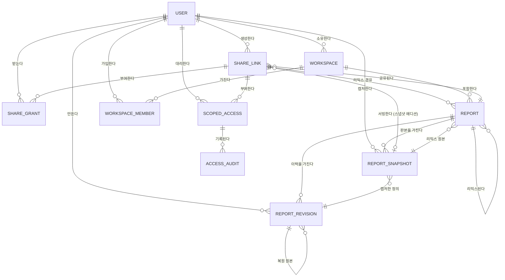

# 엔티티 모델

공유 가능한 리포트 아티팩트를 위한 엔티티: 에디션/역할 권한을 담은 공유
링크, 불변 리포트 스냅샷, 스코프 에이전트 접근, 리믹스 계보.

기존 플랫폼 엔티티(`USER`, `DASHBOARD` — 리포트, `WIDGET`, `DATASET`,
`DATABASE` — 데이터 소스)는 관계 앵커로만 포함하며, 전체 정의는 코드베이스에
있다.

## ER 다이어그램

### USER

리포트를 작성하고, 공유 링크를 만들고, 작업공간을 소유하는 로그인 계정. 기존 엔티티 — 관계 앵커로 표기.

| 속성 | 설명 | 데이터 타입 | 길이/정밀도 | 검증 규칙 |
|------|------|-------------|-------------|-----------|
| id | 고유 식별자 | Long | 19 | Primary Key, Sequence |
| userId | 로그인 식별자 | String | 50 | Not Null, Unique |

### WORKSPACE

리포트의 소유 경계이자 모든 리믹스의 목적지. `ownerId`의 소유와
`WORKSPACE_MEMBER`의 멤버십은 구분된다.

| 속성 | 설명 | 데이터 타입 | 길이/정밀도 | 검증 규칙 |
|------|------|-------------|-------------|-----------|
| id | 고유 식별자 | Long | 19 | Primary Key, Sequence |
| name | 작업공간 표시명 | String | 100 | Not Null |
| ownerId | 소유 사용자 | Long | 19 | Not Null, Foreign Key (USER.id) |

### WORKSPACE_MEMBER

작업공간의 멤버십 기록 — 소유(`WORKSPACE.ownerId`)와 별개로, 카탈로그 노출과
접근 판정에서 사용자의 작업공간 소속을 증명한다.

| 속성 | 설명 | 데이터 타입 | 길이/정밀도 | 검증 규칙 |
|------|------|-------------|-------------|-----------|
| id | 고유 식별자 | Long | 19 | Primary Key, Sequence |
| workspaceId | 소속 작업공간 | Long | 19 | Not Null, Foreign Key (WORKSPACE.id) |
| userId | 멤버 사용자 | Long | 19 | Not Null, Foreign Key (USER.id) |
| joinedAt | 가입 시각 | DateTime | - | Not Null |

**제약:** `workspaceId + userId`는 고유하다.

### REPORT

데이터셋에 바인딩된 위젯의 이름 있는 모음 — 공유 가능한 분석의 단위. 기존 `dashboard` 엔티티를 확장한다.

| 속성 | 설명 | 데이터 타입 | 길이/정밀도 | 검증 규칙 |
|------|------|-------------|-------------|-----------|
| id | 고유 식별자 | Long | 19 | Primary Key, Sequence |
| title | 리포트 제목 | String | 200 | Not Null |
| layout | 위젯 배치 정의 | String | 10000 | Not Null |
| workspaceId | 소유 작업공간 | Long | 19 | Not Null, Foreign Key (WORKSPACE.id) |
| currentRevisionNo | 현재 상태인 리비전 번호 | Integer | 10 | Not Null, Min: 1, Max: 999999 |
| remixedFromId | 리믹스인 경우 원본 리포트 | Long | 19 | Optional |
| remixedFromRevisionNo | 리믹스 시점의 원본 리비전 번호 | Integer | 10 | Optional |
| remixedFromSnapshotId | 리믹스 시점의 원본 스냅샷(있는 경우) | Long | 19 | Optional |
| remixedFromShareLinkId | 리믹스에 사용된 공유 링크 | Long | 19 | Optional |

**제약:** `currentRevisionNo`는 같은 리포트의 `REPORT_REVISION.revisionNo`를
가리킨다. `remixedFromId`는 `REPORT.id`, `remixedFromSnapshotId`는
`REPORT_SNAPSHOT.id`, `remixedFromShareLinkId`는 `SHARE_LINK.id`를 참조하며
리믹스 사본에서만 채워진다. 리믹스 사본은 `remixedFromShareLinkId`로
공유 범위의 출처를 추론할 수 있어야 한다.

### REPORT_REVISION

리포트 정의의 불변 이력 항목 — 생성·저장·리믹스·복원 때마다 제목, 레이아웃,
위젯과 데이터셋 바인딩의 전체 정의가 새 리비전으로 기록되고 이전 리비전은
모두 보존된다.

| 속성 | 설명 | 데이터 타입 | 길이/정밀도 | 검증 규칙 |
|------|------|-------------|-------------|-----------|
| id | 고유 식별자 | Long | 19 | Primary Key, Sequence |
| reportId | 리비전이 속한 리포트 | Long | 19 | Not Null, Foreign Key (REPORT.id) |
| revisionNo | 리포트 내 순번 리비전 | Integer | 10 | Not Null, Min: 1, Max: 999999 |
| definition | 제목, 레이아웃, 위젯, 데이터셋 바인딩의 전체 정의 | String | 5000000 | Not Null |
| materializedResults | 리믹스로 상속된 동결 위젯 결과(있는 경우) | String | 5000000 | Optional |
| kind | 리비전을 만든 행위 | String | 10 | Not Null, Values: Create, Save, Remix, Restore |
| restoredFromRevisionId | 복원인 경우 원본 리비전 | Long | 19 | Optional |
| carriesSourceData | 원본 스냅샷 데이터를 물려받았는지 | Boolean | 1 | Not Null |
| createdById | 리비전을 만든 사용자 | Long | 19 | Not Null, Foreign Key (USER.id) |
| createdAt | 리비전 생성 시각 | DateTime | - | Not Null |

**제약:** `reportId + revisionNo`는 고유하다. 리비전은 삽입 후 절대
갱신되지 않는다. `restoredFromRevisionId`는 같은 리포트의
`REPORT_REVISION.id`만 참조한다. `materializedResults`는 스냅샷 리믹스가
동결 결과를 복사한 곳으로, 원본 데이터 소스나 링크 없이도 리비전을
렌더링하게 한다 — 바이트 한계는 스냅샷 페이로드 한계(NFR-004)와 같다.
`carriesSourceData`는 `materializedResults`에 상속된 결과와 상속 바인딩이
모두 수신자 소유 데이터로 교체될 때까지 이후 리비전에도 참으로
유지된다. `carriesSourceData`가 참인 리비전이 현재인 리포트는 새 공유
링크를 발행할 수 없다 — 단, 상속 데이터의 원본 링크 공개 범위가 캡처
시점에 Public이었던 경우 Public 뷰어 스냅샷 링크만 허용된다.

### SHARE_LINK

에디션 모드, 역할, 리믹스 허용, 만료일을 담은 리포트 외부 접근 권한. 기존 `dashboard_share` 엔티티(uuid, shareToken, shareYn, endDate 유지)를 확장한다.

| 속성 | 설명 | 데이터 타입 | 길이/정밀도 | 검증 규칙 |
|------|------|-------------|-------------|-----------|
| id | 고유 식별자 | Long | 19 | Primary Key, Sequence |
| uuid | 공개 URL 키 | String | 64 | Not Null, Unique |
| shareToken | 링크와 함께 제시되는 접근 비밀값 | String | 300 | Optional |
| reportId | 공유된 리포트 | Long | 19 | Not Null, Foreign Key (REPORT.id) |
| createdById | 링크를 만든 작성자 | Long | 19 | Not Null, Foreign Key (USER.id) |
| mode | 링크가 서빙하는 에디션 | String | 10 | Not Null, Values: Live, Snapshot |
| role | 수신자에게 부여되는 권한 | String | 10 | Not Null, Values: Viewer, Editor |
| audience | 접근이 허용되는 수신자 범위 | String | 15 | Not Null, Values: Public, Authenticated |
| remixAllowed | 수신자의 리믹스 허용 여부 | Boolean | 1 | Not Null |
| snapshotId | 스냅샷 에디션이 서빙하는 판본 | Long | 19 | Optional |
| shareYn | 링크 활성 여부 | String | 1 | Not Null, Values: Y, N |
| endDate | 만료일(설정된 경우) | DateTime | - | Optional |

**제약:** `mode`가 `Snapshot`이면 `snapshotId`가 필수고, `mode`가 `Live`이면
`snapshotId`는 비어 있어야 한다. `snapshotId`는 `REPORT_SNAPSHOT.id`를
참조하며 같은 `reportId`의 리포트에 속한 판본만 가리킨다 — 발급 후 절대
다른 판본으로 재지정되지 않는다. `audience`가 `Public`이면 `mode` =
`Snapshot`이고 `role` = `Viewer`여야 한다. `role`이 `Editor`이면 `mode` =
`Live`이고 `audience` = `Authenticated`여야 한다. 기존 `dashboard_share`의
만료 기록(`endDate`)은 그대로 유지된다. 활성 레거시 익명 라이브 링크는
같은 URL과 라이브 DB 콘텐츠를 유지하되 `audience` = `Authenticated`,
`role` = `Viewer`, `mode` = `Live`로 이전된다 — 익명 라이브 접근이나
공개 스냅샷 자동 전환은 없다. 만료·철회된 링크와 오래된 캐시·토큰은
부활하지 않으며, `SHARE_GRANT`는 인증된 접근에서만 기록되고 스코프 토큰은
자동 발급되지 않는다.

### REPORT_SNAPSHOT

리포트의 불변 동결 캡처 — 저장된 위젯 결과, 차트 옵션, 레이아웃 — 스냅샷 에디션을 서빙하고 버전 이력을 이룬다.

| 속성 | 설명 | 데이터 타입 | 길이/정밀도 | 검증 규칙 |
|------|------|-------------|-------------|-----------|
| id | 고유 식별자 | Long | 19 | Primary Key, Sequence |
| reportId | 스냅샷이 속한 리포트 | Long | 19 | Not Null, Foreign Key (REPORT.id) |
| version | 리포트 내 순번 판본 | Integer | 10 | Not Null, Min: 1, Max: 999999 |
| sourceRevisionId | 캡처 시점의 현재 리비전 | Long | 19 | Not Null, Foreign Key (REPORT_REVISION.id) |
| payload | 저장된 위젯 결과, 옵션, 레이아웃 | String | 5000000 | Not Null |
| truncatedWidgetIds | 캡처 한계로 잘린 위젯 | String | 1000 | Optional |
| failedWidgetIds | 캡처 중 오류로 표시된 위젯 | String | 1000 | Optional |
| capturedById | 스냅샷을 캡처한 사용자 | Long | 19 | Not Null, Foreign Key (USER.id) |
| capturedAt | 캡처 시각 | DateTime | - | Not Null |

**제약:** `reportId + version`은 고유하며 `version`은 리비전 번호와 독립된
스냅샷 순번이다. `sourceRevisionId`는 같은 `reportId`의 `REPORT_REVISION`만
가리킨다. 스냅샷은 삽입 후 절대 갱신되지 않는다. 적어도 하나의
위젯이 성공적으로 캡처된 경우에만 스냅샷이 생성된다 — 모든 위젯이 실패하면
스냅샷은 저장되지 않는다. `payload`의 직렬화 크기가 저장 한계를 넘으면
캡처 전체가 거부된다.

### SHARE_GRANT

로그인 수신자가 공유 링크를 처음 열 때 기록되는 명시적 접근 권한 부여 —
접근 가능 아티팩트 카탈로그(UC-011)와 쓰기 전 재확인의 근거가 된다.

| 속성 | 설명 | 데이터 타입 | 길이/정밀도 | 검증 규칙 |
|------|------|-------------|-------------|-----------|
| id | 고유 식별자 | Long | 19 | Primary Key, Sequence |
| shareLinkId | 권한이 파생된 공유 링크 | Long | 19 | Not Null, Foreign Key (SHARE_LINK.id) |
| userId | 권한을 받은 수신자 | Long | 19 | Not Null, Foreign Key (USER.id) |
| grantedAt | 권한 기록 시각 | DateTime | - | Not Null |
| revokedAt | 권한 무효화 시각(무효화된 경우) | DateTime | - | Optional |

**제약:** `shareLinkId + userId`는 고유하다. 부모 `SHARE_LINK`가 철회되거나
만료되면 그랜트는 즉시 무효가 되며 카탈로그와 접근 판정에서 제외된다.
그랜트는 링크가 공유한 리포트와 그 리포트에 연결된 데이터셋에만 적용된다 —
임의의 데이터 접근을 부여하지 않는다. 그랜트는 작업공간 멤버십의 증거가
아니다 — 멤버십은 `WORKSPACE_MEMBER`로만 판정한다.

### SCOPED_ACCESS

하나의 공유 링크에 바인딩된 스코프 권한 — AI 에이전트에게 그 링크의 리포트와 에디션에 대한 정해진 도구 표면을 부여한다.

| 속성 | 설명 | 데이터 타입 | 길이/정밀도 | 검증 규칙 |
|------|------|-------------|-------------|-----------|
| id | 고유 식별자 | Long | 19 | Primary Key, Sequence |
| shareLinkId | 이 접근이 파생된 공유 링크 | Long | 19 | Not Null, Foreign Key (SHARE_LINK.id) |
| tokenHash | 접근 비밀값의 저장 검증 해시 | String | 128 | Not Null, Unique |
| principalId | 이 접근이 대리하는 로그인 사용자 | Long | 19 | Optional |
| permittedTools | 부여된 도구 표면(조회, 질의, 리믹스, 수정) | String | 500 | Not Null |
| issuedAt | 권한 생성 시각 | DateTime | - | Not Null |
| expiresAt | 권한 만료 — 링크 만료가 상한 | DateTime | - | Optional |
| revokedAt | 철회 시각(철회된 경우) | DateTime | - | Optional |
| lastUsedAt | 가장 최근 성공 도구 호출 | DateTime | - | Optional |

**제약:** 부모 `SHARE_LINK`가 활성이고 만료되지 않은 동안에만 접근이 유효하다. 부모 링크에 `endDate`가 있으면 `expiresAt`은 그 이하여야 하고, `endDate`가 없으면 상한 없이 선택적이다. `principalId`는 `USER.id`를 참조하며 익명 공개 스냅샷 읽기에 한해 비어 있을 수 있다 — 쓰기, 리믹스, 에이전트 수정 호출에는 반드시 식별된 사용자가 필요하다.

### ACCESS_AUDIT

모든 스코프 도구 호출의 책임 추적 기록.

| 속성 | 설명 | 데이터 타입 | 길이/정밀도 | 검증 규칙 |
|------|------|-------------|-------------|-----------|
| id | 고유 식별자 | Long | 19 | Primary Key, Sequence |
| scopedAccessId | 호출에 사용된 권한(알 수 없는 토큰은 비움) | Long | 19 | Optional |
| tokenFingerprint | 제시된 토큰의 안전한 지문 — 원문 비밀값 아님 | String | 128 | Optional |
| toolName | 호출된 도구 | String | 100 | Not Null |
| outcome | 호출 결과 | String | 20 | Not Null, Values: Success, Denied, Error |
| calledAt | 호출 시각 | DateTime | - | Not Null |

**제약:** `scopedAccessId`는 `SCOPED_ACCESS.id`를 참조한다. 알 수 없는
토큰으로 거부된 호출은 `scopedAccessId`를 비우고 `tokenFingerprint`만
기록한다 — 원문 자격 증명은 절대 저장하지 않는다. 인증 단계에서 거부된
핸드셰이크는 `toolName`에 '토큰 인증 시도' 같은 비밀이 아닌 레이블을
기록하고, 제시된 토큰 원문은 `toolName`에도 기록하지 않는다.
