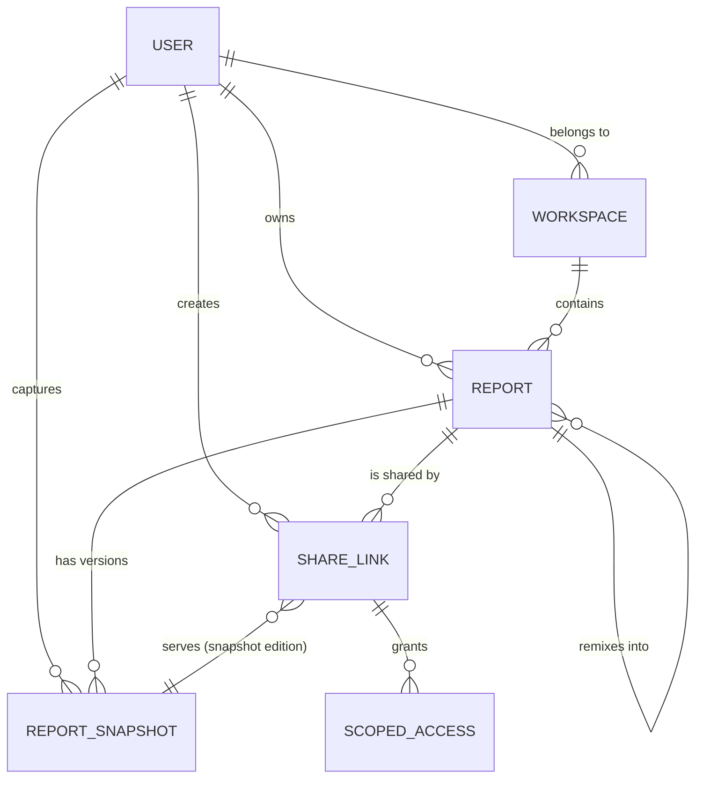

# Entity Model

Entities for shareable report artifacts: share links with edition/role grants,
immutable report snapshots, scoped agent access, and remix lineage.

Existing platform entities (`USER`, `DASHBOARD` — the report, `WIDGET`,
`DATASET`, `DATABASE` — the data source) are included only as relationship
anchors; their full definitions live in the codebase.

## Entity Relationship Diagram

### USER

A signed-in account that authors reports, creates share links, and owns a workspace. Existing entity — listed as a relationship anchor.

| Attribute | Description          | Data Type | Length/Precision | Validation Rules      |
|-----------|----------------------|-----------|------------------|-----------------------|
| id        | Unique identifier    | Long      | 19               | Primary Key, Sequence |
| userId    | Sign-in identifier   | String    | 50               | Not Null, Unique      |

### WORKSPACE

The ownership boundary for reports and the destination of every remix.

| Attribute | Description              | Data Type | Length/Precision | Validation Rules              |
|-----------|--------------------------|-----------|------------------|-------------------------------|
| id        | Unique identifier        | Long      | 19               | Primary Key, Sequence         |
| name      | Workspace display name   | String    | 100              | Not Null                      |
| ownerId   | Owning user              | Long      | 19               | Not Null, Foreign Key (USER.id) |

### REPORT

A named collection of widgets bound to datasets — the shareable unit of analysis. Extends the existing `dashboard` entity.

| Attribute     | Description                          | Data Type | Length/Precision | Validation Rules                     |
|---------------|--------------------------------------|-----------|------------------|--------------------------------------|
| id            | Unique identifier                    | Long      | 19               | Primary Key, Sequence                |
| title         | Report title                         | String    | 200              | Not Null                             |
| layout        | Widget arrangement definition        | String    | 10000            | Not Null                             |
| workspaceId   | Owning workspace                     | Long      | 19               | Not Null, Foreign Key (WORKSPACE.id) |
| remixedFromId | Source report when this is a remix   | Long      | 19               | Optional, Foreign Key (REPORT.id)    |
| remixedFromVersion | Source snapshot version at remix time | Integer | 10             | Optional                             |

### SHARE_LINK

A grant of external access to a report, carrying an edition mode, a role, remix permission, and expiry. Extends the existing `dashboard_share` entity (uuid, shareToken, shareYn, endDate preserved).

| Attribute       | Description                                | Data Type | Length/Precision | Validation Rules                        |
|-----------------|--------------------------------------------|-----------|------------------|-----------------------------------------|
| id              | Unique identifier                          | Long      | 19               | Primary Key, Sequence                   |
| uuid            | Public URL key                             | String    | 64               | Not Null, Unique                        |
| shareToken      | Access secret presented with the link      | String    | 300              | Optional                                |
| reportId        | Shared report                              | Long      | 19               | Not Null, Foreign Key (REPORT.id)       |
| createdById     | Author who created the link                | Long      | 19               | Not Null, Foreign Key (USER.id)         |
| mode            | Edition the link serves                    | String    | 10               | Not Null, Values: Live, Snapshot        |
| role            | Capability granted to the recipient        | String    | 10               | Not Null, Values: Viewer, Editor        |
| remixAllowed    | Whether recipients may remix the report    | Boolean   | 1                | Not Null                                |
| snapshotId      | Served version for snapshot editions       | Long      | 19               | Optional, Foreign Key (REPORT_SNAPSHOT.id) |
| shareYn         | Whether the link is active                 | String    | 1                | Not Null, Values: Y, N                  |
| expiresAt       | Expiry date, if set                        | DateTime  | -                | Optional                                |

**Constraints:** When `mode` is `Snapshot`, `snapshotId` is required. A link granting anonymous access must have `mode` = `Snapshot` and `role` = `Viewer`.

### REPORT_SNAPSHOT

An immutable frozen capture of a report — stored widget results, chart options, and layout — that serves snapshot editions and forms the version history.

| Attribute       | Description                                  | Data Type | Length/Precision | Validation Rules                   |
|-----------------|----------------------------------------------|-----------|------------------|------------------------------------|
| id              | Unique identifier                            | Long      | 19               | Primary Key, Sequence              |
| reportId        | Report this snapshot belongs to              | Long      | 19               | Not Null, Foreign Key (REPORT.id)  |
| version         | Ordinal version within the report            | Integer   | 10               | Not Null, Min: 1, Max: 999999      |
| payload         | Stored widget results, options, and layout   | String    | 5000000          | Not Null                           |
| truncatedWidgetIds | Widgets whose stored rows hit the capture limit | String | 1000          | Optional                           |
| failedWidgetIds | Widgets marked with an error during capture  | String    | 1000             | Optional                           |
| capturedById    | User who captured the snapshot               | Long      | 19               | Not Null, Foreign Key (USER.id)    |
| capturedAt      | Moment the snapshot was taken                | DateTime  | -                | Not Null                           |

**Constraints:** `reportId + version` is unique. Snapshots are never updated after insert.

### SCOPED_ACCESS

A scoped grant bound to one share link, giving an AI Agent a defined tool surface over that link's report and edition.

| Attribute        | Description                                  | Data Type | Length/Precision | Validation Rules                          |
|------------------|----------------------------------------------|-----------|------------------|-------------------------------------------|
| id               | Unique identifier                            | Long      | 19               | Primary Key, Sequence                     |
| shareLinkId      | Share link this access derives from          | Long      | 19               | Not Null, Foreign Key (SHARE_LINK.id)     |
| tokenHash        | Stored verification hash of the access secret | String   | 128              | Not Null, Unique                          |
| principalId      | Signed-in user the access acts for           | Long      | 19               | Optional, Foreign Key (USER.id)           |
| permittedTools   | Tool surface granted (inspect, query, remix, update) | String | 500        | Not Null                                  |
| issuedAt         | Grant creation time                          | DateTime  | -                | Not Null                                  |
| expiresAt        | Grant expiry — bounded by the link's expiry  | DateTime  | -                | Optional                                  |
| revokedAt        | Revocation moment, if withdrawn              | DateTime  | -                | Optional                                  |
| lastUsedAt       | Most recent successful tool call             | DateTime  | -                | Optional                                  |

**Constraints:** Access is valid only while its parent `SHARE_LINK` is active and unexpired. `expiresAt` must not exceed the parent link's `expiresAt`.

### ACCESS_AUDIT

The accountability trail of every scoped tool call.

| Attribute       | Description                                  | Data Type | Length/Precision | Validation Rules                            |
|-----------------|----------------------------------------------|-----------|------------------|---------------------------------------------|
| id              | Unique identifier                            | Long      | 19               | Primary Key, Sequence                       |
| scopedAccessId  | Grant used for the call                      | Long      | 19               | Not Null, Foreign Key (SCOPED_ACCESS.id)    |
| toolName        | Invoked tool                                 | String    | 100              | Not Null                                    |
| outcome         | Call result                                  | String    | 20               | Not Null, Values: Success, Denied, Error    |
| calledAt        | Call timestamp                               | DateTime  | -                | Not Null                                    |
