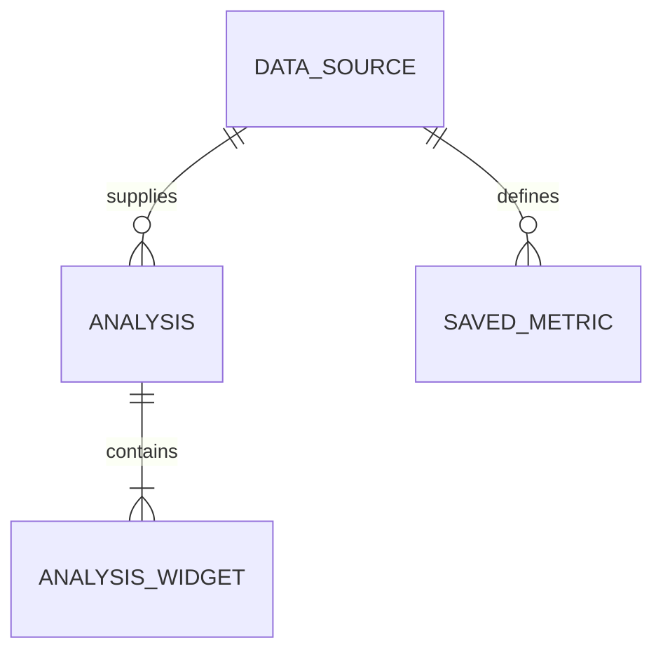
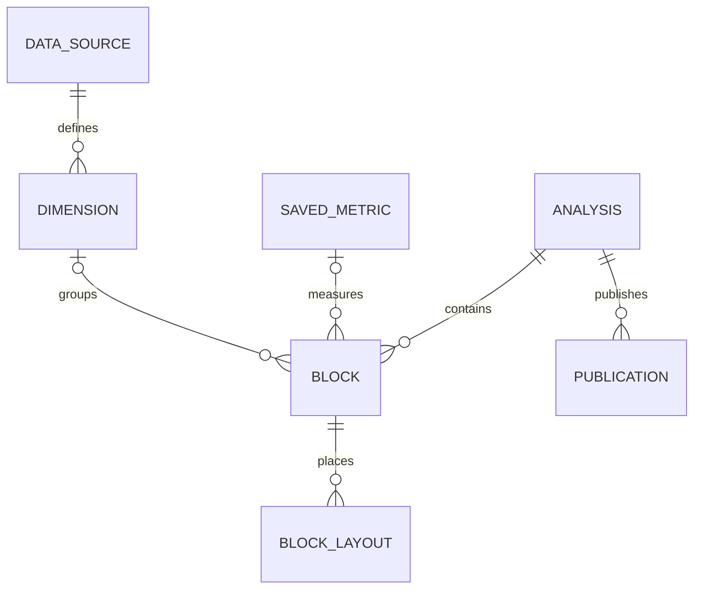

# Entity Model

UC-001~004의 현재 논리 모델과 UC-005의 목표 논리 모델을 구분하며 신규 DB 테이블 생성 명령이 아니다. 기존 JSON 위젯 정의에 포함된 지표 정의를 독립 지표 엔티티로 이미 구현했다고 주장하지 않는다.

## Entity Relationship Diagram

### DATA_SOURCE

분석 원본과 버전의 기준이다.

| Attribute | Description    | Data Type | Length/Precision | Validation Rules      |
| --------- | -------------- | --------- | ---------------- | --------------------- |
| id        | 원본 식별자    | Long      | 19               | Primary Key, Sequence |
| revision  | 게시 원본 버전 | String    | 128              | Not Null              |

### ANALYSIS

저장된 분석 정의다.

| Attribute  | Description           | Data Type | Length/Precision | Validation Rules                       |
| ---------- | --------------------- | --------- | ---------------- | -------------------------------------- |
| id         | 분석 식별자           | Long      | 19               | Primary Key, Sequence                  |
| databaseId | 데이터 소스           | Long      | 19               | Not Null, Foreign Key (DATA_SOURCE.id) |
| title      | 제목                  | String    | 300              | Not Null                               |
| revision   | 저장 충돌 검사용 버전 | String    | 128              | Optional                               |

### ANALYSIS_WIDGET

지표 계산과 차트 표시를 담은 기존 정의다.

| Attribute     | Description    | Data Type | Length/Precision | Validation Rules                    |
| ------------- | -------------- | --------- | ---------------- | ----------------------------------- |
| id            | 논리 식별자    | Long      | 19               | Primary Key                         |
| analysisId    | 분석 참조      | Long      | 19               | Not Null, Foreign Key (ANALYSIS.id) |
| type          | 표시 유형      | String    | 50               | Not Null                            |
| expression    | 지표 계산 정의 | String    | 500              | Not Null                            |
| decimalPlaces | 표시 정밀도    | Integer   | 10               | Optional                            |

**Constraints:** 실제 위젯은 analysisDefinition.widgets의 배열 항목이다. 시계열은 저장 정의의 별도 위젯이 아닌 현재 조회 조건으로 계산한 파생 결과다. 미리보기의 조회 결과를 저장 정의에 복사하지 않는다.

### SAVED_METRIC

기존 Metric.definition에 저장된 버전이 있는 구조화 계산 정의다. UC-002 생성 시 선택 참조되고 분석에는 SQL snapshot이 저장된다. live FK가 새로 생성되는 것은 아니다.

| Attribute  | Description                                         | Data Type | Length/Precision | Validation Rules                       |
| ---------- | --------------------------------------------------- | --------- | ---------------- | -------------------------------------- |
| id         | 지표 ID                                             | Long      | 19               | Primary Key, Sequence                  |
| databaseId | 원본 참조                                           | Long      | 19               | Not Null, Foreign Key (DATA_SOURCE.id) |
| definition | schemaVersion·label·aggregation·column 등 기존 정의 | String    | 10000            | Not Null                               |
| useYn      | 활성 여부                                           | String    | 1                | Not Null, Values: Y, N                 |

UC-003은 기존 Metric.definition의 definitionVersion(양의 정수)을 증가시키며 선택 분석 SQL snapshot과 atomic 저장한다. live FK/전체 자동 전파는 추가하지 않는다.

UC-004은 기존 structuredDefinition의 sourceId/metricId와 widget index 연결을 사용한다. 미연결 raw AI는 명시 선택 저장부터 metric-linked-analysis JSON snapshot을 기록한다. 같은 지표의 선택 분석들을 하나의 transaction에서 갱신한다.

## UC-005 Target Model

아래는 목표 모델이며 미구현이다. ANALYSIS는 제품의 Dashboard에 해당한다. 기존 ANALYSIS_WIDGET/Metric/JSON/layout에서 버전 있는 adapter로 전환하고 데이터 삭제·테이블 일괄 신설은 하지 않는다. 자세한 계약은 [통합 설계](architecture/prompt-to-dashboard.md)이다.

### DIMENSION

소스 열을 재사용 가능한 분류 기준으로 정의한다.

| Attribute  | Description                   | Data Type | Length/Precision | Validation Rules                       |
| ---------- | ----------------------------- | --------- | ---------------- | -------------------------------------- |
| id         | 논리 ID                       | String    | 128              | Primary Key                            |
| sourceId   | 원본 참조                     | Long      | 19               | Not Null, Foreign Key (DATA_SOURCE.id) |
| definition | 열/타입/표시/시간 의미와 버전 | String    | 10000            | Not Null                               |

### BLOCK

대시보드 내용과 표시를 안정적 ID로 식별한다.

| Attribute  | Description                 | Data Type | Length/Precision | Validation Rules                    |
| ---------- | --------------------------- | --------- | ---------------- | ----------------------------------- |
| id         | 안정적 ID                   | String    | 128              | Primary Key                         |
| analysisId | 소유 대시보드               | Long      | 19               | Not Null, Foreign Key (ANALYSIS.id) |
| kind       | 숫자/차트/표/설명/필터      | String    | 50               | Not Null                            |
| definition | 지표·차원 참조/버전 및 표시 | String    | 10000            | Not Null                            |

**Constraints:** 여러 지표/차원 참조는 definition의 목록으로 검증한다. ER의 optional 연결은 한 개 필수 참조를 강제하지 않는다. SQL snapshot은 기존 실행 호환용이며 논리 ID는 DB widget 재생성으로 바뀌지 않는다.

### BLOCK_LAYOUT

breakpoint마다 블록의 grid 위치와 크기를 저장한다.

| Attribute  | Description              | Data Type | Length/Precision | Validation Rules                 |
| ---------- | ------------------------ | --------- | ---------------- | -------------------------------- |
| id         | block/breakpoint 논리 키 | String    | 256              | Primary Key                      |
| blockId    | 대상 블록                | String    | 128              | Not Null, Foreign Key (BLOCK.id) |
| breakpoint | 표시 폭 구간             | String    | 50               | Not Null                         |
| geometry   | x/y/w/h 및 제약          | String    | 1000             | Not Null                         |

### PUBLICATION

초안과 분리된 게시 정의 및 데이터 범위를 관리한다.

| Attribute  | Description                       | Data Type | Length/Precision | Validation Rules                    |
| ---------- | --------------------------------- | --------- | ---------------- | ----------------------------------- |
| id         | 게시 ID                           | String    | 128              | Primary Key                         |
| analysisId | 원본 분석                         | Long      | 19               | Not Null, Foreign Key (ANALYSIS.id) |
| version    | 게시 버전                         | Integer   | 10               | Not Null, Min: 1, Max: 2147483647   |
| definition | 검증된 정의 snapshot              | String    | 100000           | Not Null                            |
| dataPolicy | snapshot/live 및 데이터 시점/조건 | String    | 10000            | Not Null                            |
| visibility | 계정 내부/링크                    | String    | 50               | Not Null                            |
| revoked    | 조회 중지                         | Boolean   | 1                | Not Null                            |

**Constraints:** 게시 데이터는 별도 결과 저장소 참조로 보존할 수 있다. 용량/만료/URL 버전 정책은 P4 상세 설계에서 정한다. 대화/작업 이력은 dashboardId/revision/requestId에 연결하는 서비스 책임이며 지금 새 DB 엔티티로 확정하지 않는다.

UC-006 현재 구현: analysisDefinition.widgets.blockId는 안정적 String 식별자이며 기존 layout/mapping은 DB widget 위치를 유지한다. blockLayouts는 서버가 읽어 반환하는 파생 표시 정보이며 클라이언트 쓰기 권한이 아니다. Block/Layout 전체 목표와 breakpoint별 편집은 미완료다.
