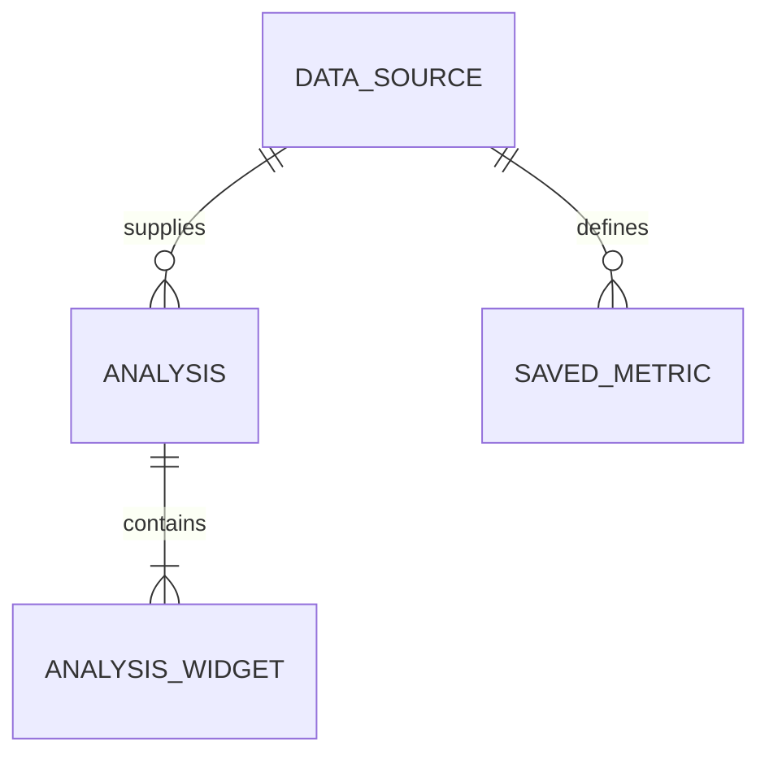

# Entity Model

이번 범위의 논리 모델이며 신규 DB 테이블 생성 설계가 아니다. 기존 JSON 위젯 정의에 포함된 지표 정의를 독립 지표 엔티티로 이미 구현했다고 주장하지 않는다.

## Entity Relationship Diagram

### DATA_SOURCE

분석 원본과 버전의 기준이다.

| Attribute | Description    | Data Type | Length/Precision | Validation Rules      |
| --------- | -------------- | --------- | ---------------- | --------------------- |
| id        | 원본 식별자    | Long      | 19               | Primary Key, Sequence |
| revision  | 게시 원본 버전 | String    | 128              | Not Null              |

### ANALYSIS

저장된 분석 정의다.

| Attribute  | Description           | Data Type | Length/Precision | Validation Rules                       |
| ---------- | --------------------- | --------- | ---------------- | -------------------------------------- |
| id         | 분석 식별자           | Long      | 19               | Primary Key, Sequence                  |
| databaseId | 데이터 소스           | Long      | 19               | Not Null, Foreign Key (DATA_SOURCE.id) |
| title      | 제목                  | String    | 300              | Not Null                               |
| revision   | 저장 충돌 검사용 버전 | String    | 128              | Optional                               |

### ANALYSIS_WIDGET

지표 계산과 차트 표시를 담은 기존 정의다.

| Attribute     | Description    | Data Type | Length/Precision | Validation Rules                    |
| ------------- | -------------- | --------- | ---------------- | ----------------------------------- |
| id            | 논리 식별자    | Long      | 19               | Primary Key                         |
| analysisId    | 분석 참조      | Long      | 19               | Not Null, Foreign Key (ANALYSIS.id) |
| type          | 표시 유형      | String    | 50               | Not Null                            |
| expression    | 지표 계산 정의 | String    | 500              | Not Null                            |
| decimalPlaces | 표시 정밀도    | Integer   | 10               | Optional                            |

**Constraints:** 실제 위젯은 analysisDefinition.widgets의 배열 항목이다. 시계열은 저장 정의의 별도 위젯이 아닌 현재 조회 조건으로 계산한 파생 결과다. 미리보기의 조회 결과를 저장 정의에 복사하지 않는다.

### SAVED_METRIC

기존 Metric.definition에 저장된 구조화 계산 snapshot이다. UC-002 생성 시 선택 참조되고 분석에는 SQL snapshot이 저장된다. live FK가 새로 생성되는 것은 아니다.

| Attribute  | Description                                         | Data Type | Length/Precision | Validation Rules                       |
| ---------- | --------------------------------------------------- | --------- | ---------------- | -------------------------------------- |
| id         | 지표 ID                                             | Long      | 19               | Primary Key, Sequence                  |
| databaseId | 원본 참조                                           | Long      | 19               | Not Null, Foreign Key (DATA_SOURCE.id) |
| definition | schemaVersion·label·aggregation·column 등 기존 정의 | String    | 10000            | Not Null                               |
| useYn      | 활성 여부                                           | String    | 1                | Not Null, Values: Y, N                 |
