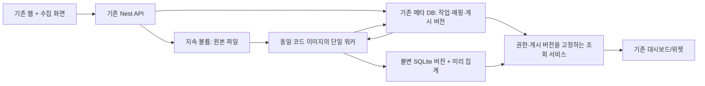

# 웹·워커 수집과 매출·환불 대시보드 MVP 계획

작성: 2026-10-12 KST. 현재 체크아웃의 소스 기준 비교이며 실행 성능·UI 통과를 새로 검증한 보고서는 아니다. 제품 구현·배포는 이번 요청 범위에 포함하지 않는다.

## 목표와 추천

기존 파일/대시보드 기능을 재사용하여, 비개발자가 실제 주문·환불 파일을 반복 업로드하고 같은 계산 기준의 대시보드를 갱신할 수 있게 한다. 최초 고객 가설은 소규모 커머스 운영팀이다. 첫 MVP는 고객사별 격리된 설치/파일럿을 기준으로 한다. 다중 고객 SaaS 출시는 별도 격리 검증을 완료해야 한다.

앞선 [데이터 플랫폼 조사](data-platform-architecture-and-templates.md)의 PostgreSQL 중심 구조는 확장 목표로 유지하되, 최소 MVP에서 메타데이터 DB를 전면 교체하지 않는다. 현재 로컬 SQLite/운영 MySQL을 유지하고, 단일 워커와 불변 SQLite 데이터 버전으로 시작한다. PostgreSQL, Redis 큐, 객체 저장소, 데스크톱 패키징을 동시에 도입하지 않는다.

## 실제 구현과 차이

| 영역 | 소스에서 확인한 현재 상태 | 재사용 / MVP 추가 |
| --- | --- | --- |
| 파일 탐색 | `frontend-web/src/pages/Data/FileAnalysis/index.tsx`: DuckDB-WASM worker, CSV/JSON/Parquet, 로컬 SQL/500행 미리보기. CREATE TABLE로 파일 전체를 적재 | 별도 로컬 엔진을 새로 만들지 않는다. 기존 탐색을 유지하되 새 수집 화면은 서버의 제한된 미리보기 사용. 브라우저 worker가 서버 수집 워커를 대체하지 않음 |
| 파일 저장 | `backend-api/src/database/database.controller.ts`, `database.service.ts`: 50 MiB 제한, 메모리 buffer 파싱, 10만 행 사후 검사, 최초 100행 숫자 추론, 업로드별 SQLite 파일/Database 생성 | 원본 disk 저장 → job 반환 → 워커 스트리밍 파싱으로 분리. 고정 dataset identity·매핑·버전·정확한 금액 타입 추가 |
| 데이터셋 | `dataset/entities/dataset.entity.ts`, `dataset.service.ts`: databaseId+조회 SQL 저장/검증 | 기존 SQL 데이터셋은 유지. 수집 단위인 IngestionSource/PublishedVersion과 구분하여 연결 |
| 메타 DB | `app.module.ts`, `data-source.ts`: local SQLite, 그 외 MySQL. prod synchronize=false. pg 드라이버가 있어도 메타 DB는 PostgreSQL로 설정되지 않음 | 현재 DB용 명시적 마이그레이션 사용. worker/API가 같은 설정을 읽도록 일치시키기 |
| 지표 | `metric.service.ts`: 단일 테이블 집계·그룹·필터. expression은 컬럼 식별자, 임의 수식이나 비율 지원 아님. metric name 전역 unique | 검증/바인딩 원칙 재사용. 첫 템플릿용 고정 계산 함수와 집계 테이블로 객단가·환불 비율 계산; 범용 수식 언어 도입 유보 |
| 템플릿 | `template/entities/template*.entity.ts`: 좌표/크기/추천 차트 등 레이아웃 | 레이아웃 재사용 + 첫 커머스 preset에 필요한 필드/지표 binding. 범용 템플릿 마켓플레이스 유보 |
| 차트/편집 | 기존 Widget/WidgetSetting/DashboardView/Modify | 기존 카드·시계열·막대·표 사용. 변경 데이터셋과 지표를 연결하는 최소 adapter 추가 |
| 진행 표시 | `progress/progress.gateway.ts`: 요청 socket에 쿼리 이벤트 전송 | 영속 job 상태가 아님. MVP job 상태는 HTTP polling; 별도 worker에서 socket relay 구축 유보 |
| 캐시 | `connection/connection.service.ts`: 기본 메모리, 옵션 Redis, DB/config/query 기반 키 | 버전+필터 기반 캐시 또는 MVP 수집 조회는 캐시 비활성. 이전 버전 숫자를 재사용하지 않게 함 |
| AI | `ai/ai.service.ts`: SQL 생성, 차트 추천, 샘플 기반 인사이트. 모델 endpoint 설정 가능, API key 필수. 차트 추천/인사이트에 행 샘플 포함 | 인증된 AI 호출과 컴포넌트 whitelist를 활용. 편집 patch·preview·undo·로컬 실행 경로는 추가 필요. 현재 샘플 인사이트를 전체 데이터 분석이라고 보지 않음 |
| 권한 | Database/Dataset/Metric의 검토한 엔티티에 owner/workspace 없음. JWT 로그인과 일부 dashboard UserMapping 검사 있음 | 로그인과 자원 소유권은 별개. 신규 source/job/version과 연결 조회에 owner 검사 필수. 기존 일반 SQL/DB 접근까지 노출하는 shared SaaS는 격리 보완 후 가능 |

## 후보 구성과 결정

1. **추천: 기존 DB + 단일 워커 + 공유 지속 볼륨 + 버전 SQLite.** 기존 조회 드라이버를 활용하고 신규 인프라를 최소화한다. 단일 호스트·단일 워커라는 운영 한계를 명시한다.
2. **확장: PostgreSQL + 객체 저장소 + 복수 워커.** 독립 확장과 다중 고객 운영에 적합하지만 DB 이전·격리·배포 전환 비용이 더 크다. 부하 측정 또는 공유 SaaS 요구가 확인되면 진행한다.
3. **로컬 제품 우선: DuckDB-WASM/로컬 런타임 + AI 편집 + 선택적 게시.** 단일 사용자 탐색에는 유리하지만 자동 수집·팀 공유·지속 실행·설치/업데이트가 별도 문제다. 본 MVP와 동시에 별도 제품을 만들지 않는다.

워커는 HTTP 서버 없이 필요한 수집 모듈만 부팅하는 별도 entry point다. AppModule 전체를 불러 자동 seed/socket/서버를 중복 기동하지 않는다. 신규 작업은 기존 serverless 요청 처리와 별도로 지속 실행 프로세스를 필요로 한다. 파일럿은 compose의 worker service와 backend 공용 data volume으로 실행한다. 저장소 용량·백업·자원 예산을 명시한다.

큐는 메타 DB job 테이블로 시작한다. 조건부 UPDATE/CAS와 affected row 확인으로 작업을 claim하며 lease/heartbeat·attempt·재시도 시점을 저장한다. SQLite와 MySQL에 같은 잠금 SQL을 억지로 적용하지 않는다. 단일 워커 계약에서 프로세스 재시작 복구를 검증하고, 복수 워커 이전에 큐 라이브러리/잠금 전략을 재평가한다.

## MVP 경계

포함:
- 표준 주문 CSV와 선택적 환불 CSV, 실제 고객 내보내기 형식 2개까지 매핑 지원. UTF-8/UTF-8 BOM, KRW, Asia/Seoul, 단일 매장/채널부터 시작한다.
- 주문은 주문당 1행, 환불은 환불 이벤트당 1행. 상품별 주문 파일은 별도 adapter로 주문 헤더 금액 일치/중복을 검증한 뒤 지원한다.
- 날짜 범위가 명시된 완전 스냅샷 교체. 새 파일은 같은 수집 source로 올리고 매핑을 재사용한다.
- 반복 업로드·중간 실패 복구·오류 행 확인·게시 버전·기간 비교·기존 화면 편집.
- 선택 기능은 누락 여부를 표시한다. 환불 데이터가 없으면 환불/순매출을 완전한 지표라고 보여주지 않는다.

유보:
- 범용 API connector builder, OAuth 다종 연결, XLSX/CP949 등 모든 형식, 다중 통화, 상품별 수익/광고 attribution, 재고, 재무제표.
- 변경분 upsert/CDC, webhook, 상시 실시간 streaming, 분산 워커, 조직 RBAC/SSO, 자동 이메일·알림, 범용 수식 편집기, 네이티브 데스크톱·내장 로컬 LLM.
- CSV/JSON/Parquet의 기존 탐색 기능은 유지하지만 신규 커머스 수집 보장은 CSV부터 제한한다.

웹·워커 골격과 첫 CSV 대시보드를 1차 MVP로, 고객이 실제 반복 사용하는 API 1개를 1.1로 구분한다. API 수집을 명목상 포함하기 위해 범용 연결 화면을 먼저 만들지 않는다.

## 첫 화면과 계산 계약

카드 4개: 상품매출(할인 차감 후, 환불 전), 환불액, 환불 차감 매출, 유효 주문수. 별도 객단가=환불 전 상품매출/유효 주문수. 추이: 상품매출·환불 일별. 채널별 비교는 채널 값이 있을 때 제공. 상세: 환불 내역 및 주문 상세. 상단: 기간·이전 동일 길이 기간 비교, 수집 시간, 데이터 기준일, 완전성/오류 표시.

주문 날짜 기준 유효 상태의 상품매출에서, 환불 처리 날짜 기준 상품 환불액을 차감하는 운영 지표를 기본으로 한다. 이 숫자는 회계상 확정 매출이나 수익으로 부르지 않는다. 세금/배송비는 양쪽 모두 제외한다. 주문 총액에 이미 환불이 반영돼 있으면 다시 차감하지 않으며 adapter에서 의미를 검증한다. 정의를 설명할 수 없는 파일은 매핑을 멈춘다.

환불률은 첫 MVP에서 카드 필수로 두지 않는다. 추후 원주문 코호트 환불 주문수/유효 주문수로 제공하며, 당월 환불 건수/당월 주문수와 혼동하지 않는다. 원주문 이력이 범위 밖이면 분모 불완전성을 표시한다.

정제 테이블 최소: orders(order_id, ordered_at, status, channel, currency, merchandise_amount_minor), refunds(refund_id, order_id, refunded_at, merchandise_refund_minor), daily_sales. 금액은 안전한 정수 범위 검증과 DB 정수/합계 처리로 부동소수 오차를 피한다. BIGINT 직렬화 정책도 정한다.

키는 owner/source 범위로 구분한다. 같은 파일 hash+mapping version의 재업로드는 no-op. 정확히 같은 키/값은 제거하고 상충하는 중복 키는 게시를 차단한다. 환불 중복은 refund_id로 판정한다. orphan 환불·금액 초과·필수 컬럼 오류를 임의 누락하지 않는다. 오류가 있어도 표본 대시보드 게시로 넘어가지 않고 마지막 성공 버전을 유지한다.

예제 정답: O1=10,000원/O2=20,000원 유효 주문, O3=5,000원 취소 주문. O2에 R1=3,000원/R2=2,000원 상품 환불. 동일 보고 기간이면 매출 30,000원·환불 5,000원·차감 매출 25,000원·주문수 2·객단가 15,000원. 환불 날짜만 다음 기간으로 이동하면 주문 기간 차감 매출 30,000원, 다음 기간 환불 5,000원을 표시한다. O2/R1 반복 행을 넣어도 합계는 바뀌지 않는다.

스냅샷 manifest에 대상 날짜 범위와 orders/refunds 완전성을 저장한다. 완전 파일의 삭제/수정은 새 버전 전체 재계산으로 반영한다. 환불 파일 생략을 환불 0으로 보지 않는다. 주문·환불을 하나의 수집 bundle로 검증한 뒤 게시한다.

## 최소 메타데이터와 인터페이스

- IngestionSource: ownerId, 종류, 매핑 JSON/version, 업무 시간대, 현재 publishedVersionId. 일반 SQL Dataset과 별개다.
- IngestionRun: sourceId, ownerId, 파일 manifest, input hash, 상태, claim token/lease, attempts, schema/mapping version, 오류·행수·금액 대사 결과.
- PublishedVersion: immutable SQLite 경로(서버 생성), runId, sourceId, 집계/정의 version, 데이터 날짜 범위, 생성/게시 시간. 원본/오류 보고서 파일은 run에서 참조.
- 임시 DB 생성 → 정제/집계/검증 → 파일 finalize → 메타 DB의 active pointer를 transaction으로 교체. 이전 파일은 유지한다. claim token/입력 순번 확인으로 늦은 작업이 새 게시 버전을 덮어쓰지 않게 한다. 메타 commit 전후 crash에서 orphan 파일과 이전 성공 상태를 복구한다.
- dashboard/widget는 source identity를 참조한다. 대시보드 조회 시작 시 version을 한 번 고정하여 모든 카드에 전달한다. Database connectionConfig 경로만 바꾸면 열린 Knex 연결이 남을 수 있으므로 그렇게만 전환하지 않는다. 버전별 connection pool·닫기 정책 또는 전용 조회 adapter를 사용한다.
- 제안 API: source 생성/매핑, bundle 업로드→202+runId, run 상태/오류, active version 조회, sales summary/detail. 모든 조회/변경은 requester와 source owner를 검사한다. 현재 공유 link에 신규 상세 데이터를 연결하는 작업은 별도 권한 검증 전까지 유보한다.
- job UI는 실행 중에만 수초 간격으로 polling, 완료 시 중단한다. 모든 파일을 브라우저에서도 다시 파싱하지 않는다.

## 단계별 개발 계획과 완료 조건

| 단계 | 최소 작업 / 주요 변경 위치 | 완료 조건 |
| --- | --- | --- |
| 0. 데이터 계약 | 고객의 실제 주문/환불 파일 확보·비식별화, 위 계산 정답·키·범위·상태 규칙을 MD로 확정. 기존 기능 및 working diff 기록 | 실제 2개 형식에서 어떤 매출/환불을 계산하는지 설명 가능; 환불 차감 중복 없음 |
| 1. 비동기 골격 | 신규 ingestion module/entity/migration, worker entry, upload disk 저장·202 응답, job polling UI, compose worker. 기존 upload API는 호환 유지 | 업로드 요청이 파싱을 기다리지 않음; 워커 재시작 후 job 복구; 실패는 기존 데이터 보존 |
| 2. 반복 수집 | streaming CSV adapter, 저장된 필드 mapping, 불변 버전 SQLite, 오류/대사, 게시 pointer·연결 처리 | 재업로드 no-op, 수정 스냅샷 반영, 늦은 job 방지, 잘못된 파일 차단, 경계 crash 복구 |
| 3. 첫 대시보드 | 고정 sales projection/preset, 기존 Widget/Dashboard rendering과 연결, 날짜·비교·완전성·최신성 표시 | 정답 fixture의 4개 카드/객단가 정확, 기간 경계·환불 날짜 정확, 새로고침·저장 후 유지 |
| 4. 파일럿 운영 | owner 접근 검사, 용량/쿼리/메모리 제한, status·로그·백업/복원, CSV 처리량 측정 | 다른 owner ID 접근 차단; 백업 복원 후 원본·게시 버전·대시보드 복구; 선택한 용량에서 OOM 없이 처리 |
| 5. MVP 1.1 API | 실제 고객이 반복 사용하는 서비스 1개, 서버 자격증명·페이지/cursor·rate limit·멱등성. 동일 정제/publish 경로 재사용 | pagination 누락·중복 없음, 429/중간 실패 복구, 지연 환불 반영, 파일과 동일한 계산 기준 |
| 6. AI 편집 실험 | 아래의 제한된 draft patch/preview/undo. 기존 AI endpoint와 화면 재사용 | 실제 사용자 명령의 성공/오류율과 편집 소요 시간 측정; 확인 전 원본/게시 데이터 불변 |

API 단계는 연결 대상의 완전 스냅샷/변경 조회/삭제 계약에 따라 설계한다. cursor와 데이터 반영을 일관되게 checkpoint하며, replay에 멱등하게 만들고 지연 갱신 조회 구간/정기 대사를 지원한다. 공급자의 업데이트 주기를 데이터 실시간성으로 과장하지 않는다.

기간은 파일/배포/권한 범위가 확정되지 않아 약속하지 않는다. 실행 순서는 0→1→2→3→4이고, API와 AI는 파일럿에서 가장 큰 반복 부담을 확인한 뒤 우선순위를 정한다. 단계별 작은 변경 묶음으로 통합하고 전면 리팩터링은 하지 않는다.

## 개발·운영 부담 줄이는 규칙

- 동일 backend 이미지의 API/worker entry만 분리. 첫 worker concurrency=1, 자원 제한. Kubernetes·Kafka·Airflow·Redis·신규 분석 DB 기본 도입 없음.
- 기존 SQLite demo 지원 유지. 단일 회사 파일럿의 메타 SQLite는 API/worker 짧은 transaction·busy handling 검증, 다중 API 고쓰기 환경은 기존 MySQL 사용. 기존 메타 DB 전면 이전 없음.
- 폴링과 한 개의 고정 business preset부터. 범용 매핑 DSL/템플릿 제작 화면/지표 수식 엔진 유보.
- 원본·이전 버전 보존은 설정된 기간/용량 한도 내에서만. active/in-use 버전은 정리하지 않고 실패 임시 파일·열린 connection을 정리한다.
- 배포 마이그레이션은 한 번 실행하고 API/worker가 각각 synchronize로 schema를 변경하지 않는다. 볼륨 공유 없는 복수 호스트 확장은 금지된 MVP 구성으로 명시한다.
- 비용 측정은 고객별 파일 크기, 처리 시간/메모리, 저장 용량, 조회 시간, AI 호출/토큰 단위로 기록한다. 초기에는 무한 재시도 대신 횟수 제한·명확한 오류와 수동 재실행 제공.
- 검증은 기존 `$vanillameta-verify` 방법론 사용. 개발 중 숫자/멱등/권한/복구의 관련 단위·통합 검사만 실행하고, 단계 완료에 변경 MD UI 케이스를 Aside에서 확인·캡처한다. 통합 시 영향받는 핵심 E2E, 출시 시 범위를 확대한다. 문서 작성만으로 빌드/E2E를 실행하지 않는다.

추가 MD 후보: ING-01 성공 업로드/상태, ING-02 재업로드, ING-03 스키마/숫자 오류, ING-04 worker 중단 복구, ING-05 이전 버전 유지/교체, SALES-01 정답 합계, SALES-02 기간 경계, SALES-03 환불 없음 vs 미제공, SALES-04 갱신/저장 유지, AUTH-ING-01 타 owner 조회 차단. 현재 cases.md에 추가하거나 실행한 케이스가 아니라 구현 시 사용할 계획 ID다.

## 로컬 + AI 즉시 편집 컨셉 평가

긍정적 가치: 파일을 넣고 비개발자가 자연어로 매핑·필터·차트·계산 초안을 수정하고 변경 전후 숫자와 화면을 즉시 비교하는 경험. 외부 수집 없이 작은 로컬 데이터로 반복할 때 체감 응답성을 높일 수 있다.

차별화의 한계: [Rill](https://docs.rilldata.com/developers/get-started/ai-quickstart)은 로컬 preview와 MCP를 통해 AI agent가 모델·지표·대시보드 파일을 생성/수정하는 흐름을 공식 안내한다. [Evidence](https://evidence.dev/product/internal-reporting)는 SQL/Markdown 기반 대시보드와 IDE 내 AI 작성/오류 수정을 안내한다. 로컬+AI+미리보기 조합 자체가 미개척 시장은 아니다. 이 기능들의 실행 품질/지연은 이번 조사에서 벤치마크하지 않았다.

[Power BI Copilot](https://learn.microsoft.com/en-us/power-bi/create-reports/copilot-create-reports)도 보고서 페이지/시각화 생성·변경·삭제와 undo/redo를 안내한다. Desktop에서 사용해도 [유료 capacity 등 요구사항](https://learn.microsoft.com/en-us/power-bi/create-reports/copilot-introduction)이 있는 클라우드 AI 기능이며 완전 오프라인 기능으로 보지 않는다. [Claude Dashboards](https://support.claude.com/en/articles/17454700-get-started-with-claude-dashboards) 역시 차트 SQL·필터·시간 단위 변경을 안내한다. Desktop UI 제공만으로 로컬 데이터 엔진이나 오프라인 추론을 보장하지 않는다.

VanillaMeta 가설: 비개발자 커머스 운영자를 위한 업무 표현을 사용하고, 구조화된 변경과 수치 영향·원본 근거·되돌리기를 제공한다. 예: “환불은 처리일 기준으로 바꿔줘” → 계산 정의 diff → 기존/새 금액 비교 → 적용. 개발자용 파일/코드를 노출하는 것보다 업무 판단을 돕는 것이 차별 후보다.

제안 구현 순서:
1. 웹 draft 편집부터: AI가 임의 React/JS를 생성하지 않고 허용된 chart/filter/layout/metric rule의 JSON patch를 제안한다. JSON 검증·권한·정의 version 검사 후 sandbox preview에 적용하고 undo/적용을 제공한다. AI 호출은 명시적 사용자 명령에만 발생하며 drag/색 변경마다 재호출하지 않는다.
2. 기존 DuckDB-WASM 파일 분석에 동일 draft/patch renderer를 연결한다. 예: “이름을 월매출로”, “채널별 막대로”, “취소 주문을 제외한 비교를 보여줘”. 주문/환불 기반 지표 변경은 검증된 정의 선택만 허용한다. 범용 SQL 변환을 나중에 확장할 때는 read-only·자원 제한·원본/결과 분리 필요.
3. 파일럿에서 로컬 보관·반복 편집 요구가 확인되면 로컬 project 저장/import/export·복구 추가. API의 AI 호출은 raw 파일 없이 schema/검증된 집계 중심으로 하고, 실제 샘플 외부 전송 여부를 UI에서 명확히 알린다.
4. 설치형 앱은 폴더 감시·내부 DB·오프라인 요구가 구매를 막을 때 결정. 단순 wrapper도 런타임/업데이트/파일 접근 지원이 생기므로 무료 확장으로 보지 않는다. 로컬 AI는 별도 모델·하드웨어·품질 지원 영역으로 분리한다.

“실시간”은 구분한다: 로컬 화면/필터 편집은 즉시 반영 목표, AI 제안은 추론 대기 포함, 전체 데이터 검증은 워커 완료 후, 최신 원천 데이터는 파일 재업로드/API 주기에 달려 있다. 목표 지연은 실제 파일 크기·브라우저·모델별 측정 후 설정한다.

로컬 UI나 계산이 있어도 현재 AI 추천/인사이트가 샘플을 외부 endpoint에 보내면 완전한 로컬 개인정보 보호가 아니다. 완전 오프라인은 로컬 추론이 필요하다. 초기는 선택한 AI 공급자 호출과 데이터 최소화를 명시하고, 원본 데이터를 AI가 직접 수정하는 기능은 제공하지 않는다.

검증 실험: 대상 운영자 5명에게 같은 실제 비식별 파일과 편집 작업 5개를 제공하여 기존 조작 vs 자연어 편집을 비교한다. 첫 화면까지 시간, 정답 일치, 수정 횟수, undo 사용, 재수집 후 수정 유지, 2주 내 재사용, 설치 없이도 해결되는지 측정한다. 목표 가설은 도움 없이 4/5명이 첫 dashboard를 만들고 두 번째 파일을 갱신하며, 핵심 지표는 정답과 전부 일치하는 것이다. 속도 개선만 있고 숫자가 틀리면 출시 조건 미충족이다.

추천 순서: **반복 수집의 정확성 → 첫 업무 대시보드 → AI draft 편집 → 로컬 저장/설치 수요 검증**. 핵심 정의/patch 계약을 웹과 로컬에서 공유해 별도 편집기를 두 번 만들지 않는다.
