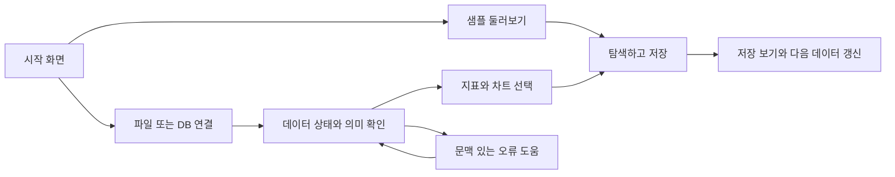

# VanillaMeta 셀프서비스 BI 보강 계획

작성: 2026-10-13 KST. 기준 develop-v2 `9e6a1035`. **계획 문서이며 새 기능 구현·검증 완료 보고가 아니다.** MCP보다 기본 BI를 먼저 완성하라는 요청, Rill 첫 화면·연결 선택·오류 상담 캡처를 반영했다. 고객 수요·가격·기간·성능 목표는 검증할 가설이다.

## 1. 제품 목표와 범위

목표: SQL과 데이터 모델을 모르는 사용자가 **데이터 넣기 → 의미 확인 → 지표 선택 → 차트 탐색 → 저장 → 다음 데이터로 갱신**을 스스로 끝낸다. AI 연결이 없어도 이 경로는 완료할 수 있어야 한다.

초기 고객 가설은 기존 [시장 진입 계획](initial-market-entry.md)의 소규모 커머스 운영팀이다. 범용 기본 BI 구조를 만들되 첫 업무 템플릿은 매출·환불에 집중한다. 실제 고객 파일 두 형식에서 반복되는 요구를 확인하기 전 광고·재고·회계로 범위를 넓히지 않는다.

우선 보강할 사용자 질문:

1. 어디서 시작하고 어떤 데이터를 넣어야 하나?
2. 이 숫자는 무엇을 합산했고 기간·통화·환불 기준은 무엇인가?
3. 특정 채널을 선택하면 전체 지표가 어떻게 바뀌나? 지난 기간과는 어떻게 다른가?
4. SQL 없이 차트를 바꾸고 같은 분석을 다시 열 수 있나?
5. 다음 파일로 갱신해도 지표와 대시보드를 다시 만들어야 하나?
6. 연결·파일·쿼리 오류가 나면 무엇을 고치고 어떻게 정상 여부를 확인하나?

MCP, 네이티브 앱, 범용 자동 에이전트, 임의 코드 실행, 새 분석 엔진, 다종 OAuth/API 수집, 전면 UI 재작성은 이번 계획의 출시 필수 범위에 넣지 않는다. Node24·기존 메타 DB·서버 DuckDB 워커·AI SDK7·Codex gpt-6-luna를 유지한다. 모델 대체 없이 AI 실패 시 기본 BI 흐름으로 돌아갈 수 있게 한다.

## 2. 근거와 현재 상태

코드와 후속 검증을 함께 확인했다. 과거 Rill 비교의 VanillaMeta Parquet 저장 실패는 당시 기록이다. 이후 서버 DuckDB 전환·139만 행 저장 검증 기록을 현재 기준으로 사용하며 해결된 문제를 새 미구현으로 되돌리지 않는다. Rill 최신 문서의 기능과 설치된 v0.90.5의 실제 검증은 구분한다.

| 근거 | 현재 확인한 내용 | 계획에서 사용할 기반 |
| --- | --- | --- |
| [대시보드 목록](../../frontend-web/src/pages/Dashboard/index.tsx#L121) | 빈 목록은 생성 안내 중심. AI 생성 메뉴는 별도로 존재 | 온보딩 시작점, 기존 목록·생성 경로 유지 |
| [메트릭 엔티티](../../backend-api/src/metric/entities/metric.entity.ts#L14), [평가](../../backend-api/src/metric/metric.service.ts#L100) | 집계·대상 컬럼·그룹·필터를 저장하고 DuckDB/기존 DB 평가 지원 | 지표 정의를 새로 만들지 않고 확장·연결 |
| [메트릭 API](../../backend-api/src/metric/metric.controller.ts#L7) | 인증 guard가 있으나 요청 사용자 ID를 서비스에 전달하지 않는 경로 | 새 개인/팀 지표 기능 전에 소스·지표 권한 범위 감사 필요 |
| [메트릭 UI](../../frontend-web/src/pages/Data/Metric/index.tsx#L132) | 별도 목록·평가 화면이 있고 SQL 형태의 설명이 노출됨 | 업무 설명과 차트 만들기 진입 추가 |
| [대시보드 저장 모델](../../backend-api/src/dashboard/entities/dashboard.entity.ts#L14) | analysisDefinition·layout·templateId를 저장 | 기존 대시보드 위에 지표 참조·분석 상태 연결 |
| [일반 배치 편집기](../../frontend-web/src/pages/Dashboard/DashboardModify/index.tsx#L496) | react-grid-layout 배치·리사이즈와 기존 저장 경로 존재 | 편집기를 다시 만들지 않고 공통 사용 흐름 정리 |
| [현재 분석 UI](../../frontend-web/src/pages/Dashboard/Components/DashboardAnalysis.tsx#L45), [운영 범위](../testing/ai-dashboard.md#L12) | 날짜·다중 필터 상태가 로컬이며 저장된 대시보드/공유에 지속하지 않음 | 명시적 저장 보기·복원 필요 |
| [서버 preview](../../backend-api/src/ai/ai-dashboard.service.ts#L391), [추세](../../backend-api/src/ai/ai-dashboard.service.ts#L468) | 필터 후 집계·KPI 추세 생성, 자동 시간 입도·240점 경계 | 기본 집계·추세를 재사용해 시간 비교·명시 입도 추가 |
| [AI 제작 범위](../testing/ai-dashboard.md#L4), [Assistant](../testing/dashboard-assistant.md) | 단일 DuckDB 소스·최대6개 위젯, 질문·수정·미리보기·적용·Undo | 기본 수동 제작에도 같은 검증 경로 사용 |
| [Commerce 서비스](../../backend-api/src/commerce/commerce.service.ts#L138), [정의](sales-refund-mvp.md) | 소유권·입력 hash·정상 게시 버전·오류 차단 존재. 고정 USD/UTC 현금·코호트 지표 | 첫 업무 템플릿과 반복 갱신의 실증 기반 |
| [공유 모델](../../backend-api/src/dashboard/entities/dashboard_share.entity.ts#L14) | 토큰·활성 여부·만료일을 관리 | 공유를 새로 만들지 않고 저장 보기·신규 조회 권한과 연결 |
| [DuckDB 운영](server-duckdb-operations.md#L23) | 단일 서버/워커. 내구성 큐·주기 수집·일반 소스의 테넌트 격리는 완료 범위 밖 | 소규모 파일럿부터 시작, 운영 확장은 별도 gate |

메트릭·일반 위젯·AI analysisDefinition·고정 Commerce가 완전히 같은 계약으로 연결된 상태는 아니다. 이 차이가 사용자가 여러 화면을 오가게 하는 원인이다. 목표는 전면 마이그레이션이 아니라 **신규 기본 제작 경로에 동일 지표·필터·표시 계약을 적용**하고 기존 저장 자료는 유지하는 것이다.

## 3. Rill과 비교해 선택할 기능

Rill의 [Metrics Views](https://docs.rilldata.com/developers/build/metrics-view/what-are-metrics-views)는 지표·차원을 재사용하고, [Explore 필터](https://docs.rilldata.com/guide/dashboards/filters)는 차원 선택을 다른 지표와 연결한다. [Canvas](https://docs.rilldata.com/developers/build/dashboards/canvas)는 시각 편집과 전역/위젯별 필터를 제공하고, [Bookmarks](https://docs.rilldata.com/guide/dashboards/bookmarks)는 분석 상태 재사용을 안내한다. 기능 설명의 근거이며 VanillaMeta와 동일 성능이라는 증거는 아니다.

| 기능 | VanillaMeta 보강 | 우선순위 / 경계 |
| --- | --- | --- |
| 첫 화면·연결 선택·샘플 | 세 가지 시작 경로와 계속하기, 완료된 샘플을 먼저 보여주기 | P0: 메뉴만 늘리지 말고 첫 결과까지 연결 |
| 지표 재사용 | 컬럼 선택형 정의·업무 이름·단위·시간 기준을 KPI/차트/AI가 공유 | P0: 제한된 정의, 임의 SQL 수식 언어 제외 |
| 시간 탐색·기간 비교 | 상대 기간·명시 일/주/월·이전 동일 길이 기간 | P0: 시간대/누락/0분모 정책을 먼저 고정 |
| 차원 클릭·상세 탐색 | 채널/기기 클릭→필터 chip→KPI/추세/표 동시 변경 | P0: 대표 차원 두 개, 무제한 탐색 제외 |
| 오류에서 상담·재시도 | 화면 문맥을 가진 AI 도움과 결정적 오류 안내 | P0 최소 진단, P1 검증 가능한 수정 제안 |
| 수동 차트 제작 | 지표·차원·표현 선택, 미리보기, 기존 배치에 추가 | P0: KPI/선/막대/표부터, 50종 전체 재작성 제외 |
| 저장 보기·재방문 | 기간·필터·지표·정렬 저장/복원, 분석 정의와 분리 | P1: 개인 보기부터, 공유가 권한을 부여하지 않음 |
| 연결 목록 | 검색·카테고리·연결 테스트·실패 안내 | P0: 파일과 실제 지원 DB부터. Rill의 카드 수를 목표로 하지 않음 |
| 데이터 갱신 | 같은 소스에 전체 스냅샷 교체·매핑/지표/차트 유지 | P1: 파일 우선, 증분 병합/CDC 제외 |
| 자동 수집·협업 확장 | 가장 반복 수요가 많은 API 하나, 최소 viewer 권한 | P2: 사용·운영 검증 이후. Rill Cloud 전체 복제 제외 |

추가 공식 근거: [시간 상세 탐색](https://docs.rilldata.com/guide/dashboards/explore/tdd), [데이터 갱신](https://docs.rilldata.com/developers/build/models/data-refresh), [Developer/Cloud 구분](https://docs.rilldata.com/developers/deploy/cloud-vs-developer). 캡처는 로컬 Developer 화면이며 Cloud 협업 기능까지 검증한 증거로 사용하지 않는다.

## 4. 첫 화면과 온보딩 설계

사용자 캡처에서 확인한 것은 기존 Open RTB Ads 프로젝트의 시작/연결 화면과 Margin Scorecard의 AI 수정 결과다. 신규 계정 첫 로그인 전체 과정을 관찰한 것은 아니다. 화면 패턴의 참고 근거로 사용한다. 첫 완료 흐름은 다음과 같다.

첫 방문 제목: **“어떤 데이터를 분석해 볼까요?”** 설명은 “샘플로 살펴보거나 내 데이터를 넣어 대시보드를 만들어 보세요.”

| 시작 카드 | 실제 결과 / 다음 동작 |
| --- | --- |
| 샘플 대시보드 둘러보기 | 추천: 매출·환불. 보조: 광고 요청 분석. 바로 완성된 화면과 추천 탐색 질문을 제공. 내 작업으로 복사하는 명시 동작 |
| 내 파일로 시작하기 | CSV/JSON/Parquet 선택→서버 저장→데이터 상태 확인→지표·차트. 매출·환불은 필요한 파일 묶음과 형식 안내 |
| 데이터베이스 연결하기 | 검증된 연결과 기존 SQL 제작 경로로 안내. 비지원·미검증 드라이버를 지원 완료 카드처럼 보여주지 않음 |

재방문자는 최근 대시보드·최근 데이터·중단한 작업을 먼저 본다. 시작 카드/도움말은 다시 접근 가능하지만 매번 튜토리얼을 강제하지 않는다. 기존 대시보드가 없다는 사실만으로 신규 사용자를 판단하지 않고 데이터/생성 상태도 확인한다.

사용자 단계는 **데이터 연결 → 데이터 확인 → 지표 선택 → 화면 완성** 네 개로 제한한다. 각 단계에 다음 버튼이 있고 완료 기준/실패 이유가 표시된다. “모델 만들기, metrics view, worker” 같은 내부 개념은 기본 화면에서 요구하지 않는다. SQL 보기는 고급 모드로 제공한다.

데이터 확인 단계:
- 저장 완료 여부·전체 행 수·컬럼 타입·데이터 날짜 범위·갱신 시점. 업로드 시각과 데이터 기준 시각은 다르게 표시.
- 날짜·금액·통화·고유 ID·분류 컬럼의 역할을 확인. 자동 추정은 초안이며 사용자가 수정 가능.
- 상위 미리보기 몇 행과 전체 검증 결과를 구분. 샘플5행만 읽고 전체 품질 통과라고 하지 않음.
- 결측 금액을 0으로 치환하지 않음. 날짜 없음/통화 혼합/상충 중복은 구체적인 수정 위치와 안내.
- 없는 컬럼이 필요한 템플릿은 왜 사용할 수 없는지 표시. 환불 파일이 없으면 환불0으로 완성하지 않음.

샘플 정책:
- 고정 데이터·고정 계산·출처/라이선스·합성/실데이터 여부 표시. LLM 실행 없이도 첫 화면 정상 동작.
- 기본 기간은 데이터 실제 범위. 오래된 샘플을 “오늘”로 속이거나 최근24시간 빈 화면을 기본으로 하지 않음.
- 우선 소규모 고정 샘플을 패키지/설치 자원으로 제공하고 용량을 측정한다. 139만 행 전체를 첫 방문마다 가져오지 않음. 작은 샘플과 대용량 검증 픽스처를 명확히 구분.
- 샘플 보기/복사는 멱등 처리하고 개인 데이터와 섞지 않음. 사용자마다139만 행을 중복 저장하는 구조를 기본으로 삼지 않음.
- 새로고침 후 완료한 단계는 복원. 업로드 중 브라우저 파일 객체를 영속 작업처럼 복원하지 않고, 서버 완료 여부에 따라 이어가기 또는 파일 재선택을 안내.

## 5. 차별화: 만들기뿐 아니라 다시 쓰기·고치기

제안 메시지: **“파일을 넣으면 의미가 확인된 숫자로 대시보드를 만들고, 다음 파일도 같은 기준으로 갱신합니다. 막힌 지점은 그 화면에서 함께 해결합니다.”** 아직 실고객 검증된 주장으로 광고하지 않는다.

| 차별화 가설 | 구현 가치 | 증명할 방법 |
| --- | --- | --- |
| 비기술 담당자 중심 시작 | 파일·업무 템플릿·시각 편집을 기본, AI/SQL은 선택 | SQL 지식 없는 담당자의 첫 완료 시간·개입 횟수 |
| 숫자의 근거가 보이는 BI | 수치에서 지표 정의·분모·기간·통화·제외·데이터 버전 확인 | 사용자에게 특정 금액/환불률의 기준을 설명하게 하기 |
| 반복 갱신의 안정성 | 같은 파일 중복 게시 방지, 스냅샷 의미·매핑·지표·배치 유지 | 두 번의 주간 갱신을 제품 담당자 개입 없이 수행 |
| 오류를 스스로 해결하는 경험 | 오류 화면에서 문맥을 가진 도움, 안전한 수정·재검사 | 날짜/컬럼 오류 복구율·복구 시간, 데이터 보존 확인 |
| 한국어 업무 기준 | 결제액/상품매출/차감수취액/환불 코호트 구분, 국내 실제 파일 매핑 | 실제 고객 두 파일 형식의 독립 정답 대조 |

Rill에도 AI 제작·지표 정의·오류 상태 확인 기능이 있으므로 “우리만 AI가 있다”는 차별점을 주장하지 않는다. 목표 고객·파일 의미·업무 안내·갱신/복구 경험에서 차이를 검증한다. 오픈소스·차트 수·MCP 지원 자체는 차별화 근거로 삼지 않는다.

현재 AE 샘플은 USD/UTC·세금/배송 포함 **차감수취액**이다. 이를 KRW/KST 상품 순매출 템플릿으로 이름만 바꾸지 않는다. 국내 지표는 실제 파일의 의미·시간대·할인/배송/세금 포함 여부를 별도로 확인해야 한다. 원가가 없으면 이익, 광고비가 없으면 ROAS, 상품별 환불 배분이 없으면 상품별 순매출을 만들지 않는다.

## 6. 지표와 탐색 계약

새 범용 모델링 플랫폼을 만들지 않는다. 기존 Metric을 확장하고 신규 structured 분석 정의가 metricId와 definitionVersion을 참조한다. 기존 raw SQL 대시보드는 계속 동작하며 자동 변환하지 않는다. 변환은 지원 가능한 정의만 미리보기·명시 저장한다.

첫 지표 형식:
- 단일 소스/테이블의 SUM, COUNT, COUNT_DISTINCT, AVG, MIN, MAX. COUNT행과 SUM요청수를 구분.
- 비율은 검증된 분자/분모 참조. 가중 평균은 SUM분자/SUM분모이며 AVG비율로 바꾸지 않음. arbitrary 식/eval/파일 접근은 제외.
- 표시 이름·설명·통화/단위·소수/K/M·집계 의미·기본 시간 컬럼·업무 시간대·가능한 차원을 저장.
- 결과에는 definitionVersion·dataVersion·필터·기간·완전성 정보 포함. AI는 승인된 정의를 설명하고 새 지표 변경은 미리보기 후 저장.
- 금액/큰 정수/비율은 기존 정확 집계 정책을 유지. 출력 반올림과 집계식을 분리.
- 변경 시 기존 대시보드를 조용히 재계산하지 않음. 저장 정의 버전을 고정하고 최신 정의로 업데이트하는 명시 경로와 영향 목록을 제공. 데이터 갱신 버전과 정의 변경 버전을 구분.

공통 분석 상태는 source/version, metric refs, dimensions, filters, timeColumn/timeZone/range, grain, comparison, sorting으로 제한한다. UI·서버·저장 보기·AI가 동일 상태를 전달한다. 업무별 고정 Commerce 계산은 별도 검증된 집계 제공자로 연결해 이벤트 날짜와 코호트 날짜를 한 컬럼으로 억지 통합하지 않는다.

### 최소 기술 계약 제안

단계0에서 기존 API 호환 여부를 확인한 후 확정할 설계 초안이다.

| 계약 | 최소 내용 / 저장 원칙 |
| --- | --- |
| Source capabilities/profile | 권한 검사된 소스ID, backend kind, ready/error, dataVersion, 행수·타입·기간·지원 조회 방식. 실제 지원 기능만 반환하고 연결 카드/제작 모드가 사용 |
| Metric definition | 기존 단순 정의 유지, 신규 단위/시간·차원·비율 정의는 versioned JSON 또는 작은 추가 컬럼으로 저장. 비율 참조는 같은 소스·순환 금지·깊이 제한 |
| Structured draft | schemaVersion, sourceId, metric ID/version+검증된 정의 snapshot, 차원·차트형식·표시 옵션·layout. 기존 raw SQL draft와 discriminator로 분리 |
| Query result | source/definition revision, 적용 상태, 정확값과 표시값, 제한/누락/완전성. 브라우저가 다른 버전 결과를 섞거나 AI가 소수/K/M을 집계에 적용하지 않도록 구분 |
| Saved view | owner, dashboardId, 상태JSON·schemaVersion, 절대/상대기간 종류. 대시보드 생성/삭제와 별도 생명주기 |
| Diagnostic | 원래 작업의 errorCode·requestId·대상 version·실패 단계·허용 동작 목록. 에이전트 제안은 허용된 UI 명령으로만 변환 |

최초 정의 버전 이력은 대시보드의 검증된 snapshot으로 고정할 수 있다. 전체 version registry/이력 관리 UI를 첫 묶음의 전제조건으로 추가하지 않는다. source 교체 후 snapshot의 컬럼/타입이 맞지 않으면 조용히 새 식으로 바꾸지 않고 broken 상태와 수정 미리보기를 제공한다. 기존 메트릭의 전역 unique name/권한은 단계0에서 이관 정책을 정한 후 바꾸며 기존 DB를 synchronize만으로 수정하지 않는다.

초기 버전 정책을 다음으로 제한한다. 신규 정의는 version1부터 시작하고 수정은 기대 버전 조건부 갱신으로 번호를 증가시킨다. 저장된 대시보드는 검증된 정의 snapshot/hash/version을 보존하고 평가 시 최신 mutable Metric 레코드를 대신 읽지 않는다. 기존 버전 없는 메트릭/SQL은 legacy version0 경로를 유지하며, 신규 structured 정의로 명시 저장할 때만 snapshot을 만든다. 개인 저장 보기는 정의를 고정하지만 데이터는 열 때 최신 정상 게시 버전을 사용하고 그 버전을 표시한다. 역사 데이터 전체 재현 기능은 이번 범위 밖이다.

탐색 규칙:
- 차원 클릭/키보드 선택으로 필터 chip 생성. 같은 컬럼 OR·컬럼 간 AND, 해제/초기화 가능. KPI·추세·표·AI 문맥이 같은 적용 상태/데이터 버전을 사용.
- 일반 기간 기본은 전체 실제 데이터. 최근7/30일은 현재 시각 기준임을 명시하고 샘플의 데이터 마지막 날짜 기준 옵션과 혼동하지 않음.
- 일/주/월·자동 입도. 주 시작 요일과 IANA 시간대 고정, 쿼리 범위는 반개구간으로 처리. 비교는 처음에는 이전 동일 길이 기간, 전년/달력기간 비교는 이후.
- 완료되지 않은 현재 기간은 부분 기간 표시. 비교 범위에 데이터가 없으면 증감0이 아니라 비교 불가, 이전값0은 증감률 계산 불가. NULL·날짜 누락과 실측0을 구분.
- 시계열 클릭은 조회 기간 변경, 상세 표는 동일 집계/필터 근거 표시. 집계값 기준 필터/HAVING·범용 피벗·차트 brush는 후속 수요 확인.
- 차원 목록 검색은 제한/페이지/정렬 상태가 보이게 하고 50개 값을 전체라고 표현하지 않음. 요약 topN이면 나머지 누락/전체 합계를 구분.

## 7. 오류 도움: 설명·제안·복구를 구분

첨부 캡처의 Rill AI는 깨진 metrics view를 참조하던 차트를 markdown 안내로 바꿨다. **화면 렌더링 복구**의 사례이며 upstream 데이터 복구 증거는 아니다. VanillaMeta도 오류를 숨기는 것으로 성공을 선언하지 않는다.

초기 범위는 기존 AI SDK7/Assistant를 재사용하는 **화면 문맥 진단**이다. MCP나 임의 shell/파일 수정 없이 구현할 수 있다.

1. 오류 응답을 errorCode/requestId/stage/sourceVersion/affectedObjects/retryable/권한 검사된 요약으로 정리. 정상 수치 대신 오류·이전 성공 결과의 시각/버전 표시.
2. 사용자가 “이 문제 설명해 주세요”를 선택하면 필요한 요약만 전달. 비밀번호·토큰·연결문자열·로컬 경로·고객 원본행/전체 로그를 모델에 보내지 않음. 데이터/로그 문자열은 지시문이 아닌 비신뢰 자료.
3. AI는 확인된 사실·가능 원인·다음 확인을 구분. 연결/형식/지표/권한/일시 장애별로 기존 UI 동작을 제안.
4. 초기에는 재시도·파일 다시 선택·설정 열기·조회 재검사만 실행 가능한 버튼으로 제공. 매핑·지표 변경은 변경 전후·영향·검증 결과를 보여준 뒤 명시 적용. 모델이 제시한 임의 SQL/명령/대상ID를 그대로 실행하지 않음.
5. 원래 실패한 작업을 같은 기대 결과로 재검사하고 데이터 조회·지표 계산이 성공했을 때만 복구 완료. 안내 문구로 대체하거나 일부 차트를 숨긴 경우는 “부분 표시/데이터 미복구”. 권한 오류는 AI가 우회하지 않음.
6. AI 미설정/타임아웃/취소에서도 오류 설명과 재시도·기존 정상 데이터는 유지. 자동 반복 호출·자동 수정 없음.

진단은 소유권 확인 뒤에만 수행하고 요청당 한 번의 명시 상담·기존 동시성/출력 한도를 사용한다. 같은 실패의 재진단은 requestId/버전과 실제 상태 변경을 확인한다. 네트워크/권한 원인을 확인하지 않은 상태에서 확정 원인이라고 쓰지 않는다. 수정 제안이 오래됐거나 데이터 버전이 달라지면 적용 전에 재검사한다.

첫 대표 오류: 날짜 형식 불일치, 필요한 컬럼 누락, 샘플 설치 실패/일시적 읽기 오류. 잘못된 비밀번호는 자격증명 재입력 안내, 수집 네트워크 장애는 재시도 안내로 제한한다. AI가 권한·비밀번호·외부 네트워크 문제를 직접 해결했다고 하지 않는다.

## 8. 단계별 개발: 작은 완결 흐름으로 출시

상대 규모 S=국소 화면/계약, M=FE+BE+관련 회귀, L=권한/버전/여러 경로 변경. 공수 확정은 시작 전1~2일 기술 점검에서 한다. 아래 순서는 의존성 순서이며 고객 인터뷰는 병행한다.

| 단계 | 최소 구현·기존 위치 | 완료/출시 gate | 규모 |
| --- | --- | --- | --- |
| 0. 계약·권한 점검 | Metric/API·general source·analysisDefinition 연결 감사, 정확도/시간 정책 확정, 기존 fixture 성능 기준선 기록 | source/metric 권한 범위와 호환 전략 확정. 공유 인스턴스 미격리는 출시 차단 | M |
| 1. 시작과 진단 | Dashboard 빈 상태→시작 카드/최근 작업, FileAnalysis/DataSource 기존 경로 연결, 고정 샘플 설치·소규모 기본 오류 도움 | 샘플 열기/내 파일 경로 모두 LLM 없이 완주. 실패를 성공으로 보이지 않음. 모바일/키보드 | M |
| 2. 지표→차트 | Metric 확장/시각 정의, DashboardAnalysis preview를 AI 전용 서비스에서 재사용 가능한 집계 경계로 분리, metric refs·KPI/선/막대/표 제작 | 같은 지표가 카드/차트/표에서 정확 일치. SQL 없는 제작/저장/재조회, 기존 SQL 호환 | L |
| 3. 탐색 | 공통 분석 상태, 상대 기간/입도/비교, 차원 클릭/상세 표, 근거 표시 | 기간·필터·비교 oracle 일치, 최신 요청만 반영. 대표 Rill 동일 작업 비교 | L |
| 4. 반복 사용 | 개인 저장 보기, 수동 편집 경로 연결, 파일 전체 스냅샷 교체·매핑 재사용·정의/배치 유지, AI 제한된 수정 제안 | reload/갱신 후 분석 유지. 실패/스키마 변경은 마지막 정상 보존, 같은 파일 no-op | L |
| 5. 고객 파일럿·운영 | 실제 두 파일 형식, 최소 읽기 공유, 백업복원·용량/이력 보존·권한·성능 점검 | 고객 스스로2회 주간 갱신·정답 일치. 결과로 유료/자동 수집 우선순위 결정 | M~L |

첫 제품 묶음은 단계0~2지만 한 번에 출시하지 않는다. **1A: 고정 샘플·내 파일 진입·기본 오류 안내**, **2A: 단일 정상 CSV → SUM 지표 한 개 → KPI 또는 막대 → 저장·재조회**, **2B: 추가 지표/비율·선/표·공통 편집**으로 나눈다. 2A 완료 전에 전체 semantic 플랫폼을 요구하지 않는다. 첫 DB 경로 검증은 준비된 SQLite 연결 하나의 기존 제작 흐름까지로 제한하고, 원격 DB는 고객 수요·환경이 있는 것부터 별도 검증한다. 기존 DB 폼이 있다는 이유만으로 연결 성공을 보장하지 않는다.

두 번째 묶음은 단계3~4: **탐색·저장·갱신**. 세 번째가 실고객 운영이다. 매 단계의 사용 경로가 끝나기 전에 다음 대형 기능을 동시에 열지 않는다.

수동 제작을 새 메뉴로만 추가하지 않고 AI 결과도 같은 편집기에 연결한다. 기존50개 차트 속성을 이 경로에 한꺼번에 옮기지 않는다. Desktop은 우측 속성/도움 패널, Mobile은 전체 화면 패널, 키보드는 이름·포커스 복귀·대체 표를 필수로 한다.

## 9. 개발·운영 부담을 줄이는 구조

- 기존 React/MUI/ECharts/react-grid-layout/Nest/TypeORM/DuckDB worker 재사용. 차트·편집기·지표 평가를 두 벌로 만들지 않음. 패키지는 필요를 확인한 뒤 선택하고 미리 추가하지 않음.
- 분석 계약·집계 compiler는 BE가 책임. FE는 상태·표현·초안 편집. AI는 승인된 정의/조회 결과를 사용하고 정확 집계는 서버에서 수행.
- 새 지표·bookmark 메타데이터는 기존 DB/migration으로 관리. 과거 전역 지표를 임의 사용자에게 귀속시키지 않고 관리자 이관 또는 legacy 격리 정책을 먼저 정의.
- source/metric ownership은 작업0 필수. 팀 권한 확장 전에는 개인 소유 또는 격리 파일럿으로 제한. 기존 프로젝트 전역 소스 계약을 다중 고객 SaaS로 오인하지 않음.
- 작업0 결과물은 source/metric/dashboard/saved view별 list/get/edit/evaluate/share 접근 행렬과 legacy 이관 기준이다. 로컬 개인 데모는 운영 SaaS 출시가 아니며, 실고객은 팀별 별도 인스턴스·DB·볼륨·자격증명으로 격리한다. 한 인스턴스에 여러 고객을 받는 배포는 타계정 직접 접근 검사와 전체 소스 범위 격리가 끝날 때까지 차단한다.
- 저장 보기에는 필터·상대기간 표현·정의버전만 저장, 원본행/자격증명은 제외. 상대기간은 열 때 해석, 절대기간은 그대로 복원. bookmark ID/공유 token은 서버 권한 재검사, bookmark가 새로운 접근권한을 주지 않음.
- 처음부터 Redis/별도 큐/분산 서버 없음. 단일 상시 서버+영속 볼륨. 프로파일/캐시는 데이터·정의버전으로 무효화하고 수동 refresh는 명시 실행.
- 검색 키 입력마다 전체 집계하지 않음. 기간·다중 필터는 Apply 또는 일관된 요청 합치기 정책, 중단/응답 순서 보호. 같은 데이터에서 카드와 표가 중복 스캔하지 않도록 필요한 집계를 묶고 큐 시간을 관찰.
- 수동 파일 갱신은 완전 스냅샷 계약. 같은 hash+매핑version no-op, schema/type 변경 검증·미리보기, 오류 시 활성 버전 교체 금지. 새 데이터버전은 새 조회부터 적용하고 진행 중 조회는 시작 버전으로 고정.
- 최초 보존은 활성 버전·직전 정상 버전·진행 중 조회가 사용하는 버전이다. 기존 보관 파일을 이 정책만으로 즉시 삭제하지 않는다. 정의 snapshot은 이를 참조하는 대시보드/보기와 함께 보존한다. 실제 파일 삭제·복원·유효 참조 확인·백업 보존 기간은 단계5의 운영 gate로 확정하고 그 전에는 수동 검토한다. 대량 버전 이력 UI/자동 GC는 추가하지 않는다.
- 내구성 작업/재시작 복구가 필요한 수집을 추가할 때만 DB job/lease를 설계. 현재 동기 import에 UI progress를 추가했다고 durable 복구를 제공한다고 하지 않음.
- 유료는 관리형 호스팅·백업·지원·추후 예약 수집/보고가 후보. 기본 정확성·권한·내보내기는 제한하지 않음. 기존 월49,000원 제안은 결제/원가 실험 가설이며 확정 가격이 아님.

## 10. 새 조건의 MD 검증 계획

아래 ID는 **제안 단계**다. 기존 cases.md의130개 집계를 변경하거나 통과로 등록하지 않았다. 구현 단계에서 신규 명세로 확정하고 PASS/FAIL/BLOCKED/NOT_RUN을 기록한다.

| 제안 ID | 입력 / 검증 가능한 완료 조건 |
| --- | --- |
| SSBI-01 | 신규 계정 첫 화면: 샘플/파일/DB 진입, 기존 사용자 최근 작업. 샘플 전체 기간은 실제 데이터 범위이며 AI 호출0으로 완주 |
| SSBI-02 | 실제 정상 파일→행수/컬럼/날짜·저장 상태→지표→차트→저장→reload. 미리보기 표본과 전체 검증을 구분 |
| SSBI-03 | metric SUM/COUNT_DISTINCT/가중 평균을 저장 후 KPI/범주/추세/표 정확값 대조. Rill 전체 샘플 요청634513000·평균5.5712386765263995와 독립 oracle 사용 |
| SSBI-04 | source/metric/대시보드/보기 ID를 타계정으로 조회·수정·evaluate→차단, 로그/AI에 비밀 없음. 같은 권한 문맥의 정상 동작 보존 |
| SSBI-05 | Mobile/Tablet 선택→필터 chip·KPI·차트·표 일치307763000, 해제→전체 복귀. 최신 요청 이전 응답 무시 |
| SSBI-06 | 절대·상대기간/일주월·이전기간: 별도 날짜 경계 fixture로 UTC/KST/윤일/주·월 경계/비교 누락/이전0 검증. 현금 이벤트와 주문 코호트 구분 |
| SSBI-07 | AE 정상 bundle 전체 결제63355735.41/환불3325529.62/차감60030205.79. 2025-09 oracle·채널/입도/비교의 신규 변형만 선택 검증 |
| SSBI-08 | 수동 지표 선택→차트표현 변경→순서/크기→저장·재조회. 표시 K/M/소수 변경이 SQL·정확값을 바꾸지 않음 |
| SSBI-09 | 개인 보기 저장→reload→기간/필터/정렬·지표 복원. 상대기간 재평가·절대기간 유지, 보기삭제는 대시보드삭제와 분리 |
| SSBI-10 | 동일 파일 no-op·정상 교체·schema mismatch·늦은 이전 작업. 매핑/지표/배치 유지, 오류는 마지막 정상 버전 유지 |
| SSBI-11 | 날짜/필수컬럼/샘플 읽기 실패→일반 안내→AI 설명→허용된 UI 수정→원래 실패 작업 재검사. 날짜/컬럼 오류용 작은 독립 fixture는 정상3행·금액10/20/30·SUM60을 기준으로 행수3/합계60/검증 오류0/대상 차트 정상 표시를 확인. 임의 날짜 추정 대신 명시 수정 파일/매핑 사용. 샘플 일시 실패는 원래 대상 ID/정의와 sample manifest 정답 재조회. rendered/dataHealth를 따로 기록하고 안내로 대체한 차트는 데이터 복구 PASS가 아님 |
| SSBI-12 | AI 미설정/타임아웃/취소·과거 응답→기본 BI 흐름 유지. 진단 전송 payload의 비밀번호/고객행/경로 노출0 |
| SSBI-13 | 공유 읽기·만료·철회, 저장 보기 대상 접근 재검사. 공유 화면에 편집·소스 비밀·AI 변경 권한이 생기지 않음 |
| SSBI-14 | 1440/390폭, 첫 시작~저장·오류복구의 실제 키보드 경로·표 대체·포커스. VoiceOver 발화는 실제 도구가 가능할 때 확인, 불가 시 BLOCKED |

검증 방식: 관련 단위/API→완성 화면의 MD 브라우저→통합 때 변경된 핵심 E2E. 파일 저장/편집마다 전체 테스트·LLM 호출을 돌리지 않는다. 기존 통과는 관련 코드/환경/픽스처 변경이 없으면 재사용한다. 수치/권한/영속화는 캡처만으로 판정하지 않는다. 신규 성공/실패 캡처를 외부 증빙 폴더에 저장하고 채팅에 실제 이미지로 남긴다. 실제 LLM 검증은 gpt-6-luna로 대표 진단/수정만 실행, 자동 회귀는 provider 경계 stub 사용.

성능 목표 초안: 동일139만 행·정해진6개 위젯에서 warm 필터 갱신20회 p95≤3초를 목표로 측정한다. cold/읽기·import·쿼리·대기시간·RSS를 별도 기록, 소수 동시 사용자3명도 측정한다. 현재 달성 수치가 아니다. 장비/조건을 고정한 기준선이 목표를 못 맞추면 기능·집계 호출 수를 먼저 줄이고 엔진/분산 도입은 이후 결정한다. 첫 사용자는 작은 데모로60초 안에 의미 있는 화면을 보고, 실제 고객 첫 파일 완료15분 이내를 별도 관찰 목표로 한다.

## 11. 고객 검증과 중단 기준

| 주요 위험 | 완화 / 확인 기준 |
| --- | --- |
| 기존 general source/metric 계약을 다중 사용자 기능으로 확장하며 누출 | 단계0 권한 감사·legacy 이관 정책. 타계정 직접 ID 조회/평가를 출시 gate로 검증 |
| 새 정의가 기존 SQL/Commerce를 깨뜨림 | 지원되는 신규 정의부터 도입·버전 고정·명시 변환. 기존 저장 대시보드 회귀를 영향 범위만 실행 |
| 첫 화면 작업이 지표 플랫폼 전체 개발로 커짐 | 첫 묶음은 기존 고정 샘플과 연결 UI/일반 안내. 지표 통합은 별도 단계2, 자동 복구 제외 |
| 단일 워커 대기·파일 이력으로 비용 증가 | 큐/스캔/RSS/디스크 관찰·집계 요청 통합·이력 보존 정책. 수집 자동화 전 백업/복구와 용량 한도 |
| LLM이 화면 오류를 숨겨 데이터 복구로 오인 | 원래 실패 작업·정답 재검사, 부분 표시와 upstream 복구 상태 분리. 모델 없이도 기본 진단·재시도 제공 |
| 국내 파일의 매출/환불 의미가 샘플과 다름 | 두 실제 형식으로 기준 합의·독립 정답·업무명 확인. 숫자만 맞추는 이름 변경/오류 행 제외 금지 |

기존6팀 파일럿 가설 유지: 4/6팀이15분 안에 첫 정상 대시보드, 두 번 연속 스스로 주간 갱신, 동일 업무시간50% 절감. 3/6팀 결제와 이후 재결제, 온보딩 이후 주간 지원20분/팀 이하를 관찰한다. 모집/결제는 실행하지 않았으며 현재 성과가 아니다.

구현 초기에5명에게 샘플→내 파일·지표→필터·저장의 사용성 과제를 주고, 도움 요청/막힌 단계·완료 시간을 기록한다. 오류 복구는 고정 오류3종을 주고 최소4/5명이 안내로 복구하는 것을 목표로 한다. 다섯 명 결과를 시장 통계로 일반화하지 않는다.

금액·중복·권한·데이터 손실 오류는 출시 차단. 합계를 맞추려고 오류 행을 조용히 제외하지 않는다. 첫 화면만 쉽고 갱신이 어렵다면 신규 차트를 늘리지 않고 갱신 경로를 수정한다. 실제 고객이 CSV 대신 XLSX만 쓰면 지원 수요·범위를 조사해 우선순위를 바꾼다. API 하나가 반복 병목인 경우에만 그 연결을 다음 투자로 선택한다.

## 12. 첫 실행 단위와 남은 결정

첫 작업은 **권한/계약 점검 + 첫 화면 + 고정 매출·환불 샘플 + 내 파일 연결 + 기본 오류 안내**다. 현재 AE 정상 샘플과 기존 Commerce/DuckDB/대시보드를 재사용해 클릭 가능한 작은 완결 경로를 만든다. 지표 통합 계약과 계정 격리 확인을 먼저 끝내고 샘플 복사 API를 설계한다.

구현 착수 시 확정할 항목: 소스/legacy 메트릭 이관 정책, 소규모 데모 크기·라이선스 포함 방식, 두 고객 파일 형식, 시간대 기본값, 샘플 실제 날짜/기본 기간, 신규 structured 정의버전. 이는 범위를 늘리기 위한 승인 질문 목록이 아니라 기술 점검/고객 증거로 정할 작업이다.

일정은 기능 수가 아니라 위 gate별로 확정한다. 전체 Rill 기능 복제·자동 복구·운영 성숙도를 이번 MVP 완료로 약속하지 않는다. 모든 단계의 최종 기준은 사용자 혼자 분석을 만들고 다음 데이터에서도 다시 쓰는가이다.

문서 독립 검토에서 첫 묶음 과대 범위·정의버전 호환·권한 출시 경계·이력 보존 비용·AI 복구 정답이 지적됐다. 위1A/2A/2B 분리, snapshot/legacy 정책, 격리 파일럿 gate, 최소 보존, SSBI-11의 고정 정답으로 보완했다. 이번에는 문서 링크/기준 위치·diff만 확인했고 제품 테스트/LLM/브라우저 재실행은 하지 않았다.

## 단계0 점검 후속 — 2026-10-13

[권한·호환 계약 감사](2026-10-13-self-service-contract-audit.md)를 완료했다. 신규3행 fixture로 일반 source/metric/preview의 계정 간 접근을 재현했다. 개인 소유 기대 SSBI-04는 미해결 FAIL이며, 기존 dashboard owner 검사만으로 source 계보 격리를 주장하지 않는다. 다음 구현 순서는 legacy dry-run·명시 migration/공통 권한 → profile/정의 snapshot →2A 제작 화면이다. 상세 접근 행렬과 호환 정책은 감사 문서를 따른다.

단계0 후속 구현: [개인 소스 권한 및 이관 기준](../testing/source-ownership.md). 일반 API 접근 경계의 선택 조건은 PASS, legacy 실제 owner 배정과 전체 SaaS 감사는 남아 있다. 다음 제품 범위는 source profile·정의 snapshot·2A 수동 제작 흐름이다.
