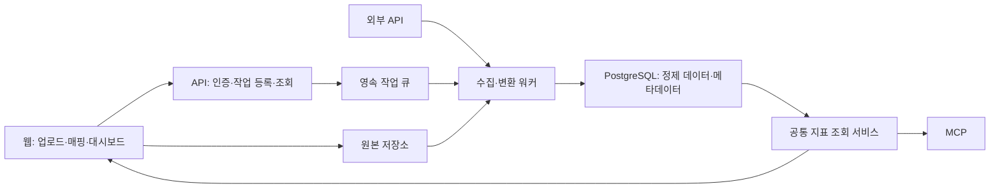

# VanillaMeta 데이터 수집 아키텍처와 해외 대시보드 참고 조사

작성일: 2026-10-12 KST. 설계 제안이며 구현 완료 상태가 아니다.
공식 공개 예제·템플릿을 조사했다. 샘플 수치, 제공사의 설명, 실제 고객 수요를 구분한다. 공개 템플릿의 존재만으로 국내 중소기업의 사용 빈도나 지불 의사를 입증할 수 없다.

## 결론

초기 제품은 웹 UI + 비동기 수집 워커 + PostgreSQL + 원본 저장소로 구성한다. 데스크톱 앱은 초기 필수 기능으로 두지 않는다. 사내 폴더/NAS 감시나 내부 ERP 접근 수요가 확인되면 같은 수집 계약을 사용하는 경량 에이전트를 추가한다.

커머스 운영 고객을 초기 가설로 유지하되, 차별점은 템플릿이나 MCP 자체보다 파일/API의 반복 수집, 재사용 가능한 매핑, 중복·환불 처리, 계산 근거와 변경 이력에 둔다.

## 공식 예제 비교

| 공개 자료 | 확인한 내용 | VanillaMeta 설계에 주는 힌트 |
| --- | --- | --- |
| [Metabase E-commerce Sales](https://www.metabase.com/dashboards/ecommerce-sales) | 순매출·주문·객단가·환불률, 기간 비교, 채널/지역 구성, 상품 표. 수치는 예시 | 주문 상태·할인·환불과 매출 정의가 준비되어야 템플릿이 작동 |
| [Metabase Cash Flow and Runway](https://www.metabase.com/dashboards/cash-flow-runway) | 현금 잔액, 주간 입출금, burn/runway, 13주 예측, 예외 거래. 수치는 예시 | 잔액 스냅샷·거래·환율·예측을 구분하고 최신 대사 완료 기간 표시 |
| [Geckoboard Shopify examples](https://www.geckoboard.com/dashboard-examples/ecommerce/shopify-dashboards/) | 단일 스토어, 복수 스토어, Shopify+Facebook Ads의 3개 예제. 미처리 주문·취소도 포함 | 매출 추이와 오늘 처리할 문제를 함께 보여주기 |
| [Geckoboard Sales Pipeline](https://www.geckoboard.com/dashboard-examples/sales/sales-pipeline-dashboard/) | 영업 활동, 계약, 목표, 파이프라인, 계약 전환 및 소요 기간 | 현재 상태와 과거 단계 변경 이력을 구분 |
| [Geckoboard SLA examples](https://www.geckoboard.com/dashboard-examples/support/service-level-agreement-sla-dashboard/) | 평균 응답시간과 SLA 준수, 위반 임박/최근 위반 티켓 표 | 평균만으로 예외를 숨기지 않고 처리 대상 원문으로 연결 |
| [Databox Shopify Store Overview](https://databox.com/dashboard-examples/shopify) | 주문·매출·할인·환불, 처리 상태, 고객·상품 구성 | 기본 템플릿 항목과 별도 확장 가능 지표를 구분 |
| [Databox QuickBooks Financials Overview](https://databox.com/dashboard-examples/quickbooks-financials-overview) | 매출·비용·순이익·순현금흐름·비용 분류 | 손익과 현금을 별도 지표로 관리. 예측은 기본 템플릿으로 확인되지 않음 |
| [Databox Marketing and Sales Deals Overview](https://databox.com/dashboard-examples/marketing-sales-overview) | 방문→연락처→기회→계약, 월 비교와 목표 | 단계 정의·대상 기간·목표 데이터를 템플릿 계약에 포함 |
| [Databox Stripe MRR & Subscriptions](https://databox.com/dashboard-examples/stripe-mrr-subscription-overview) | MRR, 신규·업그레이드·다운그레이드·이탈, 구독/플랜 | 합계보다 증감 구성과 구독 이력이 중요 |
| [Klipfolio Inventory Dashboard](https://www.klipfolio.com/dashboards/supply-chain/inventory-dashboard) | 재고·회전·품절·재고 일수 등의 예제/지표 안내 | 재고는 시점 잔액이며 일자별 합계가 아님 |
| [Klipfolio Professional Services](https://www.klipfolio.com/dashboards/business/professional-services-dashboard) | 청구 가능 시간·프로젝트 수익성·고객·현금흐름 예제/안내 | 서비스업은 작업시간·프로젝트·청구·비용 연결이 필요 |

Databox 4개 페이지는 재사용 템플릿이며 고객 실사용 검증 자료는 아니다. Klipfolio 자료는 예제/지표 가이드로, 모든 항목을 갖춘 즉시 적용 템플릿이라고 단정하지 않는다. Metabase 매출 예제는 공개 이미지를 브라우저에서도 확인했다. 모든 서비스의 제품 내부를 직접 실행한 것은 아니다.

## MCP 경쟁에 대한 수정된 판단

[Databox MCP](https://databox.com/mcp)는 지표와 정의·계산 논리를 AI 도구에 제공한다고 안내한다. [Geckoboard Metrics MCP](https://www.geckoboard.com/product/metrics-mcp/)는 미리 계산한 지표의 필터/분류 조회와 읽기 전용 접근을 안내한다. 따라서 MCP를 지원한다는 사실만으로 차별화되지 않는다. 제공사의 정확성 주장은 독립 벤치마크로 검증하지 않았다.

VanillaMeta의 후보 강점은 국내 실제 내보내기 포맷, 매핑 재사용, 파일과 API의 동일 데이터셋 갱신, 환불/중복 처리, 숫자의 원본 추적, 셀프호스팅이다. 이 역시 고객 검증이 필요한 가설이다.

## 최소 운영 아키텍처

- 브라우저: 소량 미리보기, 필드 매핑, 진행 상태, 집계 결과와 페이지 단위 상세 조회. 전체 데이터를 브라우저 메모리에 올리지 않는다.
- API: 테넌트 권한, 업로드 허가, 완료 검증, 작업 등록, 조회. 긴 파싱/변환을 HTTP 요청 안에서 끝내지 않는다.
- 워커: 파일 스트리밍 파싱, API 페이지 수집, 타입 검증, 배치 적재, 집계. CPU/메모리/임시 디스크/실행 시간 제한을 둔다.
- PostgreSQL: 사용자·데이터소스·작업·매핑·버전 및 초기 정제 데이터. 파일은 원본 저장소에 둔다.
- 큐: 초기에는 PostgreSQL 기반 작업 테이블과 lease/heartbeat로 시작할 수 있다. Redis가 이미 필요하거나 규모가 커지면 BullMQ 등을 평가한다.
- 원본 저장소: SaaS는 객체 저장소. 셀프호스팅은 지속 볼륨으로 시작할 수 있으나 스트리밍과 용량 제한이 필요하다.
- 배포: 같은 저장소의 API/워커를 별도 프로세스로 실행한다. 초기 단일 호스트에서도 자원 제한과 DB 연결 풀 예산을 분리한다. 워커 분리는 부하를 없애는 것이 아니라 제한·확장할 수 있게 한다.

[S3 presigned upload](https://docs.aws.amazon.com/AmazonS3/latest/userguide/PresignedUrlUploadObject.html)를 사용하면 브라우저가 원본 저장소로 직접 업로드할 수 있다. 짧은 유효기간, 서버 생성 object key, 완료 시 실제 크기·체크섬·소유권 검증이 필요하다. 대형 파일은 재개 가능한 업로드를 검토한다.

DuckDB는 필요 시 워커의 파일 변환/분석 엔진으로 평가한다. 초기 구성의 필수 의존성으로 추가하지 않는다. 사용할 경우 작업별 임시 DB 또는 불변 Parquet 버전을 권장한다. 여러 워커가 같은 네이티브 DB 파일을 직접 쓰는 구성을 피한다. 최신 원격 프로토콜 기능도 존재하므로 모든 다중 프로세스 사용이 불가능하다고 단정하지 않는다. [공식 동시성 문서](https://www.duckdb.org/docs/current/connect/concurrency)

## DB화 계약

| 계층 | 저장 내용 | 목적 |
| --- | --- | --- |
| 원본 | 파일/API 응답 페이지, 체크섬, 수집 시간, 원본 출처 | 복구·재처리·감사 |
| 스테이징 | 원본 헤더, 내부 컬럼 ID, 타입, 오류 행, 매핑 버전 | 고객 데이터 형식 보존과 검증 |
| 정제 | 주문·주문상품·환불·재고 스냅샷 등 업무별 테이블 | 중복 제거와 여러 소스 연결 |
| 지표 | 정의 버전, 기간, 통화, 포함/제외 상태, 집계 | 대시보드와 MCP가 같은 숫자를 반환 |

모든 파일을 고정 업무 테이블에 억지로 넣지 않는다. 일반 데이터셋 탐색은 타입이 있는 스테이징 테이블로 제공하고, 업무 템플릿을 선택할 때 정제 모델의 필수 필드를 매핑한다.

최소 메타데이터: sources, datasets, schema_versions, mapping_versions, ingestion_runs, raw_objects, checkpoints, rejected_rows, data_versions, metric_definitions. 자격증명은 암호화된 별도 참조로 관리한다.

- 수집 모드: 전체 스냅샷 교체 / 추가 전용 / 키 기준 upsert를 명시한다. 중복 제거 키와 버전은 데이터소스·테넌트 범위를 포함한다.
- 커머스 키: 주문 헤더와 주문상품의 grain을 분리한다. 주문 금액이 상품별 행마다 반복되는 파일을 그대로 합산하지 않는다. 환불 이벤트는 별도로 관리한다.
- 타입: 주문번호·우편번호는 선행 0을 보존하는 문자열, 금액은 통화와 decimal 또는 최소 화폐 단위 정수, 일시는 UTC와 업무 시간대를 함께 관리한다.
- 스키마 변화: 새 선택 컬럼은 검토 후 수용 가능. 필수 컬럼 삭제/타입 충돌은 차단하고 매핑 수정을 요청한다. 누락을 0으로 표시하지 않는다.
- 지표: 매출의 세금·배송비·할인·환불 포함 여부와 환불을 어느 날짜에 반영하는지 정한다. 객단가는 매출/주문수로 재계산하며 일별 평균을 다시 평균내지 않는다. 재고 잔액은 기간 합산하지 않는다.
- 게시: 검증과 집계가 모두 완료된 버전만 active version으로 원자적으로 전환한다. 실패 시 이전 성공 버전을 유지한다. 관련 차트는 같은 게시 버전을 조회한다.
- 캐시: tenant, 권한 범위, 데이터/지표 버전, 기간/필터를 키에 포함한다.

## 파일과 API 운영

파일: 업로드 → 원본 검증 → 작업 등록 → 파싱/매핑 → 배치 적재 → 행수·금액·중복·오류 검증 → 집계 → 게시. 두 번째 파일부터 같은 데이터셋과 매핑을 재사용한다. 재시도 시 같은 데이터가 중복 적재되지 않아야 한다.

API: 서버 워커가 인증된 연결을 사용한다. 페이지/cursor, updated_at watermark, 재시도 상태를 저장한다. 데이터 반영과 체크포인트 이동을 일관되게 처리한다. 지연 업데이트는 겹치는 조회 구간 또는 주기적 대사로 보완한다. 일부 응답에 없다고 삭제하지 않으며 삭제 이벤트나 완전 스냅샷의 보장 여부를 확인한다.

작업 상태: queued → running → validating → published, 실패는 failed/retryable로 기록한다. 테넌트별 동시 실행, API 호출, 저장 용량, 조회 시간/행수 제한을 둔다. 429/backoff, 중복 실행 방지, lease 만료 복구, 오류 행 다운로드를 제공한다. [BullMQ 멱등 작업 원칙](https://docs.bullmq.io/patterns/idempotent-jobs)

관측: 대기 시간, 처리 시간, 워커 최대 메모리, 재시도율, 검증 오류, 데이터 최신성, 조회 지연, 고객별 저장/처리 비용. 백업은 원본·DB·매핑/정의·암호화 키 복구를 함께 고려하며 실제 복원 연습이 필요하다. 보존 기간과 삭제는 원본/정제/캐시/백업 정책에 일관되게 적용한다.

테넌트 격리는 SQL뿐 아니라 작업·객체 키·캐시·조회 결과에도 적용한다. PostgreSQL RLS 사용 시 앱 역할을 테이블 소유자/우회 권한과 분리한다. [RLS 공식 문서](https://www.postgresql.org/docs/current/ddl-rowsecurity.html)

## 로컬 앱의 판단 기준

| 고객 상황 | 권장 |
| --- | --- |
| 가끔 파일 업로드·외부 SaaS API | 웹+서버 워커 |
| PC/NAS 폴더 자동 감시·외부에서 접근 불가한 ERP/DB | 경량 수집 에이전트 |
| 원본/정제 데이터의 외부 반출 금지 | 고객사 내부 셀프호스팅 또는 완전 로컬 구성 |
| 인터넷 단절 중에도 분석 필요 | 로컬 제품 별도 평가 |

에이전트가 필요하면 outbound TLS 연결, 최소 범위 자격증명, 암호화된 재전송 버퍼, heartbeat, 재개/체크섬을 적용한다. 내부 데이터를 SaaS로 보내는 에이전트는 반출 금지 요구를 해결하지 않는다. 최초부터 데스크톱 UI·설치·업데이트·플랫폼별 지원을 함께 개발하지 않는다.

## 초기 템플릿과 확장 순서

1. 커머스 매출·환불: 순매출, 주문수, 객단가, 환불률, 기간/채널/상품 비교, 미처리 주문. 주문·상품·환불 데이터부터 시작한다.
2. 채널 정산·비용: 예정/실제 정산, 수수료, 원가, 광고비를 데이터 확보 범위에서 연결한다. 정산 자료가 없으면 순이익을 계산했다고 주장하지 않는다.
3. 재고·발주: SKU별 재고 스냅샷, 판매량, 리드타임으로 품절 위험과 발주 후보를 제공한다. 입출고/반품/원가 정책이 필요하다.

현금흐름은 업종 전반에 유용한 후보지만 계좌/회계 데이터와 대사가 필요해 초기 커머스 주문 파일보다 도입이 어렵다. B2B 영업, 서비스업 프로젝트, 고객지원, SaaS 구독은 각각 CRM 단계 이력, 시간/청구, 티켓 이벤트, 구독 이벤트가 준비된 고객군에서 확장한다.

각 템플릿은 JSON/YAML 등 재사용 가능한 제품 계약으로 필수/선택 필드, grain, 키, 날짜/통화, 지표 정의, 필터, 비교 기간, 오류 정책, 상세 조회를 함께 보관한다. MD는 설명/검증 케이스로 유지한다. 매 고객마다 대시보드 코드를 복제하지 않는다.

## 현재 구현에서 이동할 순서

현재 `backend-api/src/database/database.controller.ts`는 50 MiB 업로드 제한이 있고, `database.service.ts`는 전체 버퍼 파싱 뒤 10만 행 제한을 검사한다. 업로드마다 별도 SQLite 파일을 만들고 숫자를 처음 100행으로 추론하여 float 컬럼에 적재한다. 이는 코드상 제한이며 검증된 운영 용량이 아니다.

1. 기존 업로드와 화면을 유지하면서 영속 작업 상태·워커·스트리밍 파싱부터 분리한다.
2. 원본 보존, 안정적인 dataset ID, 매핑/스키마/데이터 버전, 오류 행을 추가한다.
3. 실제 고객의 주문 파일 두 형식으로 중복/환불/타입 처리와 첫 템플릿을 검증한다.
4. SaaS용 정제 데이터의 PostgreSQL 저장과 테넌트 격리·공통 지표 조회를 도입한다.
5. 실제 반복 수요가 있는 API 연결을 추가하고 그 공통 지표 서비스를 MCP에 노출한다.
6. 내부 수집 요구가 유료 도입을 막는 경우에만 에이전트를 개발한다.

성능 상한은 실제 파일 크기뿐 아니라 행/열 수, 문자열 길이, 동시 작업 수, 변환 복잡도를 바꾼 벤치마크로 결정한다. 품질 검증은 같은 파일 재수집, 중간 실패 재개, 뒤늦은 환불, 컬럼 변경, 테넌트 혼선, 이전 성공 버전 유지 사례부터 진행한다.
