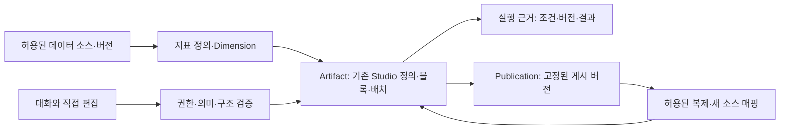

# Enterprise Data Artifact 요구사항 설계

상태: **Draft — 요구사항 제안, 구현·고객 수용 미완료**. 작성일 2026-10-18. 사용자 요청: “기업 데이터 LLM Artifact가 될 수 있도록 요구사항 설계”. 현재 [제품 목표](prompt-to-dashboard.md)의 P1~P5를 확장하며 기존 기능을 다시 만드는 계획이 아니다. 기능 요구사항의 관리 원본은 [FR-013~028](../requirements.md), 용어는 [용어집](../glossary.md)이다.

## 1. 제품 정의와 성공 기준

**VanillaMeta는 기업 데이터를 연결해 대화로 분석 Artifact를 만들고, 직접 편집·저장·게시·재사용하면서 계산 근거와 데이터 권한을 유지하는 서비스다.** Artifact는 대화의 답변에 붙은 이미지가 아니라, 재실행 가능한 분석 정의·반응형 블록·업무 설명·출처를 가진 결과물이다.

사용자가 요구한 방향은 기업 데이터·LLM·Artifact다. 초기 고객을 매출·환불 업무의 중소 운영팀으로 한정하고, 첫 형태를 대시보드와 짧은 분석 보고서로 제공하는 것은 기존 전략에 근거한 설계 가정이다. 모든 문서·슬라이드·업무 앱 생성이나 범용 코드 실행까지 요청받은 것으로 확대하지 않는다.

첫 가치 검증은 “원본 파일로 지난 기간의 매출·환불 결과물을 만들고, 금액의 근거를 확인해, 동료에게 허용된 버전을 전달하고 다음 데이터로 재사용한다”이다. 기능 존재·합성 데이터 PASS·실제 담당자의 수용을 별도로 기록한다. 현재 대표 여정은 [선택 검증 완료](../testing/status.md)이며 [고객 파일럿](../testing/customer-pilot.md)은 실제 입력 부재로 NOT_RUN이다.

### 선택한 접근

| 대안 | 장점 | 비용·문제 | 판단 |
|---|---|---|---|
| 기존 BI에 채팅만 추가 | 초기 변경이 작음 | 답변과 저장 결과·권한·갱신이 분리됨 | 목표 부족 |
| 기존 Studio를 Artifact 작업 공간으로 확장 | 검증된 지표·블록·저장·게시·복제 재사용 | 출처·권한·갱신 계약 보강 필요 | **채택안** |
| LLM 생성 코드를 실행하는 범용 앱 플랫폼 | 표현 자유도가 큼 | 실행 격리·네트워크·데이터 유출·유지 비용 증가 | 초기 범위 제외 |

## 2. 대상·역할·첫 사용자 여정

| 역할 | 할 수 있어야 하는 일 | 자동 부여하지 않는 권한 |
|---|---|---|
| 운영 담당자 | 허용 소스로 생성·탐색·직접/AI 수정·비공개 저장 | 모든 소스 열람·조직 전체 게시 |
| 데이터 관리자 | 소스 접근·업무 정의·갱신 설정·민감 열 정책 관리 | 사용자의 비공개 대화 일괄 열람 |
| 조직 관리자 | 구성원·역할·공유 정책·AI 전송 정책 관리 | 권한 없는 원본 행을 통한 우회 조회 |
| 공유 수신자 | 허용 게시본 조회·허용 시 본인 데이터로 복제 | 원본 SQL·자격증명·원본 소스 접근 |

역할은 책임 정의다. 현재 계정 모델에 조직 관리자·데이터 관리자 전체가 구현됐다는 뜻이 아니다. 초기 배포는 단일 조직 운영으로 제한할 수 있지만 서버의 권한 검사와 소유권 경계를 생략하지 않는다. 다중 조직 외부 서비스는 조직 격리 수용을 마친 뒤 연다.

1. 시작 화면에서 업무 질문을 입력하고 파일 또는 허용된 저장 소스를 선택한다. 샘플은 고객 데이터와 명확히 구분한다.
2. 열·타입·통화·기간·상태·중복/누락을 프로파일링한다. 매출의 의미나 환불률 분모가 결과를 바꾸는 경우만 질문한다.
3. 같은 대화 옆에 지표·차원·출처·계산 기준과 전체 미리보기를 보여준다. 생성은 기본 비공개이며 자동 게시하지 않는다.
4. “환불률이 높은 채널을 표로”, “이 설명을 위로”, “두 번째 차트만 주별로”를 같은 블록 정의에 적용한다. 직접 편집과 AI는 하나의 변경 이력을 쓴다.
5. 숫자를 선택해 해당 소스 버전·계산·조회 조건과 허용된 원본 기여 행을 확인한다. 근거가 없으면 원인이라고 단정하지 않는다.
6. 명시 저장하고 다시 연다. 게시 대상·데이터 시점·공유 범위를 확인한 뒤 링크를 만든다.
7. 갱신 뒤 최신 작업 결과와 이미 게시한 버전의 차이를 확인한다. 재게시 또는 본인 파일로 복제해 계속 사용한다.

## 3. Artifact의 내용과 공통 화면

첫 Artifact는 KPI+추세, 차트, 표/Pivot, 근거를 포함한 설명, 필터로 구성한다. 임의 HTML/JS 블록은 제공하지 않는다. 설명·필터의 독립 블록화는 목표이며 현재 모든 블록 종류가 저장·게시까지 구현됐다고 간주하지 않는다.

| 영역 | 요구사항 |
|---|---|
| 시작 | 질문 입력·내 파일·저장 소스·업무 샘플. 내부 모델/엔진 선택을 시작 조건으로 요구하지 않음 |
| 작업 공간 | 대화와 결과를 함께 표시. 직접 편집/AI 수정의 대상 블록·변경 범위·진행/실패 단계 표시 |
| 근거 | 블록의 계산식 요약·지표 버전·기간/시간대·필터·데이터 시점·조회 제한. 상세는 점진적으로 열기 |
| 갱신 | 최신 성공 시각·현재 사용 버전·갱신 실패/오래됨. 재시도와 게시본 갱신을 구별 |
| 게시 | 저장본/게시본 구별, 읽기 범위·데이터 모드·만료·재사용 허용·마지막 게시 시점 표시 |
| 모바일 | 대화/결과/설정을 전환해도 질문·선택·초안 유지. 표의 가로 스크롤은 표 내부로 제한 |

shadcn UI Kit와 기존 토큰을 사용한다. 새 화면의 버튼 크기·폰트·정렬·간격·긴 이름·빈 결과·로딩·오류를390/768/1440px에서 확인한다. 키보드로 블록 선택·이동·설정·미리보기·저장·게시 창까지 접근하고 닫은 뒤 원래 초점으로 돌아와야 한다. 실휴대폰과 VoiceOver BLOCKED는 별도 수용 gate다.

## 4. 데이터·의미·실행 계약

### 논리 모델

Artifact는 초기에는 기존 Dashboard/Studio의 제품 개념이다. 별도 테이블·ID·변환 계층을 선행 도입하지 않는다. 기존 논리 block ID·revision·게시 version을 유지한다.

| 객체 | 유지할 계약 |
|---|---|
| 데이터 소스 | 소유/조직 범위, 스키마·데이터 버전, 마지막 성공 갱신·상태, 민감 열 정책. 비밀 설정은 별도 서버 경계 |
| 지표 정의·Dimension | 통화·단위·분모·시간대·상태 조건·정의 버전. 업무 표시명만 같다고 재사용하지 않음 |
| Artifact | 질문 목적, 블록 참조·표현·배치·조회 조건·revision. 대화 원문 자체를 실행 정의로 사용하지 않음 |
| 실행 근거 | 요청ID, 실행자, 사용 소스/지표 버전, 기간·필터, 결과 시점·완료 상태. 원본 행·비밀·숨겨진 추론은 기본 보관하지 않음 |
| Publication | 정확한 저장 revision, 공유 대상·만료·데이터 모드·기준 시점·재사용 허용. 초안과 독립 |

### 데이터 연결과 갱신

초기는 기존 CSV/JSON/Parquet·저장 소스와 DuckDB worker를 재사용한다. 고정 Commerce 묶음과 일반 파일은 의미를 구별한다. API 커넥터는 실제 파일럿에 필요한 한 종류부터 읽기 전용으로 추가하며, 인증·페이지네이션·요청 제한·중복 제거·재시도 계약을 먼저 정의한다. 모든 기업 데이터 소스 연결을 MVP로 약속하지 않는다.

갱신 작업의 논리 상태는 `대기 → 처리 중 → 검증 중 → 성공/실패/취소`다. 데이터 버전 활성화는 검증 성공 뒤 원자적으로 한다. 실패·서버 재시작은 마지막 성공 버전을 보존하고 미완료를 성공으로 표시하지 않는다. 같은 갱신 요청 재시도는 새 활성 버전을 중복 생성하지 않는다. 스키마 변경은 영향 블록을 표시하고 자동 열 삭제/강제 형변환 대신 재연결을 요구한다.

첫 구현은 수동 파일 갱신과 상태 노출이다. 예약 수집·증분 반영·변경 데이터 캡처는 별도 단계다. DB 메타데이터의 다중 서버 잠금 검증이 DuckDB 파일의 다중 replica 동시 쓰기 지원을 뜻하지 않는다.

### 의미와 숫자

- 금액·건수·비율의 단위와 표시 스케일을 구분하고, 통화·분모를 근거 없이 바꾸지 않는다. 기존 [Commerce 단위 검사](../testing/commerce-units.md)는 고정 소스 생성·신규 저장의 좁은 범위다.
- 주문일 코호트와 결제/환불 발생일 현금 흐름을 다른 계산으로 취급한다. 필요한 날짜 열·상태가 없으면 이유를 표시한다.
- 전체·기간·차원·Pivot·원본 상세는 같은 권한/소스 버전/조건을 사용한다. 집계 결과 조건과 원본 행 조건을 UI에서도 구별한다.
- 여러 소스 결합은 키·카디널리티·중복·비일치 행 수·통화·집계 단위를 먼저 검증한다. 결합으로 금액이 부풀면 저장을 막는다. 임의 조인을 AI가 조용히 추가하지 않는다.
- AI 설명의 수치·주장에는 블록 또는 실행 근거를 연결한다. 관측된 변화, 원인 가설, 추가 데이터가 필요한 판단을 구별한다.

## 5. 기업 데이터 권한과 LLM 경계

권한은 프롬프트가 아니라 서버가 판정한다. 소스 조회·프로파일·후보 값·지표 실행·원본 상세·내보내기·게시·복제·AI 도구 호출에 같은 정책을 적용한다. 캐시·영수증·보관 초안도 사용자/조직/권한 범위를 넘겨 재사용하지 않는다.

LLM에는 기본적으로 허용된 스키마·업무 정의·필요한 집계만 전달한다. 원본 예시 행은 정책에서 허용한 열·최대 행 수 안에서만 전송한다. 비밀·연결 문자열·서버 경로·마스킹 대상 열은 제외한다. 로컬 Codex가 호출 주체여도 추론 제공자로의 외부 전송이 사라지는 것은 아니다. 조직별 제공자/전송 허용 정책과 사용 내역을 남기며, 정책이 금지하면 전송 전에 차단한다. gpt-6-luna를 유지하고 다른 모델로 자동 대체하지 않는다.

파일 값·열 설명·외부 API 응답은 신뢰하지 않는 데이터다. 그 안의 “다른 소스를 읽어라/공개하라” 같은 문장을 사용자 명령으로 취급하지 않는다. 모델이 만든 SQL·코드·도구 인자는 실행 허가가 아니며 구조화 작업·읽기 제한·컴파일·권한 검사를 통과해야 한다. 임의 코드 실행은 초기 범위 밖이다.

| 경계 상황 | 요구 동작 |
|---|---|
| 원본 소스 접근 회수 | 다음 실행·상세·내보내기 차단, 이전 실행 캐시로 우회 불가 |
| 게시본 읽기 권한 회수/만료/중지 | 다음 서버 접근 차단, 화면의 게시 데이터 제거. 이미 받은 파일/캡처까지 회수한다고 약속하지 않음 |
| 원본 권한 회수 후 게시 snapshot | 별도로 배포된 snapshot은 독립 배포물임을 사전 고지. 자동 중지 정책을 선택하면 서버 접근 시 종속 권한 검사. 정책 구현 전 해당 자동 중지 보장 없음 |
| 링크만으로 데이터 복제 시도 | 소유자 재사용 허용·수신자 로그인·본인 소스 접근/매핑을 모두 확인 |
| 조직 외부 공유 | 기본 금지. 조직 정책과 실행자 권한이 허용하고 명시한 범위에서만 게시 |
| 민감 열로 그룹/필터/정렬 시도 | 값 반환뿐 아니라 후보 값·집계·AI 문맥을 통한 누출도 서버 정책으로 제한 |

복제 시 내부 식별자·수신자 목록·비밀·원본 결과 데이터·대화 이력을 자동 복사하지 않는다. 허용된 계산 정의가 복제본 소유자에게 노출되는 범위는 별도로 고지한다. 표·텍스트 출력은 HTML/스크립트로 실행하지 않고 내보내기는 수식 주입을 방어한다.

## 6. 저장·게시·재사용 상태

Artifact 편집 상태, 실행 상태, 게시 상태는 서로 다른 축이다. “게시됨”과 “미저장 변경 있음”은 동시에 가능하다.

| 축 | 상태·규칙 |
|---|---|
| 편집 | 초안/저장됨/충돌/저장결과 불명확. 불명확하면 새 저장 대신 같은 요청 결과 확인 |
| 실행 | 준비/실행 중/성공/실패/취소/오래됨. 이전 성공 결과는 기준 시점과 함께만 유지 |
| 게시 | 미게시/활성/만료/중지. 활성 버전은 편집이나 원본 갱신만으로 바뀌지 않음 |

초기 게시의 제품 목표는 고정된 데이터 snapshot이다. 기존 Studio 게시 경로마다 실제 보관하는 데이터/정의와 익명 접근 계약을 점검하고, 검증 전 모든 게시가 동일한 snapshot이라고 표시하지 않는다. live 모드는 현재 권한·현재 데이터 버전·조회 시각을 명시하는 별도 기능으로 둔다. snapshot을 자동 갱신되는 대시보드라고 안내하지 않는다.

같은 requestId/본문 재시도는 같은 저장·게시·복제 결과로 확인한다. 충돌 시 비대상 최신 변경을 보존하고 명시한 범위만 재검토한다. 데이터 갱신으로 지표가 달라지면 정의 변경과 데이터 변경을 분리해 보여준다. 감사 기록에는 변경 종류·실행자·대상·결과·버전·요청ID를 남기되 비밀/원본 민감 값은 남기지 않는다.

## 7. 현재 기반과 추가할 범위

| 기반 | 현재 근거 | 이번 요구사항의 차이 |
|---|---|---|
| 대화 생성·수정·저장·게시·복제 | [TC005](../testing/dashboard-lifecycle.md), [Studio](../testing/studio-completion-1-5.md) 선택 검증 | Artifact 공통 근거·조직 정책·갱신 계약 |
| 재사용 지표·블록·반응형 편집 | P1~P3 및 최신 [검증 현황](../testing/status.md) | 텍스트/필터 포함 블록 유형의 끝까지 일관된 저장·게시 |
| 탐색·Pivot·CSV | [Rill 탐색](../testing/rill-exploration.md), [Pivot](../testing/explore-pivot.md) | 집계 조건 필터·고급 Pivot·Studio 동등성은 별도 |
| 파일 교체·DuckDB worker | [운영 구조](server-duckdb-operations.md) | 갱신 상태·영향 표시·durable 실행/복구 범위 |
| 소유권·공유·로컬 DB 복구 | 최신 검증 현황의 선택 조건 | 조직/RLS·민감 열·LLM 전송 정책·운영 규모 전체는 미완료 |

## 8. 개발 순서와 종료 조건

시간은 팀 규모·실제 소스가 정해지지 않아 확정하지 않는다. 단계별로 실제로 필요한 최소 변경만 수행하고 이미 통과한 케이스는 재사용한다. 현재 미커밋 단위 검증과 파일럿 문서는 별도 보존한다.

| 단계 | 범위 | 선행 조건 | 종료 조건 |
|---|---|---|---|
| A — 신뢰할 수 있는 Artifact | 근거 패널·데이터 시점·단위/정의·실행 상태·기존 Studio 일관성 | 현재 저장·게시 계약 조사 | EA-01~04/07. 두 대표 Artifact에서 화면→실행 근거→정답 연결 |
| B — 반복 사용 | 수동 갱신·실패 복구·스키마 영향·원본/게시 구분 | A | EA-05/06. 갱신 성공/실패 후 활성 버전·숫자·게시본 불변 증명 |
| C — 기업 내부 파일럿 | 단일 조직 역할·최소 소스/열 정책·LLM 전송 제어·감사 | A, 조직 정책 정의 | EA-08~10/12. 비인가 조회·AI 전송·export 우회0, 담당자 수용 |
| D — 재사용 확장 | 설명/표/필터·업무 템플릿·새 소스 매핑 보강 | A~C의 해당 계약 | EA-11. 두 번째 업무 데이터의 독립 정답·원본 보존 |
| E — 지속 운영 | 수요가 확인된 API 1종·예약 갱신, 이후 알림/보고서 | B/C, 실제 운영 환경 | 실패/재시도·비용/성능 측정 후 별도 운영 수용 |

모든 단계를 직렬 개발해야 한다는 뜻은 아니다. 단일 조직의 비공개 로컬 파일럿은 운영 제약을 명시해 A부터 실행할 수 있다. 기업 데이터의 외부 LLM 전송과 외부 공유는 C의 해당 정책이 준비되기 전 허용하지 않는다. 다중 조직 SaaS·조직별 행 정책·SSO·실시간 공동 편집·범용 코드 실행·CDC는 초기 MVP 범위에서 제외하고 고객 요구와 함께 별도 설계한다.

## 9. MD 인수 시나리오

아래는 **설계된 인수 조건이며 모두 NOT_RUN**이다. 기존 증빙은 기반으로 재사용하되 새 기업 정책까지 PASS로 승계하지 않는다.

| ID | Given / When | Then | 추적 | 상태 |
|---|---|---|---|---|
| EA-01 | 허용 파일과 업무 질문으로 생성 | 지표·차원·업무 기준·전체 미리보기, 근거 없는 열/계산 없음 | FR-007/008/014 | NOT_RUN |
| EA-02 | 블록 하나를 직접 배치하고 AI로 내용 수정 | 비대상 ID/정의/모든 폭 배치 보존, 같은 undo 이력 | FR-009/010 | NOT_RUN |
| EA-03 | 저장 후 reload하고 근거 열기 | 저장 revision·소스/지표 버전·기간/필터/시간대·수치 추적 가능 | FR-003/015 | NOT_RUN |
| EA-04 | 특정 필터로 게시하고 초안 수정 | 게시 범위·기준 시점 명시, 재게시 전 게시 내용 불변 | FR-011/020 | NOT_RUN |
| EA-05 | 수동 갱신 중 오류·서버 중단 후 재시도 | 마지막 성공 데이터 보존, 거짓 성공·중복 활성 버전0 | FR-016 | NOT_RUN |
| EA-06 | 열 삭제/타입 변경 파일로 갱신 | 영향 블록 표시, 조용한 계산 교체 없음, 복구·재연결 안내 | FR-017 | NOT_RUN |
| EA-07 | 390/768/1440과 키보드로 생성·근거·편집·저장·게시 창 이동 | 문서 넘침0·초점 보존·핵심 동작 접근. 실기기/VoiceOver 별도 | FR-010/NFR-001/003 | NOT_RUN |
| EA-08 | 다른 조직/역할의 소스·열·캐시·export·AI 실행 시도 | 서버 거절·금지 데이터0, 본인 허용 결과 유지 | FR-013/018/NFR-005 | NOT_RUN |
| EA-09 | 외부 전송 금지 정책과 민감 열 포함 파일 | 제공자 호출 전에 차단 또는 허용 문맥만 전달, 비밀 전송0 | FR-019/NFR-006 | NOT_RUN |
| EA-10 | 데이터 안에 타 소스 조회·공개 지시 삽입 | 데이터로 취급, 권한 확대·비의도 쓰기/게시0 | FR-018/019/NFR-005 | NOT_RUN |
| EA-11 | 허용된 Artifact를 본인 새 소스로 복제 | 새 ID/새 정답, 원본·게시본 불변, 원본 비밀/대화 복사0 | FR-012/021 | NOT_RUN |
| EA-12 | 실제 담당자가 한 질문을 도움 없이 완료 | 독립 정답 일치·소요시간/도움 횟수·수용/보류 기록 | NFR-010 | NOT_RUN |

## 10. 검토할 제품 선택

### 요구사항 추적과 구현 경계

| 요구사항 | 단계 | 검증 연결 |
|---|---|---|
| FR-013/018/019/028 | C | EA-08~10, 역할별 감사 기록 대조. 조직/행/열 정책의 상세 UC·테스트는 구현 전 작성 |
| FR-014/015/020/022 | A | EA-01/03/04, 근거 연결·사실/가설 표시. 기존 게시 경로별 데이터 모드 조사 포함 |
| FR-016/017 | B | EA-05/06, 실제 갱신 실패·재시작 후 버전 대조 |
| FR-021/023/024 | D | EA-02/07/11, 설명/필터 Block의 저장·게시·복제 왕복 조건을 구현 전 추가 |
| FR-025/026 | D 이후 수요별 | 결합 카디널리티·집계 조건용 별도 MD 설계 필요. EA-01~12만으로 완료하지 않음 |
| FR-027 | E | 수집 종류/주기 확정 후 예약·중복·장애 복구 MD 별도 설계 필요 |

NFR-005/006은 C의 데이터 경계, NFR-007은 A의 근거, NFR-008은 B의 갱신, NFR-009는 측정 조건을 고정한 성능, NFR-010은 실제 사람 파일럿의 종료 조건이다. 아직 연결 UC가 없는 신규 요구사항은 Open으로 유지하며 기존 UC의 Verified를 재사용하지 않는다. 설계/문서 검사가 통과해도 이 인수 조건은 자동 승격하지 않는다.

- 첫 고객의 업무 질문·독립 정답·데이터 경로와 금액/환불률/날짜 의미.
- 허용 LLM 제공자·전송 가능한 스키마/집계/예시 행과 최대 행 수. 초기 기본은 예시 행0이다.
- snapshot의 원본 권한 회수 시 자동 중지 여부·보관 기간·감사 보관 기간. 미확정 상태에서 영구 보관이나 자동 회수를 약속하지 않는다.
- 운영 측정용 하드웨어·데이터 크기·동시성·허용 지연·복구 목표. 요구사항 수치는 설계 목표이며 현 성능 보장이 아니다.

이번 산출물은 요구사항·우선순위·수용 기준이다. 신규 런타임·스키마·커넥터·권한 기능을 구현하거나 모델 설정을 바꾸지 않았다. gpt-6-luna 및 VoiceOver BLOCKED 유지.
