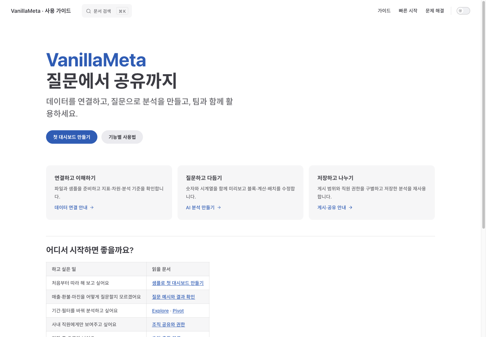

# 사용자 가이드 운영 배포 검증

2026-10-21 · Cloudflare Pages / Ego TaskSpace 125. 사용자 지정 공개 주소에 실제 배포·DNS·HTTPS·화면을 검증했다. 제품 서버·DB 인수테스트와 별개다.

## 배포 결과

- 운영 주소: **https://docs.vanillameta.net/**
- 프로젝트: `vanillameta-docs`, production branch `develop`.
- 콘솔 상태: 도메인 **활성 / SSL 사용됨**.
- CNAME: `docs` → `vanillameta-docs.pages.dev` (Cloudflare DNS).
- 최초 배포: 로컬 `11850630`에서 검증한 정적 ZIP만 Pages UI로 업로드.
- Actions 재배포: [39537491218](https://github.com/vanillabrain/vanillameta/actions/runs/39537491218), build/deploy 모두 성공. 실제 실행 기준 커밋 `1053f5d4`, 배포 `311eb330.vanillameta-docs.pages.dev`.
- 작업 중 원격에 추가된 사용자 변경은 확인 후 fast-forward로 보존했다. 배포 기준과 당시 로컬 HEAD를 혼동하지 않는다.

Pages 전용 토큰을 해당 계정의 Pages 편집으로 제한해 GitHub Actions Secret에 직접 전달했다. DNS·다른 제품 권한은 추가하지 않았고 비밀 값을 출력하거나 파일로 남기지 않았다. 계정 ID Secret·프로젝트 변수·자동 배포 활성화 변수를 등록했다.

## HTTPS와 경로

Python 기본 SSL 신뢰 저장소의 인증서 체인·호스트명 검증을 통과했다. TLS 1.3, 인증서 issuer Google Trust Services WE1, SAN `docs.vanillameta.net`, 확인 당시 만료 2027-01-19 03:14:06 UTC(한국 시각 12:14:06)였다. 인증서는 이후 자동 갱신으로 바뀔 수 있다.

초기에는 공개 DNS가 새 A를 반환해도 로컬/브라우저에 NXDOMAIN이 남았다. DNS 호스트 캐시만 새로고침한 뒤 일반 호스트명 HTTPS 200과 Ego의 실제 주소 접속을 확인했다. 쿠키·로그인·사용자 저장소는 지우지 않았다.

| 확인                                    | 결과                                        |
| --------------------------------------- | ------------------------------------------- |
| 사용자 문서 20개 직접 HTTP 조회         | 모두 200                                    |
| 홈·quickstart·scope 직접 진입/새로고침  | 정상                                        |
| 내부 `/docs/testing/user-guide-site.md` | 404                                         |
| 내부 `/docs/plans/user-guide-site.md`   | 404                                         |
| 제거한 외부 제품 참고 문구              | 20개 응답 본문에서 없음                     |
| 한국어 ‘재게시’ 검색                    | 결과 표시, 게시 문서 해당 절 이동·앵커 존재 |
| 모바일 메뉴                             | Pivot 이동 후 닫힘, 넘침 0                  |
| 빠른 시작 이미지                        | 5개 로딩·새로고침 후 유지                   |
| 실제 화면 모음                          | 16개 이미지 로딩                            |

## 반응형과 실제 화면

| 폭     | 제목 | 본문 | 페이지 가로 넘침 |
| ------ | ---- | ---- | ---------------- |
| 390px  | 27px | 16px | 0                |
| 768px  | 32px | 16px | 0                |
| 1440px | 32px | 16px | 0                |

Ego에서 홈·빠른 시작과 메뉴/검색을 확인하고 캡처를 직접 검토했다. 실휴대폰이 아닌 브라우저 폭 모사이며 모든 문서의 모든 테마·접근성 상태를 검사한 것은 아니다.

측정 원시는 Git 제외 `.aiwf/evidence/docs-production-20261021/`에 보관했다. 로컬 build/링크 검사는 HTML 21개(404 포함)·내부 참조 843건 오류 0이다.

## 자동 배포 유지

develop 문서 변경 → build/기본·하위 경로 검사 → 검증 artifact → Pages 배포 순서다. 운영 연결 이후 workflow에 커스텀 docs 주소 홈·scope 확인도 추가했다. 자동 배포가 비활성화되거나 토큰이 회수되면 공개 사이트의 기존 배포는 그대로 유지된다. 운영 절차는 [배포 안내](../operations/user-guide-cloudflare.md)를 따른다.

전체 기능 수용·운영 제품 API·DB·다른 커넥터 검증 결과로 확대하지 않는다.
