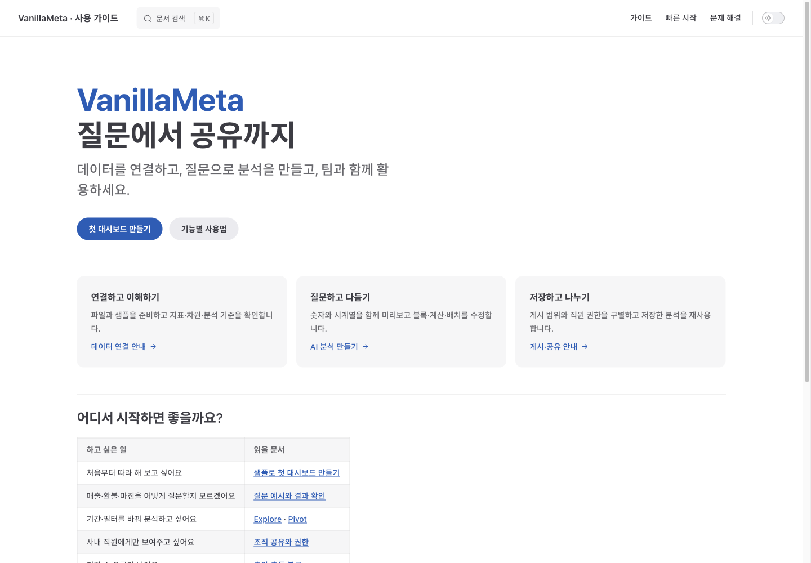
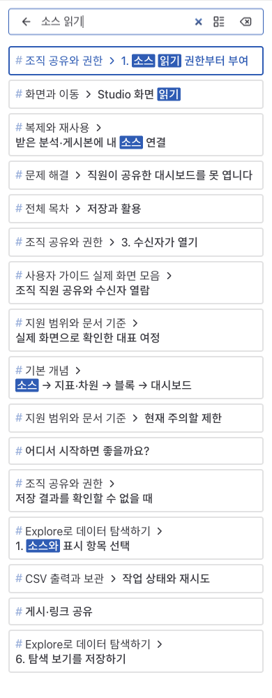

# 상세 사용자 가이드 사이트 검증

2026-10-21 · develop `b406b9e3`에서 시작한 문서 사이트 변경. 제품 소스/API/DB는 변경하지 않았다. 최종 전달 커밋은 Git 이력을 따른다. 이번 검증은 문서 사이트의 실제 동작이며 제품 전체 인수테스트 재실행이 아니다.

## 구성과 대조

- [설계](../plans/user-guide-site.md): VitePress/Docusaurus 비교, 사용자 학습 흐름, 사용자 소스만 빌드하는 경계.
- 사용자 페이지 20개(홈 포함), 별도 404. 빠른 시작·화면 모음은 기존 원문 include. 기존 공개 합성 데이터 캡처 16개를 재사용한다.
- 데이터·AI·게시·직원 공유 절차는 기존 [제품 실행 기록](user-guide-ego.md)을 바탕으로 확장한다. Explore/Pivot·지표 조합·보기 저장·CSV 작업 안내는 해당 UI 코드와 기존 검증 문서를 대조했다. 이번에 해당 제품 조합을 모두 실행한 것은 아니다.
- 사용 흐름에 목적·조건·순서·확인할 결과·문제 대응을 추가했다. 운영/실기기/전체 기업 요건 완료를 주장하지 않는다.

## 실행 환경과 결과

Node 24.19.0 / VitePress 1.6.4 / Vite 6.4.4 override / Ego TaskSpace 124. 로컬 정적 완성본 4174, 개발 서버 4175를 구분했다.

| 확인                               | 결과                                                                      |
| ---------------------------------- | ------------------------------------------------------------------------- |
| 독립 의존성 설치·audit             | 초기 3건(고위험 1 포함), Vite 6.4.4 교체 후 0건                           |
| production build                   | 성공. dead link 무시 옵션 없음                                            |
| 기본 경로 링크·이미지·앵커 검사    | HTML 21개 / 로컬 참조 844건 / 오류 0                                      |
| `/guide/` 하위 경로 빌드·동일 검사 | HTML 21개 / 로컬 참조 844건 / 오류 0                                      |
| Ego 한국어 검색                    | ‘재게시’ 결과에서 게시 문서의 해당 절 이동, hash 대상 존재                |
| 모바일 검색                        | ‘소스 읽기’ 결과 16개, 입력 16px, 넘침 0                                  |
| 모바일 메뉴                        | 메뉴 열기 → Pivot 이동 → 자동 닫힘                                        |
| 모바일 페이지 내 목차              | 변화 지표 정렬 절 이동, hash 대상 존재                                    |
| 390px 전체 사용자 페이지           | 20개 모두 로딩·페이지 가로 넘침 0                                         |
| 빠른 시작 390/768/1440px           | 넘침 0, 본문 16px, 제목 27/32/32px                                        |
| 검색 컨트롤                        | 768/1440 높이 40px, 390 모바일 아이콘 영역 55px                           |
| 캡처 표시                          | 빠른 시작 5개, 화면 모음 16개 로딩 확인; 모음 새로고침 후 유지            |
| 개발 모드                          | 원문 include와 빠른 시작 캡처 5개 로딩 확인                               |
| 소스 범위                          | 생성 HTML/검색 JS/JSON에서 내부 계획·검증/비공개/로컬 절대 경로 패턴 없음 |
| 개발 서버 파일 경계                | 문서 범위 밖 공개 설계 파일의 `@fs` 직접·raw·import 요청 모두 403         |

빌드/검사 명령:

```bash
npm --prefix docs/user-manual ci
npm run docs:build
npm --prefix docs/user-manual run check
VM_DOCS_BASE=/guide/ npm run docs:build -- --outDir /tmp/vm-guide-subpath-dist
python3 docs/user-manual/scripts/check-build.py /tmp/vm-guide-subpath-dist /guide/
```

범위 검사기는 내부 경로 패턴과 출력 페이지 목록을 검사한다. 모든 문장의 개인정보 유무나 링크의 외부 사이트 상태를 자동 보증하는 검사는 아니며 변경 본문은 별도 수동 검토했다.

## 확인 중 발견·수정

1. 한글 제목으로 직접 적은 앵커 1개가 VitePress 생성 정규화와 달랐다. 페이지 링크로 바꾸고 전체 출력 앵커 검사 0건을 확인했다.
2. 빌드에서 정상인 원문 상대 이미지 경로가 개발 모드에서 깨졌다. 사전 실행 스크립트로 공개 PNG만 ignored 정적 자산에 준비하고 사이트 렌더 경로를 일관되게 변경했다. 원본 캡처와 GitHub 문서 경로는 보존했다.
3. VitePress는 기본 설정 병합 중 작업공간 루트를 fs.allow에 더했다. 사용자 설정의 allow만으로는 충분하지 않아 직접 확인한 공개 설계 파일이 개발 서버에서 읽혔다. 최종 configResolved에서 문서 패키지로 좁힌 후 3형태 모두 403, 정상 가이드·캡처 표시를 확인했다. 실제 비공개 자료로 시험하지 않았다.
4. 기본 Vite 5 전이 의존성의 audit 결과를 확인해 고정 override로 수정했다. VitePress 기본 의존 범위를 넘는 호환 조정이므로 다음 버전 업그레이드 시 재검토한다.

## 화면 증빙






원시 모바일 페이지별 측정은 Git 제외 `.aiwf/evidence/user-guide-site-20261021/`에 보관했다. CI는 사용자 문서 변경 시 기본/하위 경로 build·링크 검사를 실행하도록 추가했으며 원격 Actions 실행 결과는 로컬 실행과 구분한다.

## 미실행·별도 작업

- 외부 호스팅 배포·도메인·사내 인증은 수행하지 않았다. 정적 결과물에 제품 데이터·자격 증명을 넣지 않는다.
- 실휴대폰·스크린 리더·모든 테마/기기·한국어 형태소 검색 품질 전체 평가는 미실행이다.
- 제품의 모든 외부 커넥터·Pivot 조합·권한·운영 환경·전체 기업 요건 수용은 별도다.
