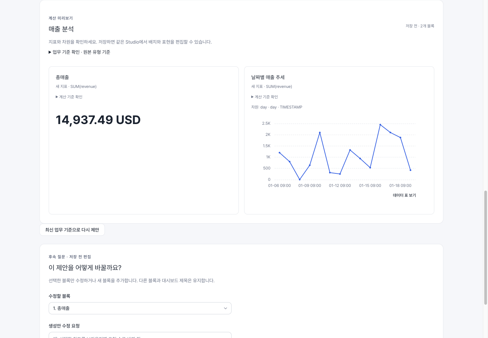

# AI 실행 환경 준비하기

::: warning 개발 환경과 운영 환경
아래 Codex CLI 절차는 **로컬 개발 환경 전용**입니다. `NODE_ENV=prod`에서는 `AI_PROVIDER=codex`를 서버가 거절합니다. 개발 환경의 로그인·생성 성공을 운영 배포 준비 완료로 판단하지 마세요. 기존 검증의 gpt-6-luna 설정은 그대로 유지하며, 이 안내가 다른 모델로 변경하라는 뜻은 아닙니다.
:::

## 운영 환경의 제공자 준비

운영자는 설치된 버전의 제공자 설정을 확인합니다. 현재 지원 설정은 다음과 같습니다. 이는 설정 계약 안내이며 각 제공자의 실제 호출 성공을 보장하는 표가 아닙니다.

| 설정 | 필요한 준비 |
| --- | --- |
| `AI_PROVIDER=openai` | `AI_API_KEY`, 사용할 `AI_MODEL`을 명시해 확인 |
| `AI_PROVIDER=anthropic` | `AI_API_KEY`, 명시적인 `AI_MODEL` |
| `AI_PROVIDER=openai-compatible` | `AI_API_KEY`, 명시적인 `AI_MODEL`, 승인된 `AI_API_BASE_URL` |

AI를 설정한 운영 환경에는 월간 한도 `AI_GLOBAL_MONTHLY_TOKENS`를 양의 정수로 지정해야 합니다. 키는 서버의 비밀 설정으로 제공하고 브라우저·질문·저장소에 넣지 않습니다. 모델 이름은 해당 제공자 계정에서 실제 사용 가능한 값인지 확인합니다. 임의 이름이나 다른 모델로 자동 대체하지 않습니다.

제공자 설정만으로 운영 서버가 완성되지는 않습니다. 데이터베이스·인증 비밀 값·CORS·읽기 전용 정책 등 서버의 운영 부팅 검사를 모두 통과해야 합니다. 앱에서 **질문 → 계산 미리보기 → 저장 → 새로고침**을 실행해 실제 결과를 확인합니다. 원장·한도 거절이나 연결 실패가 있다면 실행 성공으로 처리하지 않습니다.

## 로컬 개발 환경의 Codex 연결

VanillaMeta의 질문을 실제 AI가 처리하도록 준비하는 **서버 운영자용 안내**입니다. 일반 사용자는 관리자가 연결을 마친 앱에서 [Artifact 만들기](./agent-artifacts.md)로 바로 시작하세요.

## 먼저 연결 방향을 확인하세요

현재 제공되는 경로는 다음과 같습니다.

```text
사용자 → VanillaMeta 질문 화면 → API 서버 → Codex CLI → 분석 생성안
사용자 ← 숫자·차트 미리보기 ← 서버의 검증·계산
```

여기서는 **서버가 Codex를 호출**합니다. 개인 PC의 Claude Code나 Codex에 VanillaMeta MCP를 등록하는 경로와는 다릅니다. 외부 에이전트에서 직접 접속하려면 별도의 [로컬 MCP 연결 절차](./mcp.md)를 따르세요. MCP가 요청을 보내더라도 지원되는 서버 AI 실행 환경은 필요합니다. 운영 환경은 위의 제공자 설정을 사용합니다.

## 1. API가 실행되는 곳에서 CLI 확인

API 서버를 실행할 **같은 운영체제 계정**으로 터미널을 엽니다. 개인 노트북의 로그인만으로 원격 서버나 컨테이너가 로그인되는 것은 아닙니다.

```sh
node --version
command -v codex
codex --version
codex login status
```

이 프로젝트의 Node 기준은 24.11 이상 25 미만입니다. `command -v`가 경로를 찾지 못하면 API 프로세스에서도 CLI를 실행할 수 있는지 확인해야 합니다.

CLI가 없다면 [OpenAI 공식 Codex 설치 안내](https://developers.openai.com/codex/cli/)를 따라 설치합니다. npm 설치 방식은 다음과 같습니다.

```sh
npm install -g @openai/codex
```

설치 후 로그인 상태를 확인하세요. 로그인하지 않은 경우 아래 명령을 실행하고 CLI가 안내하는 브라우저 로그인 절차를 마칩니다.

```sh
codex login
codex login status
```

이미 로그인되어 있다면 다시 로그인하거나 로그아웃할 필요는 없습니다. 자격 증명 파일을 문서·채팅·저장소에 복사하지 마세요.

::: info 환경 범위
현재 제품 호출기는 POSIX 프로세스 그룹을 사용하며 Windows 네이티브 실행은 지원하지 않습니다. 이 안내의 설정 명령은 macOS/Linux 셸 기준입니다. WSL·원격 서버·컨테이너는 각 실행 계정의 CLI·인증·파일 접근을 별도로 확인해야 합니다. Docker 호스트에 설치한 CLI는 컨테이너 안에서 자동 제공되지 않습니다.
:::

## 2. VanillaMeta의 AI 제공자 설정

이미 앱과 DB가 실행되는 개발 환경을 기준으로 합니다. 저장소의 `backend-api/.env.local`에 기존 DB·포트 설정을 보존하면서 다음 항목을 추가하거나 갱신합니다. 파일 전체를 덮어쓰지 마세요.

```dotenv
AI_PROVIDER=codex
AI_TIMEOUT_MS=180000
```

현재 서버 호출기가 요청하는 모델은 `gpt-6-luna`로 고정되어 있습니다. `AI_MODEL`을 바꿔 이 Codex 경로의 모델을 변경하는 방식은 지원하지 않습니다. 해당 모델을 사용할 수 있는 연결과 계정이 필요합니다. 모델 지원 오류를 다른 모델로 자동 대체해 성공 처리하지 않습니다.

`NODE_ENV=local`에서 설정 우선순위는 **명시한 셸 환경변수 → `.env.local` → `.env.dev` 기본값**입니다. 파일을 바꿔도 서비스에 다른 셸 값이 남아 있으면 그 값이 우선합니다.

### 별도 연결 주소가 있는 환경만

조직에서 지정한 연결 주소나 모델 카탈로그가 필요한 경우에만 다음을 함께 설정합니다. 아래 값은 **형식 설명용**이며 실제 운영자가 제공한 값으로 바꿔야 합니다.

```dotenv
# 필요한 환경에서만 주석을 해제하고 실제 값으로 변경
# AI_CODEX_BASE_URL=https://your-approved-endpoint.example/v1
# AI_CODEX_MODEL_CATALOG=/absolute/path/to/model-catalog.json
```

- 연결 주소는 HTTPS 또는 localhost의 HTTP가 허용됩니다. URL에 사용자명·비밀번호·쿼리·fragment를 넣는 방식은 거절됩니다.
- 카탈로그는 **API 서버에서 읽을 수 있는 실제 파일 경로**여야 합니다.
- 제품은 CLI 사용자 전역 설정을 제외하고 호출하므로, 터미널에서 동작하는 별도 연결이 필요한 경우 이 두 설정을 명시해야 합니다.
- 기본 연결을 사용하는 환경이라면 예시 주소를 복사해 넣지 않습니다.

이 연결 주소는 **AI 제공자 주소**입니다. VanillaMeta 앱 주소, 문서 주소, MCP 서버 주소를 넣는 칸이 아닙니다.

## 3. API 프로세스 재시작

변경한 환경을 읽도록 **본인이 관리하는 API 프로세스만** 재시작합니다. 저장소 루트에서 로컬 API를 직접 실행하는 개발 환경이라면 다음 명령을 사용합니다.

```sh
npm run local:api
```

기존 서버가 같은 포트를 사용 중이면 먼저 해당 서버의 정상 종료 절차를 따르세요. 운영 서비스는 해당 서비스 관리자의 재시작 절차를 사용합니다. 이 명령은 DB 설정이나 운영 마이그레이션까지 준비해 주는 설치 명령이 아닙니다.

서비스 관리자로 실행한다면 대화형 터미널과 서비스의 `PATH`, 실행 계정, `HOME`, 필요한 경우 `CODEX_HOME`이 일치하는지 확인합니다. 개인 PC의 경로를 서버에 그대로 복사하지 않습니다.

## 4. 앱에서 연결 완료 확인

1. 앱에 로그인하고 지원되는 서버 저장 파일 소스를 선택합니다.
2. **질문으로 대시보드 만들기**를 엽니다.
3. 실제 열 이름으로 합계 숫자와 날짜별 시계열을 요청합니다.
4. **지표와 차트 제안** 후 **계산 미리보기**와 계산 기준을 확인합니다.
5. 값이 맞을 때 저장하고 새로고침합니다.



`codex login status` 성공은 인증 확인입니다. **앱의 생성·미리보기 성공**까지 확인해야 연결 완료로 판단할 수 있습니다. 버튼이 보인다는 사실만으로 AI 실행 성공을 뜻하지 않습니다. 예시 입력과 결과는 [프롬프트로 Artifact 만들기](./agent-artifacts.md)를 참고하세요.

## 연결 문제를 해결하는 순서

| 증상                                            | 먼저 확인할 내용                                                             |
| ----------------------------------------------- | ---------------------------------------------------------------------------- |
| CLI를 찾지 못함 / `LLM_CODEX_UNAVAILABLE`       | 서비스 계정의 설치와 `PATH`                                                  |
| 로그인 오류 / `LLM_CODEX_EXIT_ERROR`            | 같은 실행 계정의 로그인 상태, 요청 모델의 지원 여부, 서버의 정제된 오류 기록 |
| 연결 설정 오류 / `LLM_CODEX_INVALID_CONNECTION` | 실제 주소·허용 프로토콜·URL 내 인증값 포함 여부                              |
| 시간이 초과됨 / `LLM_CODEX_TIMEOUT`             | 제공자 상태·연결, 질문 범위. 현재 초안을 확인한 뒤 재시도                    |
| 사용 중 / `LLM_CODEX_BUSY`                      | 해당 API 프로세스에서 실행 중인 요청 완료 후 재시도                          |
| 터미널에서는 되지만 앱에서는 실패               | 서비스 실행 계정·환경변수 우선순위·필수 연결/카탈로그·API 재시작             |

현재 호출기는 프로세스당 동시 2건, 기본 120초/최대 180초 제한입니다. 위 설정은 180초를 요청합니다. 원격 제공자 사용이므로 CLI가 로컬에 있다고 오프라인 AI가 되는 것은 아닙니다.

::: info 확인 기준
2026-10-21 제품 코드와 설치된 Codex CLI 0.162.1의 명령을 대조했습니다. 다른 CLI 버전은 제품이 사용하는 실행 옵션의 호환 여부를 확인해야 합니다. 제품 호출기에 합성 스키마를 전달하는 실호출과 실행·오류·취소 관련 선택 단위 테스트를 별도로 확인합니다. 캡처는 기존 앱의 검증 화면이며 이번 설정 안내를 위해 새로 촬영한 설치 화면이 아닙니다. [지원 범위](./scope.md)를 함께 확인하세요.
:::
