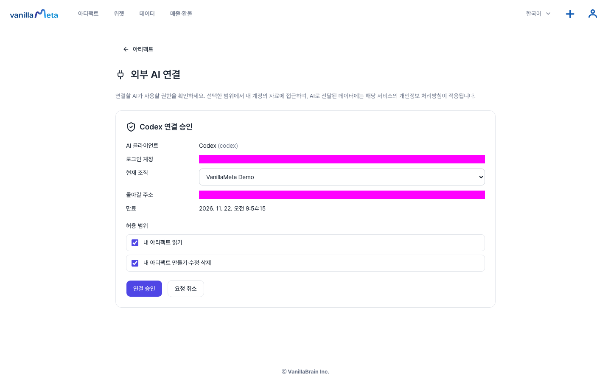
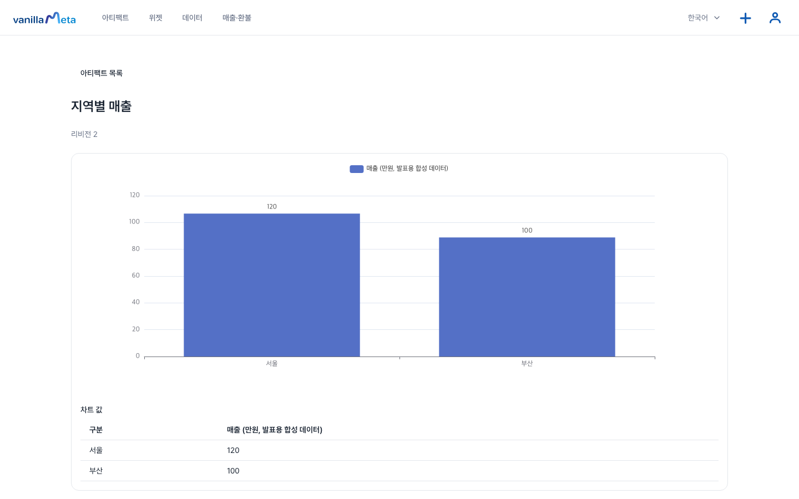
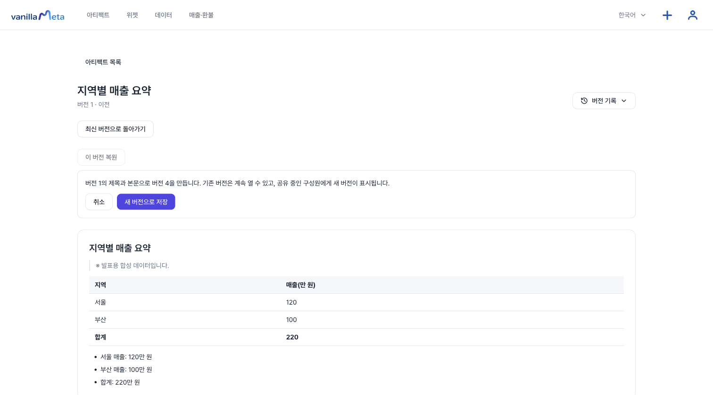
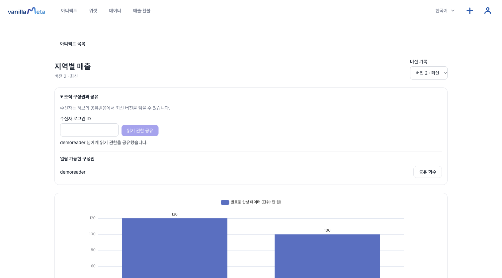
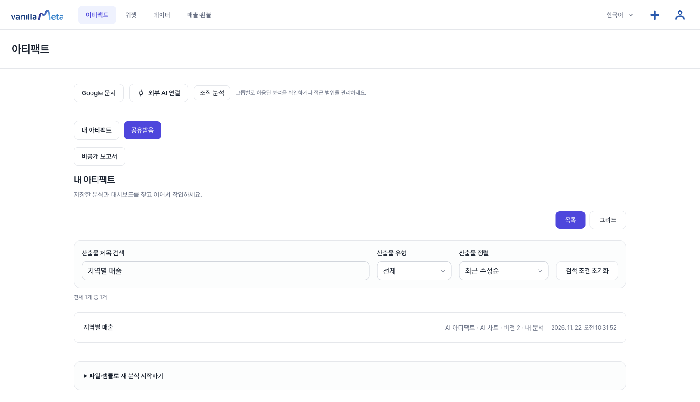
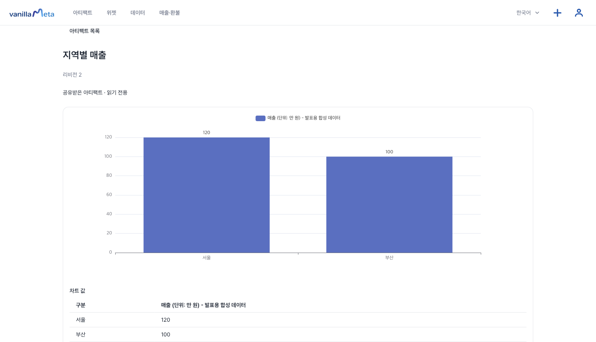
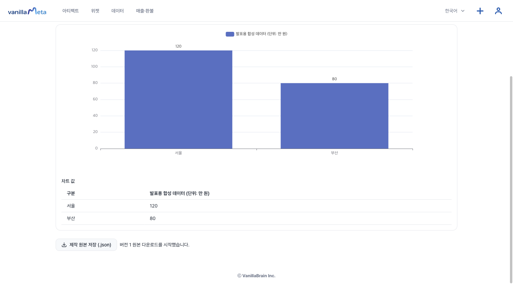

---
prev:
  text: 첫 아티팩트 만들기
  link: /quickstart
next:
  text: MCP 연결과 직접 제작
  link: /mcp
---

# Codex로 첫 차트 만들기

Codex 또는 Claude Code에 두 문장을 보내 지역별 매출 차트를 만들고 수정합니다. 완성할 차트의 제목은 **지역별 매출**입니다. 서울은 120만 원, 부산은 처음 80만 원이고 수정 뒤 100만 원입니다. 이 숫자는 **발표용 합성 데이터**입니다.

## 5분 발표 순서

| 시간 | 화면 | 확인할 결과 |
| --- | --- | --- |
| 0:00~0:45 | AI 호스트의 연결 상태와 VanillaMeta 승인 화면 | 두 아티팩트 범위가 선택된 **연결 승인** |
| 0:45~2:15 | 첫 번째 요청과 **지역별 매출** 링크 | 리비전 1, 서울 120, 부산 80 |
| 2:15~3:15 | 같은 대화의 두 번째 요청과 새로고침 | 같은 링크, 리비전 2, 부산 100 |
| 3:15~4:30 | **내 아티팩트 → 산출물 제목 검색** | AI 차트 버전 2를 다시 열기 |
| 4:30~5:00 | **조직 구성원과 공유 → 공유받음** | 동료가 읽기 전용으로 버전 2 열기 |

## 1. 호스트 연결 확인

### Claude Code

발표 환경에서는 **외부 AI 연결**의 **Claude Code 연결** 화면에서 **원격 MCP 서버 등록**과 **Claude Code 로그인 시작** 명령을 복사합니다. 별칭은 `vanillameta`이며 현재 프로젝트 범위에 등록됩니다. 시작과 조직 설정을 처음부터 하려면 [Docker에서 Claude 시연 준비](./customer-demo.md)를 먼저 따릅니다.

```sh
claude mcp add --transport http --client-id claude-code --callback-port 53683 vanillameta --scope local 'http://localhost:4000/v1/mcp'
claude mcp login vanillameta --no-browser
claude mcp get vanillameta
```

로그인 명령이 출력한 URL을 이미 로그인한 브라우저에서 열고 **연결 승인**을 누릅니다. 마지막 명령에서 `Status: Connected`를 확인합니다.

### Codex

발표에는 미리 모델 접근을 확인한 Codex를 엽니다. `model_not_found`가 표시되면 아래 **운영자 준비**에서 실제 검증한 실행기 버전을 확인하세요.

Codex에서 VanillaMeta 도구가 보이는지 확인합니다. 연결이 없으면 운영자가 준비한 명령이나 설정으로 한 번 연결합니다.

```sh
codex mcp list --json
```

목록에 `vanillameta`가 있고 `auth_status`가 `o_auth`이면 다음 단계로 갑니다. 도구 목록이 비어 있거나 인증 만료가 보이면 새 로그인을 시작합니다.

```sh
codex mcp login vanillameta
```

두 호스트 모두 브라우저의 **연결 승인** 화면에서 계정과 현재 조직을 확인합니다. 이 발표 환경의 조직명은 **VanillaMeta Demo**입니다. **내 아티팩트 읽기**와 **내 아티팩트 만들기·수정·삭제**를 모두 선택하고 **연결 승인**을 누릅니다.



읽기만 선택하면 차트를 조회할 수 있지만 만들거나 수정할 수 없습니다. **요청 취소**를 눌렀거나 창을 닫았다면 연결되지 않은 상태입니다. 위에서 사용한 호스트의 MCP 로그인 명령을 다시 실행하세요.

## 2. 첫 차트 만들기

사용하는 호스트 대화에 아래 문장을 그대로 붙여 넣습니다.

```text
서울 매출 120만 원, 부산 80만 원을 지역별 막대 차트로 만들고 제목을 “지역별 매출”로 해 줘. VanillaMeta에 저장하고 링크를 알려 줘. 발표용 합성 데이터임을 범례에 쓰고 값은 만 원 단위로 표시해 줘.
```

AI가 반환한 **지역별 매출** 링크를 엽니다. 다음 화면을 확인합니다.

- 리비전 **1**
- 서울 막대 **120**, 부산 막대 **80**
- 범례에서 금액의 단위가 만 원이고 발표용 합성 데이터임을 확인할 수 있음

## 3. 같은 차트 수정

새 대화를 열지 말고 같은 대화에 아래 문장을 보냅니다.

```text
부산 매출을 100만 원으로 수정해 줘.
```

응답에서 같은 아티팩트 ID가 유지되고 리비전이 **2**로 올라갔는지 확인합니다. 기존 차트 탭을 새로고침하면 서울 **120**, 부산 **100**이 보입니다.



`revision mismatch`가 나오면 다른 차트를 만들지 말고 같은 대화에 `현재 차트를 다시 읽고, 부산 100만 원 수정을 한 번만 다시 적용해 줘.`라고 보냅니다.

## 4. 내 아티팩트에서 다시 열기

상세 탭을 닫고 VanillaMeta에서 `/dashboard`를 엽니다.

1. 허브 상단에서 **내 아티팩트**를 선택합니다.
2. **산출물 제목 검색** 입력란에 `지역별 매출`을 입력합니다.
3. **산출물 유형**에서 **AI 아티팩트**를 선택합니다.
4. **지역별 매출**을 엽니다. 같은 제목이 여럿이면 최근 수정순으로 맨 위의 **AI 차트 · 버전 2**를 선택한 뒤 앞서 받은 링크와 ID를 대조합니다.
5. 서울 120, 부산 100이 유지되는지 확인합니다.

AI 아티팩트의 제목 검색은 처음 표시된 50개를 포함해 접근 가능한 전체 목록에서 찾습니다. 더 둘러보려면 **AI 아티팩트 더 보기**를 누릅니다.

생성 직후에는 비공개입니다. 공유하기 전에 같은 조직의 다른 시연 계정으로 직접 링크를 열면 차트가 숨겨져야 합니다.

라이브 생성이 지연될 때 사용하는 저장본은 운영자가 미리 준비한 차트입니다. 같은 소유자 계정으로 위 순서를 따라 열거나 발표자가 준비한 저장본 링크를 엽니다.

### 이전 버전 열기와 복원

차트에서 **버전 기록**을 펼치고 **버전 1**을 선택하면 부산의 첫 값인 **80만 원**을 다시 볼 수 있습니다. **최신 버전으로 돌아가기**를 누르면 부산 **100만 원**인 버전 2로 돌아옵니다. 이전 버전을 열어 보는 동안에는 동료가 보는 값도 그대로입니다.

이전 내용을 다시 사용하려면 소유자가 해당 버전을 열고 **이 버전 복원 → 새 버전으로 저장**을 누릅니다. 예를 들어 문서의 버전 1을 버전 2 위에 복원하면 같은 링크에 버전 3이 생기고, 버전 2도 기록에서 열 수 있습니다. 아래는 차트 시연을 마치고 별도 합성 문서에서 실행한 예입니다.



## 5. 동료에게 공유하고 받은 차트 열기

소유자와 수신자는 서로 다른 브라우저 프로필을 사용합니다. 두 계정이 처음 만나는 경우 [조직에 동료 추가하기](./organization.md#add-colleague)를 먼저 따라 하세요.

1. 소유자 화면에서 수정한 **지역별 매출**을 다시 열고 **조직 구성원과 공유**를 펼칩니다.
2. **수신자 로그인 ID**에 동료가 VanillaMeta에 로그인할 때 쓰는 ID를 입력한 뒤 **읽기 권한 공유**를 누릅니다. **열람 가능한 구성원** 목록에 수신자 ID가 표시되는지 확인합니다.
3. 수신자 계정으로 허브의 **공유받음**을 열고 `지역별 매출`을 검색합니다. 결과를 열면 **공유받은 아티팩트 · 읽기 전용**, 리비전 **2**, 서울 **120만 원**, 부산 **100만 원**이 보입니다. 같은 링크에서 최신 저장 버전을 읽을 수 있습니다.
4. 수신자가 **아티팩트 목록**으로 돌아가면 **공유받음**과 검색 조건이 유지됩니다.
5. 접근을 종료하려면 소유자가 **열람 가능한 구성원**에서 수신자 ID 옆 **공유 회수**를 누릅니다. 수신자가 새로고침하면 차트를 열 수 없습니다.







## 6. 제작 원본으로 다른 차트 만들기

1. 소유자 화면의 **버전 기록**에서 재사용할 버전을 엽니다. 예를 들어 버전 1을 선택하면 부산 값은 80입니다.
2. 차트 아래 **제작 원본 저장 (.json)**을 누릅니다. 파일에 그 버전의 유형, 제목, 내용이 들어 있습니다.
3. 새 Claude Code 대화에 이 파일 내용을 제공하고 다음과 같이 요청합니다.

```text
이 제작 원본의 유형과 내용을 그대로 사용해 VanillaMeta에 별도 아티팩트를 만들어 줘.
제목은 ‘지역별 매출 · 제작 원본 사본’으로 하고 새 링크를 알려줘.
```

새 링크는 버전 1로 시작합니다. 버전 1의 제작 원본을 사용했다면 사본은 서울 120, 부산 80이고 원래 링크의 최신 값은 서울 120, 부산 100입니다. 사본을 공유할 동료는 새 링크에서 따로 지정합니다.



## 7. 막혔을 때

| 증상 | 고객이 할 일 |
| --- | --- |
| 승인 창을 닫았거나 연결 상태가 `Needs authentication`임 | Claude Code에서는 `claude mcp login vanillameta --no-browser`, Codex에서는 `codex mcp login vanillameta`를 다시 실행한 뒤 브라우저에서 승인합니다. 승인 요청은 5분 뒤 만료되고 접근 토큰은 최대 10분 동안 유효합니다. |
| 읽기 도구만 보임 | 승인 화면에서 **내 아티팩트 만들기·수정·삭제**를 선택합니다. 이미 연결했다면 이번 연결을 해제한 뒤 다시 승인합니다. |
| `invalid_client` 또는 redirect URI 불일치 | 운영자에게 Codex가 출력한 callback의 host, 포트, 전체 path를 확인해 달라고 요청합니다. |
| 401 또는 도구 목록이 비어 있음 | `codex mcp login vanillameta`로 이 MCP만 다시 인증합니다. `codex logout`은 Codex 로그인까지 해제하므로 사용하지 않습니다. |
| `revision mismatch` | 차트를 다시 읽고 최신 리비전으로 같은 수정을 한 번 더 요청합니다. |

::: details 운영자 준비: 원격 MCP와 고정 callback
고객 화면에는 아래 값을 노출하지 않습니다. 이 절은 발표 전에 연결을 준비하거나 `invalid_client`를 해결할 때만 폅니다.

이 발표 환경에서 Codex CLI 0.154.0은 VanillaMeta 연결 승인에 성공했지만 ChatGPT 계정으로 `gpt-6-luna`를 호출할 때 `model_not_found`를 반환했습니다. 같은 계정과 모델로 차트 생성·수정까지 확인한 실행기는 ChatGPT 앱에 포함된 Codex CLI 0.167.0-alpha.3.2입니다. 발표 전에 사용할 실행기를 열고 버전을 확인하세요.

```sh
codex --version
codex mcp add --help
codex mcp login --help
```

HTTP MCP는 `--url`과 `--oauth-client-id`를 사용합니다. 로그인 시 Codex가 resource metadata를 읽으므로 같은 값을 `--oauth-resource`로 한 번 더 넘기지 않습니다. 이번 실제 Codex 로그인은 설정의 `scopes`에 두 범위를 둔 뒤 `codex mcp login vanillameta`를 실행했고, `--scopes`를 다시 지정할 필요는 없었습니다.

```sh
codex mcp add vanillameta \
  --url http://localhost:4000/v1/mcp \
  --oauth-client-id codex
```

Codex의 default callback port는 동적으로 바뀔 수 있습니다. VanillaMeta가 redirect URI를 정확히 비교하므로 `~/.codex/config.toml` 전역 설정이나 서버별 `oauth.callback_port`를 고정합니다.

```toml
mcp_oauth_callback_port = 53684
```

현재 VanillaMeta 서버는 동적 클라이언트 등록(DCR)이나 CIMD를 제공하지 않습니다. `--oauth-client-registration dcr` 또는 `cimd`를 켜도 연결되지 않습니다. 운영자가 `MCP_OAUTH_CLIENTS_JSON`에 정확한 client ID와 redirect URI를 등록해야 합니다.

```dotenv
MCP_OAUTH_CLIENTS_JSON='[{"id":"codex","name":"Codex","redirectUris":["http://localhost:53684/callback","http://127.0.0.1:53684/callback","http://127.0.0.1:53684/callback/6m2PpwaEkjMj"],"scopes":["artifacts:read","artifacts:write"]}]'
```

현재 서버 metadata에는 `authorization_response_iss_parameter_supported`가 없으므로 Codex 0.154.0은 MCP URL마다 `/callback` 뒤에 callback ID를 붙입니다. `http://localhost:4000/v1/mcp`의 실제 callback은 `http://127.0.0.1:53684/callback/6m2PpwaEkjMj`이며 위 allowlist에 포함되어 있습니다.

설정을 바꾼 뒤에는 현재 연결을 해제하고 다시 로그인합니다. `codex mcp get vanillameta --json`으로 URL과 클라이언트 항목을, `codex mcp list`로 인증 상태를 확인합니다. Codex 로그인 자체는 `codex logout`으로 지우지 않습니다.

발표용 서버는 저장소 루트에서 다음 명령으로 시작합니다. 처음 시작하면 웹은 `http://localhost:3000`, MCP는 `http://localhost:4000/v1/mcp`에서 열립니다.

```sh
docker compose up --build -d --wait
```

처음 시작한 서버에서는 시연 계정으로 로그인하고 계정 메뉴의 **조직·직원** 화면에서 `VanillaMeta Demo`를 입력한 뒤 **조직 만들기**를 누릅니다. 이미 소속 조직이 있으면 승인 화면에 표시된 조직을 사용합니다. 공유를 시연할 동료는 [조직에 동료 추가하기](./organization.md#add-colleague)에 따라 같은 조직에 참여시킵니다.
:::

## 다음 단계

다른 MCP 도구와 호스트별 설정은 [MCP 연결과 직접 제작](./mcp.md)에서 확인하세요. 앱에서 샘플 데이터로 대시보드를 만드는 기본 흐름은 [첫 아티팩트 만들기](./quickstart.md)를 따릅니다.
