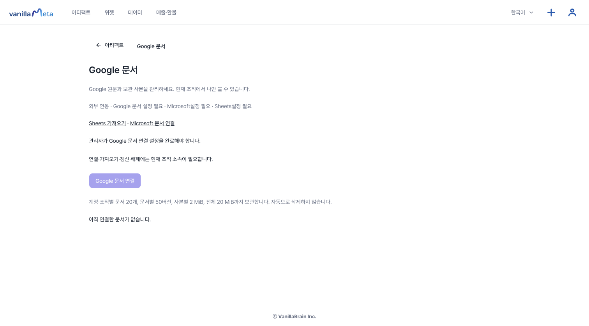
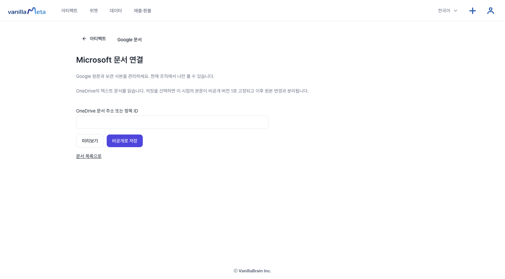

# 문서 가져오기: Google 문서와 Microsoft 문서

이미 쓴 문서를 VanillaMeta에 **읽기 전용 보관 사본**으로 가져와 같은 목록에서 관리합니다. 가져온 사본은 원본과 따로 저장되는 Markdown 글이고, 원본 문서는 바뀌지 않습니다.

**준비물:** 현재 조직에 속한 계정이어야 하고, 관리자가 연결 설정을 마쳐야 합니다. 설정이 없으면 화면에 "관리자가 Google 문서 연결 설정을 완료해야 합니다."라는 안내가 나오고 연결 버튼이 비활성입니다. 그럴 때는 관리자에게 Google·Microsoft 연결 설정을 요청하세요.

## Google 문서 가져오기

1. 아티팩트 화면 위쪽의 **Google 문서**를 엽니다.
2. **Google 문서 연결**을 누르고 문서 주소(`https://docs.google.com/document/d/…/edit`)를 붙여 넣습니다.
3. 동의 문구를 읽고 체크한 뒤 **Google에서 계속**을 누릅니다. 이 연결은 선택한 문서 하나를 **읽기만** 하며 Drive 전체에는 접근하지 않습니다.
4. 연결이 끝나면 문서 상세 화면에서 **보관 사본 가져오기**를 눌러 첫 버전을 저장합니다. 연결만으로는 자동으로 가져오지 않습니다.
5. 원본이 바뀌면 **보관 사본 갱신**으로 새 버전을 저장합니다. 이전 **보관 버전**은 **보관 버전 선택**에서 다시 볼 수 있습니다.

원본을 열려면 **Google Docs에서 원본 열기**, 연결을 끊으려면 **원본 연결 해제**를 누릅니다. 연결을 끊어도 이미 저장한 사본은 남습니다.

## Microsoft 문서 가져오기

**Google 문서** 화면의 **Microsoft 문서 연결**을 열어 OneDrive 문서의 주소나 항목 ID를 넣고 **미리보기** 후 **비공개로 저장**합니다. 저장하면 그 시점의 본문이 **비공개 버전 1**로 고정되고 이후 원본의 변경과는 분리됩니다.

 **텍스트(.txt)와 Markdown(.md) 파일만** 가져올 수 있고, Word 문서(.docx)는 아직 지원하지 않습니다.

## 한도

| 항목 | 한도 |
| --- | --- |
| 연결 문서 수 | 계정·조직별 20개 |
| 문서 하나의 버전 수 | 50개 |
| 사본 하나의 크기 | 2 MiB |
| 전체 보관 크기 | 20 MiB |

같은 Google 문서를 동시에 두 번 연결할 수 없습니다. 연결을 끊은 뒤에는 **같은 문서 다시 연결**로 이어 갈 수 있습니다. 보관한 사본은 자동으로 지워지지 않습니다.

## 이런 점은 달라요

- 사본은 **읽기 전용**입니다. 가져온 글을 VanillaMeta에서 고쳐 원본에 되돌려 보내는 기능은 없습니다.
- 표시할 수 없는 HTML, 링크, 외부 이미지는 글자로 보입니다.
- 가져온 문서를 삭제하는 기능은 없고, **원본 연결 해제**만 있습니다.
- 다른 사람에게 보여 주려면 문서 상세 화면의 **문서 공유**에서 **받는 사람 ID**를 넣고 **초대**를 누릅니다. 이 칸은 이름이 아니라 같은 조직 직원의 **숫자로 된 내부 사용자 번호**를 받고 이름으로 찾는 기능은 없으니, 번호는 관리자에게 물어보세요. 공유를 멈추려면 **회수**를 누릅니다. 받는 사람은 읽기만 할 수 있고, 받은 문서는 **공유받음**이 아니라 **Google 문서** 화면의 목록에 "받은 문서"로 나타납니다.

가져온 문서의 보관 사본은 내가 쓰는 AI에서도 읽을 수 있습니다. 연결 방법은 [원격 MCP 연결](./remote-mcp.md)에 있습니다.

숫자와 차트가 들어간 문서를 직접 쓰고 싶다면 [보고서](./docs-report.md)를 쓰세요.
