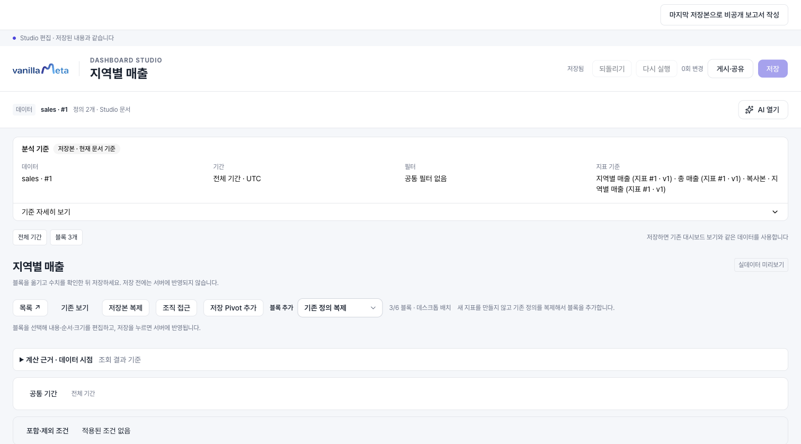
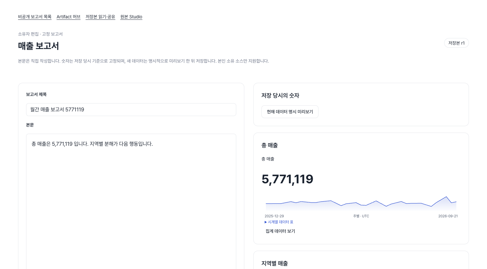
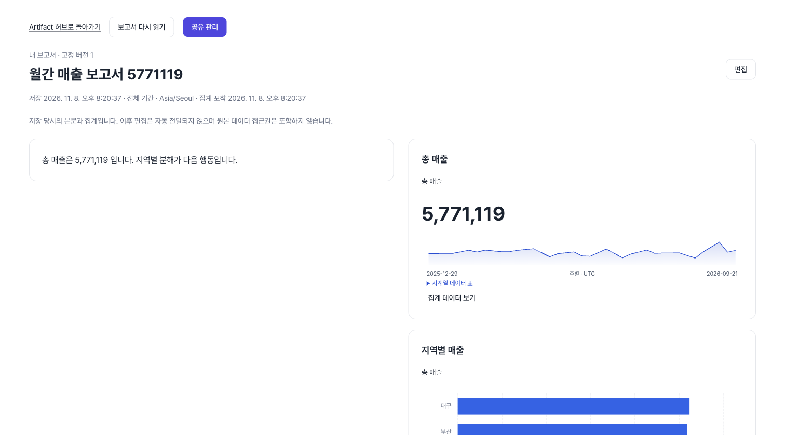
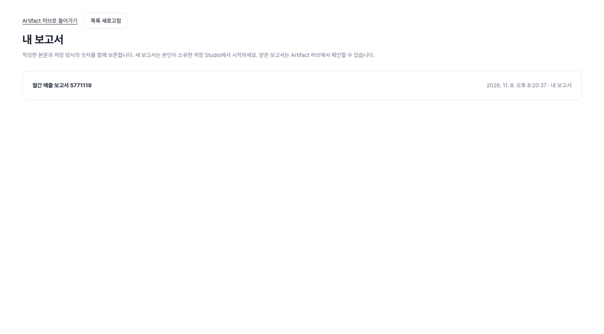
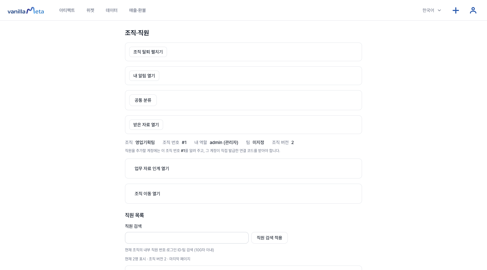
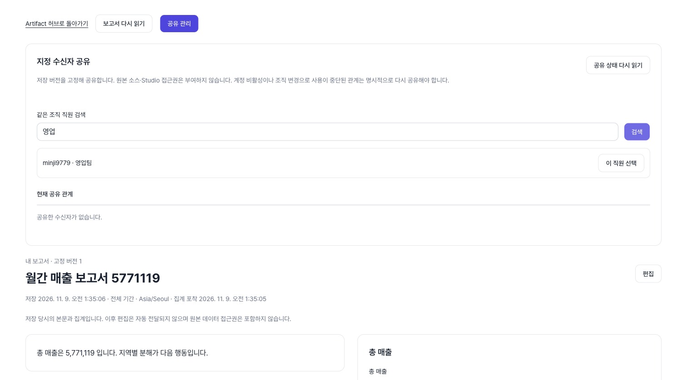
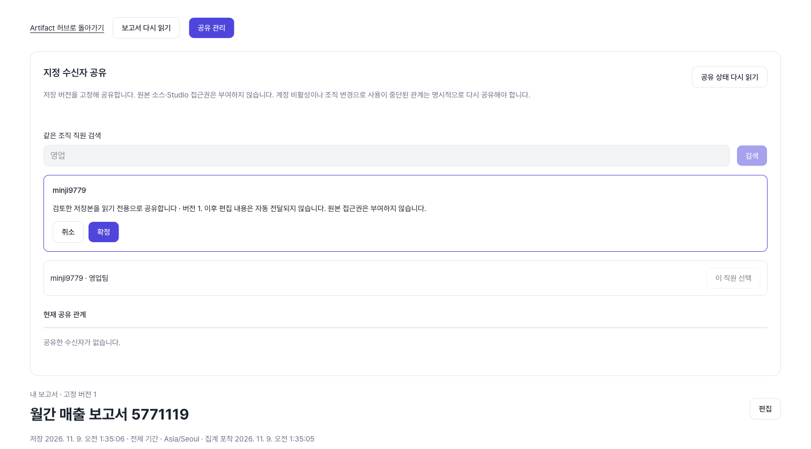
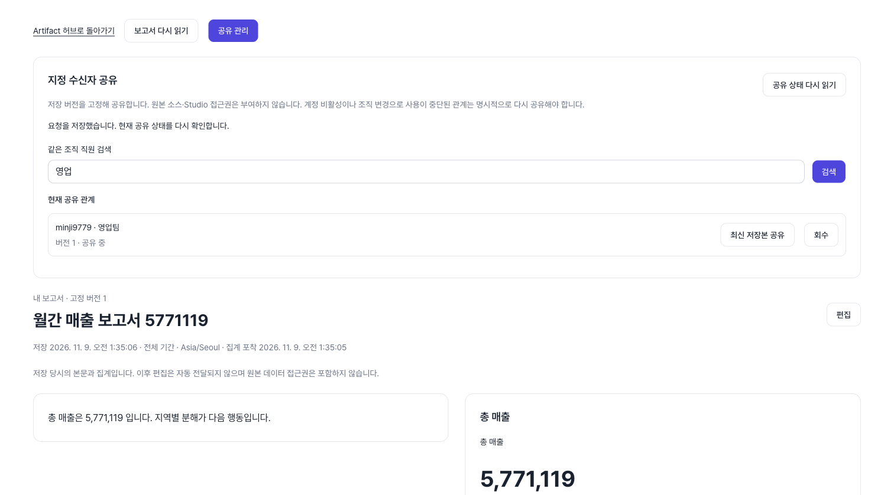
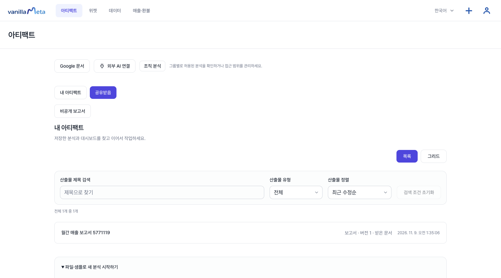

# 문서 만들기: 보고서

보고서는 **저장한 대시보드의 숫자와 차트에 설명을 붙여 한 편의 글로 만든 문서**입니다. 숫자는 저장하는 순간의 값으로 고정되므로, 나중에 데이터가 바뀌어도 보고서의 숫자는 그대로입니다.

**준비물:** Studio에서 저장한 내 대시보드 하나. 보고서는 내가 소유한 데이터로 만든 저장본에서만 시작할 수 있습니다. 아직 없다면 [첫 아티팩트 만들기](./quickstart.md)를 먼저 하세요.

::: warning 직원에게 공유할 보고서라면 조직을 먼저 만드세요
보고서는 **쓰는 시점의 조직**에 묶입니다. 조직 없이 쓴 보고서는 나중에 조직을 만들면 **내 보고서 목록에서 사라지고, 편집도 공유도 되지 않습니다.** 공유할 계획이 있다면 먼저 조직을 만들고(아래 "7. 직원에게 공유하기"에 방법이 있습니다) 그 뒤에 보고서를 쓰세요.
:::

## 1. 보고서 시작하기

저장한 대시보드를 Studio에서 열고 **마지막 저장본으로 비공개 보고서 작성**을 누릅니다.

## 2. 제목과 본문 쓰기

**보고서 제목**과 **본문**을 씁니다. 본문은 일반 텍스트이고 **20,000자**까지 저장됩니다. 화면 아래의 `bytes` 표시는 참고용입니다. 20,000자를 넘기면 저장되지 않습니다.

## 3. 숫자와 차트 넣고 미리보기

**숫자 선택**에서 보고서에 넣을 숫자(KPI)와 차트를 고르고 **현재 데이터 명시 미리보기**를 누릅니다. 미리보기에 나온 값이 **저장 당시의 숫자**가 됩니다. 값이 이상하면 저장하기 전에 데이터를 확인하세요.

## 4. 이미지 넣기(선택)

**이미지 추가**로 PNG, JPEG, WebP 이미지를 넣습니다. 장당 512KiB, 최대 4장이며, 이미지를 위나 아래로 옮기고 설명과 너비(전체·절반)를 정할 수 있습니다. 이미지 크기의 합이 1.5MiB를 넘으면 저장이 거절되고, 이미지를 포함한 **버전 하나가 2 MiB**를 넘어도 거절될 수 있으니 작은 이미지를 쓰세요.

## 5. 비공개로 저장하기

**비공개 저장**을 누릅니다. 저장하면 **저장 버전**이 하나 생기고, 다시 저장할 때마다 새 버전이 쌓입니다. 이전 버전은 **저장 버전**에서 열어 볼 수 있습니다. `Ctrl`(Mac은 `⌘`)+`Enter`로도 저장됩니다.

::: warning 보관 한도가 있고 삭제할 수 없습니다
한 계정이 가진 **모든 보고서의 모든 버전을 합쳐 20 MiB**까지 보관됩니다. 보고서와 버전은 삭제할 수 없어서 한도가 차면 새로 저장할 수 없습니다. 이미지를 많이 쓰면서 자주 저장하면 금방 찰 수 있으니, 이미지는 작게 줄이고 필요한 때만 저장하세요.
:::

::: tip AI 본문 제안
서버에 AI가 설정되어 있고 내 AI 사용 한도가 남아 있으면 편집 화면의 **AI 본문 제안**을 쓸 수 있습니다. **제안 받기**는 보고서를 **한 번 저장한 뒤에** 눌러지며, 제안은 **저장된** 본문과 고정된 숫자를 바탕으로 합니다(저장하지 않은 편집은 반영되지 않습니다). **본문에 적용**해도 **비공개 저장**을 누르기 전에는 저장되지 않고 **되돌리기**로 취소할 수 있습니다.
:::

## 6. 읽기

저장한 보고서는 아티팩트 목록(**산출물 유형 → 보고서**)이나 **비공개 보고서 → 내 보고서**에서 엽니다. 목록의 보고서를 누르면 읽기 화면이 열리고, 화면 위쪽의 **Artifact 허브로 돌아가기**로 목록에 돌아옵니다. 읽기 화면에서 본문과 이미지, 저장 당시의 숫자를 볼 수 있습니다.

## 7. 직원에게 공유하기

보고서는 **같은 조직의 직원**에게 공유합니다. 조직이 없거나 보고서를 조직 없이 썼다면 공유 화면에 "보고서 또는 원본 소스에 접근할 수 없습니다"라는 안내가 나옵니다. 위의 주의대로 먼저 [조직을 만들고 직원을 추가](./organization.md)한 뒤 보고서를 쓰세요. 조직은 **조직·직원** 화면에서 **새 조직 이름**을 쓰고 **조직 만들기**를 누르면 만들어지고, 만든 사람이 관리자가 됩니다.

공유하는 순서는 다음과 같습니다.

1. 보고서 읽기 화면에서 **공유 관리**를 엽니다.
2. **같은 조직 직원 검색**에 직원의 **로그인 ID나 팀**을 쓰고 **검색**을 누릅니다.
3. 검색된 직원 옆의 **이 직원 선택**을 누릅니다.

4. "검토한 저장본을 읽기 전용으로 공유합니다 · 버전 1"이라는 확인 안내가 나오면 내용을 읽고 **확정**을 누릅니다. 마음이 바뀌면 **취소**를 누릅니다.

5. **현재 공유 관계**에 직원 이름과 "버전 1 · 공유 중"이 표시됩니다. 보고서를 새 버전으로 저장한 뒤 **최신 저장본 공유**를 누르면 그 직원이 새 버전을 보고, **회수**를 누르면 공유가 멈춥니다.

받는 사람은 아티팩트 화면의 **공유받음**에서 **받은 문서**로 표시된 보고서를 열어 읽습니다.

- 받는 사람은 **공유한 그 저장 버전**의 본문과 숫자를 읽습니다. 원본 데이터나 Studio에 들어갈 권한은 생기지 않습니다.
- 이후에 보고서를 고쳐도 자동으로 전달되지 않습니다. 새 버전을 보여 주려면 **최신 저장본 공유**를 다시 누릅니다.
- 보고서 하나에 최대 50명까지 공유할 수 있습니다.
- 대시보드처럼 **링크로 공개하는 기능은 없습니다.** 이름으로 지정한 같은 조직 직원에게만 공유합니다.

## 지금은 없는 기능

- 보고서를 Word나 PDF 같은 파일로 내려받거나 인쇄용으로 내보내는 기능
- 보고서를 삭제하는 기능(새 버전을 저장해서 고칩니다)

다른 문서 자료를 가져와 보관하려면 [연결 문서](./connected-docs.md)를 보세요.
