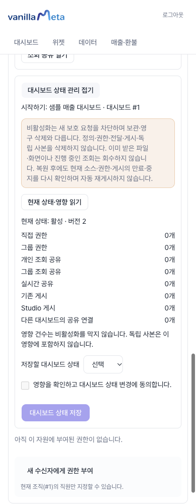
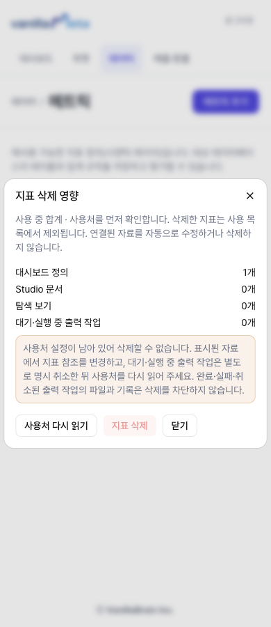
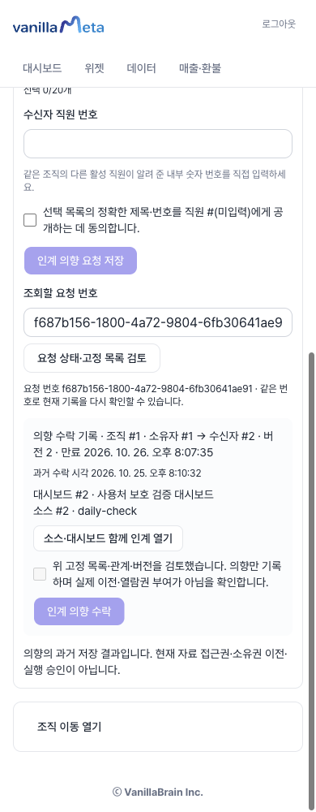
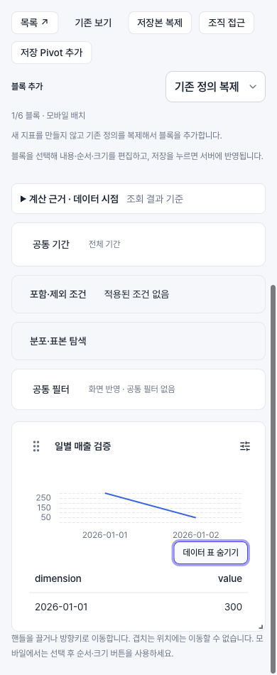
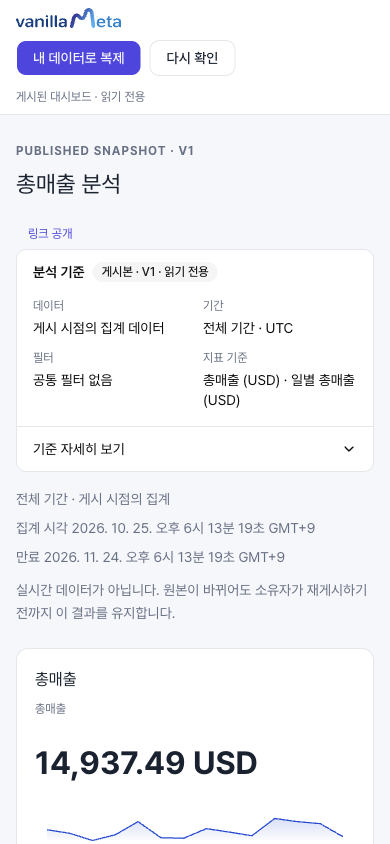

# 기능별 따라 하기와 결과 확인

하려는 일에 맞춰 50개 시나리오 중 한 항목씩 진행하세요. 각 시나리오는 **목표 → 준비 → 행동 → 기대 결과 → 막혔을 때** 순서입니다. 제품은 운영자가 안내한 앱 주소에서 사용하며, 이 도움말 사이트에서는 분석을 실행하지 않습니다.

::: info 실행 결과와 사용 안내의 구분
아래 **기대 결과**는 사용자가 대조할 기준이며 모든 기능의 테스트 완료 표시는 아닙니다. 기존 가이드의 실제 화면 확인과 현재 구현을 대조해 작성했습니다. 이번 전달 준비에서는 비용·마진 샘플의 18행·총매출 14,937.49 USD와 실제 AI 생성의 숫자·시계열 두 블록, Explore 이전 기간·숫자 범위 비교, 소스 업무 설명의 별도 확인 후 저장, 게시·재게시·중지와 독립 사본 보존, 조직 소속 준비 후 고정 조건 CSV 다운로드를 별도로 확인했습니다. 관리자 시나리오를 포함한 나머지 항목이 같은 환경에서 모두 재실행됐다는 뜻은 아닙니다. AI 응답·운영 설정·현재 권한에 따라 결과와 사용할 수 있는 메뉴가 달라집니다. [지원 범위](./scope.md)를 함께 읽으세요.
:::

## 시작할 작업 고르기

| 하고 싶은 일 | 시나리오 |
| --- | --- |
| 계정을 준비하고 데이터를 연결하기 | [1~5](#scenario-1) |
| 계산 기준을 정하고 탐색하기 | [6~12](#scenario-6) |
| Pivot으로 교차 분석하기 | [13~15](#scenario-13) |
| AI로 만들고 Studio에서 편집하기 | [16~20](#scenario-16) |
| 게시·조직 공유·복제로 전달하기 | [21~26](#scenario-21) |
| CSV·보관·오류 복구하기 | [27~29](#scenario-27) |
| 외부 에이전트에서 MCP로 만들기 | [30](#scenario-30) |
| 비활성·삭제·파일 정리하기 | [31~36](#scenario-31) |
| 인계 검토·최종 이전·조직 이동·탈퇴하기 | [37~45](#scenario-37) |
| 기존 데이터셋·위젯·대시보드 사용하기 | [46~48](#scenario-46) |
| 주문·결제·환불 리포트 사용하기 | [49~50](#scenario-49) |

처음이라면 [화면으로 따라 하는 샘플](./sample-walkthrough.md)을, 화면 위치가 낯설다면 [화면과 이동](./navigation.md)·[기본 개념](./concepts.md)을 먼저 보세요. 다른 기능은 [전체 목차](./contents.md)와 문서 검색으로 찾을 수 있습니다. 작은 화면에서는 메뉴를 펼치고, 넓은 데이터 표는 표 안에서 좌우로 이동합니다.

## 1. 초대받아 가입하고 본인 계정으로 로그인하기

- **목표:** 분석을 저장할 본인 계정을 준비합니다.
- **준비:** 운영자가 안내한 앱 주소와, 초대 가입 환경이면 유효한 초대 코드가 필요합니다.
- **행동:** 가입 화면에서 초대 코드가 표시되면 코드를 입력하고 아이디·비밀번호·비밀번호 확인·이메일을 작성합니다. 가입 완료 후 로그인 화면에서 본인 아이디로 로그인합니다. 가입이 닫혀 있거나 코드가 없다면 제공되는 대기자 등록을 이용합니다.
- **기대 결과:** 가입 완료 뒤 로그인할 수 있고 본인 대시보드 목록이 열립니다. 대기자 등록은 계정 발급이나 즉시 이용 승인이 아닙니다.
- **막혔을 때:** 사용 불가 코드 안내는 운영자에게 확인합니다. 중복 아이디·이메일은 안내된 항목을 수정하고, 요청 한도 안내가 나오면 잠시 기다립니다. 로그인 여부만으로 조직 관리자 권한이 생기지는 않습니다. [시작 안내](./quickstart.md)

## 2. 샘플 소스를 준비하고 첫 합계 확인하기

- **목표:** 실제 업무 파일 없이 데이터와 분석 화면의 관계를 익힙니다.
- **준비:** 로그인 계정과 샘플을 준비할 수 있는 환경이 필요합니다.
- **행동:** **질문으로 대시보드 만들기 → 내 데이터로 시작하기**에서 **비용·마진 샘플**을 준비합니다. **저장된 데이터**에서 선택된 소스 이름과 열을 확인합니다. 지표 탐색에서는 시나리오 6의 매출 지표를 만든 뒤 전체 기간·필터 없음으로 조회합니다.
- **기대 결과:** 이 가이드의 비용·마진 샘플과 같은 자료라면 18행이며 `revenue` 합계는 **14,937.49 USD**입니다. 샘플 소스 준비와 AI 생성·대시보드 저장은 각각 별도 동작입니다.
- **막혔을 때:** 소스가 선택됐는지 확인하고 **소스 새로 확인**을 사용합니다. 다른 샘플·기간·필터에 위 숫자를 적용하지 않습니다. [데이터 연결](./data.md) · [샘플 실습](./sample-walkthrough.md)

## 3. CSV·JSON·Parquet를 저장하고 파일 변경 확인하기

- **목표:** 내 파일을 다시 사용할 수 있는 데이터 소스로 준비합니다.
- **준비:** 지원 파일과 본인 저장 권한이 필요합니다. 숫자·날짜·통화·한 행의 의미를 먼저 확인합니다.
- **행동:** Studio의 **파일 선택** 또는 **일반 CSV·JSON·Parquet 분석**에서 파일을 선택합니다. 행 수·열·형식을 확인하고 서버 저장을 완료합니다. Studio의 **저장된 데이터**에서 소스를 다시 선택합니다. 파일을 교체했다면 소스를 새로 확인하고 이전과 같은 계산을 다시 미리봅니다.
- **기대 결과:** 저장한 소스가 목록에 나타나며 간단한 합계가 원본과 맞습니다. 브라우저 안의 일회성 분석과 서버 저장을 구별할 수 있습니다.
- **막혔을 때:** 파일 제한·필수 열·날짜 오류를 확인합니다. 파일 변경 뒤 이전 미리보기나 게시본이 자동 갱신됐다고 판단하지 않습니다. [파일 연결과 교체](./data.md)

## 4. 외부 DB 연결을 시험하고 사용할 화면 정하기

- **목표:** 서버에서 접근 가능한 외부 DB 연결을 저장합니다.
- **준비:** 지원 연결 유형, 서버 쪽 드라이버·네트워크와 운영자가 준 접속 정보가 필요합니다.
- **행동:** **데이터 연결 관리**의 소스 생성 화면에서 연결 유형을 고릅니다. 접속 정보를 입력해 **연결 테스트 → 연결 저장**을 진행합니다. 사용할 분석 화면에서 해당 소스의 지원 여부를 확인합니다.
- **기대 결과:** 연결 테스트와 저장 결과를 각각 확인할 수 있습니다. 연결 성공만으로 해당 DB의 모든 Studio·AI 기능이 지원되는 것은 아닙니다.
- **막혔을 때:** 외부 DB 유형이 보이지 않거나 이 환경에서 사용할 수 없다는 안내가 나오면 해당 배포의 허용 범위를 확인하고 파일 소스를 사용합니다. 연결이 허용된 환경의 인증·서버 네트워크·드라이버 준비는 운영자에게 확인합니다. Studio 미지원이면 안내된 기존 데이터셋·위젯 흐름을 검토합니다. 접속 비밀번호를 AI 질문에 넣지 않습니다. [외부 DB 연결](./data.md)

## 5. 열 설명·업무 날짜·분류를 확인하기

- **목표:** 금액과 날짜를 올바른 업무 의미로 해석합니다.
- **준비:** 소스 조회권이 필요하며 설명을 저장하려면 수정권이 필요합니다.
- **행동:** **데이터 업무 설명 확인**에서 열 이름·형식·단위·설명을 읽습니다. 편집 가능한 화면에서는 날짜·시각·문자열 날짜에 맞는 업무 유형과 날짜 형식을 선택하고 **변경 내용 미리보기**를 누르고 변경 목록을 읽습니다. 별도 확인란 **표시한 변경 내용을 확인했습니다**를 선택한 뒤 **확인한 변경 저장**을 누릅니다. 제공되는 공통 분류는 열의 실제 의미에 맞게 선택합니다. Studio에서 소스를 새로 확인하고 새 기준을 검토합니다.
- **기대 결과:** 일별 분석에 쓸 열과 금액 열을 구별할 수 있습니다. 저장된 과거 분석이 새 설명이나 분류를 자동 채택하는 것으로 해석하지 않습니다.
- **막혔을 때:** 숫자로 읽힌 `20260101`은 날짜 유형 선택만으로 변환되지 않습니다. 잘못된 날짜·혼합 형식을 원본에서 고치거나 운영자와 기준을 정합니다. [날짜 설정](./data.md) · [계산 기준](./metrics.md)

## 6. 저장 지표를 만들고 차원으로 나누기

- **목표:** 같은 계산을 여러 탐색에서 사용합니다.
- **준비:** 지원 소스와 지표 저장 권한이 필요합니다.
- **행동:** **지표 빌더**에서 지표 이름 `매출`, 집계 `합계`, 열 `revenue`, 단위 `USD`, 소수 `2자리`로 저장합니다. **지표 탐색 → 표시 설정**에서 매출과 `company`를 선택합니다. 계산 기준의 열·집계·지표 버전을 읽습니다.
- **기대 결과:** 전체 매출과 회사별 매출이 같은 정의로 계산됩니다. 회사 이름은 차원이며 합산할 금액 열이 아닙니다. 파일 업로드만으로 저장 지표가 생기는 것은 아닙니다.
- **막혔을 때:** 합계와 평균, 고유 개수와 행 개수, 표시 소수와 계산식을 구별합니다. 숫자형이 아닌 열을 금액처럼 합산하지 않습니다. [지표와 차원](./metrics.md)

## 7. 차이·백분율·마진율 계산 지표 만들기

- **목표:** 저장 지표의 계산 관계를 명확히 합니다.
- **준비:** 같은 소스·호환 단위의 저장 지표가 필요합니다. 매출 A와 비용 B가 있다면 마진율은 `(A−B)÷A×100`입니다.
- **행동:** **저장 지표로 계산 만들기**에서 이름과 계산 방식을 고릅니다. A·B와 필요한 분모 C를 선택하고 **계산 미리보기** 후 계산·단위를 확인해 저장합니다.
- **기대 결과:** 차이는 A−B, 백분율은 A÷B×100, 차이의 백분율은 (A−B)÷C×100입니다. 분모 0은 값 없음이며 비율 총합은 원본에서 다시 계산합니다.
- **막혔을 때:** 분자와 분모가 같은 새 비율은 거절됩니다. 이름이 다른 지표도 실제 계산이 같으면 거절될 수 있습니다. 매출÷매출을 전체 대비 비중으로 쓰지 말고 서로 다른 비교 대상을 선택합니다. 다른 계산 지표를 다시 잎 지표로 쓰는 구성도 제한됩니다. [계산 지표 안내](./metrics.md)

## 8. 조건을 검토하고 분포·표본 살펴보기

- **목표:** 어떤 행이 계산에 들어가는지 확인합니다.
- **준비:** 조회 가능한 소스나 지원되는 Studio 분석 범위가 필요합니다.
- **행동:** 조건 화면에서 포함·제외 조건을 작성하고 미리봅니다. 현재 분석에 쓰려면 제공되는 **이 분석에 조건 적용**을 명시적으로 누릅니다. **분포·표본 탐색**에서 필요한 열을 선택하고 **분포·표본 조회**를 실행합니다.
- **기대 결과:** 전체 값 빈도와 제한된 정렬 표본을 구별할 수 있습니다. 표본은 무작위·대표표본이 아니며 소스 전체와 Studio 현재 기간·필터 범위도 다를 수 있습니다. 로컬 분석 적용과 소스 조건 저장은 별도입니다.
- **막혔을 때:** 선택만 바꾼 뒤 이전 결과를 새 결과로 읽지 않습니다. 파일 버전이 달라졌다면 조건을 보존하고 다시 검토합니다. 적용 조건을 지원하지 않는 탐색 방식의 제한 안내를 따릅니다. [Explore 조건 탐색](./explore.md) · [조건 변경 검토](./ai-edit.md)

## 9. 회사 선택·숫자 범위로 Explore 좁히기

- **목표:** 원본 행에 조건을 적용해 매출을 좁혀 봅니다.
- **준비:** 비용·마진 소스와 매출 지표, UTC `2025-01-13`~`2025-01-19` 기간이 필요합니다.
- **행동:** **필터 추가 → company → 값 검색**에서 `Hanul Foods`를 선택하고 **필터 적용**을 누릅니다. 결과 확인 후 필터 칩을 삭제합니다. 다음으로 `revenue`의 **숫자 범위**에 최솟값 1000·최댓값 2000을 입력하고 적용합니다.
- **기대 결과:** 다른 필터가 없다면 회사 필터는 **2,260.00 USD**, 숫자 범위는 **4,810.40 USD**입니다. 검색만으로는 적용되지 않으며 숫자 범위는 회사별 합계가 아닌 원본 각 행에 적용됩니다.
- **막혔을 때:** 남은 필터 칩과 기간을 확인합니다. 범위 양 끝은 포함하고 NULL은 제외합니다. 차원 순위 정렬을 필터와 혼동하지 않습니다. [Explore 필터](./explore.md)

## 10. 기간·시간대·이전 기간 비교하기

- **목표:** 같은 기준의 현재값과 이전값을 비교합니다.
- **준비:** 날짜 열과 매출 지표가 필요합니다. 비용·마진 샘플에서는 필터를 모두 해제합니다.
- **행동:** **사용자 지정**에서 시작일 `2025-01-13`·종료일 `2025-01-19`를 입력하고 확정합니다. 표시 시간대 UTC, 집계 단위 일을 선택하고 **이전 기간 비교**를 켭니다.
- **기대 결과:** 현재 **9,636.75 USD**, 직전 같은 길이 기간 **5,300.74 USD**, 증감 **4,336.01 USD**, 증감률 약 **81.8%**입니다. 선택한 필터는 두 기간에 같은 방식으로 적용됩니다.
- **막혔을 때:** 날짜 입력이 미완성인지, 데이터에 해당 기간이 있는지 확인합니다. 시간대 변경은 날짜 경계를 바꿀 수 있습니다. 이전값 없음·0을 정상적인 0% 변화로 해석하지 않습니다. [기간과 비교](./explore.md)

## 11. 차원 추세와 기여 원본을 확인하기

- **목표:** 집계 차이의 원인을 실제 범위와 연결합니다.
- **준비:** 비교할 차원·지표와 원본 상세를 볼 수 있는 현재 권한이 필요합니다.
- **행동:** **차원 추세 비교**에서 차원과 비교 값을 선택하고 **추세 비교**를 실행합니다. 지원되는 집계 Pivot에서는 대상 행·열 범위의 기여 원본 동작을 열어 페이지를 넘겨 봅니다. 일반 원본 표가 제공되는 화면에서는 현재 범위와 행 수를 확인합니다.
- **기대 결과:** 값별 추세와 선택 범위에 기여한 원본 행을 구별할 수 있습니다. 기여 원본 조회는 읽기 전용이며 원래 Pivot·저장 조건을 바꾸지 않습니다.
- **막혔을 때:** 일부 표본이나 한 페이지를 전체 원본으로 해석하지 않습니다. 데이터·정의 변경 안내는 상세를 닫고 집계를 다시 조회하며, 권한 안내는 소스 접근을 확인합니다. [Explore 상세](./explore.md) · [Pivot](./pivot.md)

## 12. 탐색 보기를 저장하고 새로고침 후 열기

- **목표:** 기간·필터·선택 지표를 다음에도 사용합니다.
- **준비:** 현재 조건의 조회가 끝나 있어야 합니다.
- **행동:** **탐색 보기**에서 새 이름 `고객 매출 비교`를 입력하고 **현재 조건 저장**을 누릅니다. 새로고침 후 같은 소스를 고르고 **저장한 탐색 보기 → 보기 열기**를 실행합니다.
- **기대 결과:** 저장한 기간·비교·필터·지표가 복원됩니다. 시나리오 9의 회사 필터를 저장했다면 같은 조건의 2,260.00 USD를 대조합니다. 보기 선택만으로 열리지는 않습니다.
- **막혔을 때:** **저장 보기**와 **탐색 보기**가 별도 목록임을 확인합니다. 파일·지표 변경으로 열 수 없으면 최신 기준을 검토해 새 보기로 저장합니다. 이 저장은 Studio·게시본 갱신이 아닙니다. [탐색 보기](./explore.md)

## 13. 기본 Pivot으로 회사·요금제·환경 교차표 만들기

- **목표:** 행·열 조합별 매출을 비교합니다.
- **준비:** 비용·마진 소스, 매출 지표, 시나리오 10의 현재 기간과 필터 없음 기준을 사용합니다.
- **행동:** **Pivot**에서 행 차원 `company`, 두 번째 행 차원 `plan`, 열 차원 `environment`를 선택합니다. 전체·행 합계를 읽고 **행·열 바꾸기**를 사용합니다. 행·열 이름을 눌렀다면 적용된 필터도 확인합니다.
- **기대 결과:** 현재 기간 총합은 **9,636.75 USD**입니다. 실제 0과 **조합 없음**을 구별할 수 있습니다. 기본 Pivot은 현재 기간 교차표이며 고급 Pivot의 이전 기간 비교와 다릅니다.
- **막혔을 때:** 표시 그룹 제한과 필터를 확인합니다. 상위 표시 셀만 더한 값을 전체 합계로 쓰지 않습니다. 평균·비율 합계는 셀 합과 다를 수 있습니다. [기본 Pivot](./pivot.md)

## 14. 고급 Pivot의 계층·시간 축·정렬 바꾸기

- **목표:** 부분합과 시간별 변화를 함께 확인합니다.
- **준비:** 매출 지표와 완성된 기간이 필요합니다. 변화량·변화율에는 이전 기간 비교를 켭니다.
- **행동:** **고급 Pivot**에서 `company`·`plan`을 행에, `environment`를 열에 추가합니다. **행 계층 켜짐**과 펼치기·접기를 확인합니다. 특정 열 매출 머리글에서 변화량 정렬을 선택합니다. 이어 열을 `day`로 바꾸고 **시간 축 → 시간 집계 주**를 설정합니다. **Flat** 전환 후 교차표로 돌아와 설정을 다시 확인합니다.
- **기대 결과:** 부분합·총합·선택 셀 정렬을 구별할 수 있습니다. 예제 기간의 주간 열은 `2025-01-13`입니다. Flat은 조합별 레코드 표시이며 계층 표시와 다릅니다.
- **막혔을 때:** 날짜 필드가 축에 있는지 확인합니다. 축·Flat 전환으로 사라진 정렬 범위는 행 합계로 돌아갈 수 있습니다. 상단 집계 단위와 Pivot 시간 집계를 각각 확인합니다. [고급 Pivot](./pivot.md)

## 15. Pivot 저장·CSV·Studio 추가 구별하기

- **목표:** 교차 분석을 저장하고 지원되는 대시보드에 활용합니다.
- **준비:** 조회 완료된 Pivot과, 추가하려는 경우 같은 소스의 편집 가능한 대시보드가 필요합니다.
- **행동:** 고급 Pivot은 **탐색 보기**에 저장하고 새로고침 후 다시 엽니다. 기본 Pivot은 해당 **저장 보기**를 사용하고 **Pivot CSV 내보내기**로 결과 범위를 확인합니다. 지원되는 저장 Pivot은 목록의 **대시보드에 추가**를 사용합니다. Studio에서는 제공되는 **저장 Pivot 추가**에서 본인 저장 Pivot을 선택해 초안에 넣고 전체 미리보기·저장을 진행합니다.
- **기대 결과:** 저장 조건과 총합을 다시 확인할 수 있습니다. 대시보드에 직접 추가하는 동작과 Studio 초안 편집은 각각 화면의 완료 안내를 따릅니다. 모든 고급 Pivot 구성을 Studio로 자동 변환하는 기능은 아닙니다.
- **막혔을 때:** 소스·소유·지원 구성을 확인합니다. 개인 대시보드 추가만으로 공개 게시본이 바뀌지 않습니다. 게시·복제에서 Pivot 제한 안내가 나오면 그 구성을 먼저 검토합니다. [Pivot 저장](./pivot.md) · [Studio 편집](./ai-edit.md)

## 16. AI 실행 준비와 사용 한도 확인하기

- **목표:** 실제 계산 요청을 처리할 환경을 확인합니다.
- **준비:** 서버 AI 설정은 운영자가 준비합니다. 앱 계정, 외부 에이전트 로그인, 서버 AI 인증은 각각 별개입니다.
- **행동:** 사용자는 본인 소스로 간단한 생성 요청을 시작해 제공되는 진행·한도 안내를 읽습니다. 실행 엔진 준비 오류가 나면 운영자에게 화면 문구와 발생 단계를 전달합니다. 운영자는 설치 환경에 맞는 제공자 설정과 실제 생성 결과를 함께 확인합니다.
- **기대 결과:** 연결 상태 확인과 실제 생성·저장 확인을 구별할 수 있습니다. 쿼터나 요청 한도로 중단되면 성공한 생성안으로 해석하지 않습니다.
- **막혔을 때:** 잠시 후 재시도 안내와 사용량 한도 안내를 구별합니다. 새 계정이나 반복 클릭으로 우회하지 않습니다. 개발용 Codex 연결 확인이 운영 제공자 전체의 검증을 뜻하지는 않습니다. [실행 엔진 안내](./agent-connection.md) · [문제 해결](./troubleshooting.md)

## 17. 질문으로 숫자·시계열 생성하고 검산하기

- **목표:** 질문을 실제 계산 블록으로 만듭니다.
- **준비:** 지원되는 서버 저장 소스 하나와 AI 실행 환경이 필요합니다. 비용·마진 샘플을 사용하면 아래 결과를 대조하기 쉽습니다.
- **행동:** **만들 대시보드 요청**에 “총매출 SUM(revenue)을 숫자 지표로, 날짜별 매출 추세를 시계열 차트로 만들어줘”를 입력하고 **지표와 차트 제안**을 실행합니다. **계산 미리보기 → 계산 기준 확인 → 데이터 표 보기**에서 모든 블록을 확인합니다. 중단이 필요하면 중지 동작 후 상태와 입력 보존을 확인합니다.
- **기대 결과:** 같은 샘플·전체 기간·필터 없음이면 총매출 **14,937.49 USD**와 `day`별 시계열 두 블록을 대조할 수 있습니다. 설명 문장이나 진행 단계 표시만으로 생성 성공을 판단하지 않습니다.
- **막혔을 때:** 일별 결과가 없으면 날짜 타입·업무 날짜·실제 열 이름을 확인합니다. 상위 N·전체 대비 비중·월별 등 미지원 안내는 생성 완료가 아닙니다. 중지·연결 끊김이 저장 취소를 뜻하지도 않습니다. [AI 생성](./ai-create.md) · [질문 예시](./recipes.md)

## 18. 저장 전 후속 질문으로 수정하고 첫 저장하기

- **목표:** 생성안을 검토한 뒤 편집 가능한 저장본을 만듭니다.
- **준비:** 유효한 생성안과 전체 미리보기가 필요합니다.
- **행동:** **후속 질문 · 저장 전 편집**에서 대상 블록을 고릅니다. “숫자 지표는 유지하고 시계열 제목만 날짜별 매출로 바꿔줘”를 입력하고 수정안 전체 미리보기를 실행합니다. 결과가 맞으면 **Studio에 저장하고 열기**를 누른 뒤 **저장됨** 확인·새로고침을 진행합니다.
- **기대 결과:** 요청한 제목과 비대상 계산·블록이 함께 유지됩니다. 새 대시보드를 다시 열 수 있으며 첫 저장만으로 공개 링크가 생기지는 않습니다.
- **막혔을 때:** 미지원·확인 질문·변경 없음 응답은 적용 완료가 아닙니다. 차트 구성 준비 오류는 운영자에게 확인하고, 저장 응답 유실이면 새 요청 대신 저장 결과부터 확인합니다. [생성안 수정과 저장](./ai-create.md) · [복구](./recovery.md)

## 19. 저장한 블록을 AI로 수정하고 조건 검토하기

- **목표:** 필요한 블록만 바꾸고 다른 결과를 보존합니다.
- **준비:** Studio 편집권과 현재 소스 접근권이 필요합니다.
- **행동:** 대상 **블록 설정 → AI**에서 수정 요청을 보냅니다. 여러 블록이라면 대상과 변경 내용을 각각 적습니다. 새 조건을 제안받았다면 **제안 조건 전체 미리보기 → 조건 변경안 적용**을 거친 뒤 전체 결과를 확인하고 저장·새로고침합니다.
- **기대 결과:** 선택한 수정과 유지할 내용이 일치합니다. 제목 변경은 계산·차원·집계 변경과 별개이며, 조건 제안을 읽기만 해서는 적용되지 않습니다.
- **막혔을 때:** 다른 블록이 선택됐는지 확인합니다. 요청과 다른 제목·계산이나 변경 없는 응답은 성공으로 보지 않습니다. 명시적인 저장·게시 요청은 쓰기로 이어질 수 있으므로 실행 기록과 공개 범위를 확인합니다. [AI 수정](./ai-edit.md)

## 20. 블록 추가·배치·되돌리기 후 저장하기

- **목표:** 계산을 확인하면서 대시보드 구성을 정리합니다.
- **준비:** 편집 가능한 Studio와 지원되는 블록 추가 도구가 필요합니다.
- **행동:** 제공되는 추가 도구에서 저장 지표나 지원되는 저장 Pivot을 선택합니다. 이동·크기 조절 핸들로 배치하고 **되돌리기 / 다시 실행**을 확인합니다. 작은 화면에서는 제공되는 **앞으로 / 뒤로 / 기본 크기 / 크게** 컨트롤을 사용합니다. 전체 미리보기 후 저장·새로고침합니다.
- **기대 결과:** 추가한 블록과 나머지 블록이 의도한 위치·계산으로 유지됩니다. 모바일 배치도 직접 확인할 수 있습니다.
- **막혔을 때:** 겹침·경계 제한과 전체 미리보기 요구를 확인합니다. AI 질문란이 모든 추가·삭제를 지원한다고 가정하지 말고 제공되는 추가 도구를 사용합니다. [블록 편집](./ai-edit.md) · [실제 화면](./screenshots.md)

## 21. 비공개 게시와 링크 공개 선택하기

- **목표:** 검토한 저장본을 알맞은 범위로 전달합니다.
- **준비:** 미리보기·저장이 끝난 대시보드와 게시권이 필요합니다.
- **행동:** **게시·공유**에서 게시할 저장본 기준을 읽습니다. 본인 확인은 **비공개**, 익명 열람 허용 자료는 **링크 공개**를 선택합니다. 복제 허용과 만료를 검토해 게시하고 **게시본 열기**로 확인합니다. 링크 공개를 확인할 때는 로그인하지 않은 별도 창에서도 열어 봅니다.
- **기대 결과:** 비공개는 로그인한 소유자, 링크 공개는 링크를 가진 사람이 보는 스냅샷입니다. 링크 공개의 만료 입력을 비우면 서버의 기본 만료가 적용되며 최대 30일입니다. 명시적으로 지정할 수 있는 만료도 최대 30일 범위이며 저장 후 표시된 실제 만료를 확인합니다. 비공개 게시는 만료를 비우면 만료가 없습니다.
- **막혔을 때:** 비공개 링크 전달만으로 직원 권한이 생기지 않습니다. 사내 전용 전달은 조직 공유를 사용합니다. 기존 위젯 공유·임베드와 Studio 게시본을 구별합니다. [게시와 링크 공유](./publish.md)

## 22. 수정본 재게시·만료·게시 중지 확인하기

- **목표:** 공개하는 내용과 노출 기간을 관리합니다.
- **준비:** 본인이 관리할 수 있는 게시본이 필요합니다.
- **행동:** Studio에서 수정·미리보기·저장한 뒤 **게시·공유 → 재게시**를 실행합니다. 게시된 버전·범위·실제 만료 시각을 읽고 게시본을 다시 엽니다. 만료 확인용 자료는 짧은 기한을 지정하고 기한 후 확인합니다. 끝난 시연은 **게시 중지 → 중지 확인** 후 기존 링크를 새로고침합니다.
- **기대 결과:** 재게시 후 새 저장본이 반영됩니다. 만료·중지 후 링크에서 결과를 계속 볼 수 있는 것으로 기대하지 않습니다. 링크 공개에서 만료를 비워 무기한 링크를 만드는 흐름은 아닙니다.
- **막혔을 때:** 링크 복사만 한 것은 재게시가 아닙니다. 현재 게시자·소스 권한도 확인합니다. 중지·만료는 이미 내려받은 파일이나 저장된 독립 사본 삭제가 아닙니다. [재게시·만료·중지](./publish.md)

## 23. 소스 읽기와 직원 조회 공유 설정하기

- **목표:** 공개 링크 없이 같은 조직 직원에게 전달합니다.
- **준비:** 현재 조직의 활성 소유 관리자와 같은 조직의 활성 수신자가 필요합니다.
- **행동:** 계정 메뉴의 **조직·직원 → 자원별 권한 관리**에서 필요한 소스마다 수신자 **읽기**를 확인하고 저장합니다. 대시보드 **조회 공유 → 최신 공유 관계 읽기**에서 직원을 선택합니다. 독립 복제 설정·변경 미리보기·동의란을 검토해 저장하고 최신 관계를 다시 읽습니다.
- **기대 결과:** 선택한 수신자 행에서 저장된 공유·복제 상태를 확인할 수 있습니다. 소스 읽기와 대시보드 조회 공유는 별도이며 편집·게시·출력권 전체를 주지 않습니다.
- **막혔을 때:** 다른 소유자의 자료 관리권이 있는 것으로 가정하지 않습니다. 소스가 여러 개면 모두 확인합니다. `/organization`의 직원 관리와 `/organizations`의 조직 분석 접근 화면도 구별합니다. [조직 공유](./organization.md) · [두 계정 실습](./team-reuse-walkthrough.md)

## 24. 그룹 공유·회수와 알림 해석하기

- **목표:** 현재 구성원과 권한 경로를 기준으로 접근을 관리합니다.
- **준비:** 해당 조직·그룹·자원의 현재 관리권이 필요합니다.
- **행동:** 그룹을 사용하는 환경에서는 현재 구성원·활성 상태와 자원의 그룹 공유를 각각 확인합니다. 회수할 때는 최신 공유 관계를 읽고 대상·변경 내용을 확인해 저장합니다. 수신자에게 다시 읽기를 요청하고 직접 권한·다른 그룹·소스 읽기 관계도 확인합니다.
- **기대 결과:** 동적 그룹은 현재 구성원 기준으로 동작합니다. 직원 명단을 불러와 개별 체크한 직접 공유는 동적 그룹 공유와 다릅니다. 알림은 과거 사건이며 현재 열람권의 증명이 아닙니다.
- **막혔을 때:** 회수 후에도 열리면 다른 권한 경로를 확인합니다. 알림 읽음·제거는 공유 회수나 원본 삭제가 아닙니다. 이미 생성한 독립 사본도 회수로 지워지지 않습니다. [회수와 그룹 권한](./organization.md)

## 25. 받은 자료를 열고 내 소스로 독립 복제하기

- **목표:** 공유 원본을 읽고 내 데이터로 재계산합니다.
- **준비:** 현재 원본 조회권·모든 필요한 소스 읽기, 소유자의 별도 복제 허용, 본인 소스가 필요합니다.
- **행동:** 수신자로 **받은 자료 열기 → 받은 자료 다시 읽기 → 열기**를 실행합니다. **내 소스로 복제**에서 본인 소스를 선택하고 필요한 열을 연결합니다. **매핑 확인**으로 전체 미리보기를 본 뒤 **새 비공개 대시보드 만들기**를 실행하고 Studio를 새로고침합니다.
- **기대 결과:** [두 계정 실습](./team-reuse-walkthrough.md)의 자료라면 원본 600 USD가 본인 소스에서 **1,200 USD**, 시계열은 **200 → 400 → 600**으로 바뀝니다. 새 ID의 비공개 사본이며 원본 공유 회수 후에도 이미 저장한 본인 사본은 남습니다.
- **막혔을 때:** 받은 목록이 비면 계정·조직·공유·소스 읽기를 확인합니다. 이름뿐 아니라 열의 숫자·날짜 의미를 확인하며, 결과 불명확 시 새 복제보다 완료 사본 찾기를 먼저 합니다. [복제와 재사용](./reuse.md)

## 26. 내 저장본 또는 허용된 게시본 재사용하기

- **목표:** 원본을 보존하며 별도의 분석을 만듭니다.
- **준비:** 내 저장 대시보드 또는 현재 열람 가능하고 복제가 허용된 지원 게시본이 필요합니다.
- **행동:** 내 Studio에서는 필요한 변경을 먼저 저장하고 **저장본 복제**를 사용합니다. 게시본에서는 제공되는 복제 동작을 열어 본인 소스·열을 연결하고 모든 블록을 재계산해 저장합니다. 새 ID·소스·제목을 확인하고 새로고침합니다.
- **기대 결과:** 미저장 초안이 아니라 저장 기준의 사본을 만들거나, 본인 소스로 재계산한 새 비공개 분석을 만듭니다. 새 사본의 공유·게시는 별도로 설정합니다.
- **막혔을 때:** 원본과 사본의 제목이 같아도 ID로 구별합니다. Pivot 등 지원 제한, 현재 열람권과 복제 허용을 확인합니다. 원본 DB 자격증명을 가져오는 기능으로 해석하지 않습니다. [재사용](./reuse.md)

## 27. 현재 CSV와 고정 조건 파일 작업 사용하기

- **목표:** 어떤 기준으로 만든 파일인지 설명할 수 있게 출력합니다.
- **준비:** 유효한 조회 결과가 필요합니다. **파일 작업**에는 현재 활성 Enterprise 조직 소속과 해당 소스의 내보내기 권한이 모두 필요합니다. 소스 소유자라도 현재 조직 소속이 없으면 파일 작업이 거절될 수 있습니다. 즉시 CSV는 별도 출력 경로이며 해당 화면의 권한·지원 조건을 확인합니다.
- **행동:** 현재 결과 CSV를 받을 때는 화면 조건과 표시 제한을 확인합니다. 영속 작업은 **파일 작업 펼치기 → 현재 조건으로 작업 접수 → 고정 조건·지표 버전 확인 → CSV 만들기 → 선택 작업 다시 읽기 → 고정 파일 받기** 순서로 진행합니다. 이전 접수는 **이전 작업 읽기**로 확인합니다.
- **기대 결과:** 파일 작업은 접수 당시 기준으로 만들어지며 이후 화면 필터와 독립적입니다. 완료 파일은 다시 실행하지 않고 받습니다. 중단 상태는 기준 확인 후 명시 재실행하고, 필요 없는 작업은 지원 상태에서 취소합니다.
- **막혔을 때:** 접수 응답 유실은 **같은 접수 재확인**, 조회 실패는 상태 다시 읽기부터 진행합니다. 파일 작업이 거절되면 **현재 조직 소속과 소스 내보내기 권한**을 함께 확인하고, 만료·행 수·크기 제한도 읽습니다. 성공 알림만으로 다운로드 가능을 단정하지 않습니다. [CSV 출력](./export-library.md)

## 28. 내 산출물 찾기·보관·복원하기

- **목표:** 자료 접근을 바꾸지 않고 본인 목록을 정리합니다.
- **준비:** 로그인한 본인 계정과 현재 조직을 확인합니다.
- **행동:** 대시보드 목록의 **내 시각화 산출물**에서 검색·유형·정렬로 자료를 찾습니다. 본인 목록에서 보관한 뒤 **보관함**에서 찾아 복원하고 **기본 목록**에서 다시 엽니다.
- **기대 결과:** 개인 목록에서의 보관·복원이 구별됩니다. 보관은 원본 삭제·공유 회수·게시 중지가 아닙니다.
- **막혔을 때:** 보관함·검색 조건·현재 권한을 확인합니다. 자원 비활성·영구 삭제·인계·조직 이동·탈퇴는 별도 관리 절차이며 개인 보관으로 완료되지 않습니다. 필요한 경우 현재 소유·사용처·미완료 작업을 관리자와 검토합니다. [보관과 관리 요청](./export-library.md)

## 29. 초안·충돌·응답 유실에서 안전하게 이어가기

- **목표:** 내 변경을 보존하고 서버 결과를 확인한 뒤 다음 쓰기를 진행합니다.
- **준비:** 가능한 한 같은 계정·조직·화면·탭을 유지합니다. 복구 보관은 흐름별 조건과 유효 시간이 있습니다.
- **행동:** 새로고침 뒤 **블록 초안 복구 / 질문 복구**를 읽고 복구할 내용을 선택합니다. 409라면 **최신 내용 비교 → 최신 기준으로 내 변경 재적용 → 병합 미리보기**로 겹친 변경을 검토합니다. 저장 응답 유실은 **저장 결과 확인**, 공유는 **최신 공유 관계 읽기** 후 동의와 **같은 공유 요청 확인**, 받은 자료 복제는 완료 사본 확인부터 진행합니다.
- **기대 결과:** 단순 조회·새로고침이 자동 재저장이 되지 않으며 현재 저장본·초안·미확정 요청을 구별할 수 있습니다. 다시 미리보고 저장한 결과를 새로고침해 확인합니다.
- **막혔을 때:** 최신 조회가 실패하면 초안을 보존하고 조회부터 재시도합니다. **내 변경 버리기**는 버릴 때만 사용합니다. 요청 보관 해제·연결 취소·기록 없음은 서버 취소 증명이 아닙니다. 다른 기기·탭·계정이나 보관 만료 뒤 복구를 보장하지 않습니다. [복구 상세](./recovery.md)

## 30. Codex·Claude Code 로컬 MCP에서 제안·승인 저장하기

- **목표:** 외부 에이전트에서 실제 VanillaMeta 저장 분석을 만듭니다.
- **준비:** 지원 Node 환경, 로컬 stdio MCP 설정, 본인 앱 계정의 개인 연결 파일, 본인 소유 ready DuckDB 소스, 서버 AI 실행 환경이 필요합니다. 자세한 설치 명령은 [MCP 연결 실습](./mcp.md)을 따릅니다.
- **행동:** 사용하는 호스트에 Node·환경 파일·서버 진입 파일의 절대 경로로 등록합니다. 도구 연결 후 소스 목록·열·지표를 읽고 제안·전체 집계 미리보기까지만 요청합니다. 결과를 검토한 뒤 **별도 저장 요청**으로 같은 제안·소스 기준·저장 요청 ID를 사용해 비공개 저장합니다. 저장본을 재조회하고 반환된 Studio 링크를 열어 새로고침합니다.
- **기대 결과:** MCP 실습의 합성 자료라면 숫자 **600 USD**와 시계열 **100 → 200 → 300**을 확인합니다. 미리보기만 요청한 단계와 승인 저장을 구별하며, 실제 저장 ID와 Studio 저장 상태로 완료를 확인합니다.
- **막혔을 때:** MCP 호스트와 앱·서버의 인증을 각각 확인합니다. 로컬 stdio이며 문서 주소는 HTTP MCP 주소가 아닙니다. 시간 초과·응답 유실이면 같은 요청 ID·정확한 본문으로 결과부터 확인합니다. 원격 HTTP/OAuth, 기존 저장본 수정·게시·공유는 현재 MCP 도구 범위가 아닙니다. 토큰·연결 파일을 대화나 캡처에 넣지 않습니다. [Artifact 제작](./agent-artifacts.md)

## 관리자 작업을 진행하기 전에

31~45는 현재 관리 권한이 있는 사람이 실제 업무 승인을 받은 대상에만 수행하는 절차입니다. 이 문서는 작업을 대신 실행하거나 승인하지 않습니다. 비활성은 삭제와 다르고, 의향 수락은 최종 이전과 다릅니다. 삭제·파일 정리·최종 소유권 이전·조직 이동·탈퇴는 각각의 효과를 읽고 해당 화면에서 명시적으로 확정하세요. 되돌릴 필요가 있다면 실행 전에 복구·재인계 방안을 운영자와 정합니다.

## 31. 소스를 비활성화하거나 다시 활성화하기

- **목표:** 원본을 지우지 않고 소스를 사용하는 새 조회를 제어합니다.
- **준비:** 현재 조직의 활성 소유 관리자와 검토할 소스가 필요합니다.
- **행동:** **조직·직원 → 자원별 권한 관리**에서 대상 소스의 **권한 관리 → 활성 상태 관리 열기**를 누릅니다. 현재 상태를 읽고 변경할 활성·비활성 상태를 직접 선택합니다. 연결된 분석·게시의 영향을 읽고 동의한 뒤 **활성 상태 저장**을 누릅니다. **현재 상태 다시 읽기**로 결과를 확인합니다. 다시 활성화할 때도 같은 검토·동의 절차를 거칩니다.
- **기대 결과:** 비활성 소스는 일반 목록과 연결 분석·게시의 새 조회에서 제한됩니다. 원본 데이터·연결 정보·저장 정의는 보존되며 다시 활성화해도 현재 권한과 게시 만료·중지 조건은 별도로 적용됩니다.
- **막혔을 때:** 현재 상태가 바뀌었다면 재조회·재검토합니다. 이미 받은 화면·파일이나 진행 중인 SQL을 회수하는 기능으로 해석하지 않습니다. [관리와 보관의 차이](./export-library.md) · [조직 권한](./organization.md)

## 32. 대시보드를 비활성화하거나 복원하기

- **목표:** 정의와 관계를 보존하며 대시보드의 이용을 중단하거나 재개합니다.
- **준비:** 현재 조직의 활성 소유 관리자와 대상 대시보드가 필요합니다.
- **행동:** **조직·직원 → 자원별 권한 관리 → 대상 대시보드의 권한 관리**에서 **대시보드 상태 관리 열기 → 현재 상태·영향 읽기**를 진행합니다. 이용·공유·게시 영향을 읽고 저장할 상태를 고릅니다. 별도 동의 후 **대시보드 상태 저장**을 누릅니다. 저장 직후에는 과거 영수증만 표시되므로 **현재 상태·영향 읽기**를 다시 눌러 현재 상태와 버전을 확인합니다. 새로고침한 뒤에도 같은 경로에서 조회할 수 있습니다.
- **기대 결과:** 비활성화는 새 보호 요청을 차단하며 정의·권한·전달·게시·독립 사본을 삭제하지 않습니다. 복원 후에도 소스 접근권과 게시의 유효 상태를 다시 확인해야 합니다.
- **막혔을 때:** 결과 불명확 시 보관된 같은 요청의 결과를 확인합니다. 과거 상태 변경 영수증은 현재 활성 상태가 아닙니다. 영향 건수가 있다는 이유만으로 자동 관계 정리가 이뤄지지 않습니다. [조직 관리](./organization.md) · [복구 원칙](./recovery.md)

## 33. 저장 지표의 사용처를 확인하고 삭제하기

- **목표:** 사용 중인 분석을 임의로 고치지 않고 필요 없는 지표를 사용 목록에서 제외합니다.
- **준비:** 해당 소스의 현재 소유 권한과 삭제할 지표를 정확히 확인합니다.
- **행동:** **데이터 → 메트릭**(`/data/metric`)의 지표 목록에서 대상 지표의 **삭제** 버튼을 누르고 **지표 삭제 영향**을 읽습니다. 지표 빌더의 생성·미리보기 화면과 삭제 목록은 별도입니다. 연결된 분석·보기·Pivot·대기 또는 실행 출력 작업이 있으면 각각 필요한 변경·취소를 별도로 마칩니다. **사용처 다시 읽기** 후 삭제 가능 상태에서 **지표 삭제**를 명시적으로 누릅니다.
- **기대 결과:** 삭제한 지표는 사용 목록에서 제외됩니다. 연결 자료를 자동 수정·삭제하지 않으며 다른 독립 지표나 이미 완료된 출력 파일을 지우는 동작이 아닙니다.
- **막혔을 때:** 차단된 사용처를 강제로 우회하지 않습니다. 되돌리기 버튼이 있는 편집으로 간주하지 말고 실행 전 복구 방안을 확인합니다. 응답이 끊기면 같은 요청 결과부터 확인하며 새 로그인 후에는 목록을 다시 확인합니다. [지표 기준](./metrics.md) · [관리 절차](./export-library.md)

## 34. 대시보드의 연결을 검토하고 영구 삭제하기

- **목표:** 선택한 대시보드만 사용처 보호 아래 삭제합니다.
- **준비:** 현재 소유 권한과 영구 삭제에 대한 업무 승인이 필요합니다. 개인 목록 정리 목적이면 시나리오 28의 보관을 사용합니다.
- **행동:** 목록·상세의 삭제 동작에서 **대시보드 삭제 영향**을 읽습니다. 남아 있는 직접·그룹 권한, 전달·공유·게시 설정은 각각 별도로 정리합니다. **사용처 다시 읽기**로 최신 기준을 확인하고 삭제 가능할 때 **대시보드 삭제**를 확정합니다.
- **기대 결과:** 선택한 대시보드와 그 전용 연결의 삭제 결과를 확인할 수 있습니다. 소스·지표·위젯·데이터셋이나 다른 대시보드가 함께 삭제되는 것으로 판단하지 않습니다.
- **막혔을 때:** 사용처 변경·충돌은 다시 조회하고 검토합니다. 보관함 복원이나 Studio 되돌리기로 영구 삭제를 취소할 수 있다고 가정하지 않습니다. 미확정이면 **같은 요청으로 삭제 결과 확인**부터 사용합니다. [보관·관리 구분](./export-library.md) · [복구](./recovery.md)

## 35. 소스 연결 정보를 영구 삭제하기

- **목표:** 사용처가 해소된 소스 연결 정보를 삭제합니다.
- **준비:** 소스의 현재 소유 권한과 영구 삭제 승인이 필요합니다. 파일 정리는 별도 작업임을 확인합니다.
- **행동:** **데이터**의 대상 소스에서 **소스 삭제 영향**을 엽니다. 데이터셋·지표·분석·보기·공유·게시·출력 작업 등 표시된 사용처를 검토하고 필요한 정리를 각각 진행합니다. **사용처 다시 읽기** 후 삭제 가능 상태에서 **소스 삭제**를 확정하고 영수증을 확인합니다.
- **기대 결과:** 소스 연결 정보의 삭제와 파일 정리 대기 상태를 구분할 수 있습니다. 외부 DB 원본·다른 자료·다른 소스의 공유 파일을 자동 삭제하지 않습니다.
- **막혔을 때:** 미만료 완료 출력이나 다른 파일 참조도 차단할 수 있습니다. 조회 실패를 사용처 없음으로 해석하지 않습니다. 이미 삭제됐을 수 있으면 같은 요청 결과를 먼저 확인합니다. 재연결이 원래 소스 ID·이력을 복구하는 것이라고 가정하지 않습니다. [데이터 연결](./data.md) · [관리 요청](./export-library.md)

## 36. 삭제 확정된 소스의 관리 파일 정리하기

- **목표:** 소스 삭제와 분리하여 서버 관리 파일의 정리 결과를 확인합니다.
- **준비:** 해당 소스의 삭제 확정 영수증과 현재 정리 권한이 필요합니다. 파일 제거는 되돌릴 수 없는 작업임을 확인합니다.
- **행동:** 삭제 확정 화면의 정리 대상·상태를 검토한 뒤 필요할 때만 **파일 정리**를 누릅니다. **정리 상태 다시 읽기**로 결과를 확인합니다. 나중에 확인할 때는 **파일 정리 기록 읽기**에서 해당 영수증을 찾습니다.
- **기대 결과:** 연결 정보 삭제 확정과 파일 정리 완료·대기·재시도 필요가 각각 표시됩니다. 보관 기한·신원·공유 검사로 정리할 수 없는 파일은 임의로 지우지 않습니다.
- **막혔을 때:** 대기 중이면 다른 정리 진행 여부와 현재 기록부터 읽습니다. 경로를 추측해 직접 파일을 지우거나 외부 원본을 삭제하지 않습니다. 실패는 기록과 안내를 운영자에게 전달합니다. [파일과 소스 관리](./data.md) · [문제 해결](./troubleshooting.md)

## 37. 퇴사·인계 전에 남은 영향 건수 읽기

- **목표:** 자료 이전·탈퇴에 앞서 검토할 업무 범위를 찾습니다.
- **준비:** 같은 조직의 현재 관리자와 확인할 직원이 필요합니다.
- **행동:** **조직·직원**에서 최신 직원 목록을 불러옵니다. **퇴사·인계 전 확인 열기**에서 직원을 선택하고 **영향 건수 조회**를 누릅니다. 개인 소유와 현재 조직 관계의 건수를 나누어 읽습니다.
- **기대 결과:** 남은 자료·관계·작업의 건수를 읽을 수 있습니다. 조회만으로 열람권·소유권·소속이 바뀌거나 탈퇴·삭제가 실행되지 않습니다. 개인 자산 건수는 조직 소유 목록이 아닙니다.
- **막혔을 때:** 직원을 먼저 불러오고 현재 조직·관리권을 확인합니다. 건수가 0이어도 법적 퇴사나 실제 인계 완료 증명이 아니므로 후속 절차를 별도로 진행합니다. [조직 관리](./organization.md) · [관리 요청](./export-library.md)

## 38. 인계 의향의 제목 공개·수락·철회하기

- **목표:** 실제 이전 전에 지정 직원과 자료 목록에 대한 의향을 확인합니다.
- **준비:** 같은 조직의 활성 당사자와 소유자가 선택할 수 있는 자료가 필요합니다.
- **행동:** **업무 자료 인계 열기**에서 소유자가 자료와 수신 직원 번호를 선택합니다. 공개할 정확한 제목·번호에 동의한 뒤 **인계 의향 요청 저장**을 누릅니다. 확인한 요청 번호를 수신자에게 기존 업무 채널로 전달합니다. 새로고침 후에는 **업무 자료 인계 열기 → 조회할 요청 번호 입력 → 요청 상태·고정 목록 검토**로 다시 확인합니다. 요청 번호가 자동 복구된다고 가정하지 말고 별도로 보관하세요. 수신자는 **요청 상태·고정 목록 검토** 후 별도 동의로 **인계 의향 수락**을, 철회할 당사자는 **인계 의향 철회**를 사용합니다.
- **기대 결과:** 지정 수신자에게 제한된 제목·번호 공개와 의향 기록이 생깁니다. 수락 자체는 자료 열람권·소유권 이전·퇴사 확정이 아닙니다.
- **막혔을 때:** 만료·버전·로그인 변경 후에는 현재 기록을 다시 읽습니다. 자동 메시지가 보내지는 흐름이 아니며, 저장 불명확 시 새 요청보다 같은 번호의 상태 확인을 먼저 합니다. [인계 전 관리](./export-library.md) · [공유와 권한](./organization.md)

## 39. 수락된 인계 목록의 연결·누락 검토하기

- **목표:** 선택한 대시보드에 필요한 소스가 인계 목록에서 빠졌는지 확인합니다.
- **준비:** 수락된 고정 인계 의향과 현재 소유자의 관리권이 필요합니다.
- **행동:** 해당 요청에서 **연결 자료·보관 조건 확인 열기 → 연결 자료·보관 조건 조회**를 실행합니다. 선택 자료별 연결·미선택 소스·추가 보관 검토 필요를 읽습니다. 누락된 본인 소스가 필요하면 이를 포함한 새 의향을 별도로 검토합니다.
- **기대 결과:** 선택한 명시 연결을 검토할 수 있습니다. covered 등 충족 표시가 전체 이전 가능·최종 승인이라는 뜻은 아니며 미선택 자료의 내용·이름을 모두 공개하는 기능도 아닙니다.
- **막혔을 때:** 자료 변경으로 거절되면 요청·선택을 보존하고 명시 재조회합니다. 이 단계에서 자동 자료 추가·복사·소유권 이전을 기대하지 않습니다. [인계와 관리 요청](./export-library.md)

## 40. 인계 전 관리 파일·공유 사용처·갱신 상태 확인하기

- **목표:** 소유권 이전에 앞서 파일 보관 책임을 검토합니다.
- **준비:** 수락된 고정 인계 요청과 현재 소유자의 관리권이 필요합니다.
- **행동:** 수락된 요청에서 **연결 자료·보관 조건 확인 열기 → 연결 자료·보관 조건 조회**를 먼저 실행한 뒤 나타나는 **파일·갱신 상태 확인**을 누릅니다. 선택 소스별 등록·파일 신원·알려진 공유 사용처·열린 갱신 상태와 확인 시각을 읽습니다. 추가 검토가 필요한 항목은 운영자와 확인합니다.
- **기대 결과:** 조회한 범위의 관측 상태를 확인할 수 있습니다. 파일이 관측됐다는 표시만으로 내용 정상·배타적 보관·복구 가능·이전 승인이 확정되지는 않습니다.
- **막혔을 때:** 불완전·공유·갱신 중 안내가 있으면 단순 미관측으로 바꾸어 해석하지 않습니다. 파일 검사 실패는 그대로 남기고 재조회하며, 이 읽기 단계에서 파일 복사·삭제를 실행하지 않습니다. [파일 관리](./data.md) · [관리 요청](./export-library.md)

## 41. 비공개 대시보드의 최종 소유권 이전하기

- **목표:** 선택한 대시보드 관리권을 양쪽의 별도 동의로 이전합니다.
- **준비:** 수락된 인계 의향과 지원되는 비공개 단독 소유 대시보드가 필요합니다. 연결 소스는 이미 수신자 소유여야 합니다.
- **행동:** 소유자는 **최종 대시보드 인계**에서 **최종 이전 조건 검토** 후 목록·이전 효과에 동의하고 **최종 인계 요청 준비**를 누릅니다. 수신자는 현재 최종 기록을 읽고 별도 동의로 **최종 인계 수락**을 합니다. 소유자는 최신 상태·기한을 확인하고 별도 동의로 **선택 대시보드 전체 이전 실행**을 확정합니다.
- **기대 결과:** 선택한 대시보드의 소유권이 수신자에게 이전되고 완료 영수증을 확인합니다. ID·내용·블록·배치는 보존됩니다. 의향 수락이나 최종 수락만으로 실행된 것은 아닙니다.
- **막혔을 때:** 공유·게시·열린 작업·소스 소유 조건을 별도 해소합니다. 실행 뒤 취소 버튼으로 소유권을 돌릴 수 있다고 가정하지 않습니다. 결과 불명확 시 같은 요청 상태부터 확인하고 필요하면 별도 재인계를 검토합니다. [인계 관리](./export-library.md) · [복구](./recovery.md)

## 42. 소스·파일의 앱 관리권 최종 이전하기

- **목표:** 지원되는 파일 소스의 데이터·저장 정의·지표 관리권을 넘깁니다.
- **준비:** 소스만 선택한 수락 의향과 등록된 ready 관리 DuckDB 파일 소스가 필요합니다. 대시보드 혼합·외부 DB 계정 이전은 이 흐름이 아닙니다.
- **행동:** **최종 소스·파일 인계**에서 소유자가 **소스·파일 이전 조건 검토** 후 **최종 소스 인계 요청 준비**를 합니다. 수신자가 현재 기록과 효과를 읽고 **최종 소스 인계 수락**을 한 뒤, 소유자가 별도 동의로 **선택 소스 전체 관리권 이전 실행**을 확정합니다.
- **기대 결과:** 선택 소스의 앱 관리권이 수신자에게 이전됩니다. 소스·지표 번호와 정의·이력·서버 보관 파일은 보존되며 OS 소유자 변경이나 파일 복사 작업이 아닙니다.
- **막혔을 때:** 사용 중 연결·공유·갱신·미지원 파일을 억지로 제외해 통과시키지 않습니다. 완료 후에는 현재 권한을 다시 확인하며, 과거 영수증을 이전 소유자의 현재 이용권으로 해석하지 않습니다. [데이터와 파일](./data.md) · [인계 관리](./export-library.md)

## 43. 소스와 연결 대시보드를 묶음 인계하기

- **목표:** 서로 연결된 지원 자료의 관리권을 함께 이전합니다.
- **준비:** 같은 요청에 관리 파일 소스와 연결 비공개 단독 대시보드가 각각 하나 이상 필요합니다. 전체 선택 범위와 공유·열린 작업 제한을 확인합니다.
- **행동:** **소스·대시보드 함께 인계**에서 소유자가 현재 조건·선택 누락을 검토합니다. 별도 동의로 **최종 묶음 인계 요청 준비**, 수신자의 **최종 묶음 인계 수락**, 소유자의 **선택 묶음 전체 이전 실행**을 순서대로 진행합니다. 매 단계 현재 기록·기한·전체 목록을 읽습니다.
- **기대 결과:** 선택 묶음 전체의 소유권이 함께 이전되며 파일·정의·문서·블록·배치는 보존됩니다. 단독 대시보드 인계에서 소스 소유 조건을 우회하는 동작이 아닙니다.
- **막혔을 때:** 선택 밖 연결 자료·활성 공유·미완료 작업이 있으면 별도 검토합니다. 일부만 이전됐다고 추정해 새 실행을 만들지 말고 같은 요청의 완료 상태부터 확인합니다. 이전 후 되돌림도 별도 업무 판단이 필요합니다. [인계 관리](./export-library.md) · [현재 권한](./organization.md)

## 44. 직원의 조직 이동을 양쪽 조직이 검토하기

- **목표:** 본인 동의와 양쪽 관리자의 검토를 거쳐 소속을 옮깁니다.
- **준비:** 이동할 본인, 대상 조직 관리자, 현재 조직의 다른 관리자가 필요합니다.
- **행동:** **조직 이동 열기**에서 본인이 대상 조직 번호를 확인하고 동의해 **이동 동의 코드 발급**을 합니다. 대상 관리자는 코드를 검토하고 팀·member 역할을 확인해 **대상 조직으로 수락**합니다. 현재 조직의 다른 관리자는 **이동 요청 검토**로 최신 수락 기준을 읽고 별도 동의 후 **현재 조직에서 최종 이동**을 확정합니다.
- **기대 결과:** 최종 이동 때 기존 로그인과 조직 권한·공유·그룹 관계가 회수되며 본인은 다시 로그인해야 합니다. 개인 소유 자료·원본·분석·독립 사본·기록은 보존되지만 새 조직에 자동 공개·업무 이관되지 않습니다.
- **막혔을 때:** 코드는 유효 시간이 있으며 새 발급은 이전 동의를 무효화합니다. 팀·관리자·조직 버전이 바뀌면 재검토합니다. 수락만으로 이동 완료가 아니며 **이동 동의 철회**와 완료 후 되돌림을 구별합니다. [조직과 권한](./organization.md) · [관리 요청](./export-library.md)

## 45. 인계 후 조직 탈퇴를 별도로 확정하기

- **목표:** 남은 자료·작업을 검토한 뒤 조직 관계를 해제합니다.
- **준비:** 본인 요청과 현재 조직의 다른 관리자 확정이 필요합니다. 개인 소유 자료·열린 작업·인계·이동·마지막 관리자 등 차단 사유를 먼저 검토합니다.
- **행동:** **조직 탈퇴 펼치기**에서 본인이 로그인·조직 관계 회수에 동의하고 **본인 탈퇴 요청 저장**을 누릅니다. 다른 관리자는 같은 번호의 **현재 기록 조회 → 최신 잔여 검토**를 수행합니다. 유효 시간 안에 최신 잔여·보존 범위에 별도 동의하고 **조직 탈퇴 확정**을 누릅니다. 본인은 다시 로그인해 영수증을 확인합니다.
- **기대 결과:** 조직 소속과 관련 권한·로그인은 회수되지만 계정·원본·역사는 보존됩니다. 법적 퇴사 처리나 계정 삭제가 아니며 자료를 자동 이전·삭제하지 않습니다.
- **막혔을 때:** 차단 건수를 먼저 해소하고 최신 검토를 다시 받습니다. 소속 해제는 단순 보관처럼 복원하는 작업이 아닙니다. 완료 불명확 시 같은 요청 기록을 확인하고, 완료 후 조직 복귀가 필요하면 별도의 편입 절차를 검토합니다. [관리 요청](./export-library.md) · [현재 권한](./organization.md)

## 46. 기존 데이터셋 편집기로 조회를 저장하기

- **목표:** 기존 위젯에서 사용할 조회 결과를 데이터셋으로 준비합니다.
- **준비:** 해당 연결과 조회·저장 권한이 필요합니다. SQL을 사용하는 화면이므로 실행할 조회의 의미와 범위를 확인합니다.
- **행동:** **데이터**에서 소스의 데이터셋 생성 화면을 엽니다. 데이터 소스·이름을 확인하고 읽기 조회를 작성해 실행합니다. 결과 열·행·합계를 확인한 뒤 데이터셋을 저장합니다. 기존 항목 수정 시에는 수정 대상을 확인하고 다시 조회·저장합니다.
- **기대 결과:** 위젯의 데이터 선택에서 저장한 데이터셋을 찾을 수 있습니다. 데이터셋 저장은 AI Studio 대시보드 생성·게시와 다른 동작입니다.
- **막혔을 때:** 연결 유형·SQL 지원·현재 접근권·조회 오류를 확인합니다. AI SQL 보조가 보이더라도 결과와 실제 실행을 따로 검토합니다. 권한이 없는 소스에 임의 SQL로 접근하지 않습니다. [데이터 연결](./data.md) · [기존 화면 구분](./navigation.md)

## 47. 기존 위젯 편집기로 차트를 만들고 수정하기

- **목표:** 선택한 테이블·데이터셋으로 재사용할 차트를 만듭니다.
- **준비:** 읽을 수 있는 데이터와 해당 위젯 생성·수정 권한이 필요합니다.
- **행동:** 위젯 목록에서 만들기를 열고 **데이터 선택 → 차트 유형 선택 → 속성 설정** 순서로 진행합니다. 제목·축·대상 열·집계·표시를 확인해 저장합니다. 목록에서 저장 위젯을 열고, 수정 화면에서 필요한 설정을 변경한 뒤 다시 저장합니다.
- **기대 결과:** 선택한 데이터와 차트가 맞고 저장 후 다시 열 수 있습니다. 데이터나 차트 유형을 바꾸면 이전 속성이 그대로 유효한지 다시 확인합니다.
- **막혔을 때:** 차트별 필수 열·숫자 타입과 기본 구성 준비를 확인합니다. 기존 위젯에서 제공되는 모든 차트 유형을 AI Studio가 생성한다고 가정하지 않습니다. [화면과 이동](./navigation.md) · [문제 해결](./troubleshooting.md)

## 48. 기존 대시보드에 위젯을 모아 저장·공유하기

- **목표:** 기존 위젯을 한 화면에 배치합니다.
- **준비:** 사용할 위젯과 대시보드 생성·수정·공유 권한이 필요합니다.
- **행동:** 대시보드 목록의 기존 만들기·수정 흐름에서 제목과 위젯을 선택합니다. 배치와 크기를 확인해 저장하고 상세에서 다시 엽니다. 기존 공유·임베드를 사용할 때는 해당 설정의 범위·만료·중지 방법을 읽고 별도로 확정합니다.
- **기대 결과:** 선택 위젯이 저장 배치에 나타납니다. 기존 위젯 공유·임베드와 기존 분석 게시, Studio 게시본은 각자의 설정을 따릅니다. 한 화면에서 중지해 다른 공유 경로도 모두 닫혔다고 판단하지 않습니다.
- **막혔을 때:** 위젯과 원 소스 권한, 수정·저장 대상이 맞는지 확인합니다. 기존 공유 링크를 Studio 복제 링크로 바꾸어 쓰지 않습니다. [기존 화면 구분](./navigation.md) · [게시 방식 구분](./publish.md)

## 49. 주문·결제·환불 묶음으로 리포트 준비하기

- **목표:** 서로 연결된 거래 파일을 검증해 매출·환불 리포트를 만듭니다.
- **준비:** 매출·환불 화면을 사용할 수 있는 계정과 화면에서 안내하는 열 형식의 주문·결제·환불 CSV가 필요합니다. 고객 CSV는 안내된 선택 항목입니다. 단일 Studio 파일 업로드와 다른 흐름입니다.
- **행동:** **매출·환불**에서 **데이터 가져오기 / 교체**를 열고 새 프로젝트 또는 교체 대상을 고릅니다. 프로젝트 이름과 각 CSV를 지정해 **CSV 가져오기**를 실행합니다. 검증 결과·통화·집계 정의를 읽고 정상 프로젝트를 다시 선택하거나 새로고침합니다.
- **기대 결과:** 결제 성공 금액·환불액·차감 수취액과 주문 기준 수치를 확인합니다. 잘못된 관계·날짜·금액은 거절될 수 있으며 실패한 교체가 마지막 정상 리포트를 성공한 새 버전처럼 대체하지 않습니다.
- **막혔을 때:** 파일 역할·필수 열·중복·없는 주문 참조·환불 시각과 금액을 확인합니다. 안내를 없애려고 임의로 행을 삭제하거나 통화를 환산하지 않습니다. 일반 샘플 대시보드 준비와 거래 묶음 가져오기를 구별합니다. [데이터 준비](./data.md) · [문제 해결](./troubleshooting.md)

## 50. 매출·환불의 기간·채널과 설명 편집 확인하기

- **목표:** 거래 금액과 환불 주문 비율을 올바른 기준으로 해석합니다.
- **준비:** 시나리오 49의 정상 프로젝트가 필요합니다. AI 설명 편집에는 별도 AI 실행 환경이 필요합니다.
- **행동:** 시작일·종료일 UTC와 채널을 골라 필터를 적용합니다. 표시 결과 범위와 일별·채널별 표를 읽고 초기화로 전체 범위와 비교합니다. **AI로 설명·제목 편집**에서는 “계산 기준은 유지하고 제목·설명만 바꿔줘”처럼 요청해 초안을 검토하고, 원하면 취소하거나 별도로 저장한 뒤 새로고침합니다.
- **기대 결과:** 금액 흐름은 결제·환불 이벤트 날짜 기준이며 차감 수취액은 결제액−환불액입니다. 환불 주문 비율은 주문일 코호트와 확보된 환불 이력 기준이므로 환불액 추이와 구별합니다. 설명 편집은 계산식 변경이 아닙니다.
- **막혔을 때:** 부분·역순 날짜, 선택 통화·채널과 빈 결과를 확인합니다. 이전 성공 차트를 새 조건의 결과로 읽지 않습니다. Studio 이어 만들기가 제공되면 지원 여부와 생성된 소스·저장본을 따로 확인합니다. [질문과 계산 해석](./recipes.md) · [AI 편집 구분](./ai-edit.md)

## 확인 범위를 읽는 방법

| 구분 | 이 페이지에서 사용하는 근거 |
| --- | --- |
| 이번 전달 준비에서 별도 확인 | 비용·마진 샘플의 행 수·총매출과 실제 AI 생성의 두 블록. Explore 현재 9,636.75·이전 5,300.74·증감 4,336.01 USD·약81.8%와 숫자 범위 비교, 소스 업무 설명의 확인란 동의 후 저장, 게시·버전 2 재게시·익명 열람·중지 후 열람 차단·독립 사본 보존, 현재 조직 소속을 준비한 뒤 고정 조건 CSV 다운로드를 확인했습니다. 다른 기능까지 실행 완료로 확대하지 않습니다. |
| 앞선 실제 화면 예제 | [매출 분석 샘플](./sample-walkthrough.md)의 생성·수정·Explore·고급 Pivot, [조직 재사용 실습](./team-reuse-walkthrough.md)의 공유·복제·회수, [MCP 실습](./mcp.md)의 호스트별 제안·승인 저장 결과를 참고합니다. 이번 페이지 작성에서 같은 여정을 다시 실행한 것은 아닙니다. |
| 현재 코드와 기존 기록을 대조한 사용 절차 | 초대·외부 DB·계산 지표·조건·세부 출력·복구·관리자 작업·기존 편집기·매출·환불 등은 위 단계에 따라 현재 환경에서 결과를 확인합니다. 관리자 단계나 기존 기능을 이번 작성에서 실행한 것은 아닙니다. 해당 화면과 공개 범위가 실제로 맞는지 점검하는 기준입니다. |

브라우저의 작은 화면 확인은 실휴대폰 검증과 다릅니다. 한 계정·데이터·AI 제공자의 성공으로 모든 조직 역할·기기·제공자를 보증하지 않습니다. 오류를 문의할 때는 단계·소스 표시 이름·대시보드 번호·기대 결과와 실제 결과·발생 시각을 남기고 비밀번호·토큰·공개 링크 전체·고객 원문은 숨기세요. [문제 해결](./troubleshooting.md)에서 이어갈 수 있습니다.

## 실제 화면 예시

날짜별 집계는 데이터 표의 정확한 값을 함께 확인합니다. 아래는 3행의 합성 파일에서 날짜별 300·50을 저장·재조회한 모바일 화면입니다.

게시 화면에서는 저장 시점의 집계값과 공개 범위·만료 시각을 확인합니다. 아래 비용·마진 샘플은 총매출 14,937.49 USD이며 실시간 화면이 아닌 게시 스냅샷입니다.

