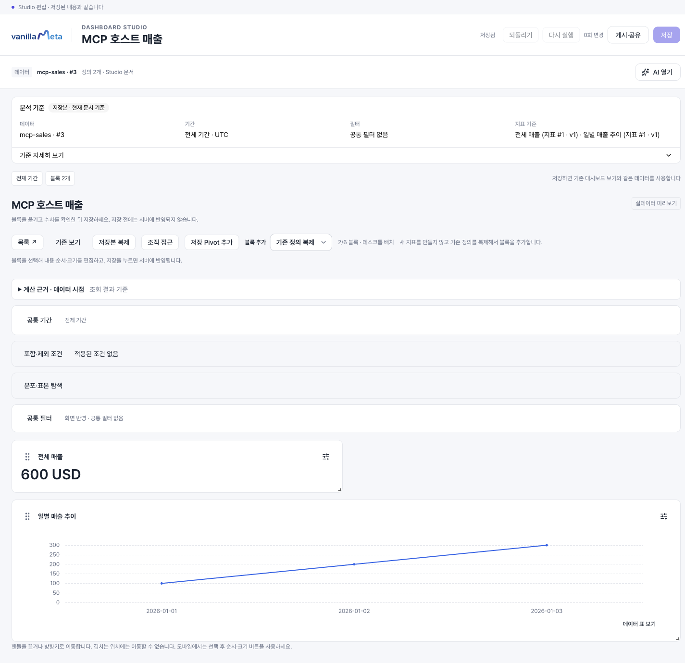
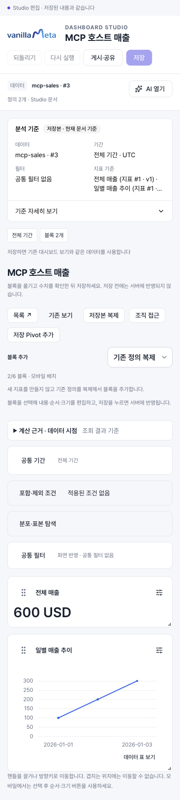
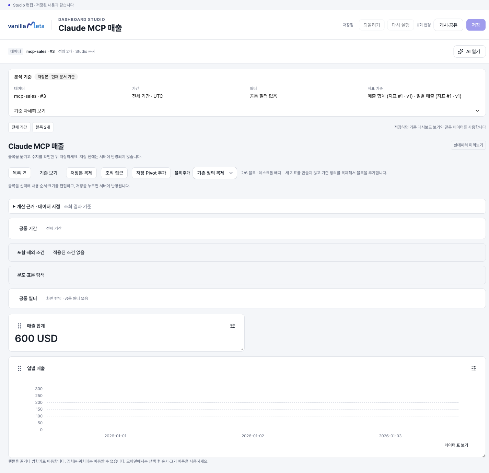
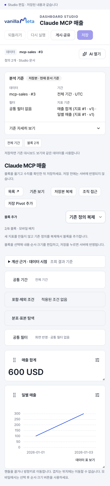

# MCP로 연결하고 분석 만들기

VanillaMeta MCP 서버를 코딩 에이전트에 연결하면 대화에서 내 소스와 지표를 찾고, 숫자·시계열을 미리본 뒤 비공개 대시보드를 저장할 수 있습니다. 반환된 Studio 링크에서 결과를 다시 열고 편집합니다.

::: info 첫 버전의 연결 방식
현재는 **로컬 stdio MCP 서버**입니다. 에이전트가 내 컴퓨터의 Node 프로세스를 실행하고, 그 프로세스가 기존 VanillaMeta API에 본인 계정으로 접속합니다. 별도 MCP 포트를 열지 않습니다. 원격 HTTP MCP·OAuth·자동 게시·공유는 이번 버전에 포함되지 않습니다.
:::

## 1. 준비할 것

- Node **24.11 이상 25 미만**과 VanillaMeta 소스 코드의 `mcp-server` 폴더
- 실행 중인 앱과 API의 실제 주소, 본인 VanillaMeta 로그인 계정
- 본인이 소유한 지원되는 ready DuckDB 파일 소스
- 서버에 준비된 [Codex AI 실행 환경](./agent-connection.md)

읽기 공유로 보이는 소스가 모두 새 분석 생성에 사용 가능한 것은 아닙니다. 첫 생성은 본인이 소유한 소스를 사용합니다. MCP 호스트의 AI와 VanillaMeta 서버의 AI 실행기는 별개입니다. 호스트가 요청을 조율하고 서버가 기존 구조화 제안·계산 검증을 수행합니다.

## 2. MCP 의존성 설치

저장소 루트의 터미널에서 실행합니다. 기존 API/웹의 의존성을 다시 설치할 필요는 없습니다.

```sh
npm --prefix mcp-server ci --ignore-scripts
node --version
command -v node
```

마지막 명령으로 나온 **Node 실행 파일의 절대 경로**를 이후 클라이언트 설정에 사용합니다. 예시 `/absolute/path/to/node`는 실제 경로로 바꿔야 합니다.

## 3. 본인 계정으로 연결 파일 만들기

아래 주소는 기본 로컬 예시입니다. 실제 설치에서 API가 `/api/v1` 프록시를 사용하거나 포트가 다르면 운영자가 안내한 주소로 바꾸세요. 웹 주소는 **앱 주소**이며 문서 사이트 주소가 아닙니다.

```sh
node mcp-server/scripts/login.js \
  --api-url http://127.0.0.1:4000/v1 \
  --web-url http://127.0.0.1:3000 \
  --output mcp-server/.env.local
```

터미널의 **VanillaMeta login ID → Password (hidden)** 순서로 입력합니다. 비밀번호는 표시하지 않고, 성공하면 본인 access token이 든 파일을 소유자만 읽고 쓸 수 있는 권한으로 만듭니다. 비밀번호와 토큰은 명령 인자나 출력으로 표시하지 않습니다.

기존 파일은 덮어쓰지 않습니다. 이미 파일이 있다면 `--output`을 새 개인 파일 경로로 바꾸고 다음 단계에서도 그 파일을 지정하세요. 파일 내용이나 토큰을 질문·스크린샷·Git에 넣지 않습니다. 이 파일은 인증정보이므로 다른 직원과 공유하지 않습니다.

로그인 도우미 없이 운영자가 발급한 본인 token으로 구성할 경우 필요한 변수는 `VM_API_URL`, `VM_WEB_URL`, `VM_ACCESS_TOKEN` 세 개입니다. API/웹 주소는 HTTPS 또는 localhost HTTP를 사용합니다. URL 안에 비밀번호·쿼리·fragment를 넣지 않습니다.

## 4. Codex에 등록

다음 세 경로를 실제 절대 경로로 바꿉니다. 등록은 사용자가 실행하는 Codex의 MCP 설정에 저장됩니다.

```sh
codex mcp add vanillameta -- \
  /absolute/path/to/node \
  --env-file=/absolute/path/to/mcp.env \
  /absolute/path/to/vanillameta/mcp-server/src/index.js
```

긴 생성 요청을 사용하는 Codex 환경에서는 등록된 `mcp_servers.vanillameta` 설정 항목의 `tool_timeout_sec`를 `200`으로 지정하세요. 서버의 AI 호출은 최대180초이므로 호스트의 짧은 기본 제한이 먼저 끝날 수 있습니다. 실제 호스트 검증에도200초를 사용했습니다. 기존 설정 전체를 덮어쓰지 않습니다.

`mcp.env` 위치에는 앞서 만든 `.env.local`의 실제 경로를 넣습니다. 에이전트가 실행되는 위치와 무관하게 파일을 찾을 수 있도록 절대 경로를 사용하세요. 등록 후 새 대화를 열고 MCP 도구 목록에 아래 6개가 보이는지 확인합니다.

| 도구                  | 하는 일                                          |
| --------------------- | ------------------------------------------------ |
| `vm_list_sources`     | 현재 접근 가능한 활성 소스 찾기                  |
| `vm_describe_source`  | 열 형식과 저장 지표 확인                         |
| `vm_propose_analysis` | 질문으로 생성안과 전체 블록 집계 미리보기 만들기 |
| `vm_get_proposal`     | 기존 미저장 생성안 다시 읽기                     |
| `vm_save_analysis`    | 검토·승인한 생성안을 비공개 분석으로 저장        |
| `vm_get_artifact`     | 저장 분석과 집계 결과·Studio 링크 다시 읽기      |

Node를 직접 실행하는 구성을 사용합니다. `npm start`를 MCP 실행 명령으로 쓰면 npm의 안내 문구가 MCP 통신용 stdout에 섞일 수 있습니다. 또 `docs.vanillameta.net/mcp`는 이 설명서 페이지이며 연결용 HTTP MCP 주소가 아닙니다.

### Claude Code 연결과 승인 저장

먼저 Claude Code 자체의 로그인을 확인합니다. VanillaMeta 로그인 파일과 Claude 로그인은 서로 다릅니다.

```sh
claude --version
claude auth status
```

Claude가 미로그인이라면 `claude auth login`으로 로그인하세요. macOS에서는 샌드박스의 키체인 접근 제한 때문에 상태 조회와 실제 실행 결과가 다를 수 있습니다. MCP가 연결되어도 모델 인증이 실패하면 질문을 처리할 수 없습니다.

Claude Code의 [공식 stdio 등록 형식](https://code.claude.com/docs/en/mcp)에 따라 다음을 등록합니다.

```sh
claude mcp add --transport stdio vanillameta -- \
  /absolute/path/to/node \
  --env-file=/absolute/path/to/mcp.env \
  /absolute/path/to/vanillameta/mcp-server/src/index.js
```

새 Claude Code 대화를 열고 `/mcp`에서 `vanillameta` 연결을 확인합니다. 이어서 아래 5단계 프롬프트로 소스 조회와 미리보기를 요청하고, 계산을 검토한 뒤 6단계의 **별도 저장 요청**을 보냅니다. 미리보기만 요청한 대화에서는 저장 도구를 승인하지 마세요. 저장 후 반환된 Studio 링크를 열고 새로고침하여 두 블록이 유지되는지 확인합니다.

생성 시간이 긴 환경에서는 Claude Code 실행 시 `MCP_TOOL_TIMEOUT=200000`(밀리초)을 설정할 수 있습니다. 예: `MCP_TOOL_TIMEOUT=200000 claude`. Codex의 `tool_timeout_sec=200`과 단위가 다릅니다.

<details>
<summary>등록을 저장하지 않고 실행별 설정으로 시험하기</summary>

다음 내용을 개인 `vm-mcp.json` 파일에 저장하고 경로를 바꿉니다. 토큰은 이 JSON 대신 앞서 만든 소유자 전용 환경 파일에 둡니다.

```json
{
  "mcpServers": {
    "vanillameta": {
      "type": "stdio",
      "command": "/absolute/path/to/node",
      "args": [
        "--env-file=/absolute/path/to/mcp.env",
        "/absolute/path/to/vanillameta/mcp-server/src/index.js"
      ]
    }
  }
}
```

```sh
MCP_TOOL_TIMEOUT=200000 claude --strict-mcp-config --mcp-config /absolute/path/to/vm-mcp.json
```

이 실행에는 지정한 MCP만 연결됩니다. 기존 전역 등록을 덮어쓰지 않습니다. 비대화형 자동화에서는 조회·제안·제안 재조회와 저장을 단계별로 분리하고 필요한 도구만 허용하세요. 검증기는 첫 단계에 `vm_get_proposal`까지 허용해 실제 재조회를 확인합니다.

</details>

호스트의 MCP 서버/도구 승인 절차를 따릅니다. 도구 연결과 실제 생성·저장은 각각 확인해야 합니다. Codex의 `never` 또는 Claude Code의 `dontAsk` 같은 비대화형 정책에서는 허용하지 않은 도구가 거절될 수 있습니다. 승인 없이 무조건 실행하도록 전역 정책을 낮추지 말고, 대화형 승인을 사용하거나 조직에서 허용한 실행별 승인 검토를 사용하세요.

## 5. 프롬프트로 미리보기 만들기

본인 소스에 아래 합성 CSV를 등록하면 간단히 결과를 확인할 수 있습니다. 파일 업로드는 [앱의 데이터 연결](./data.md)에서 수행합니다. MCP에 업로드 도구는 없습니다.

```csv
day,amount
2026-01-01,100
2026-01-02,200
2026-01-03,300
```

코딩 에이전트에 다음처럼 요청합니다.

```text
VanillaMeta MCP를 사용해 내 mcp-sales 소스를 찾아줘.
먼저 열과 저장 지표를 확인한 뒤,
amount 합계를 매출 숫자와 day별 시계열 두 블록으로 제안해줘.
전체 기간·UTC·USD·소수점 0자리로 해줘.
제목은 MCP 매출 분석으로 해줘.
각 블록의 계산과 결과를 보여주고 아직 저장하거나 게시하지 마.
```

소스가 여러 개라면 에이전트가 보여 준 이름과 번호를 확인해 선택합니다. 숫자 **600 USD**, 시계열 **100 → 200 → 300**, 두 블록이 맞는지 검토합니다. 생성안에는 `proposalId`, `sourceRevision`, `saveRequestId`가 반환됩니다. 이 값들은 이후 저장·재시도의 기준입니다.

확인 질문이 나오면 필요한 답변을 먼저 제공합니다. 환불률처럼 분모가 모호한 요청은 그대로 저장하지 않습니다. 생성안은 약 10분 동안 임시 보관되며 API 서버가 재시작하면 사라질 수 있습니다.

## 6. 검토 후 저장을 요청

결과가 맞으면 같은 대화에서 다음처럼 요청합니다.

> 방금 검토한 숫자 600과 날짜별 시계열 두 블록을 비공개 분석으로 저장해줘. 같은 생성안과 저장 요청 ID를 사용하고 게시·공유는 하지 마. 저장 후 다시 조회해서 Studio 링크를 알려줘.

저장 도구는 `confirmSave=true`와 검토한 제안·소스 버전·요청 UUID가 있어야 실행됩니다. 이 값 자체가 사람의 동의를 증명하는 것은 아니므로 호스트가 실제 사용자의 승인을 받은 뒤 호출해야 합니다.

성공하면 새 대시보드 번호와 Studio 링크가 반환됩니다. 링크를 열어 **저장됨**, 데이터 소스, 두 블록을 확인하고 새로고침하세요.



<details>
<summary>모바일에서 같은 저장본 보기</summary>



</details>

### Claude Code로 저장한 실제 결과

Claude Code가 만든 미리보기를 검토한 뒤 별도 저장 요청으로 저장한 결과입니다. 합계600 USD와 날짜별100·200·300이 Studio 새로고침 뒤에도 유지됩니다.



<details>
<summary>Claude Code 저장본의 모바일 화면</summary>



</details>

추가 AI 수정·배치 편집·게시·조직 공유·재사용은 기존 [Artifact 제작 가이드](./agent-artifacts.md)에서 이어갑니다. 이번 MCP 도구는 기존 저장본 수정·게시·공유를 직접 실행하지 않습니다.

## 오류와 재시도

| 오류/상황                | 다음 동작                                                                               |
| ------------------------ | --------------------------------------------------------------------------------------- |
| `VM_HTTP_401`            | 본인 계정으로 연결 파일을 새로 만들고 MCP 클라이언트가 새 파일을 읽도록 갱신·재시작     |
| `VM_HTTP_403`            | 현재 계정과 소스/분석 권한 확인. 다른 계정이나 임의 권한으로 우회하지 않음              |
| `VM_HTTP_409`            | 원 요청을 보존하고 최신 소스·제안 기준 검토. 자동 버전 변경이나 새 UUID 재저장 금지     |
| 생성안 만료/400          | 질문을 유지하고 다시 제안·미리보기. 이전 저장이 불명확하면 먼저 같은 요청으로 결과 확인 |
| 시간 초과·응답 유실·취소 | 성공·실패를 단정하지 않고 **동일 requestId와 정확한 저장 본문**으로 결과 확인           |
| 실행 파일을 못 찾음      | Node·환경 파일·index.js의 절대 경로, 실행 호스트의 파일 접근 확인                       |

MCP는 자동으로 재로그인하거나 권한·버전을 바꾸지 않습니다. access token 만료·회수 시 재연결해야 합니다. 이미 `VM_*` 변수가 호스트 환경에 설정되어 있다면 Node의 env 파일보다 우선할 수 있으므로 연결 계정/주소가 의도한 값인지 확인하세요.

프로필의 원본 표본·접속 설정·파일 경로와 실행 SQL은 MCP 결과에서 제외합니다. 집계 미리보기는 모든 블록을 포함하되 블록당 최대240행이며, 초과하면 `totalRows`와 `truncated`로 표시합니다. 잘린 집계 행을 전체 결과로 오해하지 마세요.

::: info 실제 검증 범위
2026-10-21 공식 MCP SDK 클라이언트와 실제 Codex CLI 0.162.1에서 로컬 stdio → Nest/Docker MySQL/DuckDB → 실제 AI 제안·미리보기 → 별도 저장 → 재조회·Studio 새로고침을 확인했습니다. 합성 매출600/시계열3점, 동일 요청의 중복 생성 방지, 타인 접근403·잘못된 token401·입력 충돌409를 확인했습니다. 390/768/1440px에서 저장본 크기·정렬을 확인했습니다. 2026-10-23에는 Claude Code 2.1.308(실제 기본 모델 `claude-sonnet-5-5`)에서도 같은 합성 데이터로 MCP 6도구 호출 → 미리보기 → 별도 승인 저장 → 재조회와 Studio 새로고침을 확인했습니다. 미리보기 단계의 저장0건과 승인 저장 후 새 대시보드1건을 DB에서 대조했습니다. 원격 HTTP/OAuth·실휴대폰·모든 조직 역할의 전체 수용은 별도입니다.
:::
