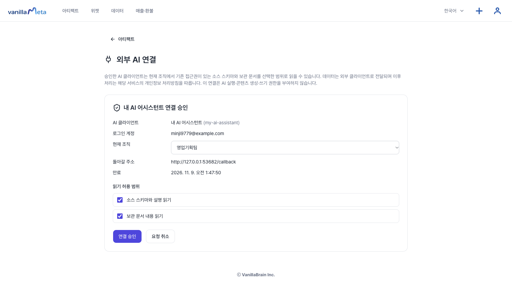
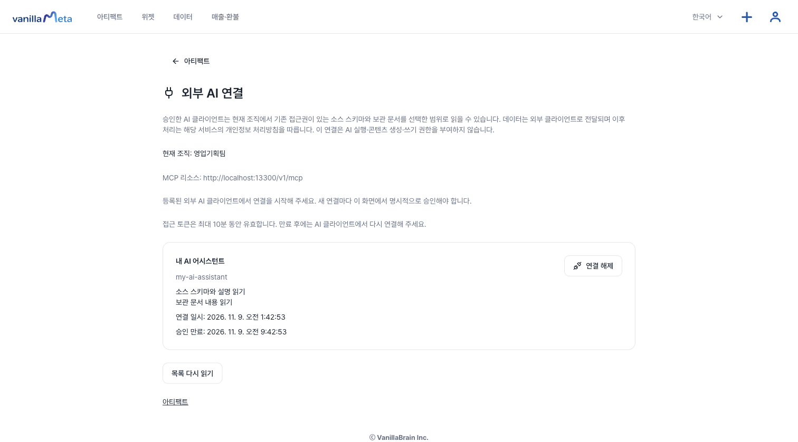
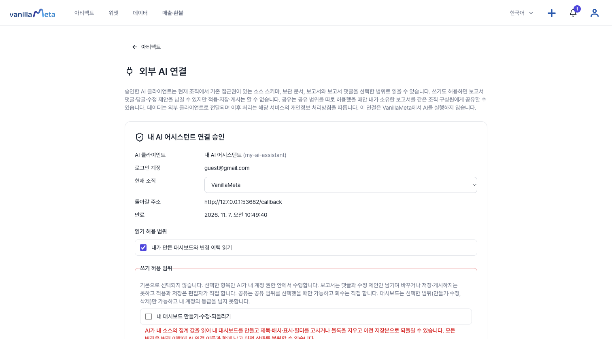
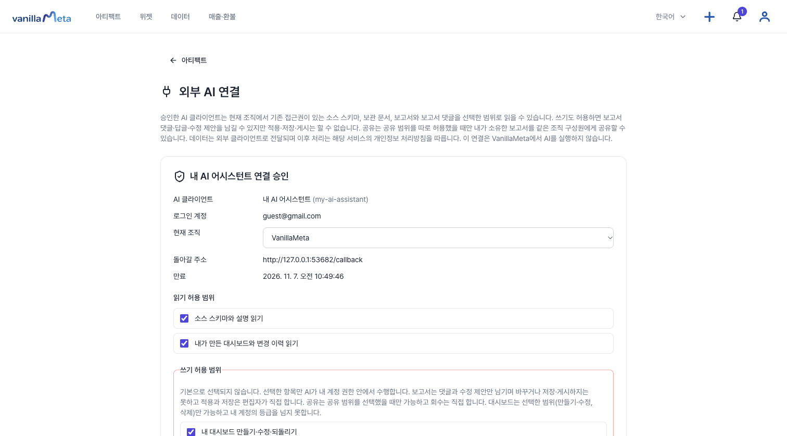
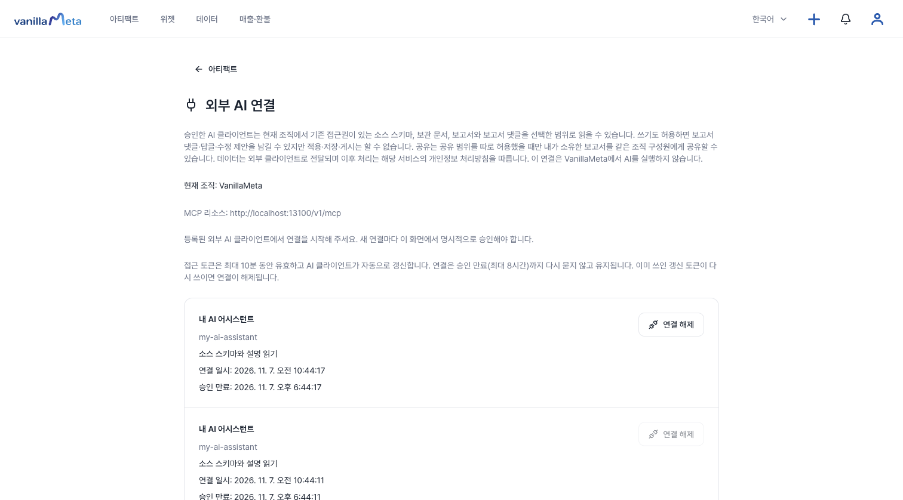
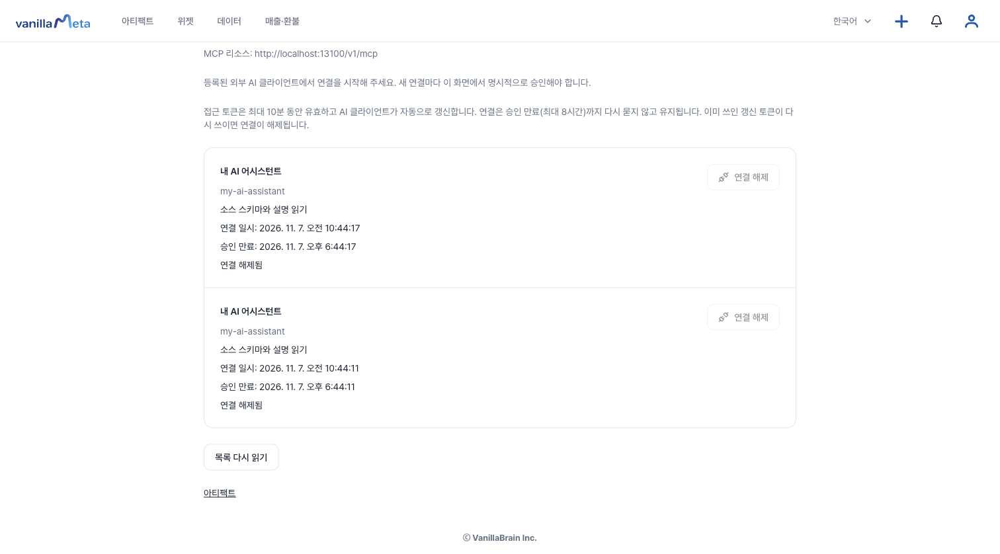
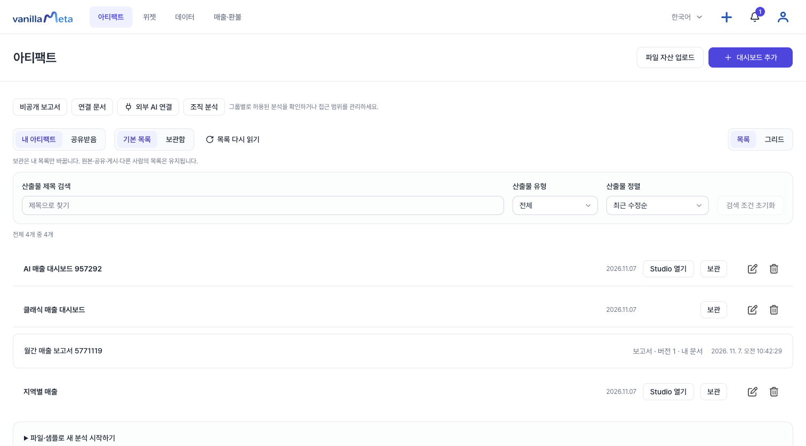
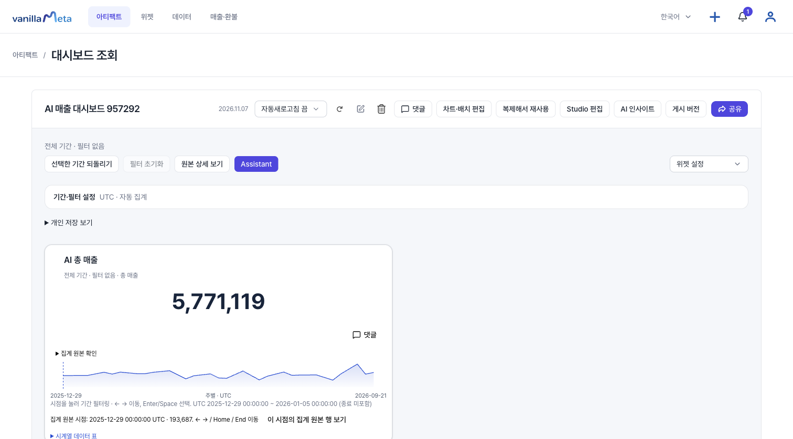
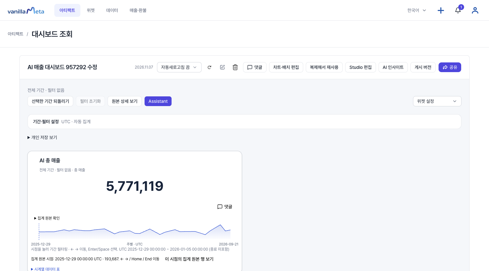
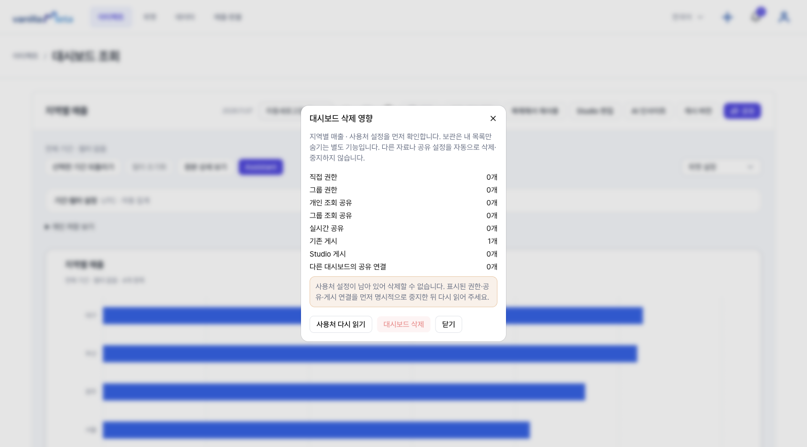

# 내 AI로 연결하기 (원격 MCP, 쓰기 기능 준비 중)

팀원은 자기가 쓰는 AI(Claude Code 등)를 VanillaMeta의 **원격 MCP**(`/v1/mcp`)에 연결해, 대화로 내 대시보드를 만들고 고치고 보고서에 댓글을 남길 수 있습니다. 서버 AI는 필요 없습니다. AI는 **내 계정의 권한 안에서** 일하고, 무엇을 허용할지는 연결할 때 내가 고릅니다.

::: warning 일부만 지금 쓸 수 있습니다
**지금 서버에서 쓸 수 있는 것**: 원격 연결(OAuth 승인)과 소스·문서 읽기 도구(`vm_list_sources`, `vm_describe_source`, `vm_list_documents`, `vm_read_document`, 권한 `sources:read`·`documents:read`). 운영자가 원격 연결을 켜고 AI 클라이언트를 등록해 두었을 때 쓸 수 있습니다.

**개발 중이며 아직 서버에 없는 것**: 이 페이지의 대시보드 만들기·수정·되돌리기·삭제 도구, 보고서·댓글·공유 도구와 그 권한, 조직 등급. 화면은 개발 환경에서 찍은 것입니다.

로컬 stdio MCP 서버로 연결하는 방법은 [MCP로 연결하고 분석 만들기](./mcp.md)에 있습니다. 개발 중인 기능이 적용되면 이 페이지가 안내의 중심이 됩니다.
:::

## 지금 쓸 수 있는 읽기 연결

운영자가 원격 연결을 켜고 AI 클라이언트를 등록해 두었고 **내가 조직에 속해 있다면**, 내가 쓰는 AI에서 **소스와 보관 문서를 읽을 수** 있습니다. 승인 화면은 이렇게 보입니다.

1. AI 클라이언트에서 연결을 시작하면 VanillaMeta에 **"○○ 연결 승인"**(○○은 AI 클라이언트 이름) 화면이 열립니다.
2. **소스 스키마와 설명 읽기**, **보관 문서 내용 읽기** 중 허용할 것을 고르고 **연결 승인**을 누릅니다. 이 연결은 AI 실행, 콘텐츠 생성, 쓰기 권한을 주지 않습니다.



승인하면 아티팩트 화면의 **외부 AI 연결**에 연결이 나타납니다. **연결 해제**를 누르면 그 연결은 바로 끊깁니다.



- 접근 토큰은 최대 10분 동안 유효하고 자동으로 갱신되지 않습니다. 만료되면 AI 클라이언트에서 다시 연결하고 승인 화면을 다시 거칩니다. 승인 자체도 8시간 뒤에 만료됩니다.
- 연결한 AI는 **내 계정이 이미 볼 수 있는** 소스와 문서만 읽습니다.
- AI가 읽을 수 있는 것은 소스 이름과 열 이름·형식, 그리고 [연결 문서](./connected-docs.md)의 보관 사본입니다. 내가 가져온 문서뿐 아니라 내가 공유받은 문서도 포함됩니다. 대시보드·보고서·슬라이드를 만들거나 고치는 도구는 아래의 "준비 중" 내용입니다.

아래 내용은 **아직 서버에 없는 기능**을 개발 환경에서 찍은 화면과 함께 설명합니다.

## 1. 준비할 것

- 운영자가 원격 연결을 켜고 AI 클라이언트를 등록해 두었는지 확인합니다. 등록은 운영자의 일입니다. 클라이언트마다 허용 범위가 정해지고, 범위를 바꾸면 **모든 연결이 끊겨** 다시 연결해야 합니다.
- 조직 구성원이어야 합니다. 연결한 AI는 내 **등급**을 넘지 못합니다. `viewer`는 읽기만, `contributor` 이상은 만들기·수정·삭제까지 허용되고, 조직 관리자라도 남이 만든 대시보드는 열지 못합니다.
- 대시보드를 만들려면 본인이 소유한 데이터 소스(DuckDB 파일 소스)와 그 소스의 **저장 지표**가 있어야 합니다. 소스를 찾는 도구는 `sources:read` 권한이므로 `dashboards:*`와 함께 승인합니다. 지표는 앱의 [지표](./metrics.md) 화면에서 먼저 만들어 둡니다.

## 2. 연결과 승인

AI 클라이언트에서 연결을 시작합니다. Claude Code의 예입니다.

```sh
claude mcp add --transport http --client-id <운영자가 알려 준 id> --callback-port <포트> vanillameta <API 주소>/mcp
```

열린 VanillaMeta 화면에서 허용할 권한을 고르고 **연결 승인**을 누릅니다. 읽기 권한은 기본 선택이고, **쓰기·삭제 권한은 기본 해제**이며 경고가 붙습니다. 필요한 것만 직접 선택하세요.



쓰기 범위는 사람이 직접 체크해야 하며, 아래는 대시보드 쓰기·삭제를 체크한 상태입니다(화면 아래쪽에서 **연결 승인**을 누릅니다).



승인하면 아티팩트 목록의 **외부 AI 연결**에 연결이 나타나며 **연결 해제**로 언제든 끊을 수 있습니다.



해제한 연결은 "연결 해제됨"으로 바뀌고 그 토큰은 바로 거절됩니다.



 승인한 연결은 최대 8시간 동안 다시 묻지 않고 유지되며(토큰은 10분마다 AI 클라이언트가 자동 갱신), 이미 쓰인 갱신 토큰이 다시 쓰이면 연결이 자동으로 해제됩니다.

## 3. 권한과 도구

| 권한 | 도구 | 하는 일 |
| --- | --- | --- |
| `dashboards:read` | `vm_list_dashboards`, `vm_read_dashboard` | **내가 만든** 대시보드와 변경 이력 읽기 (공유받은 것은 제외) |
| `dashboards:write` | `vm_list_metrics`, `vm_preview_dashboard`, `vm_create_dashboard`, `vm_update_dashboard`, `vm_restore_dashboard` | 소스의 저장 지표 찾기, 저장 지표로 미리보기·만들기, 제목·배치·표시·필터 수정과 블록 삭제, 이전 저장본으로 되돌리기 |
| `dashboards:delete` | `vm_get_dashboard_removal`, `vm_remove_dashboard` | 사용처가 없는 내 대시보드 삭제 (되돌릴 수 없음) |
| `sources:read` | `vm_list_sources`, `vm_describe_source` | 소스 이름과 열 이름·타입 (원본 행은 제외) |
| `documents:read` | `vm_list_documents`, `vm_read_document` | 내 보관 문서 읽기 |
| `reports:read` | `vm_list_reports`, `vm_read_report` | 내 보고서와 공유받은 보고서 읽기 |
| `comments:read` | `vm_list_comments` | 볼 수 있는 댓글 스레드와 제안 읽기 |
| `comments:write` | `vm_add_comment`, `vm_reply_comment` | 댓글과 답글 쓰기. 작성자는 "Claude · 클라이언트 이름"으로 표시 |
| `suggestions:write` | `vm_propose_report_edit` | 본문 범위 수정 **제안**하기 |
| `shares:write` | `vm_list_report_shares`, `vm_share_report` | 내가 소유한 보고서를 같은 조직 구성원 1~5명에게 읽기 전용 공유 |

AI가 읽는 소스·문서·보고서·댓글·대시보드 제목은 **다른 사람이나 AI가 쓴 내용**입니다. 그 안의 문장을 AI가 지시로 따르지 않도록 안내하며, 내가 대화에서 직접 요청할 때만 만들기·수정·삭제·공유를 하도록 하세요.

## 4. 대시보드를 대화로 만들고 고치기

```text
VanillaMeta로 내 mcp-sales 소스를 찾아서, 저장 지표 "매출 합계"를 숫자 한 블록과
channel별 막대 한 블록으로 미리보기 해줘. 아직 저장하지 마.
```

1. **지표 찾기** `vm_list_metrics`: 내 소스의 저장 지표와 그 `id`·`definitionVersion`을 확인합니다. 열은 `vm_describe_source`가 알려 주며 꺾은선 차트에는 날짜 열이 필요합니다.
2. **미리보기** `vm_preview_dashboard`: 저장 지표(`{id, definitionVersion}`)만 쓸 수 있고 새 지표 정의·수식은 지원하지 않습니다. 계산된 값을 돌려주며 아무것도 저장하지 않습니다. 결과의 숫자를 직접 검토하세요.
3. **만들기** `vm_create_dashboard`: 검토한 같은 입력과 미리보기의 `previewDigest`로 저장합니다. 그 사이 데이터나 지표가 바뀌었으면 `PREVIEW_STALE`로 거절되니 다시 미리보기합니다. 앱의 대시보드 목록과 Studio에서 사람이 만든 것과 똑같이 열립니다.





4. **수정** `vm_update_dashboard`: 제목, 블록 제목·설명·표시, 위치·크기, 필터·기간, 블록 삭제만 됩니다. 블록 추가나 계산 정의 변경은 지원하지 않습니다(`UNSUPPORTED_CHANGE`). 읽은 `revision`을 함께 보내므로 그 사이 다른 곳에서 바뀌었으면 거절되고 다시 읽습니다. 아래는 AI가 제목만 "수정"으로 바꾼 뒤의 화면입니다.


5. **되돌리기** `vm_restore_dashboard`: 변경 이력에서 고른 저장본으로 되돌립니다. 되돌리기도 새 이력으로 남아 다시 취소할 수 있습니다. 지운 블록은 새 블록으로 다시 만들어지며 그 블록의 차트 댓글 위치는 떨어질 수 있습니다. 표시·배치·제목·필터·블록 존재만 되돌리고, 지금의 지표나 열로 되살릴 수 없는 저장본은 거절됩니다.
6. **삭제** `vm_get_dashboard_removal`로 사용처를 확인한 뒤 `vm_remove_dashboard`: 공유·권한·전달·게시가 남아 있으면 목록과 함께 거절됩니다. 그 설정을 직접 중지한 뒤 다시 요청하세요. 삭제하면 댓글과 이력도 함께 지워집니다. 앱에서 직접 삭제를 눌러도 같은 안내가 나옵니다.



**만들기·수정·되돌리기는 모두 변경 이력에 기록됩니다**(삭제하면 이력도 함께 지워집니다). 사람이 저장한 것과 AI가 한 것이 구분되고, AI가 처음 고치기 직전 상태도 따로 남아 되돌릴 수 있습니다. 호스트가 수정·되돌리기·삭제 호출 전에 확인을 요청하도록(`destructive` 표시) 설정되어 있어도 그대로 승인 절차를 따르세요.

## 5. 보고서 협업

- 읽기 권한은 기본 선택이고, 쓰기 권한(`comments:write`, `suggestions:write`, `shares:write`)은 기본 해제입니다. `shares:write`에는 공유 경고가 따로 붙습니다.
- 댓글·제안 위치는 인용문(`quote`)으로 지정해 오프셋을 계산할 필요가 없습니다. 같은 문장이 여러 번 나오면 몇 번째인지(`occurrence`)를 함께 보냅니다.
- **적용은 사람이 합니다.** AI의 제안은 보고서 편집 화면에 "Claude · 클라이언트 이름"으로 나타나고, 소유자가 **본문에 적용**한 뒤 **비공개 저장**해야 반영됩니다. 보고서·문서·소스에는 적용·저장·게시·삭제 도구가 없습니다.
- AI가 공유하면 공유 관리 목록에 "Claude가 공유함 · 클라이언트 이름"으로 표시됩니다. 회수는 직접 합니다.

## 6. 오류와 재시도

| 오류 | 의미와 다음 동작 |
| --- | --- |
| `CONFLICT` (`REVISION_CHANGED`, `SOURCE_CHANGED`, `PREVIEW_STALE`) | 그 사이 대시보드·데이터·지표가 바뀜. 다시 읽거나 다시 미리보기하고 **같은 요청 ID**로 재시도 |
| `REQUEST_REUSED` | 그 요청 ID로 이미 다른 내용이 처리됨. 새 요청 ID로 반복하지 말고 현재 상태를 읽어 확인 |
| `INVALID` (`UNSUPPORTED_CHANGE`, `RESTORE_STALE`, `HAS_DEPENDENCIES`) | 재시도해도 소용없음. 사용자에게 알리고 사용처 중지·지표 확인 등 사람이 할 일을 안내 |
| `LIMIT` (`RATE_LIMITED`) | 짧은 시간에 너무 많이 호출함(쓰기 분당 20회, 생성 시간당 10개, 삭제 분당 10회, 미리보기 분당 10회). 잠시 뒤 같은 요청 ID로 재시도 |
| `UNAUTHORIZED` | 연결이 해제·만료됨. AI 클라이언트에서 다시 연결 |
| `FORBIDDEN` / `NOT_FOUND` | 내 등급·소유 밖이거나 존재하지 않음. 권한을 우회하지 않음 |

시간 초과나 응답 유실이 있으면 성공·실패를 단정하지 말고 **같은 요청 ID와 같은 내용**으로 다시 보내 결과를 확인합니다.

::: info 검증 범위
대시보드 도구는 합성 데이터로 단위·통합 테스트(실제 DuckDB, SQLite)로 확인했고, 2026-11-07에는 로컬 Docker 스택(PostgreSQL 17)에서 71개 화면·API 시나리오를 모두 통과했습니다. 이 페이지의 화면은 그 실행에서 찍은 것이며 검증용 계정(`guest`)과 합성 데이터만 보입니다. 외부 AI 쪽은 스크립트로 만든 OAuth 클라이언트가 호출한 것이어서, Claude Code 같은 실제 호스트가 보여 주는 승인 화면과 호출 흐름은 이 화면에 포함되지 않습니다.
:::
