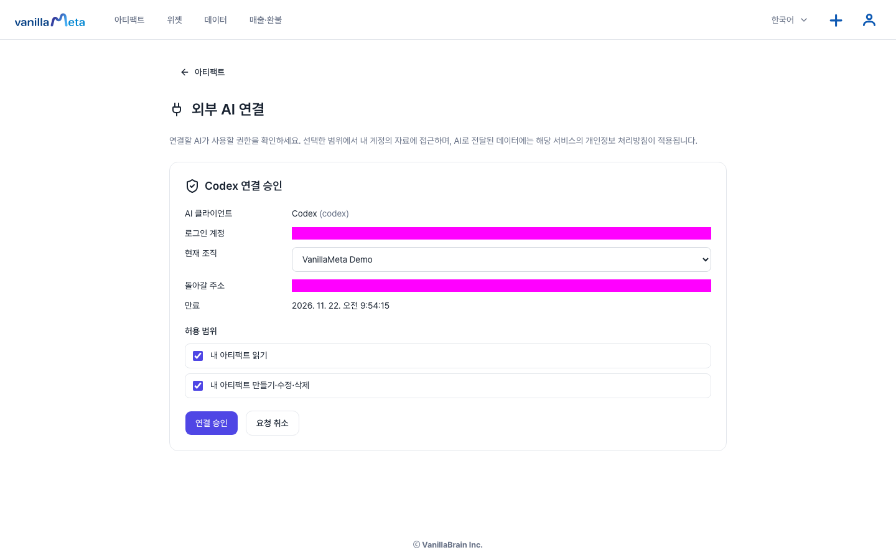

# 내 AI로 연결하기 (원격 MCP)

Codex나 Claude Code를 VanillaMeta의 **원격 MCP**(`/v1/mcp`)에 연결하면 대화에서 내 AI 아티팩트를 조회·생성·수정할 수 있습니다. 서버의 AI 실행 환경 없이 AI 클라이언트가 도구 호출을 조율합니다.

처음 연결한다면 [Codex로 첫 차트 만들기](./codex-first-chart.md)부터 따라 하세요. 승인 화면, 두 요청 문장, 수정 결과와 다시 여는 방법을 한 흐름으로 확인할 수 있습니다.

::: info 현재 범위는 개인 AI 아티팩트입니다
원격 MCP의 쓰기 범위는 승인한 계정이 소유한 AI 아티팩트에만 적용됩니다. 일반 대시보드·Studio 분석·보고서·댓글·공유의 기존 권한과 분리되어 있으며, 이 MCP 도구로 그 자료를 만들거나 수정하거나 공유할 수 없습니다.
:::

## 준비할 것

- 원격 MCP를 켠 VanillaMeta 서버
- 운영자가 등록한 AI 클라이언트 ID와 정확한 loopback callback
- 조직 구성원 계정
- 승인 화면에서 확인할 AI 클라이언트, 계정, 조직

VanillaMeta는 동적 클라이언트 등록(DCR/CIMD)을 제공하지 않습니다. 운영자가 `MCP_OAUTH_CLIENTS_JSON`에 클라이언트와 redirect URI를 미리 등록해야 합니다. Codex의 고정 callback 설정과 전체 명령은 [Codex로 첫 차트 만들기](./codex-first-chart.md)의 접힌 **운영자 준비** 절을 따릅니다.

## 연결과 승인

로그인한 AI 클라이언트가 `/v1/mcp`의 OAuth 보호 리소스 metadata를 읽고 승인 화면을 엽니다. 브라우저에서 다음 값을 확인합니다.

- **AI 클라이언트**가 연결하려는 Codex 또는 Claude Code인지
- **로그인 계정**과 **현재 조직**이 맞는지
- 필요한 읽기·쓰기 범위가 선택되어 있는지

쓰기 범위는 자동으로 선택되지 않습니다. AI가 차트를 만들고 수정해야 할 때 **내 아티팩트 만들기·수정·삭제**를 직접 선택하고 **연결 승인**을 누릅니다.



**요청 취소**를 누르거나 창을 닫으면 연결되지 않습니다. AI 클라이언트에서 MCP 로그인을 다시 시작하세요.

## 권한과 도구

| 권한 | 도구 | 범위 |
| --- | --- | --- |
| `artifacts:read` | `vm_list_artifacts`, `vm_get_artifact` | 내가 소유한 AI 아티팩트 목록과 본문 |
| `artifacts:write` | `vm_create_artifact`, `vm_update_artifact`, `vm_delete_artifact` | 내 AI 차트·표·문서·HTML을 만들고 현재 revision으로 수정·삭제 |
| `sources:read` | `vm_list_sources`, `vm_describe_source` | 승인 조직에서 현재 읽을 수 있는 소스 이름과 열 이름·타입. 원본 행과 접속 정보는 제외 |
| `documents:read` | `vm_list_documents`, `vm_read_document` | 내 비공개 보관 문서 목록과 명시한 저장 버전 본문 |

AI 아티팩트 종류는 `html`, `document`, `sheet`, `chart`입니다. 차트는 `bar` 또는 `line`을 만들 수 있습니다. 아티팩트는 호출한 계정의 소유이며 공유 링크를 자동으로 만들지 않습니다.

소스·문서의 내용은 외부 AI로 전달됩니다. 해당 AI 서비스의 데이터 처리 정책을 확인하고, 다른 사람이 쓴 내용은 지시가 아닌 자료로 다루도록 요청하세요.

## 수정과 revision

수정과 삭제는 현재 revision이 필요합니다. AI가 오래된 revision을 보내면 서버는 `revision mismatch`로 거절합니다. 같은 내용을 새 차트로 다시 만들지 말고, 아티팩트를 다시 읽은 뒤 최신 revision으로 요청합니다.

차트를 수정한 뒤에는 반환된 링크를 새로고침해 제목, 리비전, 값, 단위를 확인합니다. 같은 링크와 ID가 유지되어야 합니다.

## 연결 유지와 재인증

승인 기록은 최대 8시간 유지되고 access token은 최대 10분 동안 유효합니다. 현재 원격 MCP 서버는 **refresh token을 발급하지 않습니다**. 토큰이 만료하면 자동 갱신을 가정하지 말고 AI 클라이언트에서 MCP 로그인과 승인을 다시 진행합니다.

연결을 해제하거나 범위를 바꾸면 기존 token은 즉시 거절됩니다. 아티팩트 목록의 **외부 AI 연결**에서 현재 연결과 범위를 확인하고 **연결 해제**할 수 있습니다.

## 발표용 저장본으로 다시 열기

발표 중 라이브 생성이 지연되면 운영자가 미리 만든 **지역별 매출** 저장본을 사용할 수 있습니다. VanillaMeta에서 로그인한 뒤 다음 경로를 엽니다.

```text
/dashboard?artifactQuery=%EC%A7%80%EC%97%AD%EB%B3%84+%EB%A7%A4%EC%B6%9C&artifactKind=ai
```

화면 상단의 **내 아티팩트**와 **산출물 제목 검색** 입력란에 `지역별 매출`이 채워졌는지 확인합니다. **AI 차트 · 버전 2**를 열면 서울 120, 부산 100과 범례 **매출 (만원) · 발표용 합성 데이터**가 보입니다. 이 경로는 저장본을 다시 열 뿐 새 생성 요청을 보내지 않습니다.

## 오류와 다음 동작

| 오류 | 다음 동작 |
| --- | --- |
| `invalid_client` | 운영자에게 클라이언트 ID와 callback의 scheme, host, 포트, 전체 path가 등록값과 같은지 확인합니다. |
| `invalid_request`에서 `resource`를 지적함 | `--oauth-resource`에 MCP 주소를 중복 지정하지 않습니다. resource metadata의 값을 사용합니다. |
| 401 또는 도구 없음 | AI 클라이언트에서 이 MCP만 다시 로그인합니다. Codex 로그인 전체를 해제하는 `codex logout`은 사용하지 않습니다. |
| `revision mismatch` | 아티팩트를 다시 읽고 최신 revision으로 수정합니다. |
| 다른 계정에도 아티팩트가 보임 | 발표를 멈추고 로그인 계정과 연결 조직을 확인합니다. |

## 기본 Compose 실행

발표 환경은 저장소 루트에서 기본 Compose를 실행합니다. 웹은 `http://localhost:3000`, API와 원격 MCP는 `http://localhost:4000`에서 열립니다.

```sh
docker compose up --build -d --wait
```

3000 또는 4000 포트가 사용 중이면 `VM_WEB_PORT`와 `VM_API_PORT`를 명령 앞에 지정합니다. 같은 변수를 지정한 상태에서 같은 명령을 다시 실행하면 이미지도 갱신됩니다.

```sh
VM_WEB_PORT=3100 VM_API_PORT=4100 docker compose up --build -d --wait
```

도움말은 별도로 빌드하고 미리 봅니다.

```sh
npm run docs:build
npm --prefix docs/user-manual run preview -- --host 127.0.0.1 --port 4174
```

발표 뒤 컨테이너를 내립니다. 볼륨과 시연 자료는 남습니다.

```sh
docker compose down
```
