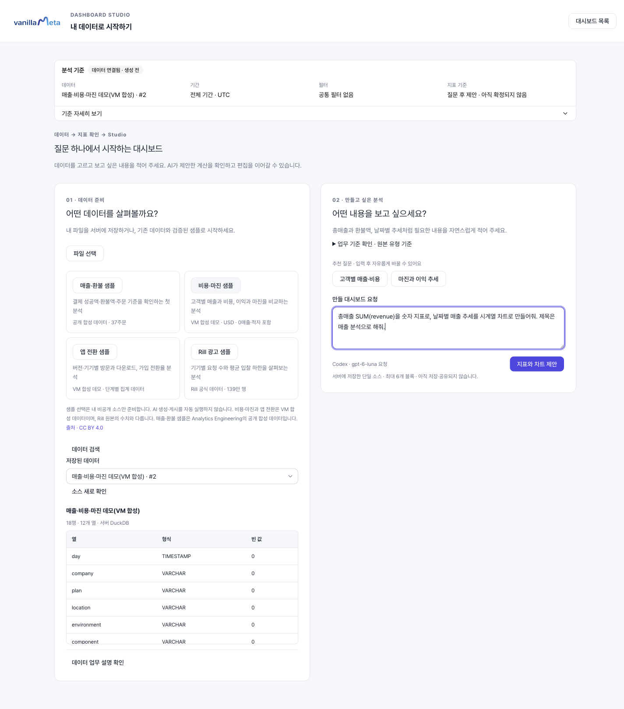
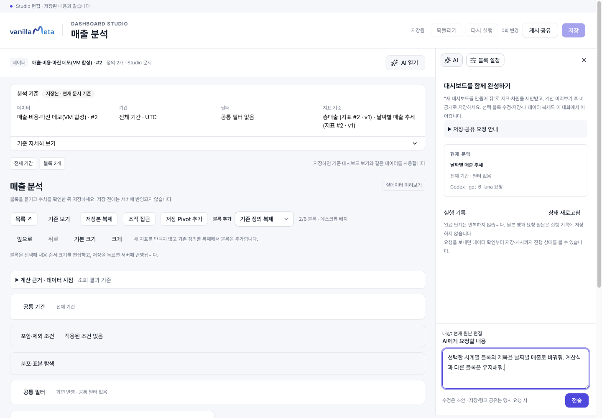
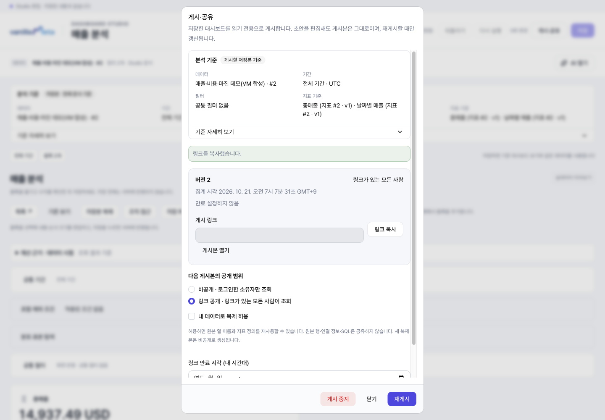
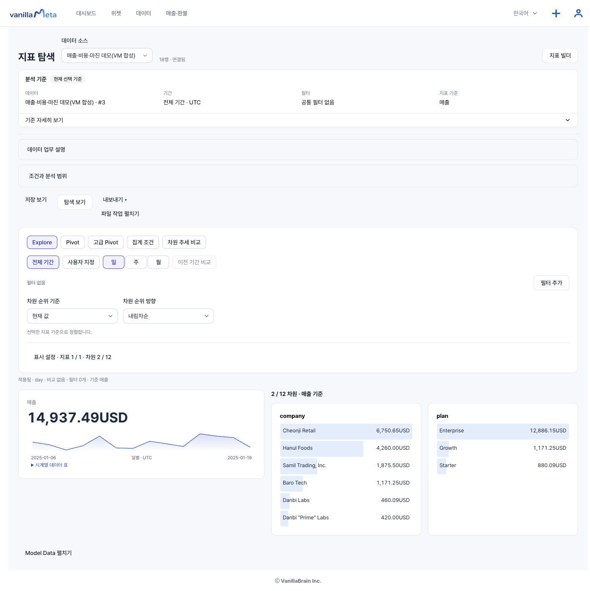
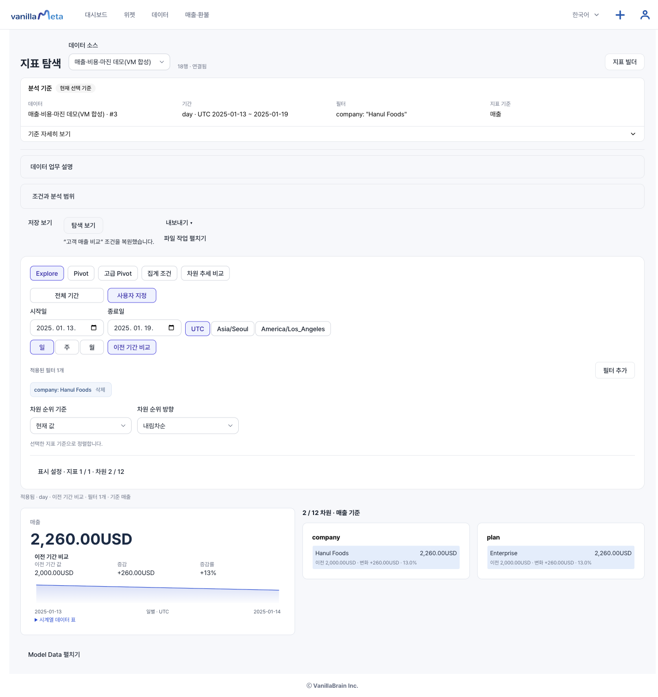
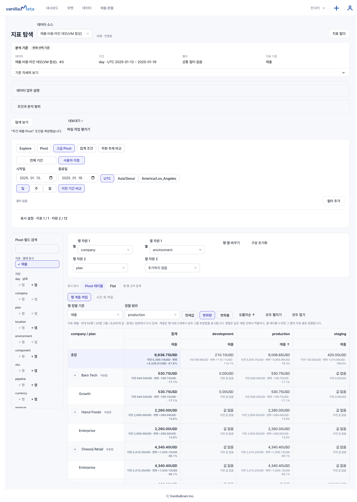
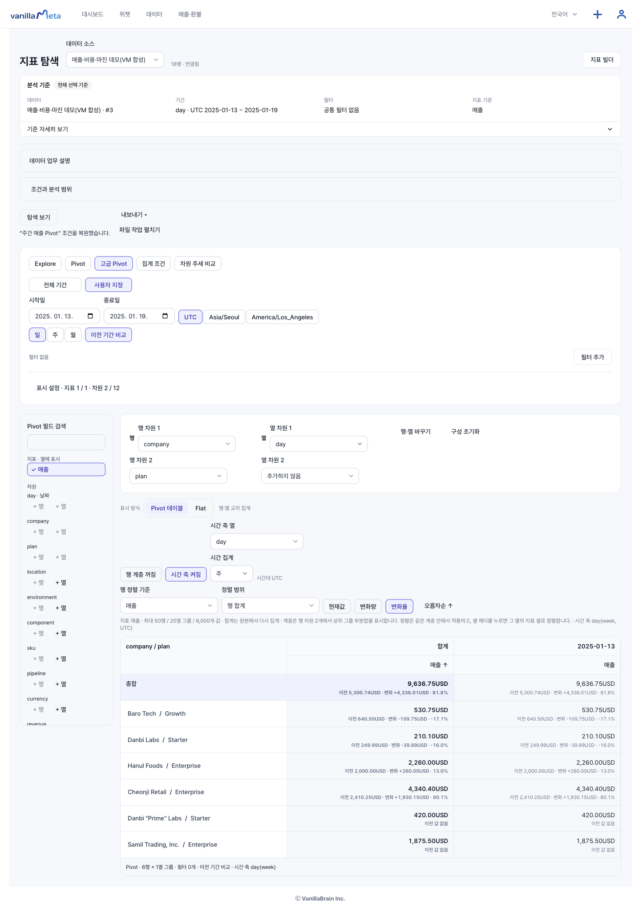
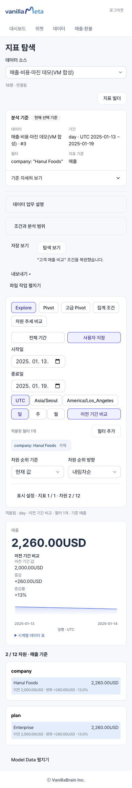
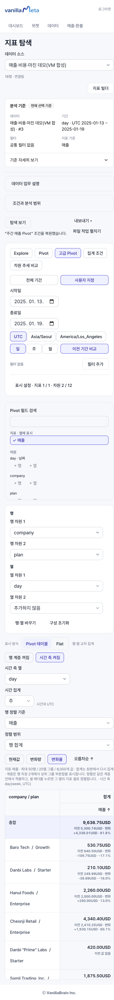

# 화면으로 따라 하는 매출 분석 샘플

비용·마진 합성 데이터로 대시보드를 만들고, 특정 고객의 매출을 비교하고, 주간 Pivot을 저장해 봅니다. 실제 앱에서 촬영한 화면을 보면서 세 가지 실습을 각각 진행할 수 있습니다.

::: tip 시작 전에
운영자가 안내한 앱 주소에 로그인하세요. 이 문서 사이트는 사용법을 보여 주는 곳이며 분석을 실행하는 앱은 별도입니다. AI 실습에는 서버의 AI 실행 환경이 필요합니다. 캡처는 공개 합성 데이터로 실행한 예시이며 소스 번호와 AI가 제안하는 제목·구성은 설치마다 다를 수 있습니다.
:::

## 실습 순서와 결과

1. **AI 대시보드 만들기:** 샘플 → 질문 → 미리보기 → 저장 → 수정 → 게시를 진행합니다. 총매출 **14,937.49 USD**와 날짜별 시계열을 확인합니다.
2. **고객 매출 비교하기:** 기간 선택 → 이전 기간 비교 → 고객 필터 → 보기 저장을 진행합니다. 고객 매출 **2,260.00 USD**, 이전 **2,000.00 USD**를 확인합니다.
3. **주간 Pivot 저장하기:** 행·열 → 계층 → 시간 축 → 정렬 → 보기 저장을 진행합니다. 주간 총합 **9,636.75 USD**와 복원된 축 구성을 확인합니다.

예상값은 원본 샘플의 매출 합계 기준입니다. 다른 파일이나 필터가 남아 있으면 숫자가 달라집니다. 세 실습의 저장 대상은 각각 **대시보드 / Explore 탐색 보기 / 고급 Pivot 탐색 보기**로 다릅니다.

## 실습 1. 질문으로 매출 대시보드 만들기

### 1-1. 데이터와 질문 준비

대시보드 목록에서 **질문으로 대시보드 만들기**를 누릅니다. **내 데이터로 시작하기**에서 **비용·마진 샘플**을 선택하고 준비가 끝나면 선택된 소스를 확인합니다.

**만들 대시보드 요청**에 다음을 입력한 뒤 **지표와 차트 제안**을 누릅니다.

> 총매출 SUM(revenue)을 숫자 지표로, 날짜별 매출 추세를 시계열 차트로 만들어줘. 제목은 매출 분석으로 해줘.

### 1-2. 미리보기와 첫 저장

**계산 미리보기**에서 숫자와 시계열이 모두 있는지 확인합니다. **계산 기준 확인**은 `revenue` 합계, 전체 매출은 **14,937.49 USD**, 날짜 열은 `day`가 기준입니다. 다른 계산이 제안됐다면 그대로 저장하지 말고 질문을 구체화하세요.

**Studio에 저장하고 열기**를 누릅니다. Studio에서 **저장됨**을 확인하고 새로고침해 숫자와 시계열이 유지되는지 확인합니다.

### 1-3. 저장한 차트 수정

시계열 블록의 **설정 아이콘 → AI** 탭을 엽니다. **AI에게 요청할 내용**에 다음을 입력하고 **전송**합니다.

> 선택한 시계열 블록의 제목을 날짜별 매출로 바꿔줘. 계산식과 다른 블록은 유지해줘.

변경 결과를 확인하고 **전체 미리보기**가 요구되면 실행합니다. 제목만 바뀌고 숫자·계산식·다른 블록이 유지되는지 확인한 뒤 **저장 → 저장됨 → 새로고침**합니다. 변경 없는 응답은 수정 완료로 보지 말고 대상과 바꿀 내용을 다시 적으세요.

### 1-4. 게시본 확인과 공유

**게시·공유**를 열고 저장본 기준을 확인합니다. 먼저 **비공개 · 로그인한 소유자만 조회**로 게시해 결과를 확인하세요.

다른 사람도 볼 수 있게 하려면 **링크 공개 · 링크가 있는 모든 사람이 조회**를 선택해 게시하거나 재게시합니다. **링크 복사 / 게시본 열기**로 결과를 확인합니다. 아래 캡처의 링크 값은 숨겨져 있습니다.

저장 후 수정 내용까지 공개하려면 **재게시**가 필요합니다. 실습을 마치면 **게시 중지 → 중지 확인**으로 공개를 끝냅니다. 사내 계정에게만 전달하려면 [조직 조회 공유](./organization.md)를 사용하세요.

**실습 1 완료 확인:** 새로고침 후 숫자·시계열·수정한 제목이 유지되고, 의도한 공개 범위에서 게시본을 확인했습니다. 자세한 절차는 [빠른 시작](./quickstart.md)에 있습니다.

## 실습 2. 고객 매출을 이전 기간과 비교하기

### 2-1. Explore와 지표 준비

앱의 **지표 탐색**(`/explore/source`)을 열어 같은 비용·마진 소스를 선택합니다. 저장 지표가 없다면 **지표 빌더**에서 아래와 같이 저장하고 **지표 탐색**으로 돌아옵니다. AI 대시보드의 지표가 이 목록에 같은 이름으로 자동 등록된다고 가정하지 마세요.

| 입력 항목   | 예제 값 |
| ----------- | ------- |
| 지표 이름   | 매출    |
| 집계 방법   | 합계    |
| 집계할 열   | revenue |
| 단위        | USD     |
| 소수 자릿수 | 2자리   |

**표시 설정**에서 매출과 `company`, `plan`을 선택합니다. **전체 기간**, 필터 없음 기준으로 **14,937.49 USD**인지 확인합니다.

### 2-2. 기간과 고객 필터 적용

1. **사용자 지정**을 누르고 시작일 `2025-01-13`, 종료일 `2025-01-19`를 입력·확정합니다.
2. **표시 시간대 UTC**, **집계 단위 일**, **이전 기간 비교**를 선택합니다.
3. 필터가 없는 현재 매출 **9,636.75 USD**, 이전 **5,300.74 USD**를 확인합니다.
4. **필터 추가 → 필터 열 company → 값 검색 Hanul → Hanul Foods 선택 → 필터 적용** 순서로 진행합니다.
5. 필터 칩과 현재 **2,260.00 USD**, 이전 **2,000.00 USD**, 증감률이 +13%인지 확인합니다.

날짜 입력을 확정하면 기간 조회는 자동으로 진행됩니다. 고객 검색과 체크만으로는 적용되지 않으므로 **필터 적용**을 꼭 누르세요.

### 2-3. 저장하고 다시 열기

**탐색 보기 → 새 보기 이름**에 `고객 매출 비교`를 입력하고 **현재 조건 저장**을 누릅니다. 새로고침 후 같은 소스를 선택하고 **탐색 보기 → 저장한 탐색 보기 → 고객 매출 비교 → 보기 열기**로 복원합니다.

**실습 2 완료 확인:** 기간·비교·고객 필터와 매출 2,260.00 USD가 복원됐습니다. 이 저장은 Studio 대시보드나 게시본을 바꾸지 않습니다. 숫자 범위와 다른 필터는 [Explore 상세 안내](./explore.md)를 참고하세요.

## 실습 3. 회사별 주간 Pivot 저장하기

### 3-1. 행·열과 계층 구성

실습 2의 `company: Hanul Foods` 필터 칩에서 **삭제**를 누릅니다. 기간은 UTC `2025-01-13`~`2025-01-19`, **이전 기간 비교**는 켠 상태로 둡니다.

**고급 Pivot**을 선택하고 아래처럼 구성합니다. 필드의 **+ 행 / + 열** 또는 행·열 선택기를 사용합니다.

| 설정      | 선택          |
| --------- | ------------- |
| 행 차원 1 | company       |
| 행 차원 2 | plan          |
| 열 차원 1 | environment   |
| 열 차원 2 | 추가하지 않음 |
| 표시 방식 | Pivot 테이블  |

**행 계층 꺼짐**을 눌러 켜고 **모두 펼치기**로 회사 아래 요금제와 부분합을 확인합니다. 총합은 **9,636.75 USD**입니다. `production` 열의 매출 머리글을 누른 뒤 **변화량**을 선택하면 해당 환경 셀을 기준으로 정렬할 수 있습니다.

### 3-2. 주간 시간 축과 정렬

1. **열 차원 1**을 `day`로 바꾸고 **열 차원 2**는 **추가하지 않음**으로 둡니다.
2. **시간 축 꺼짐**을 눌러 켭니다. **시간 축 열 day**, **시간 집계 주**를 선택합니다.
3. 비교가 쉽도록 계층을 끄고 **행 정렬 기준 매출 / 정렬 범위 행 합계 / 변화율**을 선택합니다.
4. 표에 주간 열 `2025-01-13`이 나타나는지 확인합니다. 선택한 기간이 한 주여서 주간 열은 하나입니다. 축을 바꾸면 이전 셀 정렬 범위가 초기화될 수 있습니다.

### 3-3. 저장과 복원

**탐색 보기**에서 `주간 매출 Pivot`이라는 이름으로 **현재 조건 저장**합니다. 새로고침 후 같은 소스의 **저장한 탐색 보기 → 주간 매출 Pivot → 보기 열기**를 실행합니다.

**실습 3 완료 확인:** 고급 Pivot·두 행 차원·날짜 열·주 단위·이전 기간 비교·정렬과 총합이 유지됩니다. 기본 Pivot과의 차이, Flat 전환, 합계 해석은 [Pivot 상세 안내](./pivot.md)를 참고하세요.

## 모바일에서는 이렇게 보입니다

컨트롤은 화면 폭에 맞춰 다음 줄에 배치됩니다. 숫자와 결과는 아래로 스크롤해서 확인하세요. Pivot에서 날짜 열이 보이지 않으면 **표 안을 좌우로 스크롤**합니다.

모바일 Explore 화면 보기

모바일 Pivot 화면 보기

::: info 캡처와 확인 범위
2026-10-21 실제 앱에서 확인한 공개 합성 데이터의 AI 생성·수정·저장·게시 및 Explore/Pivot 캡처를 재사용한 샘플입니다. 이 문서 추가를 위해 AI 요청이나 앱 실습을 다시 실행한 것은 아닙니다. 모바일은 브라우저 390px 화면이며 실휴대폰 촬영이 아닙니다. [지원 범위와 문서 기준](./scope.md)을 함께 확인하세요.
:::
