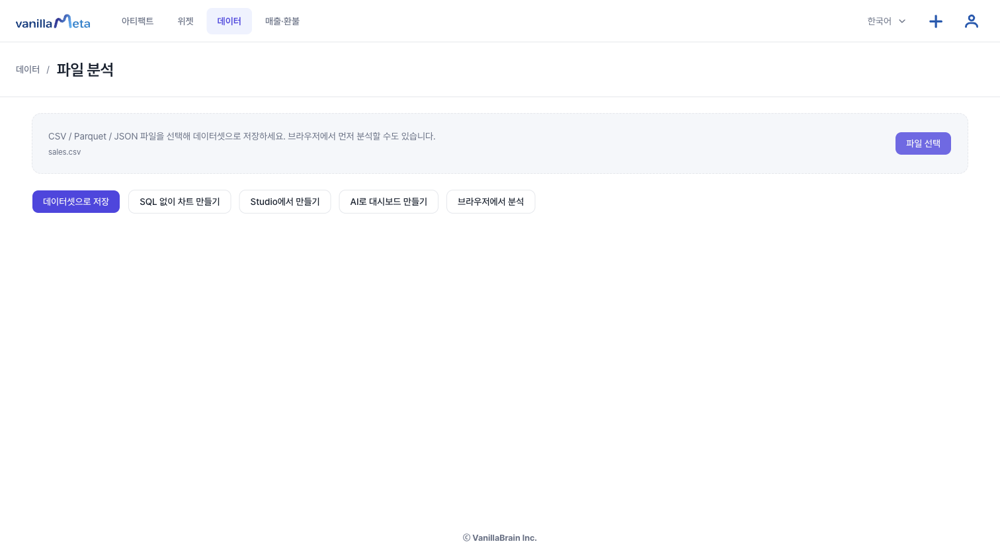
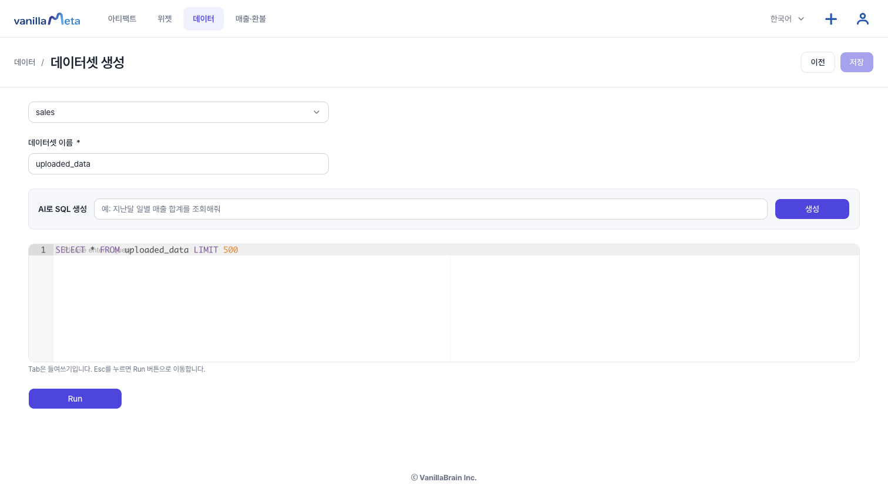
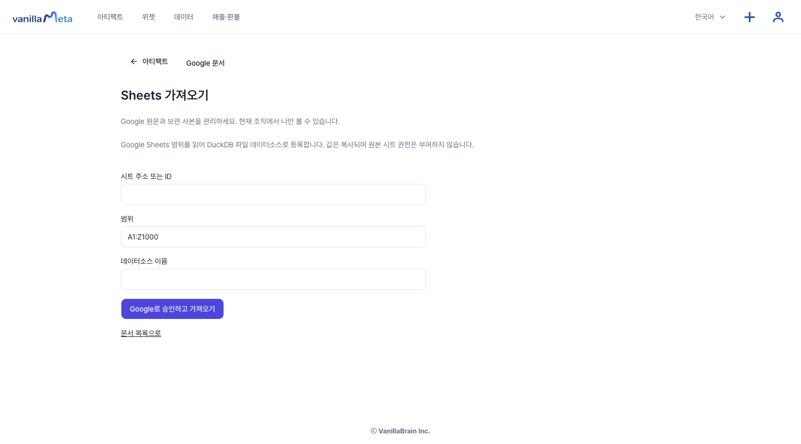

# 시트·엑셀 자료로 분석하기

엑셀이나 시트에 있는 자료는 **데이터 소스**로 가져와서 지표와 차트로 분석합니다. 앱 안에서 엑셀 표를 새로 만들거나 편집하는 화면은 없고, **가져오기**로 시작합니다.

## 어떤 파일을 가져올 수 있나요

| 가져오는 방법 | 형식 | 비고 |
| --- | --- | --- |
| 파일 올리기 (**데이터 → 파일 분석**) | **CSV, Parquet, JSON** | 파일 하나는 기본 512 MiB까지입니다. |
| **Sheets 가져오기** (Google Sheets) | 시트의 한 범위 | 관리자 설정이 필요합니다. |

::: warning 엑셀(.xlsx, .xls)은 직접 올릴 수 없습니다
엑셀 파일을 고르면 "CSV, Parquet, JSON 파일만 지원합니다."라는 안내가 나옵니다. 엑셀에서 **다른 이름으로 저장 → CSV**로 바꿔 올리거나, 파일을 Google 시트에 올려 **Sheets 가져오기**를 쓰세요.
:::

## 방법 1. 파일 올리기

CSV·Parquet·JSON을 올리는 순서는 [데이터 연결](./data.md)의 "CSV·JSON·Parquet 연결하기"에 있습니다. **데이터 → 파일 분석**에서 파일을 고릅니다. 저장하기 전에 행 수와 열을 훑어보려면 **브라우저에서 분석**을 쓰세요.

**파일 선택**으로 파일을 고르면 파일 이름 아래에 다음 선택지가 나타납니다.

앞의 **네 버튼은 모두 파일을 서버에 올려 새 데이터 소스를 만든 뒤** 이동합니다. 이동하는 곳만 다릅니다.

| 버튼 | 이동하는 곳 |
| --- | --- |
| **데이터셋으로 저장** | **데이터셋 만들기** 화면 |
| **SQL 없이 차트 만들기** | 탐색(Explore) 화면에서 방금 만든 소스로 시작 |
| **Studio에서 만들기** | Studio의 새 대시보드 |
| **AI로 대시보드 만들기** | AI 대시보드 만들기(서버에 AI가 설정되어 있어야 이어집니다) |
| **브라우저에서 분석** | 서버에 저장하지 않고 이 브라우저 안에서만 분석합니다. |

저장 버튼은 **누를 때마다 데이터 소스를 하나씩** 만들고 계정당 20개 한도를 씁니다. 같은 파일을 여러 번 누르지 마세요.

저장하면 "데이터 소스가 생성되었습니다. (N행)"이라는 안내가 잠시 나옵니다. 아래는 **데이터셋으로 저장**을 눌렀을 때 열리는 데이터셋 만들기 화면입니다.

## 방법 2. Google 시트 가져오기

1. **Google 문서** 화면에서 **Sheets 가져오기**를 엽니다.
2. **시트 주소 또는 ID**를 넣고, **범위**(기본 `A1:Z1000`)와 **데이터소스 이름**을 정합니다.
3. **Google로 승인하고 가져오기**를 누릅니다.
4. 가져온 뒤 **파일 데이터에서 열기**로 결과를 확인합니다.

가져온 값은 **복사**됩니다. 원본 시트에 대한 권한은 주어지지 않고, 원본이 바뀌어도 **자동으로 갱신되지 않습니다**. 최신 값이 필요하면 다시 가져오세요.

가져오기 조건은 다음과 같습니다.

- 첫 행은 **머리글**이어야 합니다. 빈 머리글이나 같은 이름의 머리글이 있으면 안 됩니다.
- 데이터 행이 하나 이상 있어야 합니다.
- 범위는 **100,000셀**, **50열**, 셀 하나 **1,000자**까지입니다.

## 가져온 뒤에는

1. **지표**를 정해 숫자를 만들고 ([지표와 차원](./metrics.md)), 필요하면 [Explore](./explore.md)나 [Pivot](./pivot.md)로 살펴봅니다.
2. 결과를 **대시보드**로 저장합니다 ([첫 아티팩트 만들기](./quickstart.md)).
3. 대시보드의 숫자로 [보고서](./docs-report.md)를 씁니다.
4. 분석 결과를 파일로 받으려면 [CSV 출력](./export-library.md)을 보세요. 내려받는 형식은 **CSV**입니다.

## 내 AI로 읽기

가져온 데이터 소스의 이름과 열 이름·형식은 내가 쓰는 AI에서 읽을 수 있습니다. 연결 방법은 [원격 MCP 연결](./remote-mcp.md)에 있습니다.

## 한도

- 계정마다 데이터 소스 20개, 전체 5 GiB까지 올릴 수 있습니다(베타 기본값이며 운영 설정에 따라 다를 수 있습니다).
