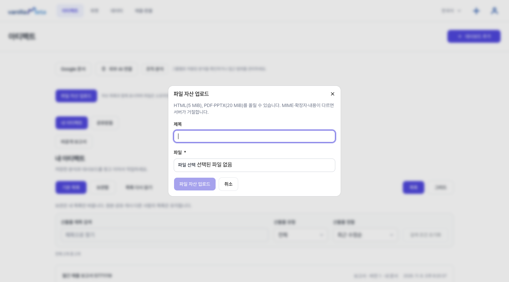
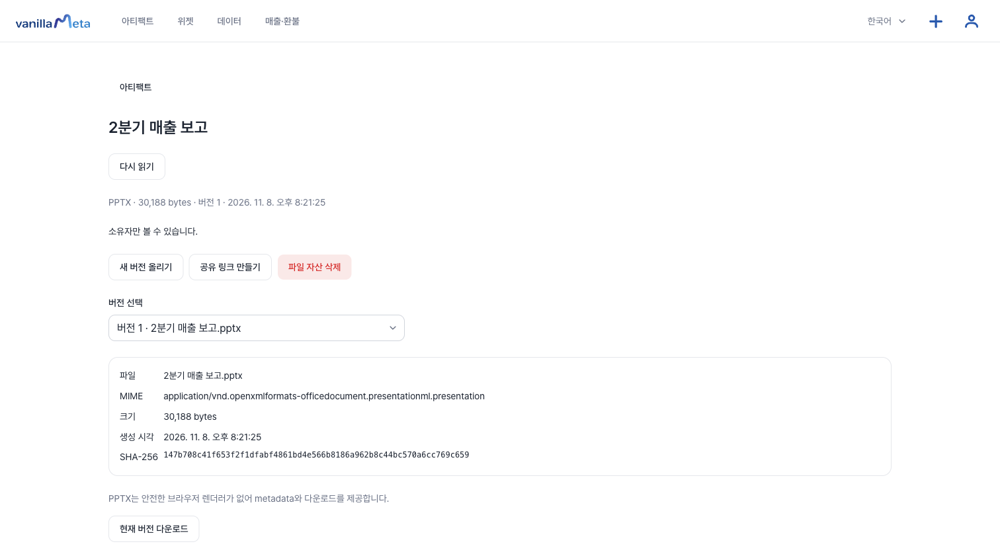
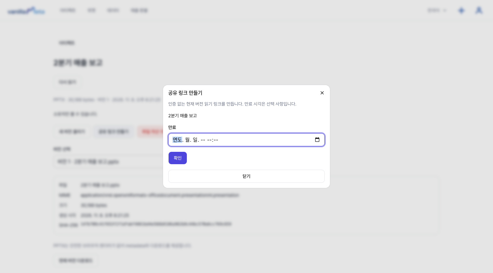
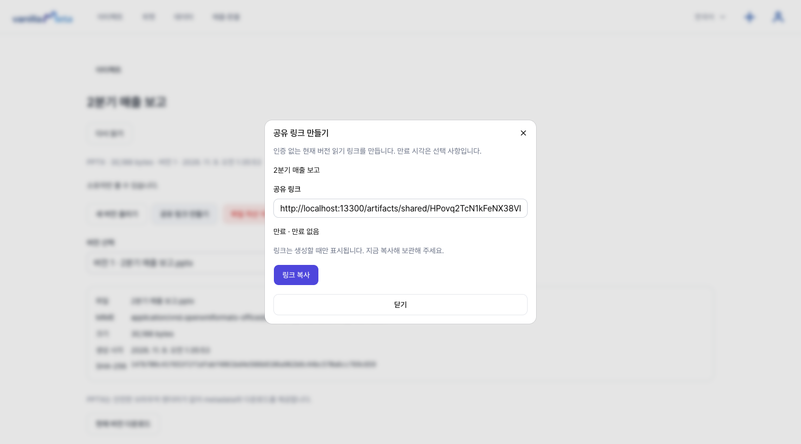

# 슬라이드(PPT) 올리고 전달하기

이미 만든 발표 자료를 **파일 자산**으로 올려 두고 같은 목록에서 관리합니다. 앱 안에서 슬라이드를 새로 만들거나 편집하지는 않습니다. PowerPoint 같은 도구에서 만든 파일을 올리는 방식입니다.

## 올릴 수 있는 파일

| 형식 | 크기 | 화면에서 보이는 모습 |
| --- | --- | --- |
| **PPTX** | 20 MiB까지 | 파일 정보(파일, MIME, 크기, 생성 시각, SHA-256)와 **현재 버전 다운로드**. 슬라이드는 화면에 그려지지 않습니다. |
| **PDF** | 20 MiB까지 | 화면에서 바로 미리봅니다. |
| **HTML** | 5 MiB까지 | 안전하게 격리된 미리보기로 보입니다. |

파일 확장자와 내용이 다르면(예: 이름만 `.pptx`인 다른 파일) 올릴 수 없습니다.

::: tip 슬라이드를 화면에서 보여 주고 싶다면
PowerPoint에서 **PDF로 저장**해 함께 올리세요. PDF는 브라우저에서 바로 열립니다. PPTX 원본은 따로 올려 두고 내려받게 할 수 있습니다.
:::

## 올리기

1. 아티팩트 화면에서 **파일 자산 업로드**를 누릅니다.
2. **제목**을 쓰고(비우면 파일 이름이 쓰입니다) **파일**을 고릅니다.
3. 다시 **파일 자산 업로드**를 눌러 올립니다.

올린 파일은 아티팩트 목록에 **파일 자산**으로 표시되고(**산출물 유형 → 파일 자산**), 눌러서 상세 화면을 엽니다.

## 고치고 다시 올리기

내용을 고쳤다면 상세 화면의 **새 버전 올리기**로 같은 자리에 다시 올립니다. 이전 버전은 **버전 선택**에서 볼 수 있습니다. 새 버전은 **같은 형식**이어야 합니다. PPTX를 올려 둔 자리에 PDF를 올릴 수는 없습니다.

## 전달하기

**공유 링크 만들기**로 로그인 없이 현재 버전을 읽는 링크를 만듭니다. 만료 시각은 정할 수 있고, 정하지 않으면 **만료 없음**입니다.

만들면 링크가 한 번 표시되고 **링크 복사**로 복사할 수 있습니다.

- 링크는 **만들 때 한 번만** 보입니다. 바로 복사해 보관하세요.
- 링크를 받은 사람은 **현재 버전**을 봅니다. PPTX는 내려받아 열게 됩니다.
- 공유 링크를 **다시 만들면 이전 링크는 바로 쓸 수 없게 됩니다.**
- 링크를 멈추려면 **공유 회수**를 누릅니다. 이미 내려받은 파일은 회수할 수 없습니다.

## 지우기

**파일 자산 삭제**는 내 목록에서 지우고, 현재 버전과 공유 링크도 열리지 않게 합니다.

## 알아 두세요

- 파일은 **올린 사람만** 관리합니다. 다른 사람을 지정해 공유하거나 댓글을 다는 기능은 없고, 링크로만 전달합니다.
- 데이터가 연결된 [대시보드](./quickstart.md)와 달리, 파일 자산의 숫자는 올릴 때 그대로입니다. 숫자가 바뀌는 자료는 대시보드나 [보고서](./docs-report.md)로 만드세요.
