# 조직 공유부터 내 데이터 재사용까지

팀의 매출 분석을 직원에게 공유하고, 받은 직원이 자신의 데이터로 독립 사본을 만들어 봅니다. 원본 합계 **600 USD**가 내 데이터의 **1,200 USD**로 바뀌는 것을 숫자와 시계열에서 확인합니다.

::: tip 준비할 계정과 자료
같은 조직의 활성 계정 두 개가 필요합니다. 원본을 소유한 관리자는 공유를 설정하고, 수신자는 받은 자료를 열고 자신의 소스로 복제합니다. 운영자가 안내한 앱에서 진행하세요. 이 문서 사이트 자체에서는 분석을 실행하지 않습니다.
:::

## 1. 서로 다른 매출 데이터 준비

소유자는 아래 CSV를 `team-sales.csv`로 준비합니다. [데이터 연결](./data.md) 절차로 등록하고, [지표 만들기](./metrics.md)에서 `amount`의 합계인 매출 지표를 만듭니다. 예시 단위는 USD, 소수 자릿수는 0입니다.

```csv
day,region,amount
2026-01-01,A,100
2026-01-02,B,200
2026-01-03,A,300
```

이 소스로 **팀 매출 분석**이라는 대시보드를 준비합니다. [AI 분석 생성](./ai-create.md)을 사용한다면 다음처럼 요청하고, 숫자와 날짜별 시계열이 함께 있는지 미리본 후 저장하세요.

> amount의 합계를 매출 숫자로, day별 매출을 시계열로 보여줘. 전체 기간을 사용하고 제목은 팀 매출 분석으로 해줘.

합계 **600 USD**, 날짜별 **100 → 200 → 300**인지 확인합니다. 질문 결과가 다르다면 계산 기준과 날짜 열을 확인하고 수정하세요.

수신자는 자신의 계정으로 다음 CSV를 `my-sales.csv`로 등록합니다. 원본과 금액 열 이름을 다르게 만들어 열 연결을 직접 확인합니다.

```csv
day,region,sales_amount
2026-01-01,A,200
2026-01-02,B,400
2026-01-03,A,600
```

파일 등록만으로 대시보드가 자동 생성되지는 않습니다. 아래 캡처는 두 파일과 숫자·시계열 두 블록을 준비한 뒤 실제 공유·복제 화면에서 진행한 예시입니다. 계정·소스·대시보드 번호는 설치마다 다릅니다.

## 2. 소유자가 소스 읽기 권한 부여

1. 계정 메뉴의 **조직·직원**(`/organization`)으로 이동합니다.
2. **자원별 권한 관리 열기**에서 데이터 소스 `team-sales`의 **권한 관리**를 누릅니다.
3. **새 수신자에게 권한 부여**를 누르고 수신 직원을 선택합니다.
4. **읽기**를 선택하고 변경 요약과 동의란을 확인합니다.
5. **권한 저장**을 누릅니다.

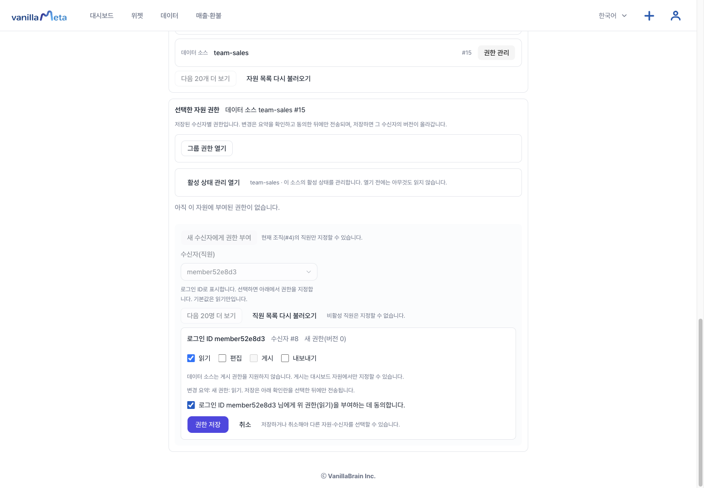

대시보드 조회 공유와 소스 읽기는 별도입니다. 여러 소스를 사용하는 분석이라면 필요한 소스마다 확인하세요. 이 실습에서는 편집·게시·내보내기를 추가하지 않습니다.

## 3. 조회 공유와 독립 복제 허용

같은 자원 목록에서 **팀 매출 분석 → 권한 관리**를 엽니다.

1. **조회 공유 열기 → 최신 공유 관계 읽기**를 누릅니다.
2. **조회 공유**를 선택하고 받을 직원을 체크합니다.
3. **독립 복제 설정**을 **독립 복제 허용**으로 선택합니다.
4. 계산식·조건·배치가 사본에 제공되고, 회수해도 이미 저장한 사본은 남는다는 안내에 동의합니다.
5. 변경 미리보기와 수신자 확인란을 확인한 뒤 **공유 변경 저장**을 누릅니다.
6. 저장 안내가 나온 뒤 **최신 공유 관계 읽기**를 눌러 수신자 행의 **공유 중 · 복제 허용**을 확인합니다.

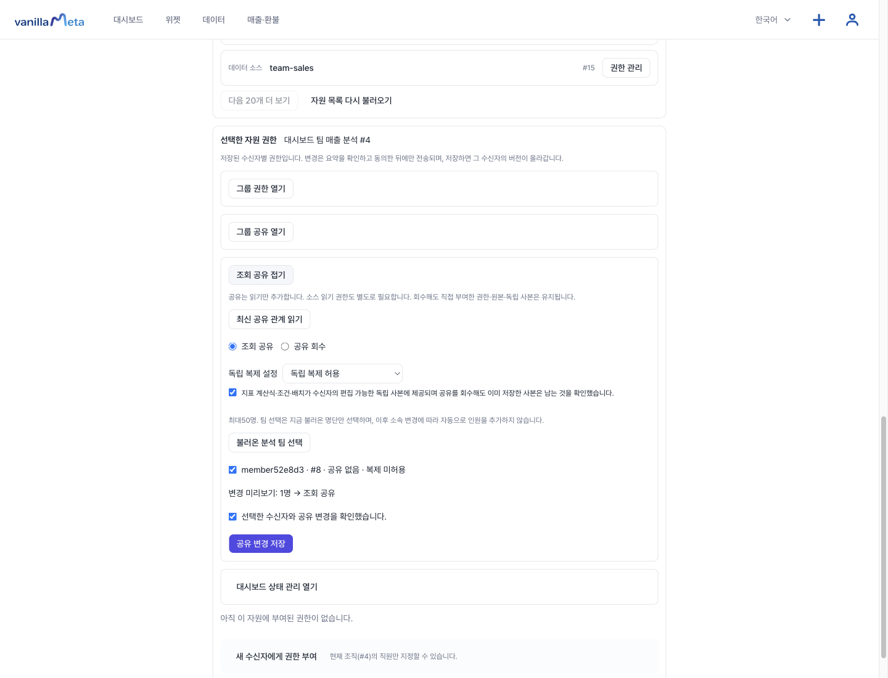

새로고침 후 관리 패널을 다시 열고 최신 관계를 읽어 상태가 유지되는지 확인하세요. 복제 설정 선택기의 기본 표시만으로 현재 허용 여부를 판단하지 말고 **수신자 행의 저장된 상태**를 확인합니다.

## 4. 수신자가 받은 자료 열기

수신자 계정으로 로그인하고 **조직·직원 → 받은 자료 열기 → 받은 자료 다시 읽기**를 누릅니다. **팀 매출 분석**의 **열기**를 눌러 원본을 확인합니다.

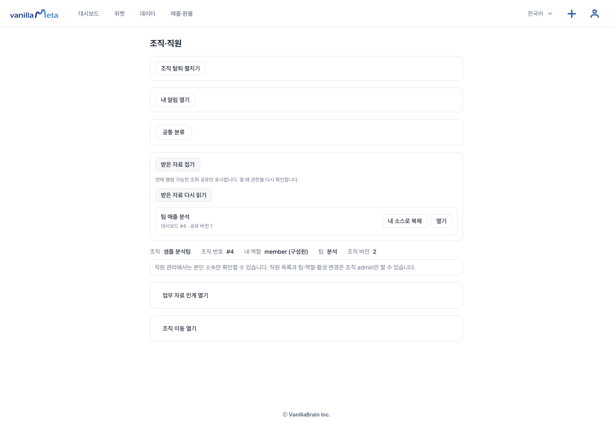

전체 기간·필터 없음 기준으로 합계 600 USD와 날짜별 매출을 확인하고 새로고침합니다. 조회 공유는 원본을 편집할 권한을 주지 않습니다. 자신의 데이터로 바꾸려면 받은 자료 목록으로 돌아가 **내 소스로 복제**를 누르세요.

<details>
<summary>모바일에서 원본 숫자와 시계열 확인</summary>

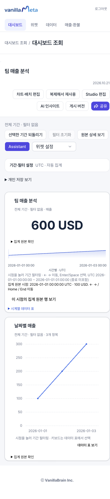

</details>

## 5. 내 소스 선택과 열 연결

**내 소스로 복제** 화면에서 **저장된 데이터**로 본인 소스 `my-sales`를 선택합니다. 원본을 읽을 수 있다는 이유만으로 원본 소스를 다시 선택하지 않도록 소스 이름과 번호를 확인하세요.

**내 열에 지표를 연결하세요**에서 다음처럼 연결합니다.

| 원본에서 필요한 열 | 내 소스의 열   | 확인할 형식 |
| ------------------ | -------------- | ----------- |
| `amount`           | `sales_amount` | 숫자        |
| `day`              | `day`          | 날짜        |

이름과 형식이 일치하는 `day`는 자동으로 연결될 수 있습니다. `amount`는 직접 `sales_amount`를 선택합니다. 두 블록의 **제외** 체크는 비워 둡니다. 이 분석에서는 사용하지 않는 `region`을 따로 연결하지 않습니다.

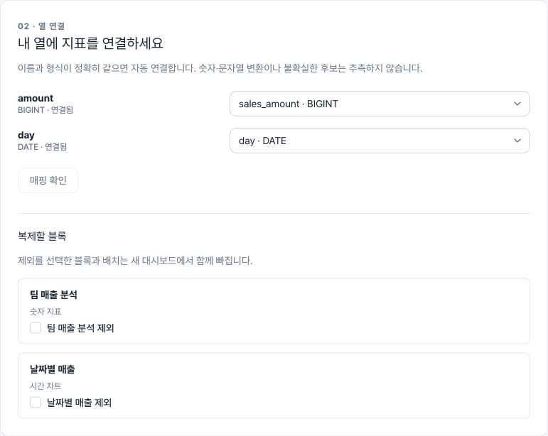

**매핑 확인**을 누르면 연결 검증과 전체 계산 미리보기가 진행됩니다. 별도 미리보기 버튼을 찾을 필요는 없습니다. 연결되지 않은 열이나 형식 오류가 나오면 선택한 소스와 열을 수정하고 다시 확인하세요.

## 6. 전체 미리보기와 비공개 사본 저장

**저장 전 결과를 확인하세요**에서 다음을 확인합니다.

- 분석 데이터는 `my-sales`, 기간은 전체, 공통 필터는 없음입니다.
- 두 블록이 모두 있고 합계는 **1,200 USD**입니다.
- 시계열은 날짜별 **200 → 400 → 600**입니다.
- 원본의 600을 그대로 복사한 값이 아니라 내 데이터에서 다시 계산한 결과입니다.

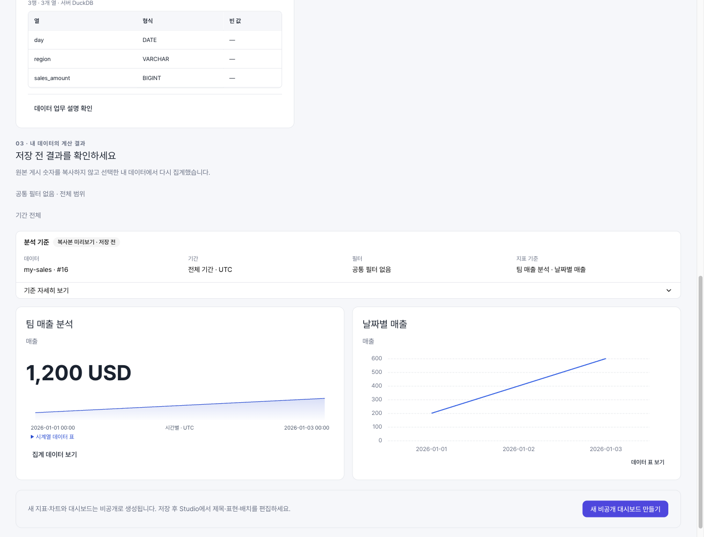

**새 비공개 대시보드 만들기**를 누릅니다. Studio가 열리면 새 대시보드 번호와 본인 소스, 두 블록을 확인합니다. 제목은 원본과 같을 수 있으므로 제목만으로 원본과 사본을 구별하지 마세요.

새로고침한 뒤에도 본인 소스와 1,200 USD가 유지되면 저장을 확인한 것입니다.

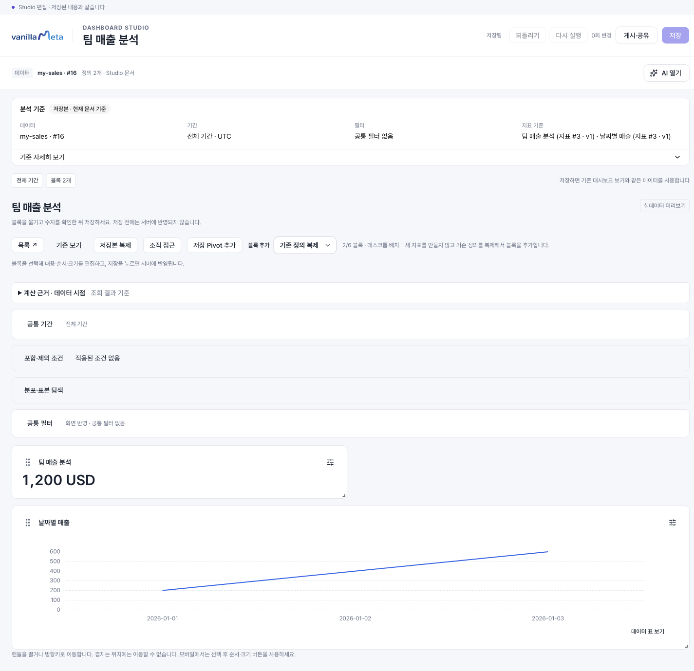

사본은 비공개로 만들어집니다. 이후 [AI로 수정](./ai-edit.md)하거나 [별도 게시](./publish.md)할 수 있습니다. 복제 저장 자체가 공개 링크를 만드는 것은 아닙니다.

## 7. 공유를 회수하면 어떻게 되나요?

소유자는 원본의 **조회 공유 → 최신 공유 관계 읽기**에서 **공유 회수**를 선택하고 수신자·확인란을 체크한 뒤 저장합니다. 다시 최신 관계를 읽어 **공유 없음 · 복제 미허용**을 확인합니다.

수신자가 받은 자료를 다시 읽으면 다른 접근 경로가 없는 원본은 목록에서 사라집니다. 하지만 이미 만든 **내 대시보드의 사본**은 계속 열 수 있습니다. Studio에서 새로고침해 본인 소스와 1,200 USD가 유지되는지 확인하세요.

<details>
<summary>회수 후 받은 자료 목록 보기</summary>

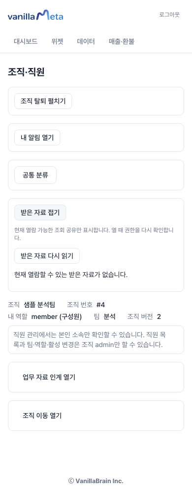

</details>

::: info 회수 범위
조회 공유 회수는 소스에 직접 부여한 읽기 권한이나 다른 직접·그룹 권한을 함께 지우지 않습니다. 다른 관계가 남으면 원본을 계속 볼 수 있으므로 [조직 공유와 권한](./organization.md)에서 각각 확인하세요. 회수는 이미 저장된 독립 사본을 삭제하지 않습니다.
:::

## 모바일에서 확인할 부분

작은 화면에서는 버튼과 선택기가 다음 줄로 배치됩니다. 필요한 단계까지 아래로 스크롤하고, 매핑 열 이름과 저장 전 결과를 확인하세요.

<details>
<summary>모바일 조회 공유 설정</summary>

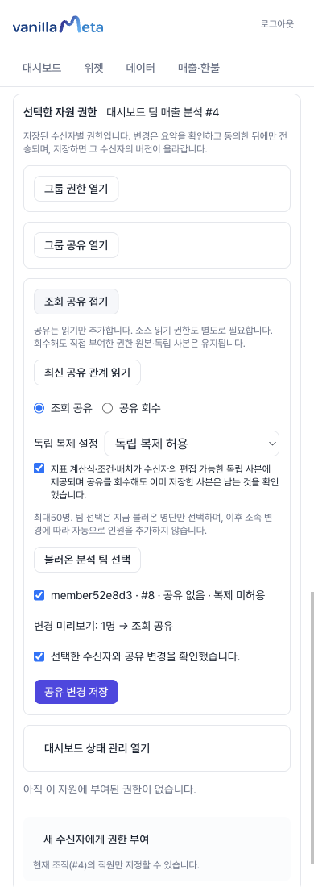

</details>

<details>
<summary>모바일 열 연결과 블록 선택</summary>

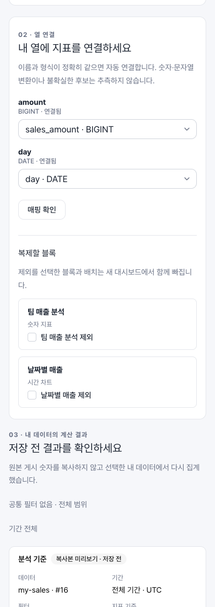

</details>

<details>
<summary>모바일 사본 저장 결과</summary>

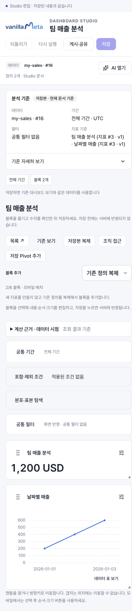

</details>

## 진행이 멈췄을 때

- **받은 자료가 비어 있음:** 현재 조직·계정, 조회 공유 상태와 필요한 모든 소스의 읽기를 확인하고 다시 읽습니다.
- **내 소스로 복제가 보이지 않음:** 현재 원본 접근과 소유자의 별도 복제 허용을 확인합니다.
- **열 연결 실패:** 이름뿐 아니라 숫자·날짜 형식과 계산에 필요한 열을 확인합니다.
- **저장 전 원본이 변경되거나 회수됨:** 기존 미리보기를 저장 완료로 판단하지 말고 안내에 따라 권한과 최신 기준을 다시 확인합니다.

::: info 실제 확인 범위
2026-10-21 합성 자료와 두 계정으로 소스 읽기 부여, 조회 공유·복제 허용, 받은 자료 열람, 본인 소스 매핑·미리보기·저장·새로고침, 공유 회수 후 사본 보존을 Ego에서 확인했습니다. 공유·목록·매핑·사본 화면은 390/768/1440px에서 확인했으며 모바일 캡처는 브라우저 폭 기준입니다. 계정·파일·원본 두 블록은 검증용 API로 준비했고, 위 AI 예시 질문과 파일 업로드를 이번 여정에서 다시 실행한 것은 아닙니다. 실휴대폰과 모든 권한·데이터 조합의 검증을 뜻하지 않습니다.
:::
