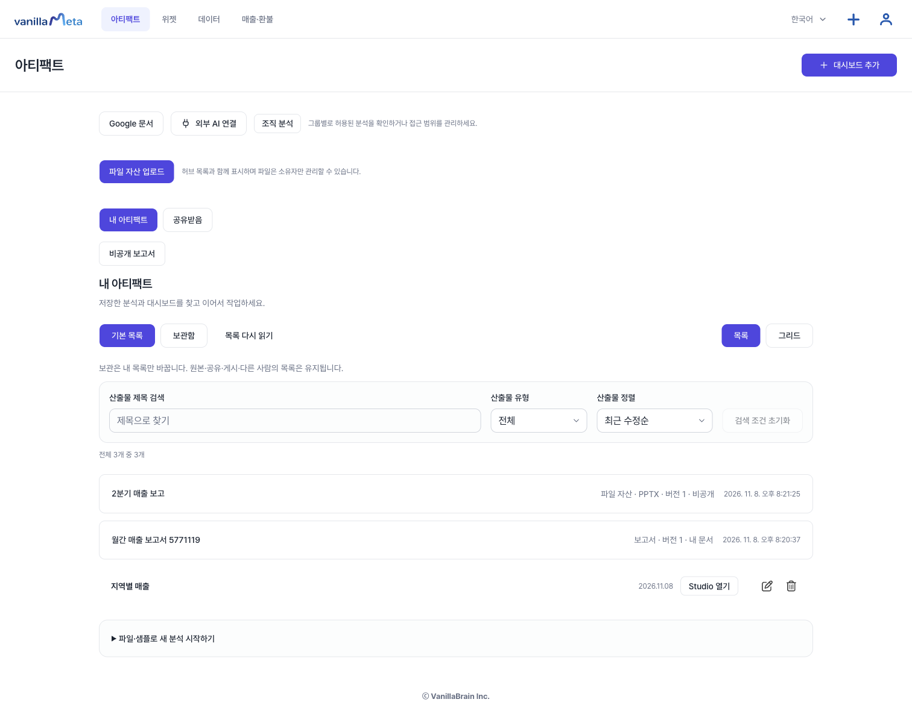
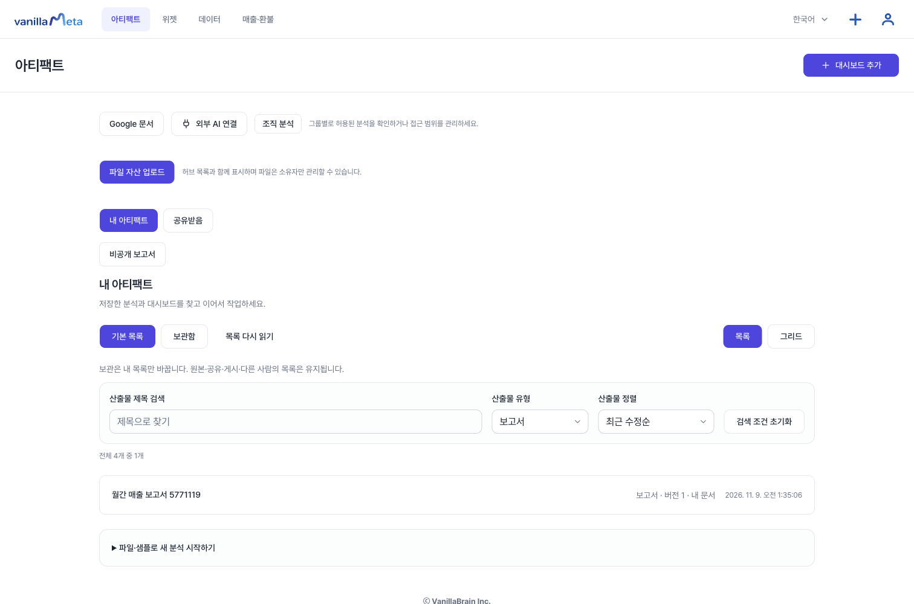
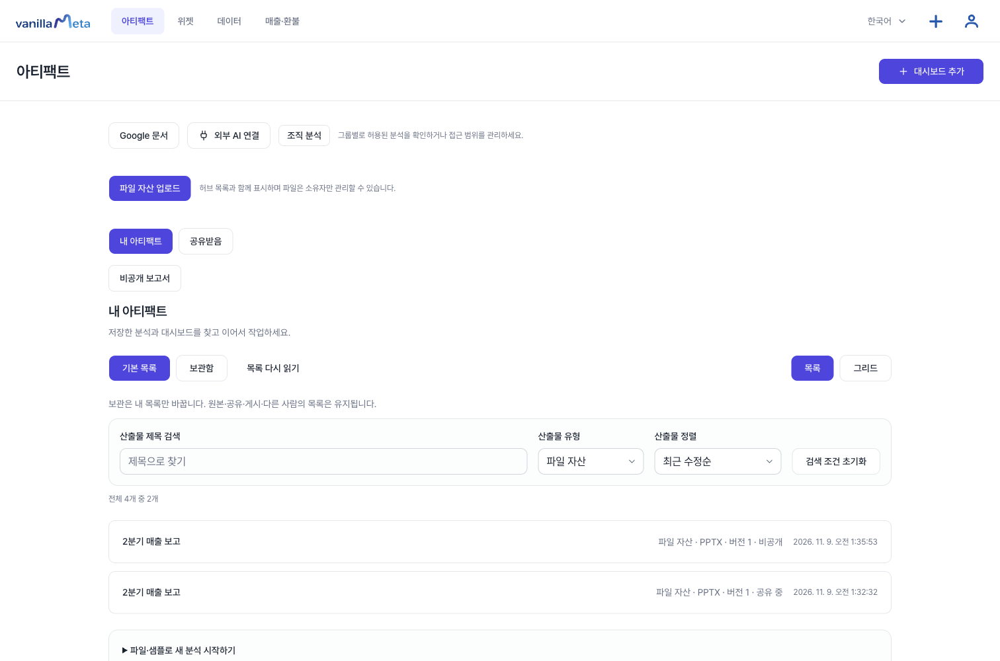
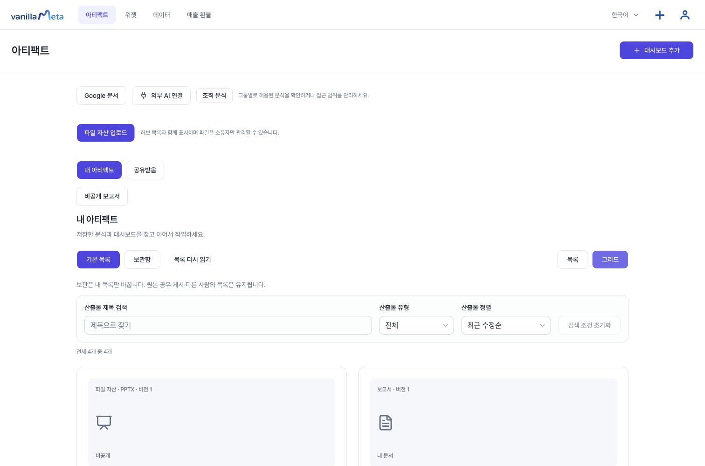

# 무엇을 만들까요? 네 가지 종류

VanillaMeta에서 만들고 보관하는 결과물은 **문서, 시트, 슬라이드, 대시보드** 네 가지입니다. 모두 **아티팩트** 목록 한 곳에 모이고, 목록의 **산출물 유형**으로 골라 볼 수 있습니다.

| 종류 | 이럴 때 | 시작하는 곳 | 앱에서 하는 일 |
| --- | --- | --- | --- |
| **[문서](./docs-report.md)** | 숫자와 설명을 한 편의 글로 전달 | Studio의 **마지막 저장본으로 비공개 보고서 작성** | 직접 쓰기, 숫자 고정, 버전 저장, 지정한 사람에게 공유 |
| **[시트](./sheets.md)** | 엑셀·시트에 있는 자료를 분석 | **데이터 → 파일 분석**, 또는 **Google 문서 → Sheets 가져오기** | 가져오기(CSV·Parquet·JSON, Google Sheets), 지표와 차트로 분석 |
| **[슬라이드](./slides.md)** | 완성한 발표 자료를 보관하고 전달 | 아티팩트의 **파일 자산 업로드** | PPTX·PDF·HTML 올리기, 새 버전 올리기, 공유 링크 |
| **[대시보드](./quickstart.md)** | 숫자와 차트를 계속 보고 고치기 | 아티팩트의 **대시보드 추가** | 질문으로 만들기, 직접 편집, 게시, 복제 |

::: info 앱에서 직접 만드는 것과 가져오는 것
**문서(보고서)와 대시보드**는 앱 안에서 쓰고 고칩니다. **시트와 슬라이드**는 이미 만든 파일을 가져오거나 올리는 방식입니다. 앱 안에서 엑셀 표나 슬라이드를 새로 만들거나 편집하는 화면은 없습니다.
:::

## 목록에서 종류별로 보기

아티팩트 목록의 **산출물 유형**에서 **분석 산출물, 일반 대시보드, 보고서, Google 문서, 파일 자산** 중에서 골라 그 종류만 볼 수 있습니다. 슬라이드로 올린 PPTX는 **파일 자산**에 있습니다.

**그리드** 버튼을 누르면 카드로 볼 수 있습니다. 카드 위쪽에 **파일 자산 · PPTX**, **보고서**처럼 종류가 글자로 표시됩니다.

다른 사람이 나에게 공유한 보고서는 **내 아티팩트** 옆의 **공유받음**에 모입니다.

## 처음이라면

1. 자료가 있다면 **시트**에서 가져옵니다. 자료가 없다면 [샘플](./quickstart.md)로 시작하세요.
2. 가져온 자료로 **대시보드**를 만들어 숫자를 확인하고 저장합니다.
3. 그 대시보드를 바탕으로 **문서(보고서)**를 써서 설명을 붙입니다.
4. 발표 자료가 이미 있다면 **슬라이드**로 올려 같은 목록에서 관리합니다.

## 알아 두세요

- **엑셀 파일(.xlsx)은 직접 올릴 수 없습니다.** 엑셀에서 CSV로 저장해 올리거나, Google 시트로 옮겨 가져오세요. 자세한 방법은 [시트](./sheets.md)에 있습니다.
- **PPTX는 앱 안에서 슬라이드로 보이지 않습니다.** 파일 정보를 보여 주고 내려받게 합니다. PDF로 올리면 화면에서 바로 볼 수 있습니다.
- **Google 문서·Sheets·Microsoft 연결은 관리자 설정이 필요합니다.** 설정이 없으면 **Google 문서 연결** 버튼이 비활성이고, Sheets와 Microsoft는 화면에 "설정 필요"라고 표시됩니다.
- **조직 전에 만든 자료는 조직을 만든 뒤 목록에서 사라질 수 있습니다.** 직원에게 공유하거나 외부 AI를 연결하려면 조직이 필요하니, 조직을 쓸 계획이라면 **먼저 조직을 만든 뒤** 보고서와 대시보드를 만드세요.
