# 사용자 가이드 실제 화면 모음

2026-10-21 · Ego TaskSpace 123에서 새 로컬 Docker MySQL 8.4.11/Nest/native DuckDB/Vite 환경으로 직접 실행한 화면입니다. 비용·마진 공개 합성 데이터와 임시 조직·계정만 사용했습니다. 접속 주소는 설치 환경에 따라 다릅니다.

게시 링크 값은 캡처 전에 화면에서 가렸습니다. 결과 숫자·차트·상태는 바꾸지 않았습니다. 캡처의 계정은 검증용이며 실제 직원 계정이 아닙니다. 모바일은 Ego의 390px 화면 크기 모사이며 실휴대폰 터치 검증은 아닙니다. 전체 실행 결과와 초기 실패·수정은 [검증 기록](../testing/user-guide-ego.md)을 참고하세요.

## 데이터 연결과 질문

CSV 파일도 직접 업로드해 `margin` 소스의 18행·12개 열을 확인했습니다.

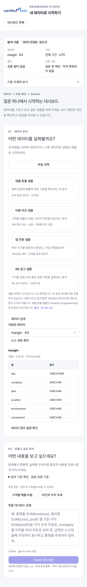

## AI 계산 미리보기

숫자 `14,937.49 USD`와 날짜별 매출 시계열을 함께 확인한 뒤 저장했습니다.

## 저장한 분석 수정

시계열 블록을 선택하고 제목 변경을 질문했습니다. 응답의 초안 반영 후 저장·새로고침으로 유지 여부를 확인했습니다. 모바일 패널 캡처는 같은 요청을 입력한 상태이며, 추가 전송하지 않았습니다.

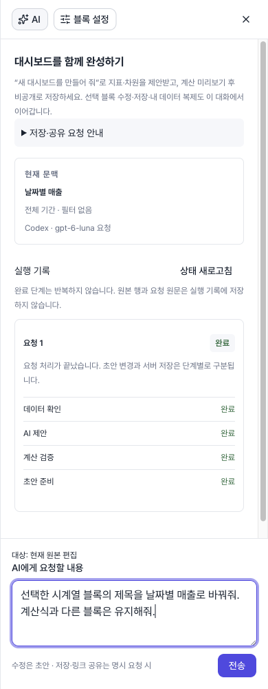

## 저장 후 반응형 배치

390·768·1440px에서 가로 넘침이 없었습니다. 주요 저장·게시·AI 버튼 높이는 36px이며, 모바일 데이터 선택·질문 입력 폰트는 16px입니다. 모든 메뉴·오류 상태를 검사한 결과는 아닙니다.

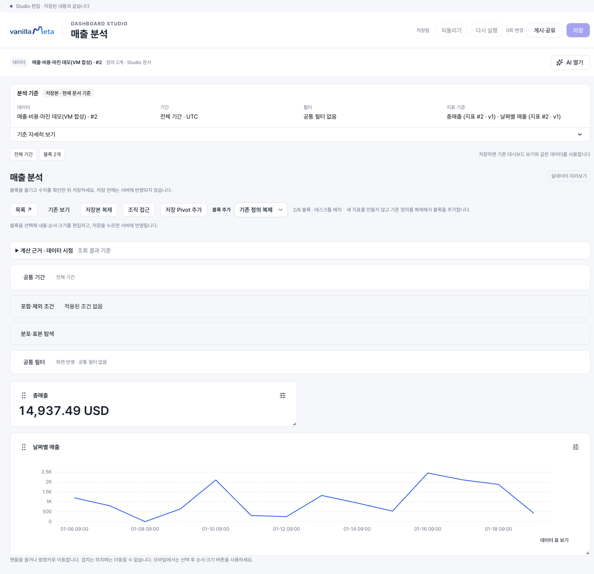

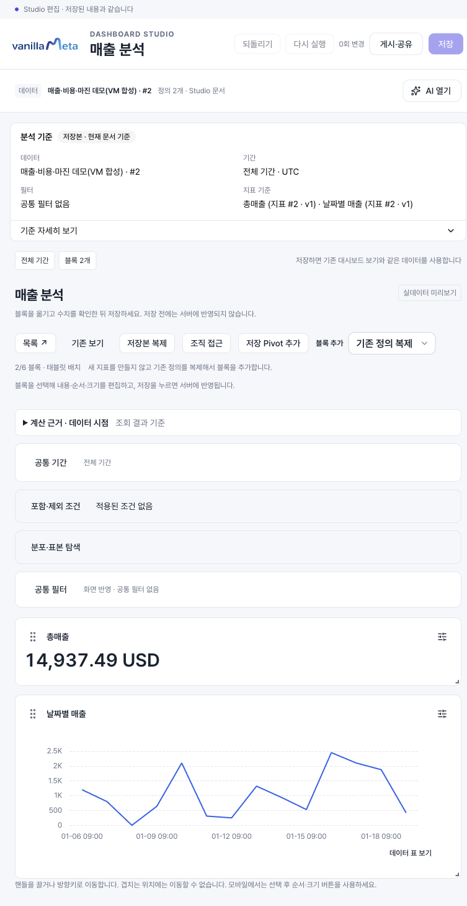

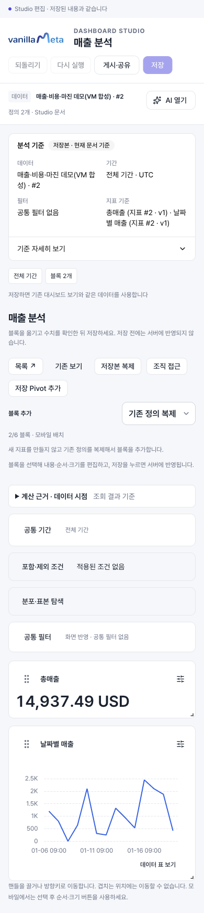

## 게시 범위와 링크 공유

비공개 V1 게시 후 링크 공개 V2로 재게시했습니다. 공개 범위는 링크 복사와 별도로 선택합니다. 긴 게시창은 내부를 스크롤하고 하단 버튼으로 확정합니다.

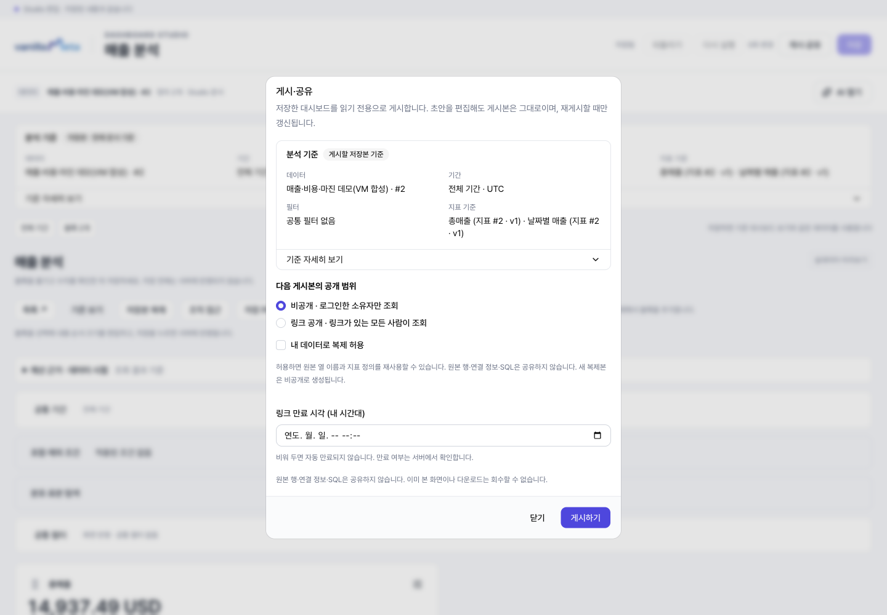

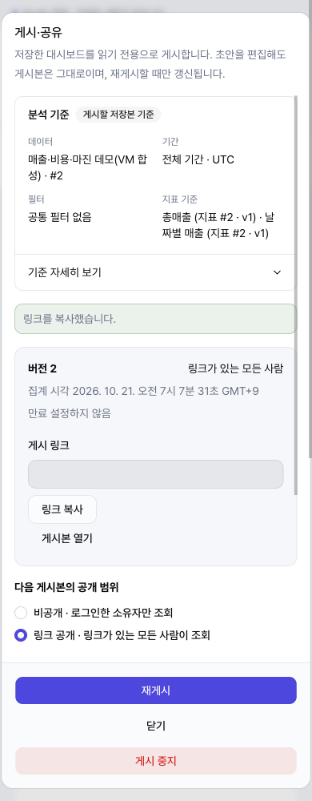

로그아웃 후에도 공개 게시본이 열리고 숫자·차트가 유지됐습니다. 검증 종료 전 **게시 중지 → 중지 확인** 후 기존 링크에서 값이 사라지는 것도 확인했습니다.

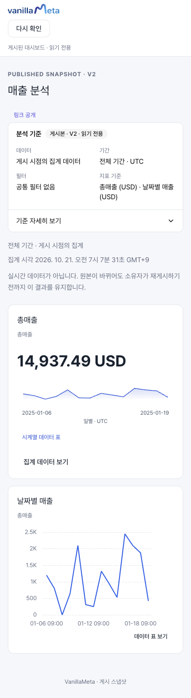

## 조직 직원 공유와 수신자 열람

먼저 소스 읽기 권한을 부여한 뒤 대시보드를 조회 공유했습니다. 복제는 허용하지 않았고 편집권도 추가하지 않았습니다.

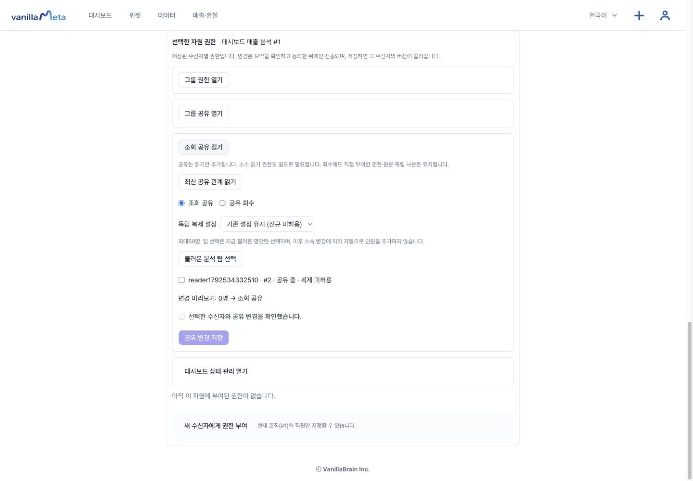

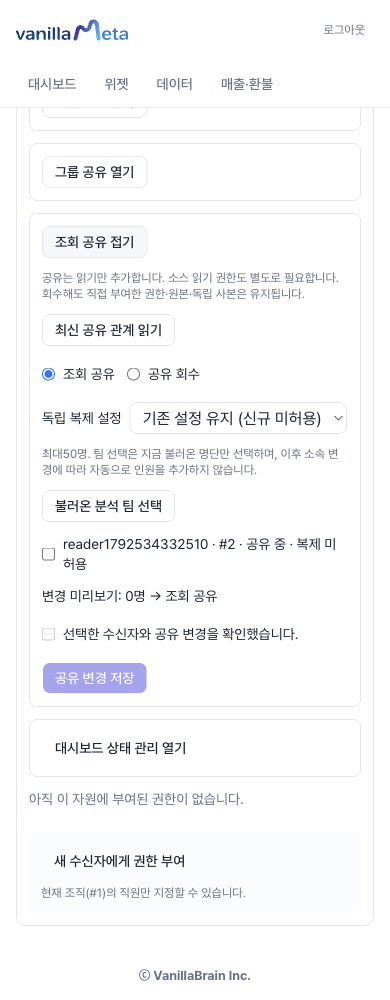

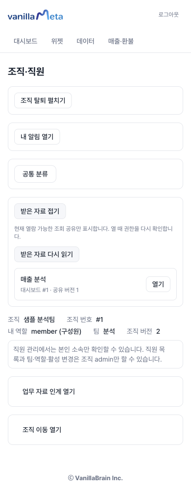

아래는 조회 전용 API 연결을 보완한 뒤 수신자가 열고 새로고침한 실제 대시보드입니다. 조회 공유는 편집권 부여가 아니며 편집·임의 SQL 요청은 서버에서 거절됐습니다.

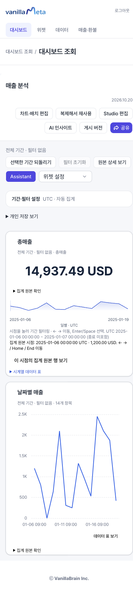

## Explore·Pivot 실제 사용 화면

공개 합성 데이터의 소스 선택·기간·필터·저장 보기 복원과 기본/고급 Pivot을 추가 검증했습니다. 사이드바의 Explore와 Pivot 안내에서 단계별 캡처와 예제 숫자를 확인하세요. 두 가이드에는 390px 모바일 화면도 포함됩니다.
